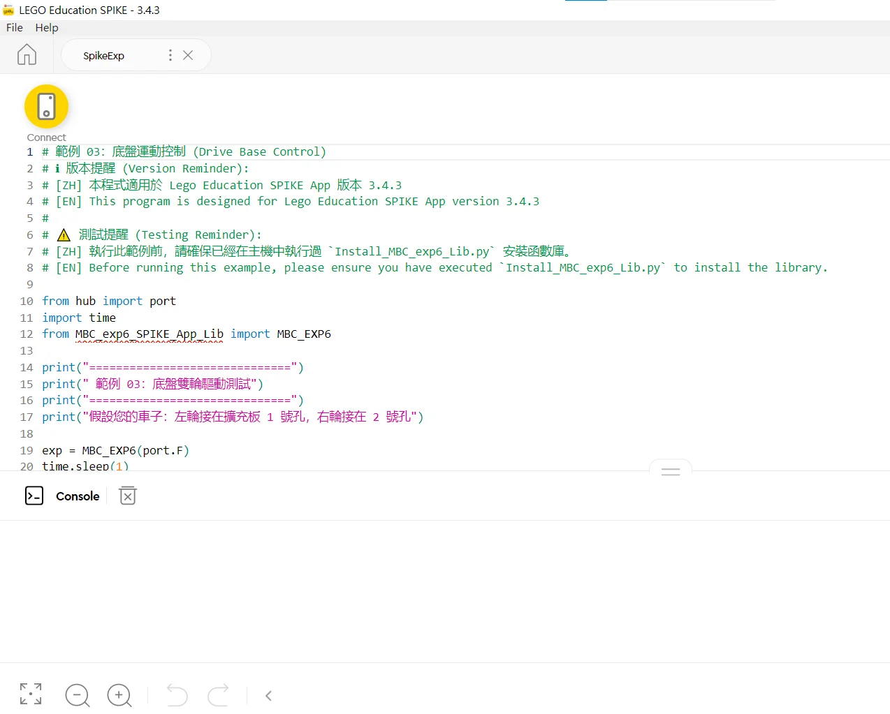

### Wiring and power

1. **Host cable**: plug the expander's **Host cable** into any SPIKE hub port (A~F).
2. **Separate power**: the expander must have its own power supply (battery box or adapter) for the motors; motor current is not drawn from the hub, and the hub signal lines go through an isolator.
3. **Devices**: plug LEGO sensors (colour, ultrasonic, force) and motors into any of the expander's ports **1~6**.

> [!WARNING]
> The EXP6 supports **SPIKE Prime**, and **Python in the Robot Inventor App on the Robot Inventor (51515) hub** (see "Robot Inventor (51515)" at the end of this page); not EV3. **Before switching to another programming method, power the EXP6 off once** (turn off the hub or unplug the Host cable): once it has run a Pybricks program it keeps talking the Pybricks way until it restarts, and the official App cannot connect.

### Install the EXP6 library (only once)

👉 First time? Step-by-step version: [Education install guide](/en/sensors/exp6/install-spike-app.md)

The official App has no EXP6 blocks; **Python text mode only** (SPIKE 3; the library is marked for version 3.4.3). The library is plain Python without multitasking (async); every command runs **synchronously**.

1. Download [📥 official App library + examples (.zip)](/downloads/MBC_EXP6_Official_App_Lib.zip). The EXP6 needs firmware dated 2026-11-03 or later. The function reference is `EXP6_Library_Manual.pdf` in the pack.
2. Paste the **install script** from the `SPIKE_Education` folder of the download (`Install_MBC_exp6_Lib.py`) into a SPIKE App Python project and run it once. The script writes the core library into the hub.
3. After that, any new project can simply `from MBC_exp6_SPIKE_App_Lib import MBC_EXP6`; no more pasting long source code.
4. When you no longer need it, run the **uninstall script** (`Uninstall_MBC_exp6_Lib.py`) from the download to remove the library from the hub cleanly.



### Create the connection object

Assuming the EXP6 is on hub **port F**:

```python
from hub import port
import time
from MBC_exp6_SPIKE_App_Lib import MBC_EXP6

exp6 = MBC_EXP6(port.F)   # expander on hub port F
time.sleep(1)             # wait 1 s for the expander to be ready

exp6.motor_power(1, 50)
time.sleep(3)
exp6.stop_all(1)          # always stop all motors before the program ends (1 = coast)
```

> [!IMPORTANT]
> **No watchdog in the official App**: if the program crashes or the hub disconnects, the motors keep the last command. Always end with `exp6.stop_all(1)`; wait with plain `time.sleep()`, no heartbeat command needed.

### MBC sensors on the EXP6, and sending them commands

MBC sensors (Line Follower, Laser Ranger, Controller, SharpShot Vision) just plug into EXP6 ports 1 to 6; the library already includes them:

```python
line8 = exp6.line8(2)            # Line Follower 8-ch in EXP6 port 2
print(line8.pos100())            # -100 ~ +100
seq = line8.cmd(0xE4, 60)        # command: code 0xE0~0xEE + up to 5 parameters (-9999~9999), returns a number
ok = line8.wait_done()           # True done; False failed / rejected / timed out (10 s by default)
state = line8.cmd_state()        # 0 done, 1 busy, 2 failed (bad parameter), 3 rejected (no such command)
line8.busy()                     # True while not finished
line8.cmd(0xE4, 60, again=True)  # the same command + parameters is not resent unless again=True
```

- Available: `line8` `line16` `laser2` `laser8` `ps2` `ps4` `unicam(port, mode)` (the camera mode must match the camera menu).
- Command codes are the same as with the sensor on the hub (Line Follower 8-ch: [command reference](/en/sensors/line8/reference.md)); each command takes about 0.1 to 0.2 seconds to come back. So far only the Line Follower 8-ch has been tested with commands (passed on 2026-11-05 on both the Education App and Robot Inventor).
- **Black/white calibration E2 / E3 and the 5-second calibration E7 are saved in the sensor, so do not send them while practising**; E4 (threshold) and E9 go back to default on power-up.
- The full demo is example 10 in the download pack (`examples/10_MBC_Commands.py`: threshold to 60 → bad parameter "failed" → unknown command "rejected" → back to 50); EXP6 in port F, Line Follower in EXP6 port 2.
- The installer was slimmed down to 46.5 KB on 2026-11-05 (faster to paste, same usage); the library uses about 38 KB on the hub, leaving about 130 KB for your program.

### Robot Inventor (51515)

The EXP6 also works with the **LEGO MINDSTORMS Robot Inventor (51515) hub**, using **Python in the Robot Inventor App 10.x** to control 6 LEGO motors, the LEGO colour / distance / force sensors and MBC sensors. Function names and usage are **exactly the same** as the Education version above (tested on Hub OS 3.4.0). The Robot Inventor App's word blocks cannot use this library.

👉 Try it in your browser first: [Robot Inventor App interactive tutorial](/en/learn/exp6/robot-inventor.html)

**Install the library (once)**　👉 Step-by-step version: [Robot Inventor install guide](/en/sensors/exp6/install-robot-inventor.md)

1. Download [📥 Robot Inventor library + examples (.zip)](/downloads/MBC_EXP6_Robot_Inventor_Lib.zip) (installer, uninstaller, 10 examples, library source). The EXP6 needs firmware dated 2026-11-03 or later.
2. Turn the hub on and connect it in the Robot Inventor App: **USB cable or Bluetooth, either works** (USB is steadier and recommended).
3. Make a new Python project, paste the whole of `Install_MBC_exp6_Lib.py` and run it. After about 6 seconds the console prints `安裝成功！ (Installed OK)` (after listing all 3 files as OK).
4. The library lives in `/projects/mbc_exp6/` on the hub and survives power-off; **install it again after a hub firmware update**. To remove it, run `Uninstall_MBC_exp6_Lib.py`.

**Writing programs: only the import line differs from the Education version**

```python
from hub import port
import time
from projects.mbc_exp6.MBC_exp6_SPIKE_App_Lib import MBC_EXP6   # Education: from MBC_exp6_SPIKE_App_Lib import MBC_EXP6

exp = MBC_EXP6(port.F)      # EXP6 on hub port F (you can also write 'F')
exp.motor_run(1, 50)        # motor on expansion port 1 at 50% speed
time.sleep(2)
exp.motor_stop(1, "brake")  # stop: coast, brake, hold, or continue (do nothing)
```

MBC sensors work the same way: `line8 = exp.line8(2)` (Line Follower 8-ch in EXP6 port 2), `print(line8.pos100())`; available: `line8` `line16` `laser2` `laser8` `ps2` `ps4` `unicam(port, mode)`. Just plug the sensor in; the first time you use a kind of sensor the hub takes about 1 second to load it. **Sending commands** (`cmd()`, `wait_done()`, `cmd_state()`) works the same as in the Education section above.

> [!IMPORTANT]
> **3 things that differ from the Education version**
> 1. **EXP6 stays in Robot Inventor mode until you take out its battery**: once a program has created `MBC_EXP6`, the App's device screen no longer sees the EXP6. To go back to a SPIKE Prime hub, or to let the App see it, take the EXP6 battery out and put it back.
> 2. **No heartbeat to write**: the library handles it in the background.
> 3. **The motors stop by themselves after the program ends**: a motor still running when the program ends stops within about 10 seconds. To keep a motor running longer than 10 seconds while your program calls nothing, wait with `exp.keep_alive_wait(ms)`, for example `exp.keep_alive_wait(15000)`.

**10 examples** (all run on a real hub; EXP6 in hub port F, motors in EXP6 ports 1 and 2; the examples print their messages in Chinese)

| Example | What it does |
| :--- | :--- |
| [01_Motor_Basic](/examples/exp6/robot_inventor/examples/01_Motor_Basic.py) | Motor speed, forward / back, stop |
| [02_Motor_Advanced](/examples/exp6/robot_inventor/examples/02_Motor_Advanced.py) | Encoder angle, turn by degrees, absolute angle |
| [03_Drive_Base](/examples/exp6/robot_inventor/examples/03_Drive_Base.py) | Two-motor drive base (straight, turns) |
| [04_Sensor_Distance_Force](/examples/exp6/robot_inventor/examples/04_Sensor_Distance_Force.py) | LEGO distance and force sensors |
| [05_Sensor_Color_Pro](/examples/exp6/robot_inventor/examples/05_Sensor_Color_Pro.py) | LEGO colour sensor: colour code, reflection, RGB, HSV |
| [06_System_Misc](/examples/exp6/robot_inventor/examples/06_System_Misc.py) | Voltage, device codes, raw values |
| [07_Motor_Inverted](/examples/exp6/robot_inventor/examples/07_Motor_Inverted.py) | Motor mounted normally / reversed |
| [08_Stop_Modes](/examples/exp6/robot_inventor/examples/08_Stop_Modes.py) | The 4 stop modes compared |
| [09_MBC_Sensors](/examples/exp6/robot_inventor/examples/09_MBC_Sensors.py) | Line Follower, Laser Ranger 2-ch, PS4 gamepad, SharpShot Vision (sensor in EXP6 port 2) |
| [10_MBC_Commands](/examples/exp6/robot_inventor/examples/10_MBC_Commands.py) | Commands to a Line Follower 8-ch: change the threshold, failed, rejected, restore |

**Troubleshooting**

| What you see | Why | What to do |
| :--- | :--- | :--- |
| `ImportError: no module named 'projects.mbc_exp6…'` | Not installed yet, or a firmware update wiped it | Run the installer again |
| `ImportError` with the line `from MBC_exp6_SPIKE_App_Lib import …` | That is the Education version's import | Change it to `from projects.mbc_exp6.MBC_exp6_SPIKE_App_Lib import …` |
| "讀不到擴充板資料" (cannot read the expander) | Wrong hub port, or EXP6 has no power | Check `MBC_EXP6(port.X)` against the real port, and the EXP6 battery |
| The App's device screen cannot see EXP6 | EXP6 is in Robot Inventor mode | Take the EXP6 battery out and put it back |
| The motors stop after a while | Nothing called the library for 10 seconds | Wait with `exp.keep_alive_wait(ms)` |
| The hub switches off during install | The transfer was interrupted | Install again over USB |
| `MemoryError` | The program is too big and uses many kinds of MBC sensor (core about 26 KB, MBC sensors up to another 19 KB; the App has about 98 KB, leaving about 37 KB) | Split the program and restart the hub |
| Garbage readings from an MBC sensor (e.g. the gamepad shows many buttons pressed) | The declared sensor is not the one plugged in | Declare the sensor that is really there |

The old SPIKE Prime App 2.x has not been tested; use SPIKE 3 (Education) or the Robot Inventor App.
