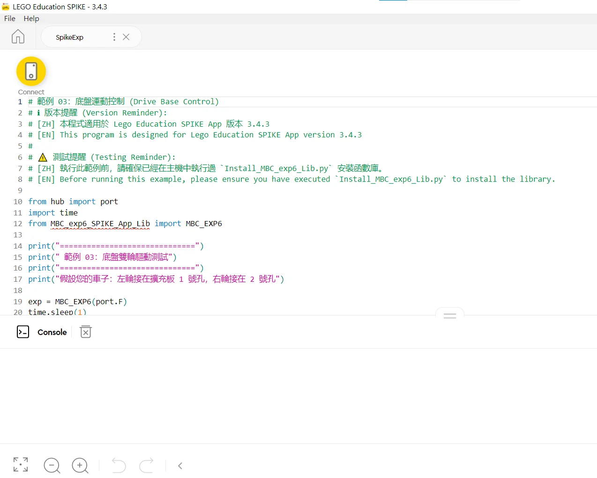

### 接線與供電

1. **主機通訊線**：把擴充器的 **Host 通訊線**插進 SPIKE 主機任一孔（Port A~F）。
2. **獨立電源**：擴充器一定要接 **2S 鋰電池**（7.4 V，充飽 8.4 V，XT30 接頭），馬達和樂高感應器都靠它供電；馬達電流不會從主機抽，主機訊號線也經過隔離晶片。**不要接 3S 以上**：超過 9 V 時，EXP6 會停止供電給樂高顏色／超音波感應器。
3. **接裝置**：樂高感應器（顏色、超音波、力量）與馬達，任意接在擴充器的 **1～6 號**孔。

> [!WARNING]
> EXP6 支援 **SPIKE Prime**，也支援 **Robot Inventor（51515）的 Robot Inventor App Python**（見本頁最後的「Robot Inventor（玩具版 51515）」）；不支援 EV3。**換另一種寫法之前，先讓 EXP6 斷電一次**（關主機或拔掉 Host 線）：EXP6 一旦跑過 Pybricks 程式，就會一直用 Pybricks 的方式溝通，直到重新開機，這時候官方 App 會連不上。

### 安裝 EXP6 函式庫（只要做一次）

👉 第一次裝、想看一步一步的版本：[教育版安裝教學](/sensors/exp6/install-spike-app.md)

官方 App 沒有 EXP6 的積木，**只能用 Python 文字模式**（SPIKE 3；函式庫標示適用 3.4.3 版）。函式庫用純 Python 寫，不支援多工（async），所有指令都是**同步（Sync）**執行。

1. 下載 [📥 官方 App 函式庫＋範例（.zip）](/downloads/MBC_EXP6_Official_App_Lib.zip)。EXP6 韌體要 2026-11-03 以後。函式說明在包裡的 `EXP6_Library_Manual.pdf`。
2. 把下載包 `SPIKE_Education` 資料夾裡的**安裝腳本**（`Install_MBC_exp6_Lib.py`）內容貼進 SPIKE App 的 Python 專案，執行一次。腳本會把核心函式庫寫進主機。
3. 安裝成功後，任何新專案都能直接 `from MBC_exp6_SPIKE_App_Lib import MBC_EXP6`，不用再貼一長串原始碼。
4. 不再需要時，執行下載包裡的**解除安裝腳本**（`Uninstall_MBC_exp6_Lib.py`），就能把函式庫從主機乾淨移除。



### 建立連線物件

假設 EXP6 接在主機的 **Port F**：

```python
from hub import port
import time
from MBC_exp6_SPIKE_App_Lib import MBC_EXP6

exp6 = MBC_EXP6(port.F)   # 擴充器接在主機的 Port F
time.sleep(1)             # 等 1 秒讓擴充器就緒

exp6.motor_power(1, 50)
time.sleep(3)
exp6.stop_all(1)          # 程式結束前一定要讓所有馬達停止（1 = 滑行）
```

> [!IMPORTANT]
> **官方 App 沒有看門狗**：程式當掉或主機斷線時，馬達會一直維持最後一道指令。程式最後一定要寫 `exp6.stop_all(1)`；等待直接用 `time.sleep()`，不需要心跳指令。

### MBC 感應器插在 EXP6 上、對感應器下命令

MBC 感應器（循行者、測距者、掌控者、神攝手）直接插在 EXP6 的 1～6 號孔就能用，函式庫裡已經有：

```python
line8 = exp6.line8(2)            # 8 路循行者插在 EXP6 的 2 號孔
print(line8.pos100())            # -100 ~ +100
seq = line8.cmd(0xE4, 60)        # 下命令：命令碼 0xE0~0xEE＋參數最多 5 個（-9999~9999），回傳序號
ok = line8.wait_done()           # True 完成；False 失敗／拒絕／逾時（預設 10 秒）
state = line8.cmd_state()        # 0 完成、1 執行中、2 失敗（參數不對）、3 拒絕（這款沒有這個命令）
line8.busy()                     # 還沒做完 = True
line8.cmd(0xE4, 60, again=True)  # 同命令同參數預設不重送；要重做加 again=True
```

- 可用：`line8` `line16` `laser2` `laser8` `ps2` `ps4` `unicam(孔, mode)`（神攝手 mode 要跟相機選單一樣）。
- 命令碼跟感應器直接插主機時一樣（循行者 8 路見 [指令參考](/sensors/line8/reference.md)）；每個命令送出到收到結果約 0.1～0.2 秒。目前只有 8 路循行者實測過下命令（2026-11-05 教育版、Robot Inventor 都通過）。
- **黑白校準 E2／E3、5 秒校準 E7 會寫進感應器，練習時不要亂送**；E4（門檻）、E9 重開機就回到預設。
- 完整示範是下載包裡的範例 10（`examples/10_MBC_Commands.py`：門檻改 60 → 參數錯誤「失敗」→ 沒有的命令「拒絕」→ 改回 50）；EXP6 插 F 孔、循行者插 EXP6 的 2 號孔。
- 安裝程式 11-05 瘦身成 46.5 KB（貼上更快，用法不變）；函式庫常駐約 38 KB，主機還有約 130 KB 給你的程式。

### Robot Inventor（玩具版 51515）

EXP6 也可以接 **LEGO MINDSTORMS Robot Inventor（51515）主機**，用 **Robot Inventor App 10.x 的 Python** 控制 6 顆樂高馬達、樂高顏色／距離／力量感應器和 MBC 感應器；函式名稱、用法跟上面的教育版**完全一樣**（Hub OS 3.4.0 上機測過）。Robot Inventor App 的積木不能用這個函式庫。

👉 先在網頁上點一遍：[Robot Inventor App 互動教學](/learn/exp6/robot-inventor.html)

**安裝函式庫（只做一次）**　👉 一步一步的版本：[玩具版安裝教學](/sensors/exp6/install-robot-inventor.md)

1. 下載 [📥 Robot Inventor 函式庫＋範例（.zip）](/downloads/MBC_EXP6_Robot_Inventor_Lib.zip)（安裝程式、移除程式、10 支範例、函式庫原始碼）。EXP6 韌體要 2026-11-03 以後。
2. 主機開機，在 Robot Inventor App 連上主機：**USB 線或藍牙都可以**（建議 USB 線，比較穩）。
3. 新開一個 Python 專案，把 `Install_MBC_exp6_Lib.py` 整份貼上，按執行。約 6 秒後主控台印出 `安裝成功！ (Installed OK)`（前面會列出 3 個檔都 OK）。
4. 函式庫裝在主機的 `/projects/mbc_exp6/`，關機不會不見；主機**韌體更新後要再裝一次**。不要了就執行 `Uninstall_MBC_exp6_Lib.py`（印出「移除完成！」）。

**寫程式：只有匯入那一行跟教育版不同**

```python
from hub import port
import time
from projects.mbc_exp6.MBC_exp6_SPIKE_App_Lib import MBC_EXP6   # 教育版是 from MBC_exp6_SPIKE_App_Lib import MBC_EXP6

exp = MBC_EXP6(port.F)      # EXP6 插在主機的 F 孔（也可以寫 'F'）
exp.motor_run(1, 50)        # 1 號孔馬達以 50% 速度轉
time.sleep(2)
exp.motor_stop(1, "brake")  # 停止：coast 滑行、brake 煞車、hold 鎖住、continue 不動作
```

MBC 感應器的寫法也一樣：`line8 = exp.line8(2)`（8 路循行者插 EXP6 的 2 號孔）、`print(line8.pos100())`；可用 `line8` `line16` `laser2` `laser8` `ps2` `ps4` `unicam(孔, mode)`。感應器直接插上就能用；第一次用某一類感應器時主機會多花約 1 秒載入。**下命令**（`cmd()`、`wait_done()`、`cmd_state()`）也跟上面教育版一樣。

> [!IMPORTANT]
> **跟教育版不一樣的 3 件事**
> 1. **EXP6 會鎖在 Robot Inventor 的通訊方式，直到拔掉 EXP6 電池**：程式第一次建立 `MBC_EXP6` 之後，App 的裝置頁就看不到 EXP6；要換回 SPIKE Prime 主機或讓 App 認得它，先拔電池重開 EXP6。
> 2. **不用寫心跳**：函式庫在背景自動處理。
> 3. **程式結束後馬達會自己停**：程式結束時馬達還在轉，約 10 秒內會自動停。要讓馬達轉超過 10 秒、中間又不呼叫任何函式，用 `exp.keep_alive_wait(毫秒)` 等，例如 `exp.keep_alive_wait(15000)`。

**10 支範例**（都在主機上跑過；EXP6 插主機 F 孔、馬達接 EXP6 的 1／2 號孔）

| 範例 | 內容 |
| :--- | :--- |
| [01_Motor_Basic](/examples/exp6/robot_inventor/examples/01_Motor_Basic.py) | 馬達轉速、正反轉、停止 |
| [02_Motor_Advanced](/examples/exp6/robot_inventor/examples/02_Motor_Advanced.py) | 編碼器角度、走角度、絕對角度 |
| [03_Drive_Base](/examples/exp6/robot_inventor/examples/03_Drive_Base.py) | 雙馬達底盤（前進、轉彎） |
| [04_Sensor_Distance_Force](/examples/exp6/robot_inventor/examples/04_Sensor_Distance_Force.py) | 樂高距離、力量感應器 |
| [05_Sensor_Color_Pro](/examples/exp6/robot_inventor/examples/05_Sensor_Color_Pro.py) | 樂高顏色感應器：顏色碼、反射、RGB、HSV |
| [06_System_Misc](/examples/exp6/robot_inventor/examples/06_System_Misc.py) | 電壓、裝置碼、底層原始值 |
| [07_Motor_Inverted](/examples/exp6/robot_inventor/examples/07_Motor_Inverted.py) | 馬達正裝／反裝 |
| [08_Stop_Modes](/examples/exp6/robot_inventor/examples/08_Stop_Modes.py) | 4 種停止方式比較 |
| [09_MBC_Sensors](/examples/exp6/robot_inventor/examples/09_MBC_Sensors.py) | 循行者、測距者 2 路、PS4 手把、神攝手（感應器插 EXP6 的 2 號孔） |
| [10_MBC_Commands](/examples/exp6/robot_inventor/examples/10_MBC_Commands.py) | 對 8 路循行者下命令：改門檻、失敗、拒絕、還原 |

**常見問題**

| 狀況 | 原因 | 怎麼辦 |
| :--- | :--- | :--- |
| `ImportError: no module named 'projects.mbc_exp6…'` | 還沒安裝，或主機韌體更新後被清掉 | 再跑一次安裝程式 |
| `ImportError`，匯入那行是 `from MBC_exp6_SPIKE_App_Lib import …` | 用了教育版的寫法 | 改成 `from projects.mbc_exp6.MBC_exp6_SPIKE_App_Lib import …` |
| 印出「讀不到擴充板資料（請確認 EXP6 接在這個孔且已開電）」 | 孔位寫錯、EXP6 沒電 | 檢查 `MBC_EXP6(port.X)` 跟實際插的孔、EXP6 電池 |
| App 裝置頁看不到 EXP6 | EXP6 已在 Robot Inventor 的通訊方式 | 拔 EXP6 電池再插回 |
| 馬達跑一陣子自己停了 | 超過 10 秒沒呼叫函式庫 | 用 `exp.keep_alive_wait(毫秒)` 等 |
| 安裝時主機自己關機 | 傳輸中斷 | 改用 USB 線再裝一次 |
| `MemoryError` | 程式太大，又用了很多種 MBC 感應器（核心約 26 KB，MBC 感應器最多再 19 KB；App 可用約 98 KB，全部載入後約剩 37 KB） | 把程式拆小、重開主機 |
| MBC 感應器讀到亂碼（例如手把一直「按下」很多鍵） | 宣告的型號跟實際插的不一樣 | 宣告要跟實際插的感應器一樣 |

SPIKE Prime 舊版 App 2.x 還沒測過，請用教育版 SPIKE 3 或 Robot Inventor App。
