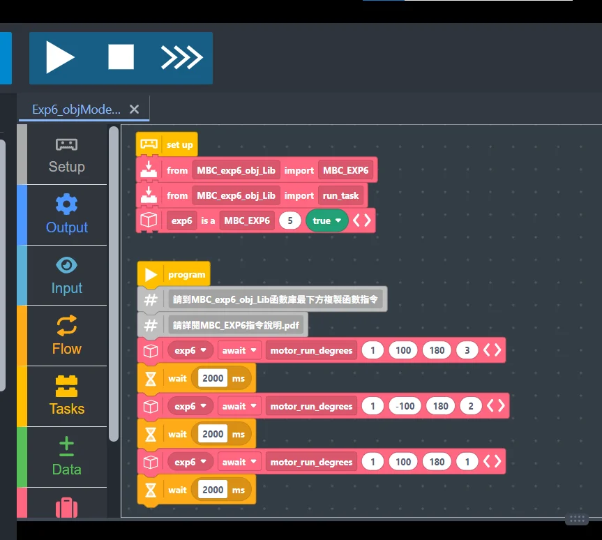

### Wiring and power

1. **Host cable**: plug the expander's **Host cable** into any SPIKE hub port (A~F).
2. **Separate power**: the expander must have its own power supply (battery box or adapter) for the motors; motor current is not drawn from the hub, and the hub signal lines go through an isolator.
3. **Devices**: plug LEGO sensors (colour, ultrasonic, force) and motors into any of the expander's ports **1~6**.

> [!WARNING]
> The EXP6 **supports SPIKE Prime only** (not Robot Inventor or EV3). **Before switching to another programming method, power the EXP6 off once** (turn off the hub or unplug the Host cable): once it has run a Pybricks program it keeps talking the Pybricks way until it restarts, and the official App cannot connect.

### Import the EXP6 library

1. Download [📥 Pybricks library v2 + examples (.zip)](/downloads/MBC_EXP6_Pybricks_Lib_v2.zip) (v1 firmware shipped before 2026-10: [legacy zip](/downloads/MBC_EXP6_Pybricks_Lib.zip)). Use **Pybricks firmware v4.1** (the command manual says "4.0.0 and later"; v4.1 works the same).
2. Put the files you need in the same Pybricks project (no renaming needed):
   - **Always**: `MBC_exp6_obj_Lib_v2.py` (EXP6, motors, LEGO sensors). The pack's examples say `from MBC_exp6_obj_Lib_v2 import MBC_EXP6`.
   - **Only with MBC sensors**: `MBC_exp6_mbc_common.py`, a shared file that the product files below load automatically. Add the product files you use: `MBC_exp6_line.py` (Line Follower 8/16-ch), `MBC_exp6_laser.py` (Laser Ranger 2/8-ch), `MBC_exp6_pad.py` (PS2/PS4 receiver), `MBC_exp6_unicam.py` (Sharpshooter Vision).
   - **Leave out the rest**: a Pybricks hub program (your code plus all libraries) is limited to about 52 KB, and all the files together are too big.



### Normal mode and multitask mode

Assuming the expander is on hub **port C (3)**:

```python
# Normal mode: one line after another
from MBC_exp6_obj_Lib_v2 import MBC_EXP6
exp6 = MBC_EXP6(3, False)
exp6.motor_power(6, 100)
exp6.keep_alive_wait(5000)
```

```python
# Multitask mode: await in front of every command, use the library's run_task
from pybricks.tools import multitask, run_task, wait
from MBC_exp6_obj_Lib_v2 import MBC_EXP6, run_task
exp6 = MBC_EXP6(3, True)

async def main():
    await exp6.motor_power(6, 100)
    await exp6.keep_alive_wait(5000)

run_task(main())
```

> [!IMPORTANT]
> **Pybricks has a watchdog**: if the expander hears nothing from the hub for about **0.5 s** (disconnect or crash), the motors coast to a stop. In multitask mode the library's `run_task` sends the heartbeat in the background; in normal mode, wait with `exp6.keep_alive_wait(ms)` instead of `wait`, and call `exp6.keep_alive()` inside long loops.

### MBC sensors on the EXP6

When you run out of hub ports, you can plug MBC sensors into EXP6 ports 1–6: **Line Follower 8/16-ch, Laser Ranger 2/8-ch, PS2/PS4 receiver and Sharpshooter Vision**. The function names and return values are the same as when the sensor is plugged straight into the hub.

- Switch each sensor to **SPIKE mode** first.
- The EXP6 needs firmware from **2026-11-03 or later**. For older firmware, contact us to update it.

**1. Normal mode: declare what is on each port.** When you create the EXP6 object, write `p5=LINE16` (Line Follower 16-ch on port 5). For the camera, write `(UNICAM, camera_mode)`. Then get each sensor object with `exp6.sensor(port)`.

- When the program starts, the library checks that every port has the declared sensor.
- A wrong sensor stops the program with a message naming what was found, for example "port 5 should be Line16 but reads Laser2".
- The camera switches to the declared mode right away.

```python
from MBC_exp6_obj_Lib_v2 import MBC_EXP6
from MBC_exp6_line import *       # Line Follower LINE8, LINE16
from MBC_exp6_unicam import *     # Sharpshooter Vision UNICAM

# EXP6 on hub port C (3); Line Follower 16-ch on EXP6 port 5, camera on port 6 (mode 51, object detection)
exp6 = MBC_EXP6(3, False, p5=LINE16, p6=(UNICAM, 51))
line = exp6.sensor(5)
cam = exp6.sensor(6)

while True:
    print("pos100 =", line.pos100(), " objects =", cam.object_count())
    exp6.keep_alive_wait(100)     # in normal mode, wait with keep_alive_wait
```

**2. Multitask mode.** Declare the sensors the same way. `exp6.sensor()` needs no `await`, but it must come before `run_task`. Multitask mode does not check the sensors when you declare them.

- Switch the camera mode yourself once, with `await cam.set_mode(mode)` inside `main()`.
- Put `await` in front of every sensor function.
- For the receiver, call `pad.update()` once per loop. The buttons and sticks in that loop all use that one reading, the same as on the hub.
- `buttons()` uses the same bit order as on the hub. The old PSX order is now called `buttons_psx()`.

```python
from pybricks.tools import multitask, run_task, wait
from MBC_exp6_obj_Lib_v2 import MBC_EXP6, run_task
from MBC_exp6_pad import *        # receiver PS2, PS4
from MBC_exp6_unicam import *     # Sharpshooter Vision UNICAM

exp6 = MBC_EXP6(3, True, p4=PS4, p6=(UNICAM, 13))   # EXP6 on hub port C (3)
pad = exp6.sensor(4)              # no await needed, but do it before run_task
cam = exp6.sensor(6)

async def main():
    await cam.set_mode(13)        # multitask: switch the camera mode yourself once
    while True:
        await pad.update()        # read the controller once per loop; buttons and sticks below use this reading
        if await pad.pressed("CROSS"):
            break
        print("LX =", await pad.lx(), " colour 1 at", await cam.xy(1))
        await wait(50)
    print("done")

run_task(main())
```

**3. The old style still works.** You can still write `exp6.line16(5)`, `exp6.laser8(3)`, `exp6.ps2(4)` and `exp6.unicam(5, 13)`, but they do not check which sensor is plugged in. **Old programs need one extra import line for the product file**, for example `from MBC_exp6_line import *`. Without it, the program tells you which line to add.

The pack's `examples/11_MBC_Sensors_v2.py` shows the Line Follower 8-ch, Laser Ranger 8-ch, PS2 receiver and camera together.

> [!NOTE]
> Hardware-tested on 2026-11-03: EXP6 examples P1–P5, example 11 and MBC SPIKE Blocks examples M1–M5. All 11 passed.
