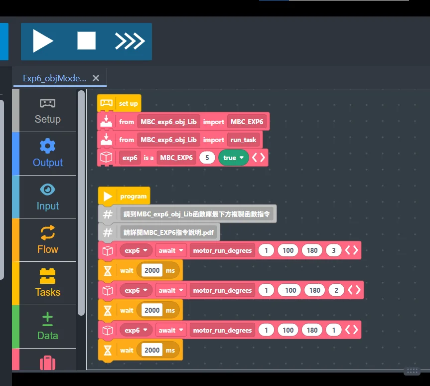

### 接線與供電

1. **主機通訊線**：把擴充器的 **Host 通訊線**插進 SPIKE 主機任一孔（Port A~F）。
2. **獨立電源**：擴充器一定要接 **2S 鋰電池**（7.4 V，充飽 8.4 V，XT30 接頭），馬達和樂高感應器都靠它供電；馬達電流不會從主機抽，主機訊號線也經過隔離晶片。**不要接 3S 以上**：超過 9 V 時，EXP6 會停止供電給樂高顏色／超音波感應器。
3. **接裝置**：樂高感應器（顏色、超音波、力量）與馬達，任意接在擴充器的 **1～6 號**孔。

> [!WARNING]
> 這個寫法的 EXP6 只支援 **SPIKE Prime** 主機（Robot Inventor（51515）主機請用 [Robot Inventor App 的 Python](/learn/exp6/robot-inventor.html)；不支援 EV3）。**換另一種寫法之前，先讓 EXP6 斷電一次**（關主機或拔掉 Host 線）：EXP6 一旦跑過 Pybricks 程式，就會一直用 Pybricks 的方式溝通，直到重新開機，這時候官方 App 會連不上。

### 匯入 EXP6 函式庫

1. 下載 [📥 Pybricks 函式庫＋範例（.zip）](/downloads/MBC_EXP6_Pybricks_Lib.zip)。EXP6 韌體要 2026-11-03 以後；主機用 **Pybricks 韌體 v4.1**。函式說明在包裡的 `EXP6_Library_Manual.pdf`。
2. 把用得到的檔案放進同一個 Pybricks 專案，檔名不用改：
   - **一定要放**：`MBC_exp6_obj_Lib.py`（EXP6、馬達、樂高感應器）。包裡的範例寫的就是 `from MBC_exp6_obj_Lib import MBC_EXP6`。
   - **有插 MBC 感應器才放**：`MBC_exp6_mbc_common.py`（共用檔，會被下面的產品檔自動載入），再加上用到的產品檔：`MBC_exp6_line.py`（循行者 8／16 路）、`MBC_exp6_laser.py`（測距者 2／8 路）、`MBC_exp6_pad.py`（掌控者 PS2／PS4）、`MBC_exp6_unicam.py`（神攝手）。
   - **用不到的不要放**：Pybricks 主機的程式（你的程式加上全部函式庫）上限大約 52 KB，全部放進去會超過。
   - **用 Pybricks 圖形積木**：下載包的 `beginner_examples/` 有 5 個積木範例，也可以單獨下載：[ex01 轉一圈](/examples/exp6/spike_beginner/pybricks/ex01_one_turn_block.py)、[ex02 三顆馬達](/examples/exp6/spike_beginner/pybricks/ex02_three_motors_block.py)、[ex03 光控開關](/examples/exp6/spike_beginner/pybricks/ex03_light_switch_block.py)、[ex04 按鈕控制](/examples/exp6/spike_beginner/pybricks/ex04_button_motor_block.py)、[ex05 走正方形](/examples/exp6/spike_beginner/pybricks/ex05_square_block.py)。在 Pybricks Code 按「匯入檔案」選這個檔，跟 `MBC_exp6_obj_Lib.py` 放同一個專案，打開就是積木。積木裡只要有等待就會變成多工（`MBC_EXP6(3, True)`、每個指令都 `await`），所以多拖了一塊「from MBC_exp6_obj_Lib import run_task」：等待的時候由它在背景送心跳，馬達才不會被看門狗停掉。



### 一般模式與多工模式

假設擴充器接在主機的 **Port C（孔 3）**：

```python
# 一般模式：一行一行執行
from MBC_exp6_obj_Lib import MBC_EXP6
exp6 = MBC_EXP6(3, False)
exp6.motor_power(6, 100)
exp6.keep_alive_wait(5000)
```

```python
# 多工模式：每個指令前加 await，要用函式庫的 run_task
from pybricks.tools import multitask, run_task, wait
from MBC_exp6_obj_Lib import MBC_EXP6, run_task
exp6 = MBC_EXP6(3, True)

async def main():
    await exp6.motor_power(6, 100)
    await exp6.keep_alive_wait(5000)

run_task(main())
```

> [!IMPORTANT]
> **Pybricks 有看門狗**：擴充器約 **0.5 秒**沒收到主機訊號（斷線或程式當掉）就讓馬達滑行停止。多工模式的 `run_task` 會在背景自動送心跳；一般模式等待時要用 `exp6.keep_alive_wait(毫秒)` 取代 `wait`，耗時的迴圈裡要呼叫 `exp6.keep_alive()`。

### MBC 感應器插在 EXP6 上

主機的孔不夠用時，MBC 感應器可以插在 EXP6 的 1～6 號孔：**循行者 8／16 路、測距者 2／8 路、掌控者 PS2／PS4、神攝手**。函式名稱和回傳值都跟感應器直接插主機時一樣。

- 感應器直接插上就能用，跟插在主機上一樣，不用另外設定。
- EXP6 韌體要是 **2026-11-03 以後的版本**。舊韌體請跟我們聯絡更新。

**1. 一般模式：先宣告每一孔接什麼。** 建立 EXP6 物件時寫 `p5=LINE16`（5 號孔接循行者 16 路），神攝手寫 `(UNICAM, 相機模式)`，接著用 `exp6.sensor(孔號)` 拿到感應器物件。程式一開始就會核對每一孔插的是不是宣告的那一款。插錯了會直接停下，並告訴你讀到的是哪一款，例如「5 號孔要接「循行者 16 路」，讀到的是「測距者 2 路」」。神攝手在宣告時就會自動切到你寫的相機模式。

```python
from MBC_exp6_obj_Lib import MBC_EXP6
from MBC_exp6_line import *       # 循行者 LINE8、LINE16
from MBC_exp6_unicam import *     # 神攝手 UNICAM

# EXP6 插主機 C 孔（3）；EXP6 的 5 號孔插循行者 16 路、6 號孔插神攝手（相機模式 51 物體偵測）
exp6 = MBC_EXP6(3, False, p5=LINE16, p6=(UNICAM, 51))
line = exp6.sensor(5)
cam = exp6.sensor(6)

while True:
    print("pos100 =", line.pos100(), " 物體數 =", cam.object_count())
    exp6.keep_alive_wait(100)     # 一般模式等待要用 keep_alive_wait
```

**2. 多工模式。** 宣告的寫法一樣，`exp6.sensor()` 不用加 `await`，但要寫在 `run_task` 之前。多工模式宣告時不會核對插的是哪一款。

- 神攝手要在 `main()` 裡用 `await cam.set_mode(模式)` 自己切一次相機模式。
- 感應器的每個函式前面都要加 `await`。
- 掌控者每一圈都要先 `pad.update()` 讀一次，這一圈的按鍵和搖桿都用這次讀到的資料，跟直接插主機時一樣。
- `buttons()` 的排法跟直接插主機時一樣。以前的 PSX 排法改名叫 `buttons_psx()`。

```python
from pybricks.tools import multitask, run_task, wait
from MBC_exp6_obj_Lib import MBC_EXP6, run_task
from MBC_exp6_pad import *        # 掌控者 PS2、PS4
from MBC_exp6_unicam import *     # 神攝手 UNICAM

exp6 = MBC_EXP6(3, True, p4=PS4, p6=(UNICAM, 13))   # EXP6 插主機 C 孔（3）
pad = exp6.sensor(4)              # 拿物件不用 await，但要寫在 run_task 之前
cam = exp6.sensor(6)

async def main():
    await cam.set_mode(13)        # 多工寫法：相機模式要自己切一次
    while True:
        await pad.update()        # 每一圈先讀一次手把，下面的按鍵、搖桿都用這一次的資料
        if await pad.pressed("CROSS"):
            break
        print("LX =", await pad.lx(), " 色 1 位置 =", await cam.xy(1))
        await wait(50)
    print("結束")

run_task(main())
```

**3. 舊寫法也能用。** `exp6.line16(5)`、`exp6.laser8(3)`、`exp6.ps2(4)`、`exp6.unicam(5, 13)` 照樣可以用，只是不會核對插的是哪一款。**舊程式只要在上面加一行 import 產品檔**，例如 `from MBC_exp6_line import *`。沒有加這一行，程式會提示你要補哪一行。

完整範例在下載包的 `examples/11_MBC_Sensors.py`，示範循行者 8 路、測距者 8 路、掌控者 PS2 和神攝手一起用。

**4. 積木寫法。** 積木只能照順序填參數，所以用 `EXP6_LINE8(exp6, 5)` 這種寫法建立感應器物件（第一格放 EXP6 物件、第二格是 EXP6 的孔號），用到的產品檔要多拖一塊匯入積木。範例：循行者 8 路插 EXP6 第 5 孔的 PD 循線，[積木檔](/examples/exp6/spike_beginner/pybricks/exp6_line8_pd_block.py)、[Python 檔](/examples/exp6/spike_beginner/pybricks/exp6_line8_pd_python.py)（左馬達接擴充孔 1、右馬達接擴充孔 2），一步一步的說明在 [EXP6 Pybricks 積木互動教學](/learn/exp6/pybricks-blocks.html#mbc-sensors)。

> [!NOTE]
> 2026-11-03 實機驗證過：EXP6 範例 P1～P5、範例 11、MBC 積木網站範例 M1～M5，11 個全部通過。
