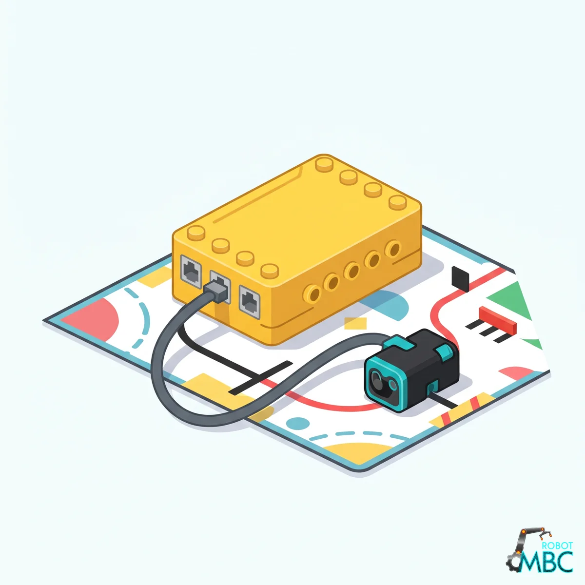

<!-- AI 注意：在此專案的 Markdown 檔案中，直接插入的 HTML 程式碼請勿使用任何縮排，否則會被 Markdown 解析器誤認為程式碼區塊（變成文本視窗）。 -->
<!-- 本頁由 _build/gen-guides.mjs 產生（exp6 × spike），請勿手改；改內容請改 _build/guides.json、_build/guides/**、_build/protocol/*.json 後重跑 node _build/gen-guides.mjs -->
<!-- guide: exp6/spike -->
# MBC EXP6 6-Port Motor Expander (for LEGO® SPIKE™) × SPIKE Prime / Robot Inventor

Using the MBC EXP6 6-Port Motor Expander (for LEGO® SPIKE™) with SPIKE Prime / Robot Inventor: check the edition and the wiring, then pick your software; its page covers that software only.

<figure class="guide-hero"></figure>

## Which edition

Plug the EXP6 host cable into any SPIKE Prime port (SPIKE Prime; on a Robot Inventor (51515) hub, Python in the Robot Inventor App only; not EV3) and connect a separate power supply for the motors.

## ② Pick your software

<!-- sw-grid -->

## More

- [MBC EXP6 6-Port Motor Expander (for LEGO® SPIKE™): overview, specs and calibration](/en/sensors/exp6/index.md)
- [Download centre](/en/downloads.md)
