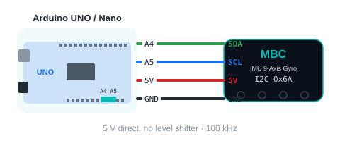

<!-- AI 注意：在此專案的 Markdown 檔案中，直接插入的 HTML 程式碼請勿使用任何縮排，否則會被 Markdown 解析器誤認為程式碼區塊（變成文本視窗）。 -->
<!-- moved: /en/sensors/imu/arduino/ide.md -->
<p class="moved-note">This page has moved into the new guide: <a href="/en/sensors/imu/arduino/ide.md">IMU 9-Axis Gyro › Arduino › Arduino IDE</a></p>

# 🧪 IMU Gyro × Arduino Examples

[🔙 Back to IMU Gyro Home](/en/sensors/imu/index.md)　|　[📡 MBC Universal I2C Protocol v2 (advanced)](/en/i2c-protocol.md)

This page has **12 examples**, from "is it connected?" all the way to "a car that turns 90 degrees on the spot", "drives straight" and "turns to a given direction", calibration and advanced commands. You can copy and upload each example as it is, and every line of the code has an English comment. **Never written code before? No problem.** Just do them one by one, in order.

> [!TIP]
> First time using Arduino? Read [🔰 First Time with Arduino: Start from Zero](/en/sensors/arduino-start.md) first. In 15 minutes you learn how to install the software, upload a program and see the result.

<div style="display: flex; gap: 15px; flex-wrap: wrap; margin: 25px 0;">
<a href="/examples/imu/arduino-en/imu_arduino_examples_en.zip" target="_blank" data-ignore="true" download class="btn-download" style="flex: 1; min-width: 220px; text-align: center; background: linear-gradient(135deg, #00d2ff, #007a75); color: #fff; padding: 12px; border-radius: 8px; text-decoration: none; font-weight: bold; font-size: 1rem;">📥 Download all examples (ZIP)</a>
</div>

---

## 🔌 Wiring (the same for every example)

| Gyro | Arduino UNO / Nano | Arduino UNO R4 | ESP32 |
| :---: | :---: | :---: | :---: |
| VCC | 5V | 5V | 3V3 or 5V (VIN) |
| GND | GND | GND | GND |
| SDA | A4 | SDA | GPIO 21 |
| SCL | A5 | SCL | GPIO 22 |

<div style="text-align: center;">

</div>

> [!IMPORTANT]
> - Use the **Universal I2C edition** of the gyro. The SPIKE and EV3 editions have different firmware and cannot connect to Arduino directly.
> - **Keep the gyro still for about 0.5 s when it powers on.** It learns "which side is up" by itself and sets the heading to zero.
> - Keep away from motors, speakers and iron desks: they disturb the magnetometer (example 6 shows the disturbance level).
> - Unplug the USB cable before you connect the wires.

---

<h2 id="cmds">📖 Command overview (what this gyro can give you)</h2>

Think of the gyro as a row of numbered "boxes". Each box holds one number (int16). Write `[number]`, then read 2 bytes, and you get one value. Boxes next to each other can be read in one row (up to 16). In the examples, `mbcRead(ADDR, number)` and `mbcReadMany(ADDR, first number, how many, array)` do exactly this.

<!-- gen:cmd-table -->
| Number | Name | Range / unit | Meaning | Used in |
| :---: | :--- | :--- | :--- | :--- |
| `01` | Gyro 3D heading | degrees | Heading computed from all three axes, 0 at power-on / zeroing; seen from above, **turning right (clockwise) makes it bigger**; it keeps adding up (two full turns = 720) and wraps at ±32767 | Examples 2, 3 |
| `02` | Fused heading | degrees | Gyro 3D slowly corrected by the magnetometer, so it does not drift over time | Examples 2, 3, 7 |
| `03` | Gyro 1D heading | degrees | Integrates only the turning axis | Examples 2, 3 |
| `04` | Magnetic heading | degrees | Magnetometer only (like a compass, disturbed by iron) | Examples 2, 3 |
| `05` | Turn rate | 0.1 deg/s | How fast it turns around the turning axis (123 = 12.3 deg/s), same sign as the heading | Examples 2, 4 |
| `06` | Pitch angle | degrees | How many degrees the board is tilted around the printed X axis, flat = 0 | Examples 2, 4 |
| `07` | Pitch rate | 0.1 deg/s | How fast the pitch angle changes | Examples 2, 4 |
| `08` | Magnetic trust | 0~255 | How much the fusion algorithm trusts the magnetometer, higher is better | Examples 2, 6 |
| `09` | Magnetic disturbance | 0~255 | Disturbance from nearby iron or motors, lower is better | Examples 2, 6 |
| `0A` | Side facing up | 0~5 | 0 +X, 1 +Y, 2 +Z (flat), 3 −X, 4 −Y, 5 −Z | Examples 2, 6 |
| `0B` | Command status | — | Last command code × 256 + state (0 done, 1 busy, 2 failed, 3 rejected) | Example 11 |
| `10`~`12` | Gyro rate X / Y / Z | 0.1 deg/s | Raw values on the physical axes | Examples 2, 5 |
| `13`~`15` | Acceleration X / Y / Z | mg | 1000 = 1 g; lying flat, Z is about 1000 | Examples 2, 5 |
| `16`~`18` | Magnetic field X / Y / Z | mG | Magnetic field strength (milligauss) | Examples 2, 5 |
| `F0` | Device ID | — | low byte = factory address 0x6A, high byte = 1 | Example 1 |
| `F1` | Protocol version | 2 | These examples are written for version 2 | Example 1 |
| `F2` | Firmware version | major x 100 + minor | for example 102 = 1.2 | Example 1 |
| `F3` | Status flags | bits | b0 ready, b1 still, b2 mounting axis captured, b3 mounted crooked, b4 accel calibrating, b5 mag calibrating, b6 mag fusion initialized, b7 mag auto-calibration converged | Examples 1, 8 |
| `F4` | Snapshot counter | — | +1 every 10 ms or after a command | Example 11 |
| `F5` | Seconds since power-on | 0~32767 | If the number gets smaller, the gyro has restarted | Example 1 |
| `E0` (write) | Heading to zero | no parameters | Sets all four headings to zero | Examples 3, 7 |
| `E1` / `E2` (write) | Start / finish accelerometer calibration | no parameters | F3 b4 = 1 while running; finishing saves to EEPROM and sets the heading to zero automatically | Example 8 |
| `E3` / `E4` (write) | Start / finish magnetometer calibration | no parameters | F3 b5 = 1 while running; finishing saves to EEPROM | Example 8 |
| `E5` (write) | Set the heading to an angle | [angle] int16 | All headings become this angle; RAM only, 0 again after power off | Example 11 |
| `E6` (write) | North as zero | no parameters | The fused heading becomes the current magnetic bearing 0~359; done within about 3 s | Example 11 |
| `E7` (write) | Re-estimate the gyro bias | no parameters | Keep it still for about 1.5 s while it re-estimates the gyro zero | Example 11 |
| `E8` (write) | Recapture the mounting axis | no parameters | Detects the mounting direction again, then zeroes the heading | — |
| `E9` (write) | Cancel calibration | no parameters | Cancels a running accelerometer / magnetometer calibration without saving | — |
| `EA` (write) | Heading correction factor | 0, 3500~3700 | Degrees one real turn reads × 10; 0 = back to 360.0; saved to EEPROM | Example 12 |
| `EB` (write) | Calibration factory reset | [0xA5] | Accelerometer and magnetometer calibration and the heading correction factor go back to factory values | — |
<!-- /gen -->

> [!NOTE]
> A box that does not exist (for example `0C`~`0F`) reads as `-32768` (called `MBC_NONE` in the examples). You also get `-32768` when the gyro cannot be read. Full specification: [MBC Universal I2C Protocol v2](/en/i2c-protocol.md).

---

## 📋 All Examples

| # | Example | What you learn | You also need |
| :---: | :--- | :--- | :--- |
| 1 | [Say hello to the gyro](#ex1) | Check the wiring, read the ID card, the 8 bits of F3 | Nothing |
| 2 | [Print all the values at once](#ex2) | See what every box holds (01~0A, 10~18) | Nothing |
| 3 | [How many degrees did I turn?](#ex3) | The four headings, E0 zeroing | Nothing |
| 4 | [How fast? How tilted?](#ex4) | Turn rate, pitch angle | A book (to lift one side) |
| 5 | [Raw 9-axis values](#ex5) | Gyro rate / acceleration / magnetic field XYZ | A magnet (optional) |
| 6 | [Which side is up?](#ex6) | Side facing up, magnetic trust / disturbance | Nothing |
| 7 | [Car turns 90 degrees on the spot (advanced)](#ex7) | Control a turn with the heading | Two-wheel car, L298N motor driver board |
| 8 | [Calibrate the accelerometer and magnetometer](#ex8) | Write commands E1~E4, watch F3 | Nothing |
| 9 | [Car drives in a straight line (advanced)](#ex9) | Correct the left / right wheel speed with the heading | Two-wheel car, L298N motor driver board |
| 10 | [Car turns to a given direction (advanced)](#ex10) | Turn to an absolute angle (measured from the power-on direction) | Two-wheel car, L298N motor driver board |
| 11 | [Send commands and check whether they are done (advanced)](#ex11) | Commands E5~E7, read command status 0B | Nothing |
| 12 | [Heading correction (advanced)](#ex12) | Measure how many degrees one turn reads, save with command EA | A desk with a straight edge (or a book) |

> [!TIP]
> **Suggested order: 1 → 2 → 3 → 4 → 6 → 5 → 7 → 9 → 10 → 8 → 11 → 12.** Examples 7, 9 and 10 use the same car and need extra parts; example 8 is only needed when the heading drifts fast. Examples 11 and 12 are advanced commands (new firmware only): do them after you know the earlier ones well; example 12 is only needed when one turn does not read 360 degrees.

---

<h2 id="ex1">1️⃣ Say hello to the gyro</h2>

**What it does:** Checks that the gyro is connected and prints its "ID card" (factory address, protocol version, firmware version) and the 8 bits of status flags F3. Run this one first every time you connect a new gyro.

**Steps:**
1. Connect the 4 wires as in the table above, then plug the USB cable into the computer.
2. Copy the code below, paste it into the Arduino IDE and click **→ Upload**.
3. Open the Serial Monitor (the magnifying glass at the top right) and choose **115200** baud.

<a href="/examples/imu/arduino-en/imu_01_hello/imu_01_hello.ino" download data-ignore="true">📄 Download imu_01_hello.ino</a>

<!-- ino: examples/imu/arduino-en/imu_01_hello/imu_01_hello.ino -->
```cpp
/*
 * IMU Gyro x Arduino   Example 1: Say hello to the gyro
 * ------------------------------------------------------------
 * What does this example do?
 *   Checks that the gyro is connected. If it is, it prints the gyro's "ID card"
 *   (device ID, protocol version, firmware version) and the 8 bits of status
 *   flags F3 (still? calibrating? mounted crooked?).
 *   Run this example first every time you connect a new gyro.
 *
 * You need: IMU Gyro (Universal I2C edition), Arduino UNO / Nano / UNO R4 or ESP32.
 *
 * Wiring:
 *   Gyro VCC -> 5V      Gyro GND -> GND
 *   Gyro SDA -> A4      Gyro SCL -> A5         (UNO / Nano)
 *   UNO R4: SDA / SCL pins; ESP32: GPIO 21 (SDA) / GPIO 22 (SCL)
 *
 * How to see the result:
 *   After uploading, open the Serial Monitor and choose 115200 baud.
 *
 * Tip:
 *   Keep the gyro still for about 0.5 s when it powers on. It learns "which side is up"
 *   by itself and sets the heading to zero.
 */

#include <Wire.h>                        // Arduino's built-in I2C tool, used to talk to the gyro

const uint8_t ADDR = 0x6A;               // The IMU Gyro's "house number" (I2C address)
const int16_t MBC_NONE = -32768;         // Code for "no such value / could not read"

// Helper declaration (the code is at the bottom of the file); mbcWrite's parameters can be left out
bool mbcWrite(uint8_t addr, uint8_t id, const uint8_t *p = NULL, uint8_t n = 0);

void setup() {
  Serial.begin(115200);                  // Open the channel to the computer at 115200 baud
  mbcBegin();                            // Get I2C ready (helper at the bottom of the file)
  delay(500);                            // Give the gyro 0.5 s to boot

  Serial.println(F("=== IMU Gyro: Say hello to the gyro ==="));

  // Wait until the gyro says "I am ready" (bit0 of status flags F3), up to 3 seconds
  if (!mbcWaitReady(ADDR, 3000)) {
    Serial.println(F("Gyro not found! Please check:"));
    Serial.println(F("  1. SDA -> A4, SCL -> A5 (ESP32: 21 / 22). Are they swapped?"));
    Serial.println(F("  2. VCC -> 5V, GND -> GND. Plugged in firmly?"));
    Serial.println(F("  3. Is your gyro the Universal I2C edition? (SPIKE and EV3 editions cannot connect to Arduino)"));
    while (true) {}                      // Stop here if not found
  }

  // ---- F0 device ID: low byte = factory address (0x6A), high byte = hw[0] (IMU = 1) ----
  int16_t id = mbcRead(ADDR, 0xF0);
  Serial.print(F("Found it! Factory address 0x"));
  Serial.print((uint8_t)(id & 0xFF), HEX);
  Serial.print(F(", type code "));
  Serial.println((uint8_t)((id >> 8) & 0xFF));   // IMU = 1

  // ---- F1 protocol version (these examples are written for version 2) ----
  Serial.print(F("Protocol version: "));
  Serial.println(mbcRead(ADDR, 0xF1));

  // ---- F2 firmware version: major x 100 + minor (for example 102 = 1.2) ----
  int16_t fw = mbcRead(ADDR, 0xF2);
  Serial.print(F("Firmware version: "));
  Serial.print(fw / 100);
  Serial.print('.');
  Serial.println(fw % 100);

  // ---- F3 status flags: 8 bits, each bit means one thing ----
  int16_t st = mbcRead(ADDR, 0xF3);
  Serial.println(F("Current status:"));
  printFlags(st);

  // ---- F5 seconds since power-on ----
  Serial.print(F("Seconds since power-on: "));
  Serial.println(mbcRead(ADDR, 0xF5));

  Serial.println(F("Wiring is correct. You can try the other examples now!"));
}

void loop() {
  // This example only checks once at power-on, so loop does nothing
}

// Print the 8 bits of F3, one line each
void printFlags(int16_t st) {
  Serial.print(F("  bit0 ready                   ")); Serial.println((st & 0x01) ? F("yes") : F("no"));
  Serial.print(F("  bit1 still                   ")); Serial.println((st & 0x02) ? F("yes") : F("no (moving)"));
  Serial.print(F("  bit2 mounting axis captured  ")); Serial.println((st & 0x04) ? F("yes (knows which side is up)") : F("no (keep it still and wait)"));
  Serial.print(F("  bit3 mounted crooked         ")); Serial.println((st & 0x08) ? F("yes (please mount it flatter)") : F("no"));
  Serial.print(F("  bit4 accel calibrating       ")); Serial.println((st & 0x10) ? F("yes") : F("no"));
  Serial.print(F("  bit5 mag calibrating         ")); Serial.println((st & 0x20) ? F("yes") : F("no"));
  Serial.print(F("  bit6 mag fusion initialized  ")); Serial.println((st & 0x40) ? F("yes (fused heading available)") : F("no"));
  Serial.print(F("  bit7 mag auto-cal converged  ")); Serial.println((st & 0x80) ? F("yes") : F("no"));
}

// ============================================================
// Below are the "Communication helpers" (MBC I2C protocol v2): they talk to the sensor.
// They are the same in every MBC example. No need to change or understand them.
//   How to read: write [number] -> wait 2 ms -> read 2 x k bytes = k int16 values (little-endian) starting at that number
//   If the number does not exist (empty slot), the sensor returns -32768 (MBC_NONE)
// ============================================================

// Start I2C (call once in setup)
// UNO/Nano: SDA=A4, SCL=A5; UNO R4: SDA/SCL pins; ESP32: default GPIO21(SDA)/22(SCL)
void mbcBegin() {
  Wire.begin();
#if defined(WIRE_HAS_TIMEOUT)
  Wire.setWireTimeout(25000, true);      // If a wire is loose, the Arduino will not freeze
#endif
}

// From the sensor at address addr, read k values (1~16) in a row starting at number id, into out. Returns true if all were read
bool mbcReadMany(uint8_t addr, uint8_t id, uint8_t k, int16_t *out) {
  if (k < 1) k = 1;
  if (k > 16) k = 16;                    // At most 16 values at a time (32 bytes, the Wire buffer limit)
  Wire.beginTransmission(addr);
  Wire.write(id);                        // Tell the sensor: I want to read starting at number id
  if (Wire.endTransmission() != 0) return false;
  delay(2);                              // Wait 2 ms before reading (ESP32-based products need this)
  uint8_t n = (uint8_t)(2 * k);
  if (Wire.requestFrom(addr, n) != n) return false;
  for (uint8_t i = 0; i < k; i++) {
    uint16_t lo = Wire.read();           // The low byte comes first
    uint16_t hi = Wire.read();           // Then the high byte (little-endian)
    out[i] = (int16_t)(uint16_t)(lo | (hi << 8));
  }
  return true;
}

// Read one value. Returns MBC_NONE if it cannot be read (not connected)
int16_t mbcRead(uint8_t addr, uint8_t id) {
  int16_t v;
  return mbcReadMany(addr, id, 1, &v) ? v : MBC_NONE;
}

// Send a command: write [id][parameters...]. p points to the parameters, n = how many bytes (leave out if none). Returns true on success
bool mbcWrite(uint8_t addr, uint8_t id, const uint8_t *p, uint8_t n) {
  Wire.beginTransmission(addr);
  Wire.write(id);
  for (uint8_t i = 0; i < n; i++) Wire.write(p[i]);
  return Wire.endTransmission() == 0;
}

// Wait until the sensor is ready (bit0 of status flags F3 = 1), up to ms milliseconds. Returns true when ready
bool mbcWaitReady(uint8_t addr, uint16_t ms) {
  unsigned long start = millis();
  while (millis() - start < ms) {
    int16_t f = mbcRead(addr, 0xF3);
    if (f != MBC_NONE && (f & 1)) return true;
    delay(50);
  }
  return false;
}
```

**You will see:**

```text
=== IMU Gyro: Say hello to the gyro ===
Found it! Factory address 0x6A, type code 1
Protocol version: 2
Firmware version: 1.2
Current status:
  bit0 ready                   yes
  bit1 still                   yes
  bit2 mounting axis captured  yes (knows which side is up)
  bit3 mounted crooked         no
  bit4 accel calibrating       no
  bit5 mag calibrating         no
  bit6 mag fusion initialized  yes (fused heading available)
  bit7 mag auto-cal converged  no
Seconds since power-on: 2
Wiring is correct. You can try the other examples now!
```

> [!NOTE]
> **What are the "Communication helpers"?** At the bottom of every example there is the same piece of code. It "talks" to the gyro. You don't need to change it or understand it. Just remember:
> - `mbcRead(ADDR, number)`: read one value (returns `-32768` if it cannot be read)
> - `mbcReadMany(ADDR, first number, how many, array)`: read a row of values starting at a number (up to 16, all from the same instant)
> - `mbcWrite(ADDR, command)`: send a command (for example `0xE0` to set the heading to zero)
> - `mbcWaitReady(ADDR, milliseconds)`: wait until the gyro has booted

---

<h2 id="ex2">2️⃣ Print all the values at once</h2>

**What it does:** Every 0.5 s it prints every value in the value table: `01`~`0A` in one read of 10, `10`~`18` in one read of 9. Turn it, flip it, and watch which line changes.

<a href="/examples/imu/arduino-en/imu_02_all_values/imu_02_all_values.ino" download data-ignore="true">📄 Download imu_02_all_values.ino</a>

<!-- ino: examples/imu/arduino-en/imu_02_all_values/imu_02_all_values.ino -->
```cpp
/*
 * IMU Gyro x Arduino   Example 2: Print all the values at once
 * ------------------------------------------------------------
 * What does this example do?
 *   Every 0.5 s it prints every value in the gyro's "value table", so you can
 *   see what each number holds:
 *     01~0A: four headings, turn rate, pitch angle, magnetic trust / disturbance, side facing up (10 values in one read)
 *     10~18: gyro rate, acceleration, magnetic field, each X/Y/Z (9 values in one read)
 *   Numbers that are next to each other can be read "in one row" (mbcReadMany),
 *   and you get the values from the same instant.
 *
 * You need: IMU Gyro (Universal I2C edition), Arduino UNO / Nano / UNO R4 or ESP32.
 *
 * Wiring:
 *   Gyro VCC -> 5V      Gyro GND -> GND
 *   Gyro SDA -> A4      Gyro SCL -> A5         (UNO / Nano)
 *   UNO R4: SDA / SCL pins; ESP32: GPIO 21 (SDA) / GPIO 22 (SCL)
 *
 * How to see the result:
 *   After uploading, open the Serial Monitor and choose 115200 baud. Turn and flip the gyro and watch which numbers change.
 *
 * Tip:
 *   Keep the gyro still for about 0.5 s when it powers on. It learns "which side is up"
 *   by itself and sets the heading to zero.
 */

#include <Wire.h>                        // Arduino's built-in I2C tool

const uint8_t ADDR = 0x6A;               // The IMU Gyro's "house number" (I2C address)
const int16_t MBC_NONE = -32768;         // Code for "no such value / could not read"

// Helper declaration (the code is at the bottom of the file); mbcWrite's parameters can be left out
bool mbcWrite(uint8_t addr, uint8_t id, const uint8_t *p = NULL, uint8_t n = 0);

unsigned long lastPrint = 0;             // When we last printed

void setup() {
  Serial.begin(115200);
  mbcBegin();
  delay(500);
  if (!mbcWaitReady(ADDR, 3000)) {
    Serial.println(F("Gyro not found. Run Example 1 first to check the wiring."));
    while (true) {}
  }
  Serial.println(F("Ready! Printing all values every 0.5 s."));
}

void loop() {
  if (millis() - lastPrint >= 500) {     // 👉 You can change this: print every 0.5 s
    lastPrint = millis();

    // ---- Part 1: numbers 01~0A, 10 values in one read ----
    int16_t a[10];
    if (!mbcReadMany(ADDR, 0x01, 10, a)) { Serial.println(F("Cannot read (part 1)")); return; }
    // ---- Part 2: numbers 10~18, 9 values in one read ----
    int16_t r[9];
    if (!mbcReadMany(ADDR, 0x10, 9, r)) { Serial.println(F("Cannot read (part 2)")); return; }

    Serial.println(F("------------------------------"));
    Serial.print(F("01 Gyro 3D heading (deg)       : ")); Serial.println(a[0]);
    Serial.print(F("02 Fused heading (deg)         : ")); Serial.println(a[1]);
    Serial.print(F("03 Gyro 1D heading (deg)       : ")); Serial.println(a[2]);
    Serial.print(F("04 Magnetic heading (deg)      : ")); Serial.println(a[3]);
    Serial.print(F("05 Turn rate (0.1 deg/s)       : ")); Serial.println(a[4]);
    Serial.print(F("06 Pitch angle (deg)           : ")); Serial.println(a[5]);
    Serial.print(F("07 Pitch rate (0.1 deg/s)      : ")); Serial.println(a[6]);
    Serial.print(F("08 Magnetic trust 0~255        : ")); Serial.println(a[7]);
    Serial.print(F("09 Magnetic disturbance 0~255  : ")); Serial.println(a[8]);
    Serial.print(F("0A Side facing up 0~5          : ")); Serial.println(a[9]);
    Serial.print(F("10~12 Gyro rate X/Y/Z (0.1 deg/s): ")); print3(r[0], r[1], r[2]);
    Serial.print(F("13~15 Accel X/Y/Z (mg)           : ")); print3(r[3], r[4], r[5]);
    Serial.print(F("16~18 Magnetic X/Y/Z (mG)        : ")); print3(r[6], r[7], r[8]);
  }
  delay(50);
}

// Print three numbers on one line
void print3(int16_t x, int16_t y, int16_t z) {
  Serial.print(x); Serial.print(F("  ")); Serial.print(y); Serial.print(F("  ")); Serial.println(z);
}

// ============================================================
// Below are the "Communication helpers" (MBC I2C protocol v2): they talk to the sensor.
// They are the same in every MBC example. No need to change or understand them.
//   How to read: write [number] -> wait 2 ms -> read 2 x k bytes = k int16 values (little-endian) starting at that number
//   If the number does not exist (empty slot), the sensor returns -32768 (MBC_NONE)
// ============================================================

// Start I2C (call once in setup)
// UNO/Nano: SDA=A4, SCL=A5; UNO R4: SDA/SCL pins; ESP32: default GPIO21(SDA)/22(SCL)
void mbcBegin() {
  Wire.begin();
#if defined(WIRE_HAS_TIMEOUT)
  Wire.setWireTimeout(25000, true);      // If a wire is loose, the Arduino will not freeze
#endif
}

// From the sensor at address addr, read k values (1~16) in a row starting at number id, into out. Returns true if all were read
bool mbcReadMany(uint8_t addr, uint8_t id, uint8_t k, int16_t *out) {
  if (k < 1) k = 1;
  if (k > 16) k = 16;                    // At most 16 values at a time (32 bytes, the Wire buffer limit)
  Wire.beginTransmission(addr);
  Wire.write(id);                        // Tell the sensor: I want to read starting at number id
  if (Wire.endTransmission() != 0) return false;
  delay(2);                              // Wait 2 ms before reading (ESP32-based products need this)
  uint8_t n = (uint8_t)(2 * k);
  if (Wire.requestFrom(addr, n) != n) return false;
  for (uint8_t i = 0; i < k; i++) {
    uint16_t lo = Wire.read();           // The low byte comes first
    uint16_t hi = Wire.read();           // Then the high byte (little-endian)
    out[i] = (int16_t)(uint16_t)(lo | (hi << 8));
  }
  return true;
}

// Read one value. Returns MBC_NONE if it cannot be read (not connected)
int16_t mbcRead(uint8_t addr, uint8_t id) {
  int16_t v;
  return mbcReadMany(addr, id, 1, &v) ? v : MBC_NONE;
}

// Send a command: write [id][parameters...]. p points to the parameters, n = how many bytes (leave out if none). Returns true on success
bool mbcWrite(uint8_t addr, uint8_t id, const uint8_t *p, uint8_t n) {
  Wire.beginTransmission(addr);
  Wire.write(id);
  for (uint8_t i = 0; i < n; i++) Wire.write(p[i]);
  return Wire.endTransmission() == 0;
}

// Wait until the sensor is ready (bit0 of status flags F3 = 1), up to ms milliseconds. Returns true when ready
bool mbcWaitReady(uint8_t addr, uint16_t ms) {
  unsigned long start = millis();
  while (millis() - start < ms) {
    int16_t f = mbcRead(addr, 0xF3);
    if (f != MBC_NONE && (f & 1)) return true;
    delay(50);
  }
  return false;
}
```

**You will see:** (lying flat, not moving)

```text
Ready! Printing all values every 0.5 s.
------------------------------
01 Gyro 3D heading (deg)       : 0
02 Fused heading (deg)         : 0
03 Gyro 1D heading (deg)       : 0
04 Magnetic heading (deg)      : 1
05 Turn rate (0.1 deg/s)       : 0
06 Pitch angle (deg)           : 0
07 Pitch rate (0.1 deg/s)      : 0
08 Magnetic trust 0~255        : 230
09 Magnetic disturbance 0~255  : 12
0A Side facing up 0~5          : 2
10~12 Gyro rate X/Y/Z (0.1 deg/s): 0  1  0
13~15 Accel X/Y/Z (mg)           : 3  -5  1002
16~18 Magnetic X/Y/Z (mG)        : 210  -95  -380
```

---

<h2 id="ex3">3️⃣ How many degrees did I turn? (four headings)</h2>

**What it does:** Every 0.1 s it prints the four headings (`01`~`04` in one read of 4). Seen from above, **turning right (clockwise) makes the number bigger**. It keeps adding up and can go negative. Type `z` in the Serial Monitor and press Enter to send command `E0`, which sets all four headings to zero.

<a href="/examples/imu/arduino-en/imu_03_heading/imu_03_heading.ino" download data-ignore="true">📄 Download imu_03_heading.ino</a>

<!-- ino: examples/imu/arduino-en/imu_03_heading/imu_03_heading.ino -->
```cpp
/*
 * IMU Gyro x Arduino   Example 3: How many degrees did I turn? (four headings)
 * ------------------------------------------------------------
 * What does this example do?
 *   Every 0.1 s it prints the four headings (numbers 01~04, 4 values in one read):
 *     01 Gyro 3D heading: computed from all three axes, the most common one
 *     02 Fused heading: gyro 3D slowly corrected by the magnetometer, so it does not drift over time
 *     03 Gyro 1D heading: integrates only the turning axis
 *     04 Magnetic heading: magnetometer only (like a compass, disturbed by iron)
 *   Seen from above, "clockwise" (turning right) makes the number bigger. It keeps adding up
 *   (two full turns = 720) and can go negative.
 *   Type z in the Serial Monitor and press Enter to send command E0, which sets all four headings to zero.
 *
 * You need: IMU Gyro (Universal I2C edition), Arduino UNO / Nano / UNO R4 or ESP32.
 *
 * Wiring:
 *   Gyro VCC -> 5V      Gyro GND -> GND
 *   Gyro SDA -> A4      Gyro SCL -> A5         (UNO / Nano)
 *   UNO R4: SDA / SCL pins; ESP32: GPIO 21 (SDA) / GPIO 22 (SCL)
 *
 * How to see the result:
 *   After uploading, open the Serial Monitor and choose 115200 baud. Lay the gyro flat, turn it slowly one full turn and watch the numbers.
 *
 * Tip:
 *   Keep the gyro still for about 0.5 s when it powers on. It learns "which side is up"
 *   by itself and sets the heading to zero.
 *   If you want 0~359, convert it yourself: ((h % 360) + 360) % 360.
 */

#include <Wire.h>                        // Arduino's built-in I2C tool

const uint8_t ADDR = 0x6A;               // The IMU Gyro's "house number" (I2C address)
const int16_t MBC_NONE = -32768;         // Code for "no such value / could not read"

// Helper declaration (the code is at the bottom of the file); mbcWrite's parameters can be left out
bool mbcWrite(uint8_t addr, uint8_t id, const uint8_t *p = NULL, uint8_t n = 0);

unsigned long lastPrint = 0;

void setup() {
  Serial.begin(115200);
  mbcBegin();
  delay(500);
  if (!mbcWaitReady(ADDR, 3000)) {
    Serial.println(F("Gyro not found. Run Example 1 first to check the wiring."));
    while (true) {}
  }
  Serial.println(F("Ready! Turn the gyro. Type z + Enter to set the heading to zero."));
  Serial.println(F(" Gyro3D   Fused  Gyro1D     Mag"));
}

void loop() {
  // ---- 1. Did the computer send a z? If so, send command E0 (heading to zero, no parameters) ----
  if (Serial.available()) {
    char ch = Serial.read();
    if (ch == 'z' || ch == 'Z') {
      mbcWrite(ADDR, 0xE0);              // Command E0: set all four headings to zero
      Serial.println(F(">>> Heading set to zero"));
    }
  }

  // ---- 2. Every 0.1 s read numbers 01~04, the four headings ----
  if (millis() - lastPrint >= 100) {     // 👉 You can change this: print every 0.1 s
    lastPrint = millis();
    int16_t h[4];
    if (!mbcReadMany(ADDR, 0x01, 4, h)) { Serial.println(F("Cannot read the gyro")); return; }
    char line[48];
    snprintf(line, sizeof(line), "%7d %7d %7d %7d", h[0], h[1], h[2], h[3]);   // Each number takes 7 columns, so they line up
    Serial.println(line);
  }
  delay(50);
}

// ============================================================
// Below are the "Communication helpers" (MBC I2C protocol v2): they talk to the sensor.
// They are the same in every MBC example. No need to change or understand them.
//   How to read: write [number] -> wait 2 ms -> read 2 x k bytes = k int16 values (little-endian) starting at that number
//   If the number does not exist (empty slot), the sensor returns -32768 (MBC_NONE)
// ============================================================

// Start I2C (call once in setup)
// UNO/Nano: SDA=A4, SCL=A5; UNO R4: SDA/SCL pins; ESP32: default GPIO21(SDA)/22(SCL)
void mbcBegin() {
  Wire.begin();
#if defined(WIRE_HAS_TIMEOUT)
  Wire.setWireTimeout(25000, true);      // If a wire is loose, the Arduino will not freeze
#endif
}

// From the sensor at address addr, read k values (1~16) in a row starting at number id, into out. Returns true if all were read
bool mbcReadMany(uint8_t addr, uint8_t id, uint8_t k, int16_t *out) {
  if (k < 1) k = 1;
  if (k > 16) k = 16;                    // At most 16 values at a time (32 bytes, the Wire buffer limit)
  Wire.beginTransmission(addr);
  Wire.write(id);                        // Tell the sensor: I want to read starting at number id
  if (Wire.endTransmission() != 0) return false;
  delay(2);                              // Wait 2 ms before reading (ESP32-based products need this)
  uint8_t n = (uint8_t)(2 * k);
  if (Wire.requestFrom(addr, n) != n) return false;
  for (uint8_t i = 0; i < k; i++) {
    uint16_t lo = Wire.read();           // The low byte comes first
    uint16_t hi = Wire.read();           // Then the high byte (little-endian)
    out[i] = (int16_t)(uint16_t)(lo | (hi << 8));
  }
  return true;
}

// Read one value. Returns MBC_NONE if it cannot be read (not connected)
int16_t mbcRead(uint8_t addr, uint8_t id) {
  int16_t v;
  return mbcReadMany(addr, id, 1, &v) ? v : MBC_NONE;
}

// Send a command: write [id][parameters...]. p points to the parameters, n = how many bytes (leave out if none). Returns true on success
bool mbcWrite(uint8_t addr, uint8_t id, const uint8_t *p, uint8_t n) {
  Wire.beginTransmission(addr);
  Wire.write(id);
  for (uint8_t i = 0; i < n; i++) Wire.write(p[i]);
  return Wire.endTransmission() == 0;
}

// Wait until the sensor is ready (bit0 of status flags F3 = 1), up to ms milliseconds. Returns true when ready
bool mbcWaitReady(uint8_t addr, uint16_t ms) {
  unsigned long start = millis();
  while (millis() - start < ms) {
    int16_t f = mbcRead(addr, 0xF3);
    if (f != MBC_NONE && (f & 1)) return true;
    delay(50);
  }
  return false;
}
```

**You will see:** (turn right about 90 degrees, then type z)

```text
Ready! Turn the gyro. Type z + Enter to set the heading to zero.
 Gyro3D   Fused  Gyro1D     Mag
      0       0       0       1
     45      45      44      47
     90      90      89      93
>>> Heading set to zero
      0       0       0       0
```

> [!TIP]
> - Normally just use `02` fused heading: as accurate as the gyro during fast turns, and it does not drift when left for a long time.
> - If you want 0~359, convert it yourself: `((h % 360) + 360) % 360`.
> - All headings are "relative" (the direction at power-on or zeroing = 0), not a compass bearing pointing north; `04` magnetic heading also has the zero point subtracted.

---

<h2 id="ex4">4️⃣ How fast? How tilted? (turn rate and pitch angle)</h2>

**What it does:** Every 0.2 s it prints `05` turn rate, `06` pitch angle, `07` pitch rate (3 values in one read). The rate unit is 0.1 deg/s, and the program prints it like `12.3`; above 30 deg/s it warns "Too fast!".

<a href="/examples/imu/arduino-en/imu_04_rate_tilt/imu_04_rate_tilt.ino" download data-ignore="true">📄 Download imu_04_rate_tilt.ino</a>

<!-- ino: examples/imu/arduino-en/imu_04_rate_tilt/imu_04_rate_tilt.ino -->
```cpp
/*
 * IMU Gyro x Arduino   Example 4: How fast? How tilted? (turn rate and pitch angle)
 * ------------------------------------------------------------
 * What does this example do?
 *   Every 0.2 s it prints numbers 05~07 (3 values in one read):
 *     05 Turn rate: how fast it turns around the "turning axis", in 0.1 deg/s (123 = 12.3 deg/s), same sign as the heading
 *     06 Pitch angle: how many degrees the board is tilted around the printed X axis (flat = 0)
 *     07 Pitch rate: how fast the pitch angle changes, in 0.1 deg/s
 *   When the turn rate goes above 30 deg/s it warns "Too fast!".
 *
 * You need: IMU Gyro (Universal I2C edition), Arduino UNO / Nano / UNO R4 or ESP32.
 *
 * Wiring:
 *   Gyro VCC -> 5V      Gyro GND -> GND
 *   Gyro SDA -> A4      Gyro SCL -> A5         (UNO / Nano)
 *   UNO R4: SDA / SCL pins; ESP32: GPIO 21 (SDA) / GPIO 22 (SCL)
 *
 * How to see the result:
 *   After uploading, open the Serial Monitor and choose 115200 baud. Turn the gyro on the spot to see 05; lift one side to see 06.
 *
 * Tip:
 *   Keep the gyro still for about 0.5 s when it powers on. It learns "which side is up"
 *   by itself and sets the heading to zero.
 */

#include <Wire.h>                        // Arduino's built-in I2C tool

const uint8_t ADDR = 0x6A;               // The IMU Gyro's "house number" (I2C address)
const int16_t MBC_NONE = -32768;         // Code for "no such value / could not read"

// Helper declaration (the code is at the bottom of the file); mbcWrite's parameters can be left out
bool mbcWrite(uint8_t addr, uint8_t id, const uint8_t *p = NULL, uint8_t n = 0);

const int FAST_DPS = 30;                 // 👉 You can change this: above how many deg/s counts as "too fast"

unsigned long lastPrint = 0;

void setup() {
  Serial.begin(115200);
  mbcBegin();
  delay(500);
  if (!mbcWaitReady(ADDR, 3000)) {
    Serial.println(F("Gyro not found. Run Example 1 first to check the wiring."));
    while (true) {}
  }
  Serial.println(F("Ready! Turn it, tilt it."));
}

void loop() {
  if (millis() - lastPrint >= 200) {     // 👉 You can change this: print every 0.2 s
    lastPrint = millis();

    // Read numbers 05~07 (3 values) in one go: [0] turn rate [1] pitch angle [2] pitch rate
    int16_t v[3];
    if (!mbcReadMany(ADDR, 0x05, 3, v)) { Serial.println(F("Cannot read the gyro")); return; }

    Serial.print(F("Turn rate "));
    Serial.print(v[0] / 10); Serial.print('.'); Serial.print(abs(v[0] % 10));   // 0.1 deg/s -> printed as 12.3
    Serial.print(F(" deg/s | Pitch "));
    Serial.print(v[1]);
    Serial.print(F(" deg | Pitch rate "));
    Serial.print(v[2] / 10); Serial.print('.'); Serial.print(abs(v[2] % 10));
    Serial.print(F(" deg/s"));
    if (abs(v[0]) > FAST_DPS * 10) Serial.print(F("   <<< Too fast!"));
    Serial.println();
  }
  delay(50);
}

// ============================================================
// Below are the "Communication helpers" (MBC I2C protocol v2): they talk to the sensor.
// They are the same in every MBC example. No need to change or understand them.
//   How to read: write [number] -> wait 2 ms -> read 2 x k bytes = k int16 values (little-endian) starting at that number
//   If the number does not exist (empty slot), the sensor returns -32768 (MBC_NONE)
// ============================================================

// Start I2C (call once in setup)
// UNO/Nano: SDA=A4, SCL=A5; UNO R4: SDA/SCL pins; ESP32: default GPIO21(SDA)/22(SCL)
void mbcBegin() {
  Wire.begin();
#if defined(WIRE_HAS_TIMEOUT)
  Wire.setWireTimeout(25000, true);      // If a wire is loose, the Arduino will not freeze
#endif
}

// From the sensor at address addr, read k values (1~16) in a row starting at number id, into out. Returns true if all were read
bool mbcReadMany(uint8_t addr, uint8_t id, uint8_t k, int16_t *out) {
  if (k < 1) k = 1;
  if (k > 16) k = 16;                    // At most 16 values at a time (32 bytes, the Wire buffer limit)
  Wire.beginTransmission(addr);
  Wire.write(id);                        // Tell the sensor: I want to read starting at number id
  if (Wire.endTransmission() != 0) return false;
  delay(2);                              // Wait 2 ms before reading (ESP32-based products need this)
  uint8_t n = (uint8_t)(2 * k);
  if (Wire.requestFrom(addr, n) != n) return false;
  for (uint8_t i = 0; i < k; i++) {
    uint16_t lo = Wire.read();           // The low byte comes first
    uint16_t hi = Wire.read();           // Then the high byte (little-endian)
    out[i] = (int16_t)(uint16_t)(lo | (hi << 8));
  }
  return true;
}

// Read one value. Returns MBC_NONE if it cannot be read (not connected)
int16_t mbcRead(uint8_t addr, uint8_t id) {
  int16_t v;
  return mbcReadMany(addr, id, 1, &v) ? v : MBC_NONE;
}

// Send a command: write [id][parameters...]. p points to the parameters, n = how many bytes (leave out if none). Returns true on success
bool mbcWrite(uint8_t addr, uint8_t id, const uint8_t *p, uint8_t n) {
  Wire.beginTransmission(addr);
  Wire.write(id);
  for (uint8_t i = 0; i < n; i++) Wire.write(p[i]);
  return Wire.endTransmission() == 0;
}

// Wait until the sensor is ready (bit0 of status flags F3 = 1), up to ms milliseconds. Returns true when ready
bool mbcWaitReady(uint8_t addr, uint16_t ms) {
  unsigned long start = millis();
  while (millis() - start < ms) {
    int16_t f = mbcRead(addr, 0xF3);
    if (f != MBC_NONE && (f & 1)) return true;
    delay(50);
  }
  return false;
}
```

**You will see:** (lying flat, then a fast right turn, then one side resting on a book)

```text
Ready! Turn it, tilt it.
Turn rate 0.0 deg/s | Pitch 0 deg | Pitch rate 0.0 deg/s
Turn rate 85.3 deg/s | Pitch 0 deg | Pitch rate 0.2 deg/s   <<< Too fast!
Turn rate 0.1 deg/s | Pitch 14 deg | Pitch rate 0.0 deg/s
```

---

<h2 id="ex5">5️⃣ Raw 9-axis values</h2>

**What it does:** Every 0.2 s it prints the nine raw values `10`~`18` (9 values in one read): gyro rate XYZ (0.1 deg/s), acceleration XYZ (mg, 1000 = 1 g), magnetic field XYZ (mG). For your own algorithms.

<a href="/examples/imu/arduino-en/imu_05_raw_9axis/imu_05_raw_9axis.ino" download data-ignore="true">📄 Download imu_05_raw_9axis.ino</a>

<!-- ino: examples/imu/arduino-en/imu_05_raw_9axis/imu_05_raw_9axis.ino -->
```cpp
/*
 * IMU Gyro x Arduino   Example 5: Raw 9-axis values
 * ------------------------------------------------------------
 * What does this example do?
 *   Every 0.2 s it prints the nine raw values in numbers 10~18 (9 values in one read):
 *     10~12 gyro rate X/Y/Z, in 0.1 deg/s
 *     13~15 acceleration X/Y/Z, in mg (1000 = 1 g; lying flat, Z is about 1000)
 *     16~18 magnetic field X/Y/Z, in mG (milligauss)
 *   These are the "physical axis" values (the X, Y, Z printed on the board), for your own algorithms.
 *
 * You need: IMU Gyro (Universal I2C edition), Arduino UNO / Nano / UNO R4 or ESP32.
 *
 * Wiring:
 *   Gyro VCC -> 5V      Gyro GND -> GND
 *   Gyro SDA -> A4      Gyro SCL -> A5         (UNO / Nano)
 *   UNO R4: SDA / SCL pins; ESP32: GPIO 21 (SDA) / GPIO 22 (SCL)
 *
 * How to see the result:
 *   After uploading, open the Serial Monitor and choose 115200 baud. Lying flat, accel Z is about 1000 and X/Y about 0; bring a magnet close and watch the magnetic values change.
 *
 * Tip:
 *   Keep the gyro still for about 0.5 s when it powers on. It learns "which side is up"
 *   by itself and sets the heading to zero.
 */

#include <Wire.h>                        // Arduino's built-in I2C tool

const uint8_t ADDR = 0x6A;               // The IMU Gyro's "house number" (I2C address)
const int16_t MBC_NONE = -32768;         // Code for "no such value / could not read"

// Helper declaration (the code is at the bottom of the file); mbcWrite's parameters can be left out
bool mbcWrite(uint8_t addr, uint8_t id, const uint8_t *p = NULL, uint8_t n = 0);

unsigned long lastPrint = 0;

void setup() {
  Serial.begin(115200);
  mbcBegin();
  delay(500);
  if (!mbcWaitReady(ADDR, 3000)) {
    Serial.println(F("Gyro not found. Run Example 1 first to check the wiring."));
    while (true) {}
  }
  Serial.println(F("Ready!"));
  Serial.println(F("Gyro X/Y/Z(0.1deg/s) | Accel X/Y/Z(mg) | Mag X/Y/Z(mG)"));
}

void loop() {
  if (millis() - lastPrint >= 200) {     // 👉 You can change this: print every 0.2 s
    lastPrint = millis();

    // Read numbers 10~18 (9 values) in one go: [0..2] gyro rate [3..5] accel [6..8] magnetic
    int16_t r[9];
    if (!mbcReadMany(ADDR, 0x10, 9, r)) { Serial.println(F("Cannot read the gyro")); return; }

    char line[96];
    snprintf(line, sizeof(line), "%6d %6d %6d | %6d %6d %6d | %6d %6d %6d",
             r[0], r[1], r[2], r[3], r[4], r[5], r[6], r[7], r[8]);   // Each number takes 6 columns
    Serial.println(line);
  }
  delay(50);
}

// ============================================================
// Below are the "Communication helpers" (MBC I2C protocol v2): they talk to the sensor.
// They are the same in every MBC example. No need to change or understand them.
//   How to read: write [number] -> wait 2 ms -> read 2 x k bytes = k int16 values (little-endian) starting at that number
//   If the number does not exist (empty slot), the sensor returns -32768 (MBC_NONE)
// ============================================================

// Start I2C (call once in setup)
// UNO/Nano: SDA=A4, SCL=A5; UNO R4: SDA/SCL pins; ESP32: default GPIO21(SDA)/22(SCL)
void mbcBegin() {
  Wire.begin();
#if defined(WIRE_HAS_TIMEOUT)
  Wire.setWireTimeout(25000, true);      // If a wire is loose, the Arduino will not freeze
#endif
}

// From the sensor at address addr, read k values (1~16) in a row starting at number id, into out. Returns true if all were read
bool mbcReadMany(uint8_t addr, uint8_t id, uint8_t k, int16_t *out) {
  if (k < 1) k = 1;
  if (k > 16) k = 16;                    // At most 16 values at a time (32 bytes, the Wire buffer limit)
  Wire.beginTransmission(addr);
  Wire.write(id);                        // Tell the sensor: I want to read starting at number id
  if (Wire.endTransmission() != 0) return false;
  delay(2);                              // Wait 2 ms before reading (ESP32-based products need this)
  uint8_t n = (uint8_t)(2 * k);
  if (Wire.requestFrom(addr, n) != n) return false;
  for (uint8_t i = 0; i < k; i++) {
    uint16_t lo = Wire.read();           // The low byte comes first
    uint16_t hi = Wire.read();           // Then the high byte (little-endian)
    out[i] = (int16_t)(uint16_t)(lo | (hi << 8));
  }
  return true;
}

// Read one value. Returns MBC_NONE if it cannot be read (not connected)
int16_t mbcRead(uint8_t addr, uint8_t id) {
  int16_t v;
  return mbcReadMany(addr, id, 1, &v) ? v : MBC_NONE;
}

// Send a command: write [id][parameters...]. p points to the parameters, n = how many bytes (leave out if none). Returns true on success
bool mbcWrite(uint8_t addr, uint8_t id, const uint8_t *p, uint8_t n) {
  Wire.beginTransmission(addr);
  Wire.write(id);
  for (uint8_t i = 0; i < n; i++) Wire.write(p[i]);
  return Wire.endTransmission() == 0;
}

// Wait until the sensor is ready (bit0 of status flags F3 = 1), up to ms milliseconds. Returns true when ready
bool mbcWaitReady(uint8_t addr, uint16_t ms) {
  unsigned long start = millis();
  while (millis() - start < ms) {
    int16_t f = mbcRead(addr, 0xF3);
    if (f != MBC_NONE && (f & 1)) return true;
    delay(50);
  }
  return false;
}
```

**You will see:** (lying flat, then a magnet brought close)

```text
Ready!
Gyro X/Y/Z(0.1deg/s) | Accel X/Y/Z(mg) | Mag X/Y/Z(mG)
     0      1      0 |      3     -5   1002 |    210    -95   -380
     0      0      1 |      2     -4   1001 |   1850   -620   -410
```

---

<h2 id="ex6">6️⃣ Which side is up? Can we trust the magnetometer?</h2>

**What it does:** Every 0.3 s it reads `08` magnetic trust, `09` magnetic disturbance, `0A` side facing up (3 values in one read). When the side facing up changes it prints one line; lying flat (+Z up) the board's built-in LED turns on.

<a href="/examples/imu/arduino-en/imu_06_level/imu_06_level.ino" download data-ignore="true">📄 Download imu_06_level.ino</a>

<!-- ino: examples/imu/arduino-en/imu_06_level/imu_06_level.ino -->
```cpp
/*
 * IMU Gyro x Arduino   Example 6: Which side is up? Can we trust the magnetometer?
 * ------------------------------------------------------------
 * What does this example do?
 *   Every 0.3 s it reads numbers 08~0A (3 values in one read):
 *     0A Side facing up: 0 +X, 1 +Y, 2 +Z, 3 -X, 4 -Y, 5 -Z (the axes printed on the board)
 *     08 Magnetic trust 0~255: how much the fusion algorithm trusts the magnetometer (higher is better)
 *     09 Magnetic disturbance 0~255: is there iron or a motor nearby? (lower is better)
 *   When the side facing up changes it prints one line; lying flat (+Z up) the board's built-in LED turns on.
 *
 * You need: IMU Gyro (Universal I2C edition), Arduino UNO / Nano / UNO R4 or ESP32.
 *
 * Wiring:
 *   Gyro VCC -> 5V      Gyro GND -> GND
 *   Gyro SDA -> A4      Gyro SCL -> A5         (UNO / Nano)
 *   UNO R4: SDA / SCL pins; ESP32: GPIO 21 (SDA) / GPIO 22 (SCL)
 *
 * How to see the result:
 *   After uploading, open the Serial Monitor and choose 115200 baud. Flip the gyro around and see which side is up; bring a magnet close and watch the disturbance.
 *
 * Tip:
 *   Keep the gyro still for about 0.5 s when it powers on. It learns "which side is up"
 *   by itself and sets the heading to zero.
 */

#include <Wire.h>                        // Arduino's built-in I2C tool

#ifndef LED_BUILTIN
#define LED_BUILTIN 2                    // Some ESP32 boards do not say where the built-in LED is, so use pin 2
#endif

const uint8_t ADDR = 0x6A;               // The IMU Gyro's "house number" (I2C address)
const int16_t MBC_NONE = -32768;         // Code for "no such value / could not read"

// Helper declaration (the code is at the bottom of the file); mbcWrite's parameters can be left out
bool mbcWrite(uint8_t addr, uint8_t id, const uint8_t *p = NULL, uint8_t n = 0);

const int LED = LED_BUILTIN;             // The board's built-in LED (pin 13 on the UNO)

unsigned long lastPrint = 0;
int16_t lastFace = -1;                   // The side facing up last time (-1 = not seen yet)

void setup() {
  Serial.begin(115200);
  pinMode(LED, OUTPUT);
  mbcBegin();
  delay(500);
  if (!mbcWaitReady(ADDR, 3000)) {
    Serial.println(F("Gyro not found. Run Example 1 first to check the wiring."));
    while (true) {}
  }
  Serial.println(F("Ready! Flip the gyro around."));
}

void loop() {
  if (millis() - lastPrint >= 300) {     // 👉 You can change this: check every 0.3 s
    lastPrint = millis();

    // Read numbers 08~0A (3 values) in one go: [0] magnetic trust [1] magnetic disturbance [2] side facing up
    int16_t v[3];
    if (!mbcReadMany(ADDR, 0x08, 3, v)) { Serial.println(F("Cannot read the gyro")); return; }

    digitalWrite(LED, v[2] == 2 ? HIGH : LOW);    // +Z up (lying flat) -> LED on

    if (v[2] != lastFace) {              // Only print when the side facing up changes
      lastFace = v[2];
      Serial.print(F("Side facing up: "));
      printFace(v[2]);
      Serial.print(F(" | Magnetic trust ")); Serial.print(v[0]);
      Serial.print(F(" | Magnetic disturbance ")); Serial.print(v[1]);
      if (v[1] > 100) Serial.print(F(" (big disturbance, iron or a motor nearby?)"));
      Serial.println();
    }
  }
  delay(50);
}

// 0A side facing up: 0 +X, 1 +Y, 2 +Z, 3 -X, 4 -Y, 5 -Z
void printFace(int16_t f) {
  switch (f) {
    case 0: Serial.print(F("+X (X axis up)")); break;
    case 1: Serial.print(F("+Y (Y axis up)")); break;
    case 2: Serial.print(F("+Z (flat, top side up)")); break;
    case 3: Serial.print(F("-X")); break;
    case 4: Serial.print(F("-Y")); break;
    case 5: Serial.print(F("-Z (flipped, bottom side up)")); break;
    default: Serial.print(F("?")); break;
  }
}

// ============================================================
// Below are the "Communication helpers" (MBC I2C protocol v2): they talk to the sensor.
// They are the same in every MBC example. No need to change or understand them.
//   How to read: write [number] -> wait 2 ms -> read 2 x k bytes = k int16 values (little-endian) starting at that number
//   If the number does not exist (empty slot), the sensor returns -32768 (MBC_NONE)
// ============================================================

// Start I2C (call once in setup)
// UNO/Nano: SDA=A4, SCL=A5; UNO R4: SDA/SCL pins; ESP32: default GPIO21(SDA)/22(SCL)
void mbcBegin() {
  Wire.begin();
#if defined(WIRE_HAS_TIMEOUT)
  Wire.setWireTimeout(25000, true);      // If a wire is loose, the Arduino will not freeze
#endif
}

// From the sensor at address addr, read k values (1~16) in a row starting at number id, into out. Returns true if all were read
bool mbcReadMany(uint8_t addr, uint8_t id, uint8_t k, int16_t *out) {
  if (k < 1) k = 1;
  if (k > 16) k = 16;                    // At most 16 values at a time (32 bytes, the Wire buffer limit)
  Wire.beginTransmission(addr);
  Wire.write(id);                        // Tell the sensor: I want to read starting at number id
  if (Wire.endTransmission() != 0) return false;
  delay(2);                              // Wait 2 ms before reading (ESP32-based products need this)
  uint8_t n = (uint8_t)(2 * k);
  if (Wire.requestFrom(addr, n) != n) return false;
  for (uint8_t i = 0; i < k; i++) {
    uint16_t lo = Wire.read();           // The low byte comes first
    uint16_t hi = Wire.read();           // Then the high byte (little-endian)
    out[i] = (int16_t)(uint16_t)(lo | (hi << 8));
  }
  return true;
}

// Read one value. Returns MBC_NONE if it cannot be read (not connected)
int16_t mbcRead(uint8_t addr, uint8_t id) {
  int16_t v;
  return mbcReadMany(addr, id, 1, &v) ? v : MBC_NONE;
}

// Send a command: write [id][parameters...]. p points to the parameters, n = how many bytes (leave out if none). Returns true on success
bool mbcWrite(uint8_t addr, uint8_t id, const uint8_t *p, uint8_t n) {
  Wire.beginTransmission(addr);
  Wire.write(id);
  for (uint8_t i = 0; i < n; i++) Wire.write(p[i]);
  return Wire.endTransmission() == 0;
}

// Wait until the sensor is ready (bit0 of status flags F3 = 1), up to ms milliseconds. Returns true when ready
bool mbcWaitReady(uint8_t addr, uint16_t ms) {
  unsigned long start = millis();
  while (millis() - start < ms) {
    int16_t f = mbcRead(addr, 0xF3);
    if (f != MBC_NONE && (f & 1)) return true;
    delay(50);
  }
  return false;
}
```

**You will see:** (lying flat, flipped over, then stood on its side)

```text
Ready! Flip the gyro around.
Side facing up: +Z (flat, top side up) | Magnetic trust 230 | Magnetic disturbance 12
Side facing up: -Z (flipped, bottom side up) | Magnetic trust 228 | Magnetic disturbance 15
Side facing up: +X (X axis up) | Magnetic trust 225 | Magnetic disturbance 18
```

---

<h2 id="ex7">7️⃣ Car turns 90 degrees on the spot (advanced)</h2>

**What it does:** At power-on it sends `E0` to set the heading to zero. Then every 3 s it turns right 90 degrees on the spot: `02` fused heading tells how far it has turned, far from the target = turn fast, almost there = turn slow, arrived = stop. After 4 turns the car faces the original direction again.

**You also need:** A two-wheel car, an L298N motor driver board (or a TB6612 wired the same way), and batteries. Mount the gyro flat and firmly on the car.

**Motor wiring:**

| L298N | Arduino UNO / Nano / R4 | ESP32 |
| :---: | :---: | :---: |
| ENA, IN1, IN2 (left wheel) | 5, 7, 8 | 25, 26, 27 |
| ENB, IN3, IN4 (right wheel) | 6, 9, 10 | 14, 32, 33 |
| GND | GND | GND |

> [!WARNING]
> Before the first run, **lift the car up** (wheels in the air) and upload: on a right turn the left wheel should go forward and the right wheel backward. If a wheel turns the wrong way, change `LEFT_REVERSE` / `RIGHT_REVERSE`. Do not move the car at power-on (the gyro first learns which side is up).

<a href="/examples/imu/arduino-en/imu_07_turn90_car/imu_07_turn90_car.ino" download data-ignore="true">📄 Download imu_07_turn90_car.ino</a>

<!-- ino: examples/imu/arduino-en/imu_07_turn90_car/imu_07_turn90_car.ino -->
```cpp
/*
 * IMU Gyro x Arduino   Example 7: Car turns 90 degrees on the spot (advanced)
 * ------------------------------------------------------------
 * What does this example do?
 *   At power-on it sends command E0 to set the heading to zero. Then every 3 s it makes a
 *   two-wheel car turn right 90 degrees on the spot:
 *   number 02 (fused heading) tells "how far have I turned". Far from the target = turn fast,
 *   almost there = turn slow, arrived = stop. After 4 turns the car faces the original direction again.
 *   Seen from above, clockwise (turning right) makes the heading bigger, so for a right turn target = current + 90.
 *
 * You need: IMU Gyro (Universal I2C edition), Arduino UNO / Nano / UNO R4 or ESP32. Also: a two-wheel car, an L298N motor driver board (or a TB6612 wired the same way), batteries.
 *
 * Wiring:
 *   Gyro VCC -> 5V      Gyro GND -> GND
 *   Gyro SDA -> A4      Gyro SCL -> A5         (UNO / Nano)
 *   UNO R4: SDA / SCL pins; ESP32: GPIO 21 (SDA) / GPIO 22 (SCL)
 *   L298N ENA -> 5     IN1 -> 7     IN2 -> 8      (left wheel)
 *   L298N ENB -> 6     IN3 -> 9     IN4 -> 10     (right wheel)
 *   The L298N GND must be connected to the Arduino GND!
 *   (ESP32 uses different pins, see "Motor pins" below)
 *
 * Before you start:
 *   1. Mount the gyro flat and firmly on the car. Do not move the car at power-on (the gyro first learns which side is up).
 *   2. Test with the car lifted up: on a right turn the left wheel should go forward and the right wheel backward.
 *      If a wheel turns the wrong way, change LEFT_REVERSE / RIGHT_REVERSE.
 *   3. If it overshoots, make TURN_SPEED smaller or SLOW_ZONE bigger.
 *
 * How to see the result:
 *   The Serial Monitor (115200) prints the target angle and the current heading.
 *
 * Tip:
 *   To turn left: change TURN_ANGLE to -90.
 */

#include <Wire.h>

const uint8_t ADDR = 0x6A;               // The IMU Gyro's "house number" (I2C address)
const int16_t MBC_NONE = -32768;         // Code for "no such value / could not read"

// Helper declaration (the code is at the bottom of the file); mbcWrite's parameters can be left out
bool mbcWrite(uint8_t addr, uint8_t id, const uint8_t *p = NULL, uint8_t n = 0);

// ---- Motor pins ----
#if defined(ESP32)
// ESP32 pins 6 ~ 11 are connected to the on-board memory chip and cannot be used, so we use these instead
const int ENA = 25, IN1 = 26, IN2 = 27;  // Left wheel
const int ENB = 14, IN3 = 32, IN4 = 33;  // Right wheel
#else
const int ENA = 5, IN1 = 7, IN2 = 8;     // Left wheel
const int ENB = 6, IN3 = 9, IN4 = 10;    // Right wheel
#endif

// ---- 👉 You can change these ----
const int  TURN_ANGLE    = 90;           // Degrees per turn: positive = right, negative = left
const int  TURN_SPEED    = 150;          // Turning speed 0~255
const int  SLOW_SPEED    = 80;           // Slow speed when almost there
const int  SLOW_ZONE     = 25;           // Switch to slow speed when fewer than this many degrees remain
const int  DONE_ZONE     = 2;            // Within this many degrees counts as arrived
const unsigned long WAIT_MS = 3000;      // How many ms to wait after each turn
const bool LEFT_REVERSE  = false;        // Change to true if the left wheel turns the wrong way
const bool RIGHT_REVERSE = false;        // Change to true if the right wheel turns the wrong way

long target = 0;                         // The angle to turn to this time
unsigned long doneAt = 0;                // When the last turn finished
bool turning = false;                    // Are we turning right now?

void setup() {
  Serial.begin(115200);
  pinMode(ENA, OUTPUT); pinMode(IN1, OUTPUT); pinMode(IN2, OUTPUT);
  pinMode(ENB, OUTPUT); pinMode(IN3, OUTPUT); pinMode(IN4, OUTPUT);
  drive(0, 0);                           // Stop first

  mbcBegin();
  delay(1000);                           // Wait a little longer so the gyro can learn which side is up
  if (!mbcWaitReady(ADDR, 3000)) {
    Serial.println(F("Gyro not found. Run Example 1 first to check the wiring."));
    while (true) {}
  }

  mbcWrite(ADDR, 0xE0);                  // Command E0: heading to zero (current direction = 0 degrees)
  delay(100);
  Serial.println(F("Heading set to zero. Turning 90 degrees on the spot every 3 s."));
  doneAt = millis();
}

void loop() {
  int16_t heading = mbcRead(ADDR, 0x02); // 02 fused heading (degrees), bigger when turning right
  if (heading == MBC_NONE) {             // Cannot read the gyro -> stop, to be safe
    drive(0, 0);
    Serial.println(F("Cannot read the gyro -> stop"));
    delay(50);
    return;
  }

  if (!turning) {
    // ---- Resting: when the time is up, set the next target ----
    if (millis() - doneAt >= WAIT_MS) {
      target += TURN_ANGLE;
      turning = true;
      Serial.print(F("Start turning, target ")); Serial.print(target); Serial.println(F(" deg"));
    }
  } else {
    // ---- Turning: how many degrees are left? ----
    long error = target - heading;       // Positive = still need to turn right, negative = turn left (or overshot)
    if (abs(error) <= DONE_ZONE) {       // Arrived
      drive(0, 0);
      turning = false;
      doneAt = millis();
      Serial.print(F("Arrived! Heading now ")); Serial.println(heading);
    } else {
      int spd = (abs(error) < SLOW_ZONE) ? SLOW_SPEED : TURN_SPEED;   // Slow down when almost there
      if (error > 0) drive(spd, -spd);   // Right turn: left wheel forward, right wheel backward
      else           drive(-spd, spd);   // Left turn
    }
  }
  delay(50);
}

// Control the two wheels: speed -255 (full speed backward) ~ 255 (full speed forward)
void drive(int left, int right) {
  if (LEFT_REVERSE)  left  = -left;
  if (RIGHT_REVERSE) right = -right;
  setMotor(ENA, IN1, IN2, left);
  setMotor(ENB, IN3, IN4, right);
}

void setMotor(int en, int inA, int inB, int speed) {
  speed = constrain(speed, -255, 255);   // Keep the speed inside the allowed range
  digitalWrite(inA, speed >= 0 ? HIGH : LOW);
  digitalWrite(inB, speed >= 0 ? LOW : HIGH);
  analogWrite(en, abs(speed));
}

// ============================================================
// Below are the "Communication helpers" (MBC I2C protocol v2): they talk to the sensor.
// They are the same in every MBC example. No need to change or understand them.
//   How to read: write [number] -> wait 2 ms -> read 2 x k bytes = k int16 values (little-endian) starting at that number
//   If the number does not exist (empty slot), the sensor returns -32768 (MBC_NONE)
// ============================================================

// Start I2C (call once in setup)
// UNO/Nano: SDA=A4, SCL=A5; UNO R4: SDA/SCL pins; ESP32: default GPIO21(SDA)/22(SCL)
void mbcBegin() {
  Wire.begin();
#if defined(WIRE_HAS_TIMEOUT)
  Wire.setWireTimeout(25000, true);      // If a wire is loose, the Arduino will not freeze
#endif
}

// From the sensor at address addr, read k values (1~16) in a row starting at number id, into out. Returns true if all were read
bool mbcReadMany(uint8_t addr, uint8_t id, uint8_t k, int16_t *out) {
  if (k < 1) k = 1;
  if (k > 16) k = 16;                    // At most 16 values at a time (32 bytes, the Wire buffer limit)
  Wire.beginTransmission(addr);
  Wire.write(id);                        // Tell the sensor: I want to read starting at number id
  if (Wire.endTransmission() != 0) return false;
  delay(2);                              // Wait 2 ms before reading (ESP32-based products need this)
  uint8_t n = (uint8_t)(2 * k);
  if (Wire.requestFrom(addr, n) != n) return false;
  for (uint8_t i = 0; i < k; i++) {
    uint16_t lo = Wire.read();           // The low byte comes first
    uint16_t hi = Wire.read();           // Then the high byte (little-endian)
    out[i] = (int16_t)(uint16_t)(lo | (hi << 8));
  }
  return true;
}

// Read one value. Returns MBC_NONE if it cannot be read (not connected)
int16_t mbcRead(uint8_t addr, uint8_t id) {
  int16_t v;
  return mbcReadMany(addr, id, 1, &v) ? v : MBC_NONE;
}

// Send a command: write [id][parameters...]. p points to the parameters, n = how many bytes (leave out if none). Returns true on success
bool mbcWrite(uint8_t addr, uint8_t id, const uint8_t *p, uint8_t n) {
  Wire.beginTransmission(addr);
  Wire.write(id);
  for (uint8_t i = 0; i < n; i++) Wire.write(p[i]);
  return Wire.endTransmission() == 0;
}

// Wait until the sensor is ready (bit0 of status flags F3 = 1), up to ms milliseconds. Returns true when ready
bool mbcWaitReady(uint8_t addr, uint16_t ms) {
  unsigned long start = millis();
  while (millis() - start < ms) {
    int16_t f = mbcRead(addr, 0xF3);
    if (f != MBC_NONE && (f & 1)) return true;
    delay(50);
  }
  return false;
}
```

**You will see:**

```text
Heading set to zero. Turning 90 degrees on the spot every 3 s.
Start turning, target 90 deg
Arrived! Heading now 89
Start turning, target 180 deg
Arrived! Heading now 180
```

> [!TIP]
> Overshoots: make `TURN_SPEED` smaller and `SLOW_ZONE` bigger. To turn left: change `TURN_ANGLE` to `-90`.

---

<h2 id="ex8">8️⃣ Calibrate the accelerometer and magnetometer</h2>

**What it does:** Type commands in the Serial Monitor: `1` E1 start accelerometer calibration, `2` E2 finish (save, and the heading is set to zero automatically), `3` E3 start magnetometer calibration, `4` E4 finish (save). While calibrating, bit4 / bit5 of F3 is 1, and the program prints them every 0.5 s.

**How to calibrate:**
- **Accelerometer**: press `1`, lay the gyro flat on each of its six sides for a few seconds (top, bottom, four edges), then press `2`.
- **Magnetometer**: press `3`, slowly turn the gyro in all directions (draw a figure 8) for about 20 s, away from iron, then press `4`.

<a href="/examples/imu/arduino-en/imu_08_calibrate/imu_08_calibrate.ino" download data-ignore="true">📄 Download imu_08_calibrate.ino</a>

<!-- ino: examples/imu/arduino-en/imu_08_calibrate/imu_08_calibrate.ino -->
```cpp
/*
 * IMU Gyro x Arduino   Example 8: Calibrate the accelerometer and magnetometer
 * ------------------------------------------------------------
 * What does this example do?
 *   Type commands in the Serial Monitor to calibrate the gyro (the result is saved in its EEPROM):
 *     1 -> E1 start accelerometer calibration   2 -> E2 finish accelerometer calibration (save, and heading is set to zero automatically)
 *     3 -> E3 start magnetometer calibration    4 -> E4 finish magnetometer calibration (save)
 *   While calibrating, bit4 (accelerometer) or bit5 (magnetometer) of status flags F3 is 1. The program prints them every 0.5 s.
 *   Accelerometer calibration: press 1, then lay the gyro flat on each of its six sides for a few seconds, then press 2.
 *   Magnetometer calibration: press 3, then slowly turn the gyro in all directions (draw a figure 8) for about 20 s, then press 4.
 *
 * You need: IMU Gyro (Universal I2C edition), Arduino UNO / Nano / UNO R4 or ESP32.
 *
 * Wiring:
 *   Gyro VCC -> 5V      Gyro GND -> GND
 *   Gyro SDA -> A4      Gyro SCL -> A5         (UNO / Nano)
 *   UNO R4: SDA / SCL pins; ESP32: GPIO 21 (SDA) / GPIO 22 (SCL)
 *
 * How to see the result:
 *   After uploading, open the Serial Monitor, choose 115200 baud, type 1~4 in the input box at the top and press Enter.
 *
 * Tip:
 *   Not sure whether you need to calibrate? It is calibrated at the factory. Only do it when the heading drifts fast,
 *   or the "side facing up" is wrong.
 *   Keep away from motors, speakers and iron desks while calibrating.
 */

#include <Wire.h>                        // Arduino's built-in I2C tool

const uint8_t ADDR = 0x6A;               // The IMU Gyro's "house number" (I2C address)
const int16_t MBC_NONE = -32768;         // Code for "no such value / could not read"

// Helper declaration (the code is at the bottom of the file); mbcWrite's parameters can be left out
bool mbcWrite(uint8_t addr, uint8_t id, const uint8_t *p = NULL, uint8_t n = 0);

unsigned long lastPrint = 0;

void setup() {
  Serial.begin(115200);
  mbcBegin();
  delay(500);
  if (!mbcWaitReady(ADDR, 3000)) {
    Serial.println(F("Gyro not found. Run Example 1 first to check the wiring."));
    while (true) {}
  }
  Serial.println(F("=== IMU calibration ==="));
  Serial.println(F("Type 1 = start accel calibration, 2 = finish; 3 = start mag calibration, 4 = finish"));
}

void loop() {
  // ---- 1. Did the computer send a character? ----
  if (Serial.available()) {
    char ch = Serial.read();
    switch (ch) {
      case '1': mbcWrite(ADDR, 0xE1); Serial.println(F(">>> E1 accel calibration started: lay it flat on each of the six sides for a few seconds")); break;
      case '2': mbcWrite(ADDR, 0xE2); Serial.println(F(">>> E2 accel calibration finished (saved, heading set to zero)")); break;
      case '3': mbcWrite(ADDR, 0xE3); Serial.println(F(">>> E3 mag calibration started: slowly draw a figure 8 for about 20 s")); break;
      case '4': mbcWrite(ADDR, 0xE4); Serial.println(F(">>> E4 mag calibration finished (saved)")); break;
      default: break;                    // Ignore other characters (for example the newline)
    }
  }

  // ---- 2. Every 0.5 s print the calibration status (bit4, bit5 of F3) ----
  if (millis() - lastPrint >= 500) {
    lastPrint = millis();
    int16_t st = mbcRead(ADDR, 0xF3);
    if (st == MBC_NONE) { Serial.println(F("Cannot read the gyro")); return; }
    Serial.print(F("Accel calibrating ")); Serial.print((st & 0x10) ? F("yes") : F("no"));   // bit4
    Serial.print(F(" | Mag calibrating ")); Serial.print((st & 0x20) ? F("yes") : F("no"));  // bit5
    Serial.print(F(" | Mag fusion initialized ")); Serial.print((st & 0x40) ? F("yes") : F("no"));   // bit6
    Serial.print(F(" | Mag auto-cal converged ")); Serial.println((st & 0x80) ? F("yes") : F("no"));  // bit7
  }
  delay(50);
}

// ============================================================
// Below are the "Communication helpers" (MBC I2C protocol v2): they talk to the sensor.
// They are the same in every MBC example. No need to change or understand them.
//   How to read: write [number] -> wait 2 ms -> read 2 x k bytes = k int16 values (little-endian) starting at that number
//   If the number does not exist (empty slot), the sensor returns -32768 (MBC_NONE)
// ============================================================

// Start I2C (call once in setup)
// UNO/Nano: SDA=A4, SCL=A5; UNO R4: SDA/SCL pins; ESP32: default GPIO21(SDA)/22(SCL)
void mbcBegin() {
  Wire.begin();
#if defined(WIRE_HAS_TIMEOUT)
  Wire.setWireTimeout(25000, true);      // If a wire is loose, the Arduino will not freeze
#endif
}

// From the sensor at address addr, read k values (1~16) in a row starting at number id, into out. Returns true if all were read
bool mbcReadMany(uint8_t addr, uint8_t id, uint8_t k, int16_t *out) {
  if (k < 1) k = 1;
  if (k > 16) k = 16;                    // At most 16 values at a time (32 bytes, the Wire buffer limit)
  Wire.beginTransmission(addr);
  Wire.write(id);                        // Tell the sensor: I want to read starting at number id
  if (Wire.endTransmission() != 0) return false;
  delay(2);                              // Wait 2 ms before reading (ESP32-based products need this)
  uint8_t n = (uint8_t)(2 * k);
  if (Wire.requestFrom(addr, n) != n) return false;
  for (uint8_t i = 0; i < k; i++) {
    uint16_t lo = Wire.read();           // The low byte comes first
    uint16_t hi = Wire.read();           // Then the high byte (little-endian)
    out[i] = (int16_t)(uint16_t)(lo | (hi << 8));
  }
  return true;
}

// Read one value. Returns MBC_NONE if it cannot be read (not connected)
int16_t mbcRead(uint8_t addr, uint8_t id) {
  int16_t v;
  return mbcReadMany(addr, id, 1, &v) ? v : MBC_NONE;
}

// Send a command: write [id][parameters...]. p points to the parameters, n = how many bytes (leave out if none). Returns true on success
bool mbcWrite(uint8_t addr, uint8_t id, const uint8_t *p, uint8_t n) {
  Wire.beginTransmission(addr);
  Wire.write(id);
  for (uint8_t i = 0; i < n; i++) Wire.write(p[i]);
  return Wire.endTransmission() == 0;
}

// Wait until the sensor is ready (bit0 of status flags F3 = 1), up to ms milliseconds. Returns true when ready
bool mbcWaitReady(uint8_t addr, uint16_t ms) {
  unsigned long start = millis();
  while (millis() - start < ms) {
    int16_t f = mbcRead(addr, 0xF3);
    if (f != MBC_NONE && (f & 1)) return true;
    delay(50);
  }
  return false;
}
```

**You will see:** (type 3, turn it around, then type 4)

```text
=== IMU calibration ===
Type 1 = start accel calibration, 2 = finish; 3 = start mag calibration, 4 = finish
Accel calibrating no | Mag calibrating no | Mag fusion initialized yes | Mag auto-cal converged no
>>> E3 mag calibration started: slowly draw a figure 8 for about 20 s
Accel calibrating no | Mag calibrating yes | Mag fusion initialized yes | Mag auto-cal converged no
>>> E4 mag calibration finished (saved)
Accel calibrating no | Mag calibrating no | Mag fusion initialized yes | Mag auto-cal converged yes
```

> [!NOTE]
> It is calibrated at the factory. Only do it again when the heading drifts fast, or the "side facing up" is wrong.

---

<h2 id="ex9">9️⃣ Car drives in a straight line (advanced)</h2>

> [!NOTE]
> The code compiles for Nano / UNO R4 / ESP32 and the readings and commands it uses are hardware-tested; **the car control itself has not been tested on a real car yet**, so lift the car up the first time and check the wheel directions.

**What it does:** At power-on it sends `E0` to zero the heading, then keeps driving forward. `02` fused heading tells whether it drifts: correction `fix = KP × heading` (at most `MAX_FIX`), left wheel = `BASE_SPEED − fix`, right wheel = `BASE_SPEED + fix`. Seen from above, clockwise (drifting right) makes the heading bigger → the left wheel slows down and the right wheel speeds up → the nose turns back left; drifting left does the opposite. If the gyro cannot be read, the car stops.

**You also need:** A two-wheel car, an L298N motor driver board (or a TB6612 wired the same way), and batteries. Mount the gyro flat and firmly on the car (the car from Example 7 works as it is).

**Motor wiring:** (same as Example 7; wire the gyro as in the table at the top)

| L298N | Arduino UNO / Nano / R4 | ESP32 |
| :---: | :---: | :---: |
| ENA, IN1, IN2 (left wheel) | 5, 7, 8 | 25, 26, 27 |
| ENB, IN3, IN4 (right wheel) | 6, 9, 10 | 14, 32, 33 |
| GND | GND | GND |

> [!WARNING]
> Before the first run, **lift the car up** (wheels in the air) and upload: both wheels should turn forward. If a wheel turns the wrong way, change `LEFT_REVERSE` / `RIGHT_REVERSE`. Do not move the car at power-on (the gyro first learns which side is up).

<a href="/examples/imu/arduino-en/imu_09_drive_straight/imu_09_drive_straight.ino" download data-ignore="true">📄 Download imu_09_drive_straight.ino</a>

<!-- ino: examples/imu/arduino-en/imu_09_drive_straight/imu_09_drive_straight.ino -->
```cpp
/*
 * IMU Gyro x Arduino   Example 9: Car drives in a straight line (advanced)
 * ------------------------------------------------------------
 * What does this example do?
 *   At power-on it sends command E0 to set the heading to zero (the direction the car faces now = 0 degrees),
 *   then it keeps driving forward.
 *   Number 02 (fused heading) tells whether the car is drifting. If it drifts, the two wheels get different
 *   speeds to pull the nose back:
 *     correction fix = KP x heading (at most MAX_FIX)
 *     left = BASE_SPEED - fix     right = BASE_SPEED + fix
 *   Seen from above, clockwise (drifting right) makes the heading bigger -> fix is positive ->
 *   left wheel slows down, right wheel speeds up -> the nose turns back to the left.
 *   Drifting left makes the heading smaller (negative) -> fix is negative ->
 *   left wheel speeds up, right wheel slows down -> the nose turns back to the right.
 *   If the gyro cannot be read, the car stops at once.
 *
 * You need: IMU Gyro (Universal I2C edition), Arduino UNO / Nano / UNO R4 or ESP32. Also: a two-wheel car, an L298N motor driver board (or a TB6612 wired the same way), batteries.
 *
 * Wiring:
 *   Gyro VCC -> 5V      Gyro GND -> GND
 *   Gyro SDA -> A4      Gyro SCL -> A5         (UNO / Nano)
 *   UNO R4: SDA / SCL pins; ESP32: GPIO 21 (SDA) / GPIO 22 (SCL)
 *   L298N ENA -> 5     IN1 -> 7     IN2 -> 8      (left wheel)
 *   L298N ENB -> 6     IN3 -> 9     IN4 -> 10     (right wheel)
 *   The L298N GND must be connected to the Arduino GND!
 *   (ESP32 uses different pins, see "Motor pins" below)
 *
 * Before you start:
 *   1. Mount the gyro flat and firmly on the car. Do not move the car at power-on (the gyro first learns which side is up).
 *   2. Test with the car lifted up: both wheels should turn forward.
 *      If a wheel turns the wrong way, change LEFT_REVERSE / RIGHT_REVERSE.
 *   3. If the car wiggles left and right (snaking), make KP smaller; if it cannot pull back, make KP bigger.
 *
 * How to see the result:
 *   The Serial Monitor (115200) prints every 0.2 s: heading, correction, left and right wheel speed.
 *   Turn the car's nose a little by hand: the correction gets bigger and the car turns itself back to 0 degrees.
 *
 * Tip:
 *   To use number 03 (gyro 1D heading) instead: change HEADING_ID to 0x03 (not affected by magnetic fields,
 *   more stable near motors or iron desks).
 *   To stop after a while: change RUN_MS to the number of milliseconds to drive (for example 5000 = stop after 5 s).
 */

#include <Wire.h>

const uint8_t ADDR = 0x6A;               // The IMU Gyro's "house number" (I2C address)
const int16_t MBC_NONE = -32768;         // Code for "no such value / could not read"

// Helper declaration (the code is at the bottom of the file); mbcWrite's parameters can be left out
bool mbcWrite(uint8_t addr, uint8_t id, const uint8_t *p = NULL, uint8_t n = 0);

// ---- Motor pins ----
#if defined(ESP32)
// ESP32 pins 6 ~ 11 are connected to the on-board memory chip and cannot be used, so we use these instead
const int ENA = 25, IN1 = 26, IN2 = 27;  // Left wheel
const int ENB = 14, IN3 = 32, IN4 = 33;  // Right wheel
#else
const int ENA = 5, IN1 = 7, IN2 = 8;     // Left wheel
const int ENB = 6, IN3 = 9, IN4 = 10;    // Right wheel
#endif

// ---- 👉 You can change these ----
const int   BASE_SPEED   = 150;          // Basic forward speed 0~255
const float KP           = 4.0;          // How much speed to correct per degree of drift (bigger = stronger)
const int   MAX_FIX      = 80;           // Largest correction (so one wheel never stops or turns backward)
const uint8_t HEADING_ID = 0x02;         // Which heading to use: 0x02 fused heading, 0x03 gyro 1D heading
const unsigned long RUN_MS = 0;          // Stop after this many ms: 0 = drive forever
const bool  LEFT_REVERSE  = false;       // Change to true if the left wheel turns the wrong way
const bool  RIGHT_REVERSE = false;       // Change to true if the right wheel turns the wrong way

unsigned long startAt = 0;               // When the car started driving
unsigned long lastPrint = 0;             // When we last printed

void setup() {
  Serial.begin(115200);
  pinMode(ENA, OUTPUT); pinMode(IN1, OUTPUT); pinMode(IN2, OUTPUT);
  pinMode(ENB, OUTPUT); pinMode(IN3, OUTPUT); pinMode(IN4, OUTPUT);
  drive(0, 0);                           // Stop first

  mbcBegin();
  delay(1000);                           // Wait a little longer so the gyro can learn which side is up
  if (!mbcWaitReady(ADDR, 3000)) {
    Serial.println(F("Gyro not found. Run Example 1 first to check the wiring."));
    while (true) {}
  }

  mbcWrite(ADDR, 0xE0);                  // Command E0: heading to zero (the direction the car faces now = 0 degrees)
  delay(100);
  Serial.println(F("Heading set to zero. Driving straight ahead."));
  Serial.println(F("Head    Fix  Left Right"));
  startAt = millis();
}

void loop() {
  // ---- 1. Stop after RUN_MS (RUN_MS = 0 drives forever) ----
  if (RUN_MS > 0 && millis() - startAt >= RUN_MS) {
    drive(0, 0);
    return;
  }

  // ---- 2. Read the heading: 0 = straight ahead, bigger when drifting right, smaller when drifting left ----
  int16_t heading = mbcRead(ADDR, HEADING_ID);
  if (heading == MBC_NONE) {             // Cannot read the gyro -> stop, to be safe
    drive(0, 0);
    Serial.println(F("Cannot read the gyro -> stop"));
    delay(50);
    return;
  }

  // ---- 3. Work out the correction: more drift = more correction, but never more than MAX_FIX ----
  int fix = (int)(KP * heading);
  fix = constrain(fix, -MAX_FIX, MAX_FIX);
  int left  = BASE_SPEED - fix;          // Drifting right (fix positive) -> left wheel a bit slower
  int right = BASE_SPEED + fix;          //                               -> right wheel a bit faster, nose turns back left
  drive(left, right);

  // ---- 4. Print every 0.2 s ----
  if (millis() - lastPrint >= 200) {
    lastPrint = millis();
    char line[40];
    snprintf(line, sizeof(line), "%4d  %6d  %4d  %4d", heading, fix, left, right);
    Serial.println(line);
  }
  delay(20);
}

// Control the two wheels: speed -255 (full speed backward) ~ 255 (full speed forward)
void drive(int left, int right) {
  if (LEFT_REVERSE)  left  = -left;
  if (RIGHT_REVERSE) right = -right;
  setMotor(ENA, IN1, IN2, left);
  setMotor(ENB, IN3, IN4, right);
}

void setMotor(int en, int inA, int inB, int speed) {
  speed = constrain(speed, -255, 255);   // Keep the speed inside the allowed range
  digitalWrite(inA, speed >= 0 ? HIGH : LOW);
  digitalWrite(inB, speed >= 0 ? LOW : HIGH);
  analogWrite(en, abs(speed));
}

// ============================================================
// Below are the "Communication helpers" (MBC I2C protocol v2): they talk to the sensor.
// They are the same in every MBC example. No need to change or understand them.
//   How to read: write [number] -> wait 2 ms -> read 2 x k bytes = k int16 values (little-endian) starting at that number
//   If the number does not exist (empty slot), the sensor returns -32768 (MBC_NONE)
// ============================================================

// Start I2C (call once in setup)
// UNO/Nano: SDA=A4, SCL=A5; UNO R4: SDA/SCL pins; ESP32: default GPIO21(SDA)/22(SCL)
void mbcBegin() {
  Wire.begin();
#if defined(WIRE_HAS_TIMEOUT)
  Wire.setWireTimeout(25000, true);      // If a wire is loose, the Arduino will not freeze
#endif
}

// From the sensor at address addr, read k values (1~16) in a row starting at number id, into out. Returns true if all were read
bool mbcReadMany(uint8_t addr, uint8_t id, uint8_t k, int16_t *out) {
  if (k < 1) k = 1;
  if (k > 16) k = 16;                    // At most 16 values at a time (32 bytes, the Wire buffer limit)
  Wire.beginTransmission(addr);
  Wire.write(id);                        // Tell the sensor: I want to read starting at number id
  if (Wire.endTransmission() != 0) return false;
  delay(2);                              // Wait 2 ms before reading (ESP32-based products need this)
  uint8_t n = (uint8_t)(2 * k);
  if (Wire.requestFrom(addr, n) != n) return false;
  for (uint8_t i = 0; i < k; i++) {
    uint16_t lo = Wire.read();           // The low byte comes first
    uint16_t hi = Wire.read();           // Then the high byte (little-endian)
    out[i] = (int16_t)(uint16_t)(lo | (hi << 8));
  }
  return true;
}

// Read one value. Returns MBC_NONE if it cannot be read (not connected)
int16_t mbcRead(uint8_t addr, uint8_t id) {
  int16_t v;
  return mbcReadMany(addr, id, 1, &v) ? v : MBC_NONE;
}

// Send a command: write [id][parameters...]. p points to the parameters, n = how many bytes (leave out if none). Returns true on success
bool mbcWrite(uint8_t addr, uint8_t id, const uint8_t *p, uint8_t n) {
  Wire.beginTransmission(addr);
  Wire.write(id);
  for (uint8_t i = 0; i < n; i++) Wire.write(p[i]);
  return Wire.endTransmission() == 0;
}

// Wait until the sensor is ready (bit0 of status flags F3 = 1), up to ms milliseconds. Returns true when ready
bool mbcWaitReady(uint8_t addr, uint16_t ms) {
  unsigned long start = millis();
  while (millis() - start < ms) {
    int16_t f = mbcRead(addr, 0xF3);
    if (f != MBC_NONE && (f & 1)) return true;
    delay(50);
  }
  return false;
}
```

**You can change:**
- `BASE_SPEED` (150): basic forward speed 0~255.
- `KP` (4.0): how much speed to correct per degree of drift; bigger = stronger.
- `MAX_FIX` (80): the largest correction.
- `HEADING_ID` (`0x02` fused heading; `0x03` gyro 1D heading).
- `RUN_MS` (0 = drive forever): stop after this many milliseconds.
- `LEFT_REVERSE` / `RIGHT_REVERSE`: set to `true` if that wheel turns the wrong way.

**How to see the result:** Set the Serial Monitor to **115200**. Every 0.2 s it prints a line with "heading, correction, left, right". Turn the nose a little by hand: the correction grows and the car turns itself back to 0 degrees.

**FAQ:**
- **The car rushes off to one side and gets worse:** one wheel turns the wrong way. Lift the car up — both wheels must go forward; change `LEFT_REVERSE` / `RIGHT_REVERSE`.
- **It snakes left and right:** make `KP` smaller (for example 2.0).
- **It cannot pull back after drifting:** make `KP` or `MAX_FIX` bigger.
- **Near motors or iron desks the direction slowly drifts:** change `HEADING_ID` to `0x03` (gyro 1D does not use the magnetometer).

---

<h2 id="ex10">🔟 Car turns to a given direction (advanced)</h2>

> [!NOTE]
> The code compiles for Nano / UNO R4 / ESP32 and the readings and commands it uses are hardware-tested; **the car control itself has not been tested on a real car yet**, so lift the car up the first time and check the wheel directions.

**What it does:** Sends `E0` once at power-on, then turns to 90 → 180 → 0 → −90 → 0 degrees in order, waits 2 s at each one, and stops at the end. "Target − current" positive = turn right, negative = turn left; slower when the gap is smaller than `SLOW_ZONE`, stop when it is ≤ `DONE_ZONE`.

**You also need:** Same as Example 9 (two-wheel car, L298N, batteries, gyro mounted flat on the car).

**Motor wiring:** (same as Examples 7 and 9)

| L298N | Arduino UNO / Nano / R4 | ESP32 |
| :---: | :---: | :---: |
| ENA, IN1, IN2 (left wheel) | 5, 7, 8 | 25, 26, 27 |
| ENB, IN3, IN4 (right wheel) | 6, 9, 10 | 14, 32, 33 |
| GND | GND | GND |

> [!WARNING]
> Before the first run, **lift the car up** (wheels in the air) and upload: on a right turn the left wheel should go forward and the right wheel backward. If a wheel turns the wrong way, change `LEFT_REVERSE` / `RIGHT_REVERSE`. Do not move the car at power-on (the gyro first learns which side is up).

<a href="/examples/imu/arduino-en/imu_10_turn_to_heading/imu_10_turn_to_heading.ino" download data-ignore="true">📄 Download imu_10_turn_to_heading.ino</a>

<!-- ino: examples/imu/arduino-en/imu_10_turn_to_heading/imu_10_turn_to_heading.ino -->
```cpp
/*
 * IMU Gyro x Arduino   Example 10: Car turns to a given direction (advanced)
 * ------------------------------------------------------------
 * What does this example do?
 *   At power-on it sends command E0 once to set the heading to zero (the direction the car faces now = 0 degrees).
 *   Then it turns to 90 -> 180 -> 0 -> -90 -> 0 degrees in order, waits 2 s at each one, and stops when all are done.
 *   These are "absolute angles": all measured from the direction the car faced at power-on. The heading is
 *   never zeroed again in between, so errors do not add up turn after turn.
 *   Each time, "target - current" decides how to turn: positive = turn right, negative = turn left.
 *   Far from the target = turn fast, almost there = turn slow, within DONE_ZONE degrees = stop.
 *   Seen from above, clockwise (turning right) makes the heading bigger.
 *
 * You need: IMU Gyro (Universal I2C edition), Arduino UNO / Nano / UNO R4 or ESP32. Also: a two-wheel car, an L298N motor driver board (or a TB6612 wired the same way), batteries.
 *
 * Wiring:
 *   Gyro VCC -> 5V      Gyro GND -> GND
 *   Gyro SDA -> A4      Gyro SCL -> A5         (UNO / Nano)
 *   UNO R4: SDA / SCL pins; ESP32: GPIO 21 (SDA) / GPIO 22 (SCL)
 *   L298N ENA -> 5     IN1 -> 7     IN2 -> 8      (left wheel)
 *   L298N ENB -> 6     IN3 -> 9     IN4 -> 10     (right wheel)
 *   The L298N GND must be connected to the Arduino GND!
 *   (ESP32 uses different pins, see "Motor pins" below)
 *
 * Before you start:
 *   1. Mount the gyro flat and firmly on the car. Do not move the car at power-on (the gyro first learns which side is up).
 *   2. Test with the car lifted up: on a right turn the left wheel should go forward and the right wheel backward.
 *      If a wheel turns the wrong way, change LEFT_REVERSE / RIGHT_REVERSE.
 *   3. If it overshoots, make TURN_SPEED smaller or SLOW_ZONE bigger.
 *
 * How to see the result:
 *   The Serial Monitor (115200) prints each target angle, which way it turns, and the heading after arriving.
 *   When all turns are done, the car should face the same direction as at power-on.
 *
 * Tip:
 *   For a different route: change the numbers in TARGETS[] (they can go past 360, for example 450 = one full turn plus 90).
 *   Difference from Example 7: Example 7 does "target += 90" each time (relative turn); here you write
 *   "which angle to turn to" directly (absolute angle).
 */

#include <Wire.h>

const uint8_t ADDR = 0x6A;               // The IMU Gyro's "house number" (I2C address)
const int16_t MBC_NONE = -32768;         // Code for "no such value / could not read"

// Helper declaration (the code is at the bottom of the file); mbcWrite's parameters can be left out
bool mbcWrite(uint8_t addr, uint8_t id, const uint8_t *p = NULL, uint8_t n = 0);

// ---- Motor pins ----
#if defined(ESP32)
// ESP32 pins 6 ~ 11 are connected to the on-board memory chip and cannot be used, so we use these instead
const int ENA = 25, IN1 = 26, IN2 = 27;  // Left wheel
const int ENB = 14, IN3 = 32, IN4 = 33;  // Right wheel
#else
const int ENA = 5, IN1 = 7, IN2 = 8;     // Left wheel
const int ENB = 6, IN3 = 9, IN4 = 10;    // Right wheel
#endif

// ---- 👉 You can change these ----
const int  TARGETS[]     = {90, 180, 0, -90, 0};   // Angles to turn to, in order (measured from the power-on direction)
const int  TURN_SPEED    = 150;          // Turning speed 0~255
const int  SLOW_SPEED    = 80;           // Slow speed when almost there
const int  SLOW_ZONE     = 25;           // Switch to slow speed when fewer than this many degrees remain
const int  DONE_ZONE     = 2;            // Within this many degrees counts as arrived
const unsigned long WAIT_MS = 2000;      // How many ms to wait after each turn
const bool LEFT_REVERSE  = false;        // Change to true if the left wheel turns the wrong way
const bool RIGHT_REVERSE = false;        // Change to true if the right wheel turns the wrong way

const int N_TARGETS = sizeof(TARGETS) / sizeof(TARGETS[0]);   // How many targets in total
int step = 0;                            // Which target we are turning to now (counting from 0)
unsigned long doneAt = 0;                // When the last turn finished
bool turning = false;                    // Are we turning right now?

void setup() {
  Serial.begin(115200);
  pinMode(ENA, OUTPUT); pinMode(IN1, OUTPUT); pinMode(IN2, OUTPUT);
  pinMode(ENB, OUTPUT); pinMode(IN3, OUTPUT); pinMode(IN4, OUTPUT);
  drive(0, 0);                           // Stop first

  mbcBegin();
  delay(1000);                           // Wait a little longer so the gyro can learn which side is up
  if (!mbcWaitReady(ADDR, 3000)) {
    Serial.println(F("Gyro not found. Run Example 1 first to check the wiring."));
    while (true) {}
  }

  mbcWrite(ADDR, 0xE0);                  // Command E0: heading to zero (only this once, at power-on)
  delay(100);
  Serial.println(F("Heading set to zero (the direction the car faces now = 0 deg). Turning to 90 -> 180 -> 0 -> -90 -> 0."));
  doneAt = millis();
}

void loop() {
  if (step >= N_TARGETS) {               // All turns done: stop and do nothing
    drive(0, 0);
    return;
  }

  int16_t heading = mbcRead(ADDR, 0x02); // 02 fused heading (degrees), bigger when turning right
  if (heading == MBC_NONE) {             // Cannot read the gyro -> stop, to be safe
    drive(0, 0);
    Serial.println(F("Cannot read the gyro -> stop"));
    delay(50);
    return;
  }

  int target = TARGETS[step];
  if (!turning) {
    // ---- Resting: when the time is up, start turning to the next target ----
    if (millis() - doneAt >= WAIT_MS) {
      turning = true;
      Serial.print(F("Target ")); Serial.print(target); Serial.print(F(" deg, now "));
      Serial.print(heading); Serial.print(F(" deg -> "));
      Serial.println(target - heading > 0 ? F("turn right") : F("turn left"));
    }
  } else {
    // ---- Turning: target - current = how many degrees are left ----
    long error = (long)target - heading; // Positive = still need to turn right, negative = turn left (or overshot)
    if (abs(error) <= DONE_ZONE) {       // Arrived
      drive(0, 0);
      turning = false;
      doneAt = millis();
      Serial.print(F("Arrived! Heading now ")); Serial.println(heading);
      step++;                            // Next target
      if (step >= N_TARGETS) Serial.println(F("All turns done, stopping. Press the Arduino reset button to run again."));
    } else {
      int spd = (abs(error) < SLOW_ZONE) ? SLOW_SPEED : TURN_SPEED;   // Slow down when almost there
      if (error > 0) drive(spd, -spd);   // Right turn: left wheel forward, right wheel backward
      else           drive(-spd, spd);   // Left turn
    }
  }
  delay(50);
}

// Control the two wheels: speed -255 (full speed backward) ~ 255 (full speed forward)
void drive(int left, int right) {
  if (LEFT_REVERSE)  left  = -left;
  if (RIGHT_REVERSE) right = -right;
  setMotor(ENA, IN1, IN2, left);
  setMotor(ENB, IN3, IN4, right);
}

void setMotor(int en, int inA, int inB, int speed) {
  speed = constrain(speed, -255, 255);   // Keep the speed inside the allowed range
  digitalWrite(inA, speed >= 0 ? HIGH : LOW);
  digitalWrite(inB, speed >= 0 ? LOW : HIGH);
  analogWrite(en, abs(speed));
}

// ============================================================
// Below are the "Communication helpers" (MBC I2C protocol v2): they talk to the sensor.
// They are the same in every MBC example. No need to change or understand them.
//   How to read: write [number] -> wait 2 ms -> read 2 x k bytes = k int16 values (little-endian) starting at that number
//   If the number does not exist (empty slot), the sensor returns -32768 (MBC_NONE)
// ============================================================

// Start I2C (call once in setup)
// UNO/Nano: SDA=A4, SCL=A5; UNO R4: SDA/SCL pins; ESP32: default GPIO21(SDA)/22(SCL)
void mbcBegin() {
  Wire.begin();
#if defined(WIRE_HAS_TIMEOUT)
  Wire.setWireTimeout(25000, true);      // If a wire is loose, the Arduino will not freeze
#endif
}

// From the sensor at address addr, read k values (1~16) in a row starting at number id, into out. Returns true if all were read
bool mbcReadMany(uint8_t addr, uint8_t id, uint8_t k, int16_t *out) {
  if (k < 1) k = 1;
  if (k > 16) k = 16;                    // At most 16 values at a time (32 bytes, the Wire buffer limit)
  Wire.beginTransmission(addr);
  Wire.write(id);                        // Tell the sensor: I want to read starting at number id
  if (Wire.endTransmission() != 0) return false;
  delay(2);                              // Wait 2 ms before reading (ESP32-based products need this)
  uint8_t n = (uint8_t)(2 * k);
  if (Wire.requestFrom(addr, n) != n) return false;
  for (uint8_t i = 0; i < k; i++) {
    uint16_t lo = Wire.read();           // The low byte comes first
    uint16_t hi = Wire.read();           // Then the high byte (little-endian)
    out[i] = (int16_t)(uint16_t)(lo | (hi << 8));
  }
  return true;
}

// Read one value. Returns MBC_NONE if it cannot be read (not connected)
int16_t mbcRead(uint8_t addr, uint8_t id) {
  int16_t v;
  return mbcReadMany(addr, id, 1, &v) ? v : MBC_NONE;
}

// Send a command: write [id][parameters...]. p points to the parameters, n = how many bytes (leave out if none). Returns true on success
bool mbcWrite(uint8_t addr, uint8_t id, const uint8_t *p, uint8_t n) {
  Wire.beginTransmission(addr);
  Wire.write(id);
  for (uint8_t i = 0; i < n; i++) Wire.write(p[i]);
  return Wire.endTransmission() == 0;
}

// Wait until the sensor is ready (bit0 of status flags F3 = 1), up to ms milliseconds. Returns true when ready
bool mbcWaitReady(uint8_t addr, uint16_t ms) {
  unsigned long start = millis();
  while (millis() - start < ms) {
    int16_t f = mbcRead(addr, 0xF3);
    if (f != MBC_NONE && (f & 1)) return true;
    delay(50);
  }
  return false;
}
```

**You can change:**
- `TARGETS[]` (`{90, 180, 0, -90, 0}`): the angles to turn to, in order, all measured from the power-on direction.
- `TURN_SPEED` (150): turning speed 0~255.
- `SLOW_SPEED` (80): the slow speed when almost there.
- `SLOW_ZONE` (25): switch to the slow speed when fewer than this many degrees are left.
- `DONE_ZONE` (2): counts as arrived when the gap is this small.
- `WAIT_MS` (2000): how many milliseconds to wait after each turn.
- `LEFT_REVERSE` / `RIGHT_REVERSE`: set to `true` if that wheel turns the wrong way.

**How to see the result:** Set the Serial Monitor to **115200**. It prints each target, which way it turns, and the heading after arriving. At the end the car faces the power-on direction again.

**FAQ:**
- **How is this different from Example 7?** Example 7 does `target += 90` each time (relative: turn 90 more from here); Example 10 writes "which angle to turn to" directly (absolute, always measured from the power-on direction). The heading is never zeroed in between, so every turn corrects against the same 0 degrees and a 1~2 degree stop error does not add up; if you zeroed before every turn, the errors would accumulate.
- **Why does 180 → 0 turn left 180 degrees instead of right?** The heading keeps adding up (two turns = 720); "target − current" = −180, so it turns left. To turn right back to straight ahead, use 360 as the target.
- **It overshoots or rocks back and forth:** make `TURN_SPEED` smaller or `SLOW_ZONE` bigger.
- **It spins and never stops:** a wheel turns the wrong way (on a right turn the left wheel goes forward, the right wheel backward); change `LEFT_REVERSE` / `RIGHT_REVERSE`.

---

<h2 id="ex11">1️⃣1️⃣ Send commands and check whether they are done (advanced)</h2>

**What it does:** No car needed. Step by step it shows the new commands and reads `0B` "command status" after each one: read the current heading → `E5 [90]` set the heading to 90 degrees (`01` / `02` / `03` all about 90) → `E0` zero → `E7` re-estimate the gyro bias (keep still about 1.5 s) → `E6` north as zero (`02` fused heading = current magnetic bearing 0~359) → print the status code table. When it is done, type any character + Enter to run it again.

**You also need:** Nothing (just wire the gyro as in the table at the top).

**Commands and numbers used in this example:**

| Number | What it does |
| :---: | :--- |
| `E5 [angle]` (write) | Set the heading to the given angle (for example `E5 [90]`) |
| `E6` (write) | North as zero: `02` fused heading becomes the current magnetic bearing (0 north, 90 east, 180 south, 270 west) |
| `E7` (write) | Re-estimate the gyro bias; keep it still for about 1.5 s |
| `0B` (read) | Command status = (last command code × 256) + state, for example `0xE500` = E5 done, `0xE701` = E7 busy |
| `F4` (read) | Snapshot counter: +1 every 10 ms or after a command |

> [!NOTE]
> These commands, `0B` and `F4` need the new firmware from 2026-11 on (tested on Arduino Nano, 2026-11-02). `E5` and `E6` only change RAM: they are lost at power off, and the heading starts from 0 at power-on.

**Command helper `mbcCmd(addr, code, p, n, timeoutMs)`:** notes `F4`, sends the command, then keeps reading `F4` and `0B` until "`F4` is at least 2 higher than before, the high byte of `0B` = this command code, and the low byte is not 1 busy". Returns 0 done, 1 busy (timed out), 2 failed, 3 rejected, −1 no reply. It waits for `F4` because, when the same command is sent twice in a row, `0B` right after sending may still show the previous result.

<a href="/examples/imu/arduino-en/imu_11_commands/imu_11_commands.ino" download data-ignore="true">📄 Download imu_11_commands.ino</a>

<!-- ino: examples/imu/arduino-en/imu_11_commands/imu_11_commands.ino -->
```cpp
/*
 * IMU Gyro x Arduino   Example 11: Send commands and check whether they are done (command status 0B)
 * ------------------------------------------------------------
 * What does this example do?
 *   Step by step it shows the gyro's new commands. After each command it reads the "command status"
 *   (number 0B) to check the result:
 *     1. Read the current heading
 *     2. E5 [90]: set the heading to 90 degrees -> 01 / 02 / 03 all read about 90
 *     3. E0: heading to zero -> all about 0
 *     4. E7: re-estimate the gyro bias (keep it still for about 1.5 s)
 *     5. E6: north as zero -> 02 fused heading = the magnetic bearing it faces now (0 north, 90 east, 180 south, 270 west)
 *     6. Print the "command status code table"
 *   0B = (last command code x 256) + state, for example 0xE500 = E5 done, 0xE701 = E7 still busy.
 *   State: 0 done, 1 busy (still working), 2 failed, 3 rejected (cannot do it right now).
 *
 * You need: IMU Gyro (Universal I2C edition), Arduino UNO / Nano / UNO R4 or ESP32. No car needed.
 *
 * Wiring:
 *   Gyro VCC -> 5V      Gyro GND -> GND
 *   Gyro SDA -> A4      Gyro SCL -> A5         (UNO / Nano)
 *   UNO R4: SDA / SCL pins; ESP32: GPIO 21 (SDA) / GPIO 22 (SCL)
 *
 * How to see the result:
 *   After uploading, open the Serial Monitor, choose 115200 baud. Lay the gyro flat on the desk, do not touch it,
 *   and watch it print each step.
 *   When it is finished, type any character and press Enter to run it again.
 *
 * Tip:
 *   E6 needs a working magnetometer: keep away from motors, speakers and iron desks. "3 rejected" usually means the
 *   magnetic fusion is not ready yet: wait a few seconds and try again, or calibrate the magnetometer with Example 8 first.
 *   E5 and E6 only change RAM. After a power cycle the heading starts at 0 again.
 */

#include <Wire.h>                        // Arduino's built-in I2C tool

const uint8_t ADDR = 0x6A;               // The IMU Gyro's "house number" (I2C address)
const int16_t MBC_NONE = -32768;         // Code for "no such value / could not read"

// Helper declaration (the code is at the bottom of the file); mbcWrite's parameters can be left out
bool mbcWrite(uint8_t addr, uint8_t id, const uint8_t *p = NULL, uint8_t n = 0);

void setup() {
  Serial.begin(115200);
  mbcBegin();
  delay(500);
  if (!mbcWaitReady(ADDR, 3000)) {
    Serial.println(F("Gyro not found. Run Example 1 first to check the wiring."));
    while (true) {}
  }
  delay(2000);                           // Wait 2 more seconds after power-on so the magnetic fusion is ready (E6 needs it)
  runDemo();
}

void loop() {
  // Type any character + Enter -> run again
  if (Serial.available()) {
    delay(50);
    while (Serial.available()) Serial.read();   // Throw away the rest of the line (for example the newline)
    runDemo();
  }
}

// ---- The whole demo ----
void runDemo() {
  Serial.println();
  Serial.println(F("=== IMU Gyro: new commands and command status 0B ==="));

  // ---- 1. Current heading ----
  Serial.println(F("[1] Current heading"));
  printHeadings();

  // ---- 2. E5 [90]: set the heading to 90 degrees (parameter int16 little-endian: low byte first, then high byte) ----
  Serial.println(F("[2] Send E5 [90]: set the heading to 90 degrees"));
  int16_t angle = 90;
  uint8_t p[2] = {(uint8_t)(angle & 0xFF), (uint8_t)((angle >> 8) & 0xFF)};
  int st = mbcCmd(ADDR, 0xE5, p, 2, 1000);
  printStatus(st);
  if (st == 0) {
    waitFused(90);                       // 02 fused heading waits for the fusion to restart (up to about 3 s)
    printHeadings();
  }

  // ---- 3. E0: heading to zero ----
  Serial.println(F("[3] Send E0: heading to zero"));
  st = mbcCmd(ADDR, 0xE0, NULL, 0, 1000);
  printStatus(st);
  if (st == 0) {
    waitFused(0);
    printHeadings();
  }

  // ---- 4. E7: re-estimate the gyro bias (needs about 1.5 s of stillness; fails if not done within 4 s) ----
  Serial.println(F("[4] Send E7: re-estimate the gyro bias. Do not move the gyro!"));
  for (int i = 3; i >= 1; i--) {         // Count down 3 s so you can take your hands away
    Serial.print(F("    ")); Serial.print(i); Serial.println(F("..."));
    delay(1000);
  }
  unsigned long t0 = millis();
  st = mbcCmd(ADDR, 0xE7, NULL, 0, 5000);
  printStatus(st);
  Serial.print(F("    took ")); Serial.print(millis() - t0); Serial.println(F(" ms"));
  if (st == 2) Serial.println(F("    Failed = it was moved during this time. Lay it flat, do not touch it, and run again."));

  // ---- 5. E6: north as zero (when done, 02 fused heading = the current magnetic bearing 0~359) ----
  Serial.println(F("[5] Send E6: north as zero"));
  st = mbcCmd(ADDR, 0xE6, NULL, 0, 4000);
  printStatus(st);
  if (st == 0) {
    delay(50);
    int16_t fused = mbcRead(ADDR, 0x02);
    int16_t mag = mbcRead(ADDR, 0x04);
    Serial.print(F("    02 fused heading = ")); Serial.print(fused);
    Serial.print(F(" deg (= the magnetic bearing it faces now: 0 north, 90 east, 180 south, 270 west)  04 magnetic heading = "));
    Serial.println(mag);
  } else if (st == 3) {
    int16_t f3 = mbcRead(ADDR, 0xF3);
    Serial.print(F("    Rejected: the magnetometer is not ready. F3 bit6 magnetic fusion initialised = "));
    Serial.println((f3 != MBC_NONE && (f3 & 0x40)) ? F("yes") : F("no"));
    Serial.println(F("    (or a calibration is running). Keep away from iron, wait a few seconds and try again; if it never works, calibrate the magnetometer with Example 8."));
  } else if (st == 2) {
    Serial.println(F("    Failed: the fusion was not ready within 3 s (too much magnetic disturbance?). Try another place."));
  }

  // ---- 6. Table ----
  printStatusTable();
  Serial.println(F("Finished. Type any character and press Enter to run again."));
}

// Read the three headings 01~03 at once and print them
void printHeadings() {
  int16_t h[3];
  if (!mbcReadMany(ADDR, 0x01, 3, h)) { Serial.println(F("    Cannot read the gyro")); return; }
  Serial.print(F("    01 gyro 3D = ")); Serial.print(h[0]);
  Serial.print(F("   02 fused = "));    Serial.print(h[1]);
  Serial.print(F("   03 gyro 1D = "));  Serial.println(h[2]);
}

// Wait until 02 fused heading catches up with the target (within 10 degrees), up to 4 s
void waitFused(int target) {
  unsigned long start = millis();
  while (millis() - start < 4000) {
    int16_t f = mbcRead(ADDR, 0x02);
    if (f != MBC_NONE && abs(f - target) <= 10) return;
    delay(100);
  }
}

// Print what the status code means, plus the raw 0B value
void printStatus(int st) {
  Serial.print(F("    -> state ")); Serial.print(st); Serial.print(' ');
  switch (st) {
    case 0:  Serial.print(F("done")); break;
    case 1:  Serial.print(F("busy (still not finished when the wait timed out)")); break;
    case 2:  Serial.print(F("failed")); break;
    case 3:  Serial.print(F("rejected (cannot do it right now)")); break;
    default: Serial.print(F("cannot read the gyro")); break;
  }
  int16_t b = mbcRead(ADDR, 0x0B);
  if (b != MBC_NONE) {
    Serial.print(F("   0B = 0x")); Serial.print((uint16_t)b, HEX);
  }
  Serial.println();
}

void printStatusTable() {
  Serial.println(F("=== Command status code table (low byte of 0B; high byte = command code) ==="));
  Serial.println(F("  0  done: the command has finished"));
  Serial.println(F("  1  busy: still working (E6 waits for the magnetic fusion, E7 for stillness, E8 for the mount axis)"));
  Serial.println(F("  2  failed: wrong parameter (missing, out of range, wrong magic byte), or it did not succeed (for example E7 was moved)"));
  Serial.println(F("  3  rejected: cannot do it right now (E5~E8 and EB during calibration; E2 / E4 / E9 when not calibrating; E6 when the magnetometer is not ready)"));
  Serial.println(F(" -1  no reply: no answer on I2C, check the wiring (this code comes from the example, not from the gyro)"));
}

// ============================================================
// Below are the "Communication helpers" (MBC I2C protocol v2): they talk to the sensor.
// They are the same in every MBC example. No need to change or understand them.
//   How to read: write [number] -> wait 2 ms -> read 2 x k bytes = k int16 values (little-endian) starting at that number
//   If the number does not exist (empty slot), the sensor returns -32768 (MBC_NONE)
// ============================================================

// Start I2C (call once in setup)
// UNO/Nano: SDA=A4, SCL=A5; UNO R4: SDA/SCL pins; ESP32: default GPIO21(SDA)/22(SCL)
void mbcBegin() {
  Wire.begin();
#if defined(WIRE_HAS_TIMEOUT)
  Wire.setWireTimeout(25000, true);      // If a wire is loose, the Arduino will not freeze
#endif
}

// From the sensor at address addr, read k values (1~16) in a row starting at number id, into out. Returns true if all were read
bool mbcReadMany(uint8_t addr, uint8_t id, uint8_t k, int16_t *out) {
  if (k < 1) k = 1;
  if (k > 16) k = 16;                    // At most 16 values at a time (32 bytes, the Wire buffer limit)
  Wire.beginTransmission(addr);
  Wire.write(id);                        // Tell the sensor: I want to read starting at number id
  if (Wire.endTransmission() != 0) return false;
  delay(2);                              // Wait 2 ms before reading (ESP32-based products need this)
  uint8_t n = (uint8_t)(2 * k);
  if (Wire.requestFrom(addr, n) != n) return false;
  for (uint8_t i = 0; i < k; i++) {
    uint16_t lo = Wire.read();           // The low byte comes first
    uint16_t hi = Wire.read();           // Then the high byte (little-endian)
    out[i] = (int16_t)(uint16_t)(lo | (hi << 8));
  }
  return true;
}

// Read one value. Returns MBC_NONE if it cannot be read (not connected)
int16_t mbcRead(uint8_t addr, uint8_t id) {
  int16_t v;
  return mbcReadMany(addr, id, 1, &v) ? v : MBC_NONE;
}

// Send a command: write [id][parameters...]. p points to the parameters, n = how many bytes (leave out if none). Returns true on success
bool mbcWrite(uint8_t addr, uint8_t id, const uint8_t *p, uint8_t n) {
  Wire.beginTransmission(addr);
  Wire.write(id);
  for (uint8_t i = 0; i < n; i++) Wire.write(p[i]);
  return Wire.endTransmission() == 0;
}

// Wait until the sensor is ready (bit0 of status flags F3 = 1), up to ms milliseconds. Returns true when ready
bool mbcWaitReady(uint8_t addr, uint16_t ms) {
  unsigned long start = millis();
  while (millis() - start < ms) {
    int16_t f = mbcRead(addr, 0xF3);
    if (f != MBC_NONE && (f & 1)) return true;
    delay(50);
  }
  return false;
}

// ============================================================
// Command helper (only in Examples 11 and 12): send a command and wait for the "command status" 0B to report the result.
//   0B = (command code << 8) | state; state 0 done, 1 busy, 2 failed, 3 rejected.
//   Note: when the same command is sent twice in a row, right after sending 0B may still show the result of the
//   previous one. So we first note F4 (snapshot counter: +1 every 10 ms or after a command, wraps 0~255) and only
//   trust 0B once F4 is at least 2 higher than before the command: by then 0B is surely from after this command.
// Returns: 0 done, 1 busy (not finished within timeoutMs), 2 failed, 3 rejected, -1 no reply / could not write
// ============================================================
int mbcCmd(uint8_t addr, uint8_t code, const uint8_t *p, uint8_t n, uint16_t timeoutMs) {
  int16_t s0 = mbcRead(addr, 0xF4);      // Snapshot counter before the command
  if (s0 == MBC_NONE) return -1;
  if (!mbcWrite(addr, code, p, n)) return -1;
  bool fresh = false;                    // Has F4 gone up by 2 yet? (only trust 0B after that)
  bool gotAny = false;                   // Did we ever read anything?
  unsigned long start = millis();
  while (true) {
    int16_t s = mbcRead(addr, 0xF4);     // Read F4 first, then 0B (0B is never older than F4)
    int16_t b = mbcRead(addr, 0x0B);
    if (s != MBC_NONE && b != MBC_NONE) {
      gotAny = true;
      if ((uint8_t)((uint8_t)s - (uint8_t)s0) >= 2) fresh = true;
      uint8_t who = (uint16_t)b >> 8;    // High byte: last command code
      uint8_t state = b & 0xFF;          // Low byte: state
      if (fresh && who == code && state != 1) return state;
    }
    if (millis() - start >= timeoutMs) return gotAny ? 1 : -1;
    delay(10);
  }
}
```

**How to see the result:** Set the Serial Monitor to **115200**, gyro lying flat and untouched. Each step normally prints a line like "-> state 0 done 0B = 0xE500".

**Command status codes (low byte of `0B`):**

| Code | Meaning | Examples |
| :---: | :--- | :--- |
| 0 | done | E0, E5 finish at once; E7 finishes after about 1.5 s of stillness |
| 1 | busy | E6 waits for the magnetic fusion, E7 for stillness, E8 for the mount axis |
| 2 | failed | missing parameter, EA outside 3500~3700, wrong EB magic byte; E7 moved within 4 s; E6 fusion not ready within 3 s |
| 3 | rejected | E5~E8 and EB during calibration; E2 / E4 / E9 when not calibrating; E6 when the magnetometer is not ready |
| −1 | no reply | defined by the example: no answer on I2C |

**FAQ:**
- **E6 returns 3 rejected:** the magnetic fusion is not initialised yet (`F3` bit6 = 0) or a calibration is running. Keep away from motors and iron desks, wait a few seconds and run again; if it never works, calibrate the magnetometer with Example 8.
- **E7 returns 2 failed:** it was touched during that time. Lay it flat, hands off, and run again.
- **After E5, `02` fused heading reaches 90 a bit later:** the fusion restarts (up to about 3 s); the program waits for it.
- **Are E5 and E6 lost at power off?** Yes, they only change RAM; the heading starts from 0 at power-on.

---

<h2 id="ex12">1️⃣2️⃣ Heading correction (advanced)</h2>

**What it does:** Some gyros do not read exactly 360 degrees per turn. This example measures "how many degrees one real turn reads", works out EA = degrees per turn × 10 and saves it with command `EA`.

**You also need:** A desk with a straight edge (or a book) to line it up against.

**Steps:**
1. Lay the gyro flat and line its front up with the desk edge.
2. Press Enter (the program first sends `EA 0` to go back to 360.0 per turn and zero the heading).
3. Seen from above, turn it **clockwise** exactly 5 full turns, back to the same edge.
4. Press Enter again: it reads `03` gyro 1D heading, works out EA, and writes it only if it is 3500~3700.
5. Type `r` + Enter at any time to write EA back to 0.

**Direction of the correction:** 5 turns read 1750 degrees → 350.0 per turn → EA = 3500. After writing, the gyro multiplies its readings by 360 / 350.0, so one turn reads 360.

> [!NOTE]
> Command `EA` needs the new firmware from 2026-11 on (tested on Arduino Nano, 2026-11-02).

<a href="/examples/imu/arduino-en/imu_12_heading_correction/imu_12_heading_correction.ino" download data-ignore="true">📄 Download imu_12_heading_correction.ino</a>

<!-- ino: examples/imu/arduino-en/imu_12_heading_correction/imu_12_heading_correction.ino -->
```cpp
/*
 * IMU Gyro x Arduino   Example 12: Heading correction (when one turn is not exactly 360 degrees)
 * ------------------------------------------------------------
 * What does this example do?
 *   Some gyros do not read exactly 360 degrees for one full turn (for example 357 or 363).
 *   This example helps you measure "how many degrees one real turn reads", works out the correction
 *   factor and saves it in the gyro with command EA:
 *     1. Lay the gyro flat with its front lined up with the desk edge -> press Enter
 *        (the program first sends EA 0 to go back to "360.0 per turn", so what it measures is the raw, uncorrected angle)
 *     2. Seen from above, turn it clockwise exactly TURNS full turns (5 by default) until the front lines up
 *        with the same desk edge again -> press Enter
 *     3. It reads the angle accumulated by number 03 (gyro 1D heading) and works out EA = degrees read per turn x 10
 *        Example: 5 turns read 1785 degrees -> 357.0 degrees per turn -> EA = 3570
 *     4. EA is written only if it is within 3500~3700 (otherwise it asks you to try again)
 *   After writing, the gyro scales its readings to 360 degrees per turn (reading x 360 / 357.0).
 *   At any time type r and press Enter: write EA back to 0 (back to 360.0 per turn, no correction).
 *
 * You need: IMU Gyro (Universal I2C edition), Arduino UNO / Nano / UNO R4 or ESP32. No car needed.
 *           A desk with a straight edge (or a book) to line it up against.
 *
 * Wiring:
 *   Gyro VCC -> 5V      Gyro GND -> GND
 *   Gyro SDA -> A4      Gyro SCL -> A5         (UNO / Nano)
 *   UNO R4: SDA / SCL pins; ESP32: GPIO 21 (SDA) / GPIO 22 (SCL)
 *
 * How to see the result:
 *   After uploading, open the Serial Monitor, choose 115200 baud and follow the instructions on screen.
 *   In the lower right corner of the Serial Monitor choose "New Line" (or "Both NL & CR"), then just press Enter;
 *   with "No line ending", type any character (for example g) and then press Enter.
 *
 * Tip:
 *   After writing, the gyro waits 3 s before saving to EEPROM: wait more than 3 s before unplugging. Once saved,
 *   it is kept after power off.
 *   Changing the factor sets the heading to zero once.
 *   Each measurement first clears the old factor to 0; if nothing is written (out of range, try again),
 *   the factor stays at 360.0.
 *   Turn slowly, wind up the cable first (or turn the Arduino together with it), and count the turns carefully.
 */

#include <Wire.h>                        // Arduino's built-in I2C tool

const uint8_t ADDR = 0x6A;               // The IMU Gyro's "house number" (I2C address)
const int16_t MBC_NONE = -32768;         // Code for "no such value / could not read"

// Helper declaration (the code is at the bottom of the file); mbcWrite's parameters can be left out
bool mbcWrite(uint8_t addr, uint8_t id, const uint8_t *p = NULL, uint8_t n = 0);

// ---- 👉 You can change these ----
const int TURNS = 5;                     // How many turns (more turns = more accurate, at most 80)
const uint16_t EA_MIN = 3500;            // Range the gyro accepts: 350.0 ~ 370.0 degrees per turn
const uint16_t EA_MAX = 3700;

void setup() {
  Serial.begin(115200);
  mbcBegin();
  delay(500);
  if (!mbcWaitReady(ADDR, 3000)) {
    Serial.println(F("Gyro not found. Run Example 1 first to check the wiring."));
    while (true) {}
  }
  Serial.println(F("=== IMU Gyro: heading correction EA ==="));
  printMenu();
}

void loop() {
  char ch = waitKey(false);              // Wait for the user to press Enter (or type something)
  if (ch == 'r' || ch == 'R') resetCorrection();
  else measure();
  printMenu();
}

void printMenu() {
  Serial.println();
  Serial.println(F("Press Enter to start measuring; type r and press Enter = write EA back to 0 (360.0 per turn)"));
}

// ---- Measure once, work out EA, write it ----
void measure() {
  // Step 1: line it up
  Serial.println(F("Step 1: lay the gyro flat on the desk, line up its front (the end the printed X arrow points to) with the desk edge, keep it still, then press Enter"));
  char ch = waitKey(false);
  if (ch == 'r' || ch == 'R') { resetCorrection(); return; }

  // First go back to 360.0 per turn (no correction) so we measure the raw angle; EA also sets the heading to zero
  int st = sendEA(0);
  if (st != 0) { Serial.print(F("EA 0 did not succeed, state ")); Serial.println(st); return; }
  delay(300);
  Serial.print(F("Heading set to zero, 03 gyro 1D heading = ")); Serial.println(mbcRead(ADDR, 0x03));

  // Step 2: turn TURNS times
  Serial.print(F("Step 2: seen from above, slowly turn it clockwise exactly "));
  Serial.print(TURNS);
  Serial.println(F(" full turns, line the front up with the same desk edge again, keep it still, then press Enter"));
  waitKey(true);                         // While waiting, print the current angle every second
  delay(300);
  int16_t d = mbcRead(ADDR, 0x03);       // 03 gyro 1D heading: keeps adding up, 5 turns is about 1800
  if (d == MBC_NONE) { Serial.println(F("Cannot read the gyro")); return; }

  if (d < 0) {
    Serial.print(F("Read ")); Serial.print(d);
    Serial.println(F(" degrees (negative): it looks like you turned counterclockwise. Turn clockwise as seen from above and try again."));
    return;
  }

  // Step 3: EA = degrees read per turn x 10 (rounded)
  long ea = ((long)d * 10 + TURNS / 2) / TURNS;
  Serial.print(TURNS); Serial.print(F(" turns read ")); Serial.print(d);
  Serial.print(F(" degrees -> ")); Serial.print(ea / 10); Serial.print('.'); Serial.print(ea % 10);
  Serial.print(F(" degrees per turn -> EA = ")); Serial.println(ea);

  if (ea < EA_MIN || ea > EA_MAX) {
    Serial.println(F("Outside 3500~3700 (350~370 degrees per turn): the turns may be miscounted, not lined up, or turned too fast. Not written, please try again."));
    return;
  }

  // Step 4: write it into the gyro
  st = sendEA((uint16_t)ea);
  if (st == 0) {
    Serial.print(F("Written EA = ")); Serial.print(ea);
    Serial.println(F(". The gyro waits 3 s before saving to EEPROM, please wait before unplugging; heading set to zero."));
    delay(3500);
    Serial.print(F("Saved. To check it, open Example 3, type z to zero, then turn clockwise "));
    Serial.print(TURNS); Serial.print(F(" turns: 03 should read about ")); Serial.println(TURNS * 360L);
  } else {
    Serial.print(F("Writing failed, state ")); Serial.println(st);
  }
}

// ---- Write EA back to 0 ----
void resetCorrection() {
  int st = sendEA(0);
  if (st == 0) Serial.println(F("EA written back to 0 (360.0 per turn, no correction), heading set to zero. Saved to EEPROM after 3 s."));
  else { Serial.print(F("EA 0 did not succeed, state ")); Serial.println(st); }
}

// Send EA [factor uint16 little-endian]: low byte first, then high byte. Returns the mbcCmd state
int sendEA(uint16_t v) {
  uint8_t p[2] = {(uint8_t)(v & 0xFF), (uint8_t)(v >> 8)};
  return mbcCmd(ADDR, 0xEA, p, 2, 1500);
}

// Wait for the user to press Enter (or type a character and press Enter). Returns the first character typed (just Enter = '\n')
// showAngle = true: while waiting, print 03 gyro 1D heading every second
char waitKey(bool showAngle) {
  while (Serial.available()) Serial.read();      // First throw away anything left over
  unsigned long last = millis();
  while (!Serial.available()) {
    if (showAngle && millis() - last >= 1000) {
      last = millis();
      Serial.print(F("  now 03 = ")); Serial.println(mbcRead(ADDR, 0x03));
    }
    delay(10);
  }
  char ch = Serial.read();
  delay(50);
  while (Serial.available()) Serial.read();      // Throw away the rest of the line (for example the newline)
  return ch;
}

// ============================================================
// Below are the "Communication helpers" (MBC I2C protocol v2): they talk to the sensor.
// They are the same in every MBC example. No need to change or understand them.
//   How to read: write [number] -> wait 2 ms -> read 2 x k bytes = k int16 values (little-endian) starting at that number
//   If the number does not exist (empty slot), the sensor returns -32768 (MBC_NONE)
// ============================================================

// Start I2C (call once in setup)
// UNO/Nano: SDA=A4, SCL=A5; UNO R4: SDA/SCL pins; ESP32: default GPIO21(SDA)/22(SCL)
void mbcBegin() {
  Wire.begin();
#if defined(WIRE_HAS_TIMEOUT)
  Wire.setWireTimeout(25000, true);      // If a wire is loose, the Arduino will not freeze
#endif
}

// From the sensor at address addr, read k values (1~16) in a row starting at number id, into out. Returns true if all were read
bool mbcReadMany(uint8_t addr, uint8_t id, uint8_t k, int16_t *out) {
  if (k < 1) k = 1;
  if (k > 16) k = 16;                    // At most 16 values at a time (32 bytes, the Wire buffer limit)
  Wire.beginTransmission(addr);
  Wire.write(id);                        // Tell the sensor: I want to read starting at number id
  if (Wire.endTransmission() != 0) return false;
  delay(2);                              // Wait 2 ms before reading (ESP32-based products need this)
  uint8_t n = (uint8_t)(2 * k);
  if (Wire.requestFrom(addr, n) != n) return false;
  for (uint8_t i = 0; i < k; i++) {
    uint16_t lo = Wire.read();           // The low byte comes first
    uint16_t hi = Wire.read();           // Then the high byte (little-endian)
    out[i] = (int16_t)(uint16_t)(lo | (hi << 8));
  }
  return true;
}

// Read one value. Returns MBC_NONE if it cannot be read (not connected)
int16_t mbcRead(uint8_t addr, uint8_t id) {
  int16_t v;
  return mbcReadMany(addr, id, 1, &v) ? v : MBC_NONE;
}

// Send a command: write [id][parameters...]. p points to the parameters, n = how many bytes (leave out if none). Returns true on success
bool mbcWrite(uint8_t addr, uint8_t id, const uint8_t *p, uint8_t n) {
  Wire.beginTransmission(addr);
  Wire.write(id);
  for (uint8_t i = 0; i < n; i++) Wire.write(p[i]);
  return Wire.endTransmission() == 0;
}

// Wait until the sensor is ready (bit0 of status flags F3 = 1), up to ms milliseconds. Returns true when ready
bool mbcWaitReady(uint8_t addr, uint16_t ms) {
  unsigned long start = millis();
  while (millis() - start < ms) {
    int16_t f = mbcRead(addr, 0xF3);
    if (f != MBC_NONE && (f & 1)) return true;
    delay(50);
  }
  return false;
}

// ============================================================
// Command helper (only in Examples 11 and 12): send a command and wait for the "command status" 0B to report the result.
//   0B = (command code << 8) | state; state 0 done, 1 busy, 2 failed, 3 rejected.
//   Note: when the same command is sent twice in a row, right after sending 0B may still show the result of the
//   previous one. So we first note F4 (snapshot counter: +1 every 10 ms or after a command, wraps 0~255) and only
//   trust 0B once F4 is at least 2 higher than before the command: by then 0B is surely from after this command.
// Returns: 0 done, 1 busy (not finished within timeoutMs), 2 failed, 3 rejected, -1 no reply / could not write
// ============================================================
int mbcCmd(uint8_t addr, uint8_t code, const uint8_t *p, uint8_t n, uint16_t timeoutMs) {
  int16_t s0 = mbcRead(addr, 0xF4);      // Snapshot counter before the command
  if (s0 == MBC_NONE) return -1;
  if (!mbcWrite(addr, code, p, n)) return -1;
  bool fresh = false;                    // Has F4 gone up by 2 yet? (only trust 0B after that)
  bool gotAny = false;                   // Did we ever read anything?
  unsigned long start = millis();
  while (true) {
    int16_t s = mbcRead(addr, 0xF4);     // Read F4 first, then 0B (0B is never older than F4)
    int16_t b = mbcRead(addr, 0x0B);
    if (s != MBC_NONE && b != MBC_NONE) {
      gotAny = true;
      if ((uint8_t)((uint8_t)s - (uint8_t)s0) >= 2) fresh = true;
      uint8_t who = (uint16_t)b >> 8;    // High byte: last command code
      uint8_t state = b & 0xFF;          // Low byte: state
      if (fresh && who == code && state != 1) return state;
    }
    if (millis() - start >= timeoutMs) return gotAny ? 1 : -1;
    delay(10);
  }
}
```

**You can change:**
- `TURNS` (5, at most 80): how many turns; more turns = more accurate.

**How to see the result:** Set the Serial Monitor to **115200**. Choose "New Line" in the lower right corner to just press Enter; with "No line ending", type a character (for example `g`) first and then press Enter. While turning it prints the current `03` every second.

**FAQ:**
- **How soon can I unplug it after writing?** The gyro waits 3 s before saving to EEPROM (it skips the write if the value did not change). Wait more than 3 s; once saved it is kept after power off.
- **The heading jumped back to 0 after writing?** Changing the factor always zeroes the heading once. This is normal.
- **"Outside 3500~3700":** the turns were miscounted (one turn too many or too few is off by 70+ degrees), not lined up, or turned too fast. Turn slowly, count carefully and try again.
- **Negative reading:** you turned counterclockwise. Turn clockwise as seen from above.
- **I stopped halfway, what is the factor now?** Each measurement first sends `EA 0`, so if nothing was written it is 360.0 (no correction).
- **Back to factory:** type `r` (clears only the heading correction); to also reset the accelerometer and magnetometer calibration use `EB [A5]` (not done in this example).
- **The cable gets wound up:** wind it the other way first, or turn the Arduino together with the gyro.

---

## ❓ FAQ

**Q: It keeps saying "Gyro not found"?**
1. Check that SDA and SCL are not swapped (UNO: SDA → A4, SCL → A5; R4: SDA / SCL; ESP32: 21 / 22).
2. Check that VCC and GND are plugged in firmly.
3. Make sure it is the **Universal I2C edition**. The SPIKE and EV3 editions have different firmware and cannot connect to Arduino directly.

**Q: The Serial Monitor shows strange characters?**
The speed is not set to **115200**. Change it at the bottom right of the Serial Monitor and it will be fine.

**Q: The heading keeps slowly changing even when it is not moving?**
1. Did you keep it still for 0.5 s at power-on? If not, press the RESET button on the Arduino and try again.
2. Use `02` fused heading (corrected by the magnetometer), not `01` / `03`.
3. Keep away from motors, speakers and iron desks; use example 6 to check the magnetic disturbance.
4. Still drifting: run example 8 to calibrate again.

**Q: What does `-32768` mean?**
It is the code for "no such value" (called `MBC_NONE` in the examples): either the box is empty (for example `0C`~`0F`), or the gyro cannot be read (a wire is loose). In your own code, check `v != MBC_NONE` before you use the value.

**Q: Can I remove the `delay(2)` in the helpers?**
The gyro itself does not need it, but the PS4/PS5 receiver and the Sharpshooter (built on an ESP32) do. That is why every MBC example waits 2 ms. We suggest you keep it.

**Q: What should I know when the ESP32 is the host?**
Wire it to GPIO 21 (SDA) / 22 (SCL). The motor pins in the car example are different on ESP32 and UNO; the code already separates them with `#if defined(ESP32)`. On ESP32 boards without `LED_BUILTIN`, example 6 uses pin 2.

**Q: I want to know what data each box holds?**
See the [Command overview](#cmds) above and the [MBC Universal I2C Protocol v2](/en/i2c-protocol.md) (advanced information for people who can code).
