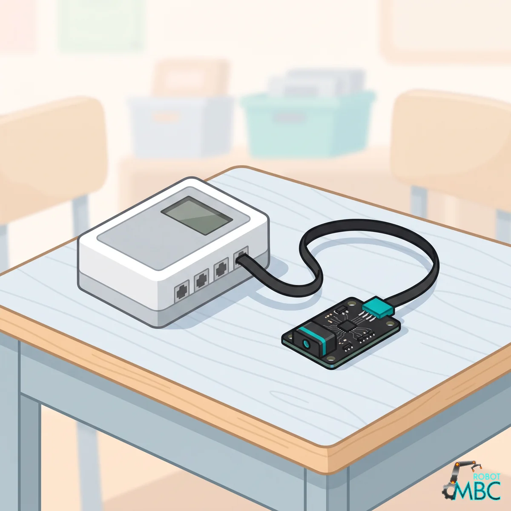
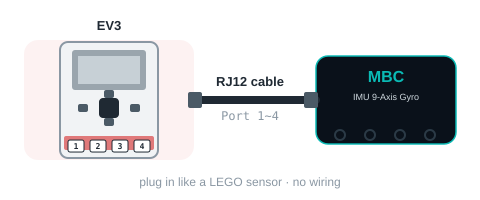

<!-- AI 注意：在此專案的 Markdown 檔案中，直接插入的 HTML 程式碼請勿使用任何縮排，否則會被 Markdown 解析器誤認為程式碼區塊（變成文本視窗）。 -->
<!-- 本頁由 _build/gen-guides.mjs 產生（imu × ev3），請勿手改；改內容請改 _build/guides.json、_build/guides/**、_build/protocol/*.json 後重跑 node _build/gen-guides.mjs -->
<!-- guide: imu/ev3 -->
# IMU 9-Axis Gyro × MINDSTORMS EV3

Using the IMU 9-Axis Gyro with MINDSTORMS EV3: check the edition and the wiring, then pick your software; its page covers that software only.

<figure class="guide-hero"></figure>

## Which edition

Get the **EV3 edition** (RJ12 plug) and plug it into sensor port 1~4. **Power the EV3 on first, then plug the sensor in**, **pushing the plug all the way in, in one go**. If the EV3 detects the wrong device (NXT I2C or Energy Meter) or the numbers freeze, unplug it and plug it back in.

> [!TIP]
> **Tested on the stock EV3 firmware (2026-11-02):** detected as the LEGO gyro sensor, the stock gyro reset block works, all 7 modes read correctly, and 300 mode switches plus continuous reading never dropped the connection. **ev3dev:** supported.

## Wiring

<figure class="ref-fig"></figure>

## ② Pick your software

<!-- sw-grid -->

## More

- [IMU 9-Axis Gyro: overview, specs and calibration](/en/sensors/imu/index.md)
- [Download centre](/en/downloads.md)
