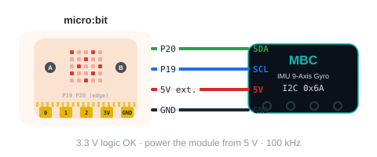
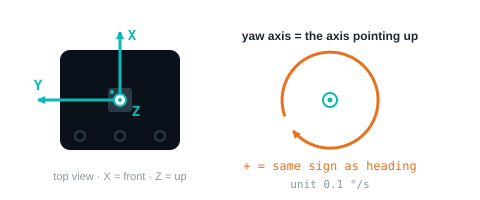
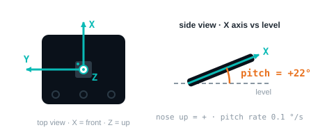
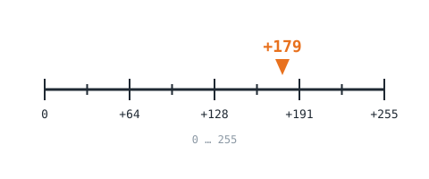
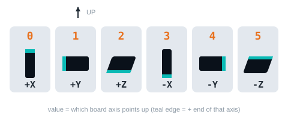
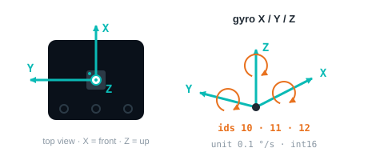
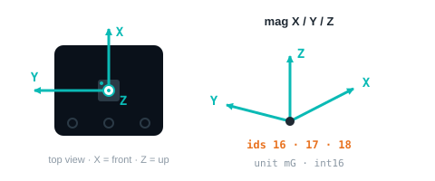

<!-- AI 注意：在此專案的 Markdown 檔案中，直接插入的 HTML 程式碼請勿使用任何縮排，否則會被 Markdown 解析器誤認為程式碼區塊（變成文本視窗）。 -->
<!-- 本頁由 _build/gen-guides.mjs 產生（imu × microbit × makecode），請勿手改；改內容請改 _build/guides.json、_build/guides/**、_build/protocol/*.json 後重跑 node _build/gen-guides.mjs -->
<!-- guide: imu/microbit/makecode -->
# IMU 9-Axis Gyro × micro:bit × MakeCode

This page covers **MakeCode (blocks / JavaScript)** only: how to set it up for the IMU 9-Axis Gyro on BBC micro:bit V1 / V2, how to read every value, the commands it supports and examples. Use the switcher above to change product, host or software.

## Which edition and how to connect

Get the **Universal I2C edition** and connect it to the I2C header of a micro:bit breakout (SDA = P20, SCL = P19), factory address `0x6A`. It draws little current, so VCC can go to the micro:bit **3V** pin (about 90 mA on V1, 190 mA on V2); on batteries the rail can sag below 3 V, so switch to external 5 V if readings are unstable (share GND with the micro:bit).

<figure class="ref-fig"></figure>

## Setup

<!-- setup: _build/guides/software/microbit-makecode.en.md + _build/guides/product/imu/microbit-makecode.en.md {"product":"IMU 9-Axis Gyro","edition":"Universal I2C edition","port":"I2C","lib":"","libUrl":"","addr":"0x6A"} -->
<!-- include-fallback -->
> [!NOTE]
> Setup steps for this software are being moved onto this page. Meanwhile see the previous guide: [IMU 9-Axis Gyro: MakeCode (blocks / JavaScript)](/en/sensors/imu/microbit.md).
<!-- /include-fallback -->

## Reading values

After adding pxt-mbc-sensors, find the blocks in the MBC Sensors category; the JavaScript form is shown too, address `0x6A`.

<section id="v01" class="ref-item">

### gyro 3D heading <small>headingGyro3D</small>

| Range | Meaning |
| :--- | :--- |
| `-32768~32767` ° | heading from the 3D quaternion, degrees, 0 at boot/zero, accumulates past 360 (wraps at ±32767, ~91 turns) |

<pre class="blocks">(IMU heading [gyro 3D v] \(°\) :: #00A4E4)</pre>

```typescript
let headingGyro3D = mbc.imuHeading(MbcImuHeading.Gyro3D)   // gyro 3D heading：-32768~32767 °
```

<p class="ref-note">Returns 0 when the sensor does not answer; check with "device at … is ready" first.</p>

</section>

<section id="v02" class="ref-item">

### fused heading <small>headingFused</small>

| Range | Meaning |
| :--- | :--- |
| `-32768~32767` ° | 3D gyro heading slowly corrected by the magnetometer, degrees, relative to the zero point; may exceed 360 |

<pre class="blocks">(IMU heading [fused v] \(°\) :: #00A4E4)</pre>

```typescript
let headingFused = mbc.imuHeading(MbcImuHeading.Fused)   // fused heading：-32768~32767 °
```

**Related block "on IMU turned by 90 °"**

```typescript
mbc.onImuTurned(90, function () {
})
```

<p class="ref-note">Returns 0 when the sensor does not answer; check with "device at … is ready" first.</p>

</section>

<section id="v03" class="ref-item">

### gyro 1D heading <small>headingGyro1D</small>

| Range | Meaning |
| :--- | :--- |
| `-32768~32767` ° | heading integrated about the yaw axis only, degrees, 0 at boot/zero; may exceed 360 |

<pre class="blocks">(IMU heading [gyro 1D v] \(°\) :: #00A4E4)</pre>

```typescript
let headingGyro1D = mbc.imuHeading(MbcImuHeading.Gyro1D)   // gyro 1D heading：-32768~32767 °
```

<p class="ref-note">Returns 0 when the sensor does not answer; check with "device at … is ready" first.</p>

</section>

<section id="v04" class="ref-item">

### magnetic heading <small>headingMag</small>

| Range | Meaning |
| :--- | :--- |
| `-32768~32767` ° | tilt-compensated magnetometer heading, degrees, relative to the zero point |

<pre class="blocks">(IMU heading [magnetic v] \(°\) :: #00A4E4)</pre>

```typescript
let headingMag = mbc.imuHeading(MbcImuHeading.Magnetic)   // magnetic heading：-32768~32767 °
```

<p class="ref-note">Returns 0 when the sensor does not answer; check with "device at … is ready" first.</p>

</section>

<section id="v05" class="ref-item">

### yaw rate <small>yawRate</small>

<figure class="ref-fig"></figure>

| Range | Meaning |
| :--- | :--- |
| `-32768~32767` 0.1 dps | angular rate about the yaw axis (getYawAxis()), 0.1 deg/s, same sign as the heading |

<pre class="blocks">(IMU turn rate \(0.1 °/s\) :: #00A4E4)</pre>

```typescript
let yawRate = mbc.imuYawRate()   // yaw rate：-32768~32767 0.1 dps
```

**Related block "IMU is [still]"**

```typescript
let imuFlag = mbc.imuFlag(MbcImuFlag.Still)
```

<p class="ref-note">Returns 0 when the sensor does not answer; check with "device at … is ready" first.</p>

</section>

<section id="v06" class="ref-item">

### pitch angle <small>pitch</small>

<figure class="ref-fig"></figure>

| Range | Meaning |
| :--- | :--- |
| `-90~+90` ° | elevation of the board's printed X axis above horizontal: +90 pointing up, −90 pointing down, 0 level (from the gravity vector) |

<pre class="blocks">(IMU pitch \(°\) :: #00A4E4)</pre>

```typescript
let pitch = mbc.imuPitch()   // pitch angle：-90~+90 °
```

<p class="ref-note">Returns 0 when the sensor does not answer; check with "device at … is ready" first.</p>

</section>

<section id="v07" class="ref-item">

### pitch rate <small>pitchRate</small>

<figure class="ref-fig"></figure>

| Range | Meaning |
| :--- | :--- |
| `-32768~32767` 0.1 dps | angular rate about the board's printed X axis, 0.1 °/s (right-hand rule, CCW seen from +X is positive); this is gyro X, not the derivative of 06 |

<pre class="blocks">(IMU pitch rate \(0.1 °/s\) :: #00A4E4)</pre>

```typescript
let pitchRate = mbc.imuPitchRate()   // pitch rate：-32768~32767 0.1 dps
```

<p class="ref-note">Returns 0 when the sensor does not answer; check with "device at … is ready" first.</p>

</section>

<section id="v08" class="ref-item">

### magnetometer trust <small>magTrust</small>

<figure class="ref-fig"></figure>

| Range | Meaning |
| :--- | :--- |
| `0~255` | how much the fusion trusts the magnetometer, 0~255 (= 0~1 × 255) |

<pre class="blocks">(IMU magnetic trust :: #00A4E4)</pre>

```typescript
let magTrust = mbc.imuMagTrust()   // magnetometer trust：0~255
```

<p class="ref-note">Returns 0 when the sensor does not answer; check with "device at … is ready" first.</p>

</section>

<section id="v09" class="ref-item">

### magnetic disturbance <small>magDisturb</small>

<figure class="ref-fig"></figure>

| Range | Meaning |
| :--- | :--- |
| `0~255` 0.01° | magnetic disturbance level 0~255 (degrees × 100, capped at 255) |

<pre class="blocks">(IMU magnetic disturbance :: #00A4E4)</pre>

```typescript
let magDisturb = mbc.imuMagDisturbance()   // magnetic disturbance：0~255 0.01°
```

<p class="ref-note">Returns 0 when the sensor does not answer; check with "device at … is ready" first.</p>

</section>

<section id="v0a" class="ref-item">

### face up <small>upFace</small>

<figure class="ref-fig"></figure>

| Range | Meaning |
| :--- | :--- |
| `0~5` | which axis points up: 0 +X, 1 +Y, 2 +Z, 3 −X, 4 −Y, 5 −Z (physical axes) |

<pre class="blocks">(IMU face up :: #00A4E4)</pre>

```typescript
let upFace = mbc.imuFaceUp()   // face up：0~5
```

**Related block "IMU face up is [+Z]"**

```typescript
let imuFaceUpIs = mbc.imuFaceUpIs(MbcImuFace.PlusZ)
```

<p class="ref-note">Returns 0 when the sensor does not answer; check with "device at … is ready" first.</p>

</section>

<section id="v10" class="ref-item">

### gyro axis 1~3 <small>gyro</small>

<figure class="ref-fig"></figure>

| Range | Meaning |
| :--- | :--- |
| `-32768~32767` 0.1 dps | 10 X, 11 Y, 12 Z angular rate, 0.1 deg/s (physical axes, sign-corrected) |

<pre class="blocks">(IMU [gyro \(0.1 °/s\) v] axis [X v] :: #00A4E4)</pre>

```typescript
let gyro = [mbc.imuAxis(MbcImuSensor.Gyro, MbcAxis.X), mbc.imuAxis(MbcImuSensor.Gyro, MbcAxis.Y), mbc.imuAxis(MbcImuSensor.Gyro, MbcAxis.Z)]   // gyro axis 1~3：-32768~32767 0.1 dps
```

<p class="ref-note">Returns 0 when the sensor does not answer; check with "device at … is ready" first.</p>

</section>

<section id="v13" class="ref-item">

### accel axis 1~3 <small>accel</small>

<figure class="ref-fig"></figure>

| Range | Meaning |
| :--- | :--- |
| `-32768~32767` mg | 13 X, 14 Y, 15 Z acceleration, mg (1000 = 1 g) |

<pre class="blocks">(IMU [accelerometer \(mg\) v] axis [X v] :: #00A4E4)</pre>

```typescript
let accel = [mbc.imuAxis(MbcImuSensor.Accel, MbcAxis.X), mbc.imuAxis(MbcImuSensor.Accel, MbcAxis.Y), mbc.imuAxis(MbcImuSensor.Accel, MbcAxis.Z)]   // accel axis 1~3：-32768~32767 mg
```

<p class="ref-note">Returns 0 when the sensor does not answer; check with "device at … is ready" first.</p>

</section>

<section id="v16" class="ref-item">

### mag axis 1~3 <small>mag</small>

<figure class="ref-fig"></figure>

| Range | Meaning |
| :--- | :--- |
| `-32768~32767` mG | 16 X, 17 Y, 18 Z magnetic field, mG (milligauss) |

<pre class="blocks">(IMU [magnetometer \(mG\) v] axis [X v] :: #00A4E4)</pre>

```typescript
let mag = [mbc.imuAxis(MbcImuSensor.Mag, MbcAxis.X), mbc.imuAxis(MbcImuSensor.Mag, MbcAxis.Y), mbc.imuAxis(MbcImuSensor.Mag, MbcAxis.Z)]   // mag axis 1~3：-32768~32767 mG
```

<p class="ref-note">Returns 0 when the sensor does not answer; check with "device at … is ready" first.</p>

</section>

<section id="v0b" class="ref-item">

### command status <small>cmdStatus</small>

| Range | Meaning |
| :--- | :--- |
| `0~0xEF03` | (last command code << 8) \| state; state 0 done, 1 busy, 2 failed, 3 rejected (same codes as the SPIKE command reply (mode 8 v3)); reported for E1~EB; undefined codes after EB: ignored on I2C, 0B unchanged (SPIKE replies 3 rejected) |

No dedicated block; in JavaScript read it with `mbc.readValue(address, id)` (−32768 when nothing answers).

```typescript
let cmdStatus = mbc.readValue(0x6A, 0x0B)   // command status：0~0xEF03
```

</section>

## Commands

<section id="ce0" class="ref-item ref-cmd">

### zero heading <small>zeroHeading</small>

zero all four headings (zeroHeadings()); EV3 also accepts the stock gyro-reset WRITE 0x11

<pre class="blocks">IMU zero heading :: #00A4E4</pre>

```typescript
mbc.imuZeroHeading()   // zero heading
```

</section>

<section id="ce1" class="ref-item ref-cmd">

### start accelerometer calibration <small>accelCalStart</small>

start accelerometer calibration (= v1 0x20=0x01); F3 b4 = 1 meanwhile; ignored during magnetometer calibration (0B state 3 rejected)

<pre class="blocks">IMU calibration [accelerometer start v] :: #00A4E4</pre>

```typescript
mbc.imuCalibrate(MbcImuCalib.AccelStart)   // start accelerometer calibration
```

</section>

<section id="ce2" class="ref-item ref-cmd">

### end accelerometer calibration <small>accelCalEnd</small>

finish accelerometer calibration and save to EEPROM (= v1 0x20=0x02); on success the mount axis is re-captured and headings are zeroed once the sensor is level and still (not immediately); rejected if not calibrating (0B state 3); failed check → 0B state 2

<pre class="blocks">IMU calibration [accelerometer end v] :: #00A4E4</pre>

```typescript
mbc.imuCalibrate(MbcImuCalib.AccelEnd)   // end accelerometer calibration
```

</section>

<section id="ce3" class="ref-item ref-cmd">

### start magnetometer calibration <small>magCalStart</small>

start magnetometer calibration (= v1 0x20=0x03); F3 b5 = 1 meanwhile; ignored if the magnetometer has failed (0B state 3)

<pre class="blocks">IMU calibration [magnetometer start v] :: #00A4E4</pre>

```typescript
mbc.imuCalibrate(MbcImuCalib.MagStart)   // start magnetometer calibration
```

</section>

<section id="ce4" class="ref-item ref-cmd">

### end magnetometer calibration <small>magCalEnd</small>

finish magnetometer calibration and save to EEPROM (= v1 0x20=0x04); headings zeroed right away on success; rejected if not calibrating (0B state 3); failed check → 0B state 2

<pre class="blocks">IMU calibration [magnetometer end v] :: #00A4E4</pre>

```typescript
mbc.imuCalibrate(MbcImuCalib.MagEnd)   // end magnetometer calibration
```

</section>

<section id="ce5" class="ref-item ref-cmd">

### set heading <small>setHeading</small>

[angle int16 little-endian]: all four headings set to this angle (RAM); rejected while calibrating (0B state 3)

No dedicated block; in JavaScript use `mbc.writeCmd(0x6A, 0xE5, [params])`.

</section>

<section id="ce6" class="ref-item ref-cmd">

### north as zero <small>zeroNorth</small>

gyro heading set to the current magnetic bearing 0~359, then only whole turns are removed (absolute bearing); fusion re-init within ~3 s, timeout = failed; rejected while calibrating (0B state 3)

No dedicated block; in JavaScript use `mbc.writeCmd(0x6A, 0xE6, [params])`.

</section>

<section id="ce7" class="ref-item ref-cmd">

### re-estimate gyro bias <small>gyroBiasReset</small>

re-estimates the gyro bias over ~1.5 s of stillness (3 still windows); moved and not done within 4 s = failed; rejected while calibrating (0B state 3)

No dedicated block; in JavaScript use `mbc.writeCmd(0x6A, 0xE7, [params])`.

</section>

<section id="ce8" class="ref-item ref-cmd">

### re-capture mount axis <small>recaptureAxis</small>

re-detects the mounting orientation (headings zeroed after capture); RAM; rejected while calibrating (0B state 3)

No dedicated block; in JavaScript use `mbc.writeCmd(0x6A, 0xE8, [params])`.

</section>

<section id="ce9" class="ref-item ref-cmd">

### cancel calibration <small>cancelCalib</small>

cancels the running accelerometer / magnetometer calibration without saving (old values restored)

No dedicated block; in JavaScript use `mbc.writeCmd(0x6A, 0xE9, [params])`.

</section>

<section id="cea" class="ref-item ref-cmd">

### heading correction <small>headingCorrection</small>

[uint16 little-endian] actual degrees per turn × 10 (0.1°/turn), 3500~3700; 0 = back to 360.0. Saved to EEPROM 0x60 (written after 3 s, skipped if unchanged), headings zeroed afterwards; missing or out of range → 0B state 2 (SPIKE also 2)

No dedicated block; in JavaScript use `mbc.writeCmd(0x6A, 0xEA, [params])`.

</section>

<section id="ceb" class="ref-item ref-cmd">

### calibration factory reset <small>calibFactoryReset</small>

[A5]: accelerometer, magnetometer calibration and heading correction back to factory values, saved immediately; wrong magic → 0B state 2; rejected while calibrating (3)

No dedicated block; in JavaScript use `mbc.writeCmd(0x6A, 0xEB, [params])`.

</section>

## Examples

<!-- examples: en/sensors/imu/microbit-examples.md host=microbit sw=makecode whole -->

## More questions

- **Cannot find the MBC blocks?** In MakeCode Extensions, paste https://github.com/contactmbcrobot/pxt-mbc-sensors.

Still stuck? [Contact us](/en/contact.md) with your software and a screenshot of the program.

## Downloads

- [MakeCode extension pxt-mbc-sensors (paste this URL in MakeCode Extensions)](https://github.com/contactmbcrobot/pxt-mbc-sensors)
- [Download centre (libraries, firmware, catalogue for every product)](/en/downloads.md)

## Sources

- Host and software list：`_build/guides.json`
- Values and commands：`_build/protocol/imu.json` (single source of truth)
- Setup：`_build/guides/software/microbit-makecode.en.md`、`_build/guides/product/imu/microbit-makecode.en.md`
- Examples：`sensors/imu/microbit-examples.md`
