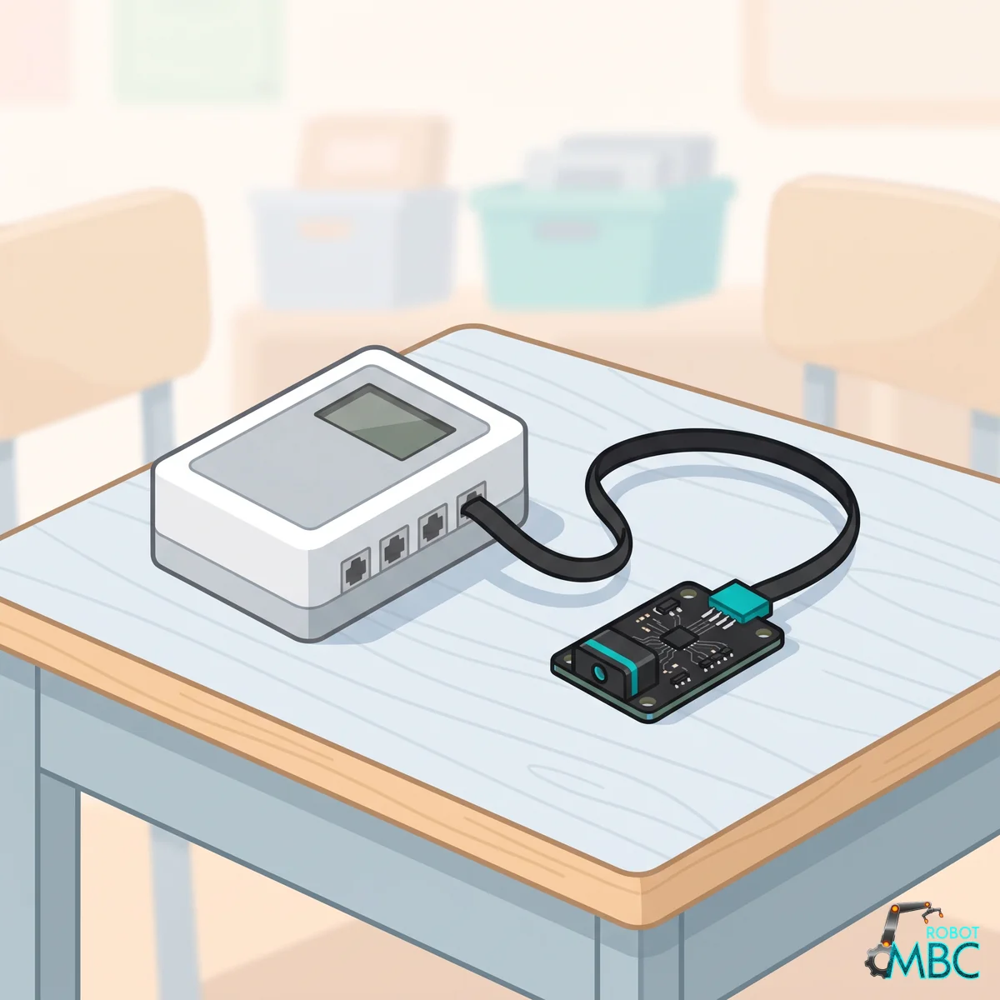
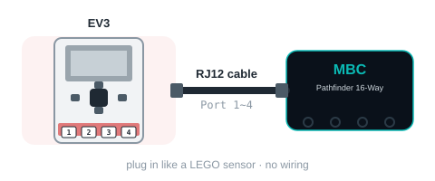

<!-- AI 注意：在此專案的 Markdown 檔案中，直接插入的 HTML 程式碼請勿使用任何縮排，否則會被 Markdown 解析器誤認為程式碼區塊（變成文本視窗）。 -->
<!-- 本頁由 _build/gen-guides.mjs 產生（line16 × ev3），請勿手改；改內容請改 _build/guides.json、_build/guides/**、_build/protocol/*.json 後重跑 node _build/gen-guides.mjs -->
<!-- guide: line16/ev3 -->
# Pathfinder 16-Way (Line16) × MINDSTORMS EV3

Using the Pathfinder 16-Way (Line16) with MINDSTORMS EV3: check the edition and the wiring, then pick your software; its page covers that software only.

<figure class="guide-hero"></figure>

## Which edition

Get the **EV3 edition** (RJ12 plug) and plug it into sensor port 1~4. **Power the EV3 on first, then plug the sensor in**, **pushing the plug all the way in, in one go**; replug if the numbers freeze or the EV3 detects the wrong device.

> [!TIP]
> **Tested on the EV3 (2026-11-03)**: the stock EV3 firmware (EV3-G / EV3 Classroom / clev3r) and Pybricks v4 pass; ev3dev / EV3 MicroPython v2 are supported (same mode table as the LEGO infrared sensor). The EV3 detects it as an **infrared sensor** (type 33).

- **Switching sensor modes on the EV3 takes about 1.1 s** (the same for the LEGO infrared sensor): read one mode only and do not switch modes inside a loop.
- **With no line in view, mode 0 stays at the side where the line was last seen** (negative = left, positive = right), not 0.
- **Mode 3 (bitmap): channel 16 (CH15) reads as a negative number when it is on the line**: apply `& 0xFFFF` before checking the bits.
- **The EV3 edition cannot take commands from the hub** (stock firmware, Pybricks and ev3dev cannot send E0~E9; the format is exactly the same as the LEGO infrared sensor). Instead: **hold the board button while powering up = white-line mode** (not pressed = black line); press the calibration button while running = 5-second dynamic calibration. Left/right swap and thresholds are not available on the EV3 edition; use the SPIKE or I2C edition for those.

## Wiring

<figure class="ref-fig"></figure>

## ② Pick your software

<!-- sw-grid -->

## More

- [Pathfinder 16-Way (Line16): overview, specs and calibration](/en/sensors/line16/index.md)
- [Download centre](/en/downloads.md)
