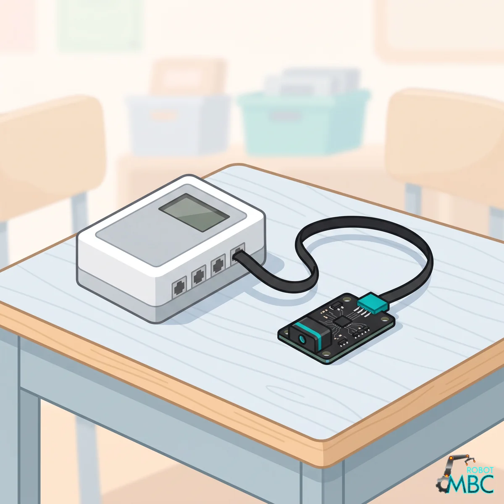
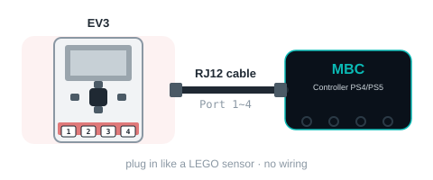

<!-- AI 注意：在此專案的 Markdown 檔案中，直接插入的 HTML 程式碼請勿使用任何縮排，否則會被 Markdown 解析器誤認為程式碼區塊（變成文本視窗）。 -->
<!-- 本頁由 _build/gen-guides.mjs 產生（ps4 × ev3），請勿手改；改內容請改 _build/guides.json、_build/guides/**、_build/protocol/*.json 後重跑 node _build/gen-guides.mjs -->
<!-- guide: ps4/ev3 -->
# Controller PS4/PS5 × MINDSTORMS EV3

Using the Controller PS4/PS5 with MINDSTORMS EV3: check the edition and the wiring, then pick your software; its page covers that software only.

<figure class="guide-hero"></figure>

## Which edition

Get the **EV3 edition** (RJ12 plug) and plug it into sensor port 1~4. **Power the EV3 on first, then plug the sensor in**, **pushing the plug all the way in, in one go**; replug if the numbers freeze or the EV3 detects the wrong device.

> [!NOTE]
> **The EV3 edition cannot take commands from the hub**: it uses exactly the same format as the LEGO infrared sensor, so the EV3 (stock firmware, Pybricks, ev3dev) cannot send MBC commands. To send commands, use SPIKE, Arduino, etc.

## Wiring

<figure class="ref-fig"></figure>

## ② Pick your software

<!-- sw-grid -->

## More

- [Controller PS4/PS5: overview, specs and calibration](/en/sensors/ps4/index.md)
- [Download centre](/en/downloads.md)
