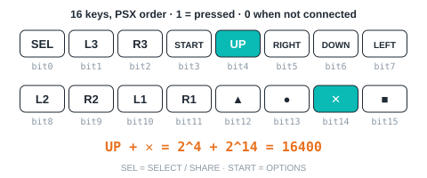
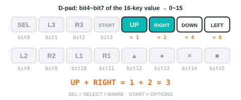
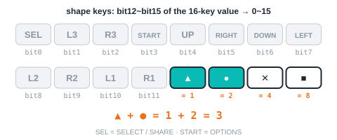
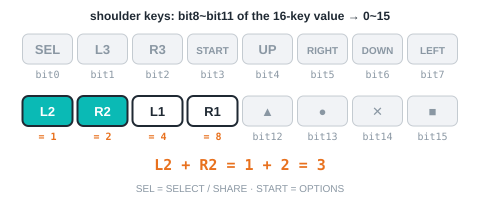
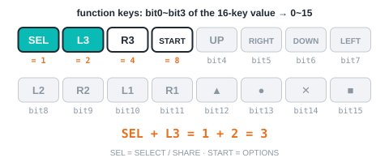
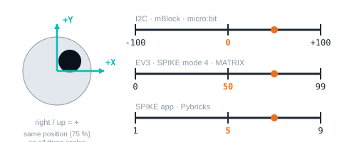

<!-- AI 注意：在此專案的 Markdown 檔案中，直接插入的 HTML 程式碼請勿使用任何縮排，否則會被 Markdown 解析器誤認為程式碼區塊（變成文本視窗）。 -->
<!-- 本頁由 _build/gen-guides.mjs 產生（ps4 × spike × official），請勿手改；改內容請改 _build/guides.json、_build/guides/**、_build/protocol/*.json 後重跑 node _build/gen-guides.mjs -->
<!-- guide: ps4/spike/official -->
# Controller PS4/PS5 × SPIKE × Official LEGO App

This page covers **Official LEGO App (SPIKE 3, Robot Inventor)** only: how to set it up for the Controller PS4/PS5 on SPIKE Prime / Robot Inventor, how to read every value, the commands it supports and examples. Use the switcher above to change product, host or software.

## Setup

<!-- setup: _build/guides/software/spike-official.en.md + _build/guides/product/ps4/spike-official.en.md {"product":"Controller PS4/PS5","edition":"SPIKE edition","port":"C","lib":"MBC_gamepad_Lib.py","libUrl":"/examples/ps4/spike_beginner/pybricks/MBC_gamepad_Lib.py","addr":"0x42"} -->
<!-- include-fallback -->
> [!NOTE]
> Setup steps for this software are being moved onto this page. Meanwhile see the previous guide: [Controller PS4/PS5: Official LEGO App (SPIKE 3, Robot Inventor)](/en/sensors/ps4/spike-examples.md).
<!-- /include-fallback -->

## Reading values

The official app shows the sensor as a Color Sensor. Read it with the color, reflected light and raw red / green / blue blocks under More Sensors, then decode as shown.

<section id="v01" class="ref-item">

### 16 buttons <small>buttons16</small>

<figure class="ref-fig"></figure>

| Range | Meaning |
| :--- | :--- |
| `0~65535` bit | all buttons in one 16-bit word (PSX layout): bit0 SELECT(SHARE), 1 L3, 2 R3, 3 START(OPTIONS), 4 up, 5 right, 6 down, 7 left, 8 L2, 9 R2, 10 L1, 11 R1, 12 triangle, 13 circle, 14 cross, 15 square; 1 = pressed; 0 when not connected |

| Hub | Value | Block (More Sensors → Color Sensor) | Decode |
| :--- | :--- | :--- | :--- |
| SPIKE Prime | 16 buttons | 「raw blue」 | the number it returns (negative while ■ is held: add 65536 first) |

Firmware note: PSX 排列（#65 已改，原本是 Bluepad32 排列）

</section>

<section id="v02" class="ref-item">

### D-pad <small>dpad</small>

<figure class="ref-fig"></figure>

| Range | Meaning |
| :--- | :--- |
| `0~15` bit | up 1, right 2, down 4, left 8, added when pressed together (0~15) |

| Hub | Value | Block (More Sensors → Color Sensor) | Decode |
| :--- | :--- | :--- | :--- |
| SPIKE Prime | D-pad | 「reflected light」 | the number mod 16 |
| Robot Inventor | D-pad | 「reflected light」 | the number mod 16 (negative while ■ is held, ■ alone = −128: add 256 first) |

Firmware note: 低 nibble；高 nibble = 形狀鍵; 低 nibble；高 nibble = 形狀鍵

</section>

<section id="v03" class="ref-item">

### shape buttons <small>shapeKeys</small>

<figure class="ref-fig"></figure>

| Range | Meaning |
| :--- | :--- |
| `0~15` bit | triangle 1, circle 2, cross 4, square 8, added when pressed together (0~15) |

| Hub | Value | Block (More Sensors → Color Sensor) | Decode |
| :--- | :--- | :--- | :--- |
| SPIKE Prime | shape buttons | 「reflected light」 | floor(the number ÷ 16) |
| Robot Inventor | shape buttons | 「reflected light」 | floor(the number ÷ 16) (negative while ■ is held, ■ alone = −128: add 256 first) |

Firmware note: 高 nibble; 高 nibble

</section>

<section id="v04" class="ref-item">

### shoulder buttons <small>shoulderKeys</small>

<figure class="ref-fig"></figure>

| Range | Meaning |
| :--- | :--- |
| `0~15` bit | L2 1, R2 2, L1 4, R1 8, added when pressed together (0~15) |

| Hub | Value | Block (More Sensors → Color Sensor) | Decode |
| :--- | :--- | :--- | :--- |
| SPIKE Prime | shoulder buttons | 「color」 | the number mod 16 (negative while OPTIONS is held, OPTIONS alone = −128: add 256 first) |
| Robot Inventor | shoulder buttons | 「raw blue」 | the number mod 16 |
| Robot Inventor | one-button code | 「color」 | the number = one-button code: L2 1, R2 2, L1 3, R1 4, SHARE 5, L3 6, R3 7, OPTIONS 8, none 0 (with several held, only the smallest code) |

Firmware note: 低 nibble；高 nibble = 功能鍵; 原始藍 = 肩 | 功能<<4（0~255）; 單鍵編號（L2=1 R2=2 L1=3 R1=4 SELECT（SHARE）=5 L3=6 R3=7 START（OPTIONS）=8，沒按 0；同時按只回編號最小的那個）

</section>

<section id="v05" class="ref-item">

### function buttons <small>funcKeys</small>

<figure class="ref-fig"></figure>

| Range | Meaning |
| :--- | :--- |
| `0~15` bit | SELECT(SHARE) 1, L3 2, R3 4, START(OPTIONS) 8, added when pressed together (0~15) |

| Hub | Value | Block (More Sensors → Color Sensor) | Decode |
| :--- | :--- | :--- | :--- |
| SPIKE Prime | function buttons | 「color」 | floor(the number ÷ 16) (negative while OPTIONS is held, OPTIONS alone = −128: add 256 first) |
| Robot Inventor | one-button code | 「color」 | the number = one-button code: L2 1, R2 2, L1 3, R1 4, SHARE 5, L3 6, R3 7, OPTIONS 8, none 0 (with several held, only the smallest code) |
| Robot Inventor | function buttons | 「raw blue」 | floor(the number ÷ 16) |

Firmware note: 高 nibble; 單鍵編號 1~8（掃 功能鍵<<4|肩鍵 的 bit0→7：1 L2 2 R2 3 L1 4 R1 5 SELECT（SHARE） 6 L3 7 R3 8 START（OPTIONS））; 原始藍 = 肩 | 功能<<4（0~255）

</section>

<section id="v10" class="ref-item">

### stick axis 1~4 <small>stick</small>

<figure class="ref-fig"></figure>

| Range | Meaning |
| :--- | :--- |
| `1~9` (5 = centre) | SPIKE gives a scaled value, 1~9 (5 = centre). I2C registers: 10 LX, 11 LY, 12 RX, 13 RY: −100 to +100, 0 = centre, right/up positive; 0 when not connected |

| Hub | Value | Block (More Sensors → Color Sensor) | Decode |
| :--- | :--- | :--- | :--- |
| SPIKE Prime | left stick LX, LY | 「raw red」 | the number = LX×10 + LY: floor(number ÷ 10) = LX, number mod 10 = LY (1~9 each, 5 = centre) |
| SPIKE Prime | right stick RX, RY | 「raw green」 | the number = RX×10 + RY: floor(number ÷ 10) = RX, number mod 10 = RY (1~9 each, 5 = centre) |
| Robot Inventor | left stick LX, LY | 「raw red」 | the number = LX×10 + LY: floor(number ÷ 10) = LX, number mod 10 = LY (1~9 each, 5 = centre) |
| Robot Inventor | right stick RX, RY | 「raw green」 | the number = RX×10 + RY: floor(number ÷ 10) = RX, number mod 10 = RY (1~9 each, 5 = centre) |

Firmware note: LX×10+LY（各 1~9，5 = 中間）；byte 4~5 = RX×10+RY; 原始紅 = LX×10+LY、原始綠 = RX×10+RY（各 1~9，5 = 中間）

</section>

<b>Not readable here</b>：connected, battery, L2 analog, R2 analog, system buttons, gamepad type. Use <a href="/en/sensors/ps4/spike/pybricks.md">Pybricks</a> for these.

## Commands

The SPIKE port is read-only, so this software cannot send commands: calibrate with the button on the sensor and change settings over Arduino I2C, mBlock or micro:bit.

## Examples

<!-- examples: en/sensors/ps4/spike-examples.md host=spike sw=official -->

## More questions

- **The hub does not detect the sensor?** Unplug and replug, wait 2 s, try another port. The official app shows it as a colour sensor — that is expected.
- **Can I use the official app and Pybricks on the same hub?** One firmware at a time: Pybricks and the MBC Blocks website need Pybricks firmware, the official app needs LEGO firmware; you can switch back any time with the SPIKE app.

Still stuck? [Contact us](/en/contact.md) with your software and a screenshot of the program.

## Downloads

- [ps4_demo_robot_inventor_v10.5.0.lms](/examples/ps4/spike/ps4_demo_robot_inventor_v10.5.0.lms)
- [ps4_demo_spike_prime_v3.4.3.llsp3](/examples/ps4/spike/ps4_demo_spike_prime_v3.4.3.llsp3)
- [Download centre (libraries, firmware, catalogue for every product)](/en/downloads.md)

## Sources

- Host and software list：`_build/guides.json`
- Values and commands：`_build/protocol/ps4.json` (single source of truth)
- Setup：`_build/guides/software/spike-official.en.md`、`_build/guides/product/ps4/spike-official.en.md`
- Examples：`sensors/ps4/spike-examples.md`
