<!-- AI 注意：在此專案的 Markdown 檔案中，直接插入的 HTML 程式碼請勿使用任何縮排，否則會被 Markdown 解析器誤認為程式碼區塊（變成文本視窗）。 -->
# Sharpshooter Vision Camera Sensor (In Development)

> [!WARNING]
> **The SPIKE edition is verified on hardware** (2026-11-01, shipping firmware v1.0-261101, see [Reading it on SPIKE](/en/sensors/unicam/spike/index.md)); **the EV3, MATRIX, Arduino, micro:bit and mBlock editions are not yet hardware-verified**: the value layout is final and passes the computer-side tests, but real-hardware numbers (fps, line-following thresholds, I2C pins) may change after bench testing.

> [!TIP]
> **New to it? Try the interactive tutorial first**: no hub needed. Drag blobs, sample points and lines in your browser and watch the code build up. Six ways to write it: Pybricks (SPIKE), EV3, Arduino, mBlock, MATRIX, micro:bit → [Start the tutorial](/en/learn/index.md#unicam)

<!-- product-hero -->

<!-- platform-grid -->
<!-- 神攝手（unicam）還沒進 _build/guides.json 三層導覽（gen-guides 會改寫 reference.md 與範例頁），上面的 platform-grid 目前是空的；主機格子由 _build/gen-unicam.mjs 產生在下面。以後整合進三層導覽時，刪掉 gen:unicam-hosts 這一段。 -->
<!-- gen:unicam-hosts -->

<h2 class="pick-title">① Pick your host</h2>
One page per host: wiring, reading and the smallest working code. The slot-by-slot layout is on the value reference page.

<a class="pick-tile pg-spike" href="/en/sensors/unicam/spike/index.md">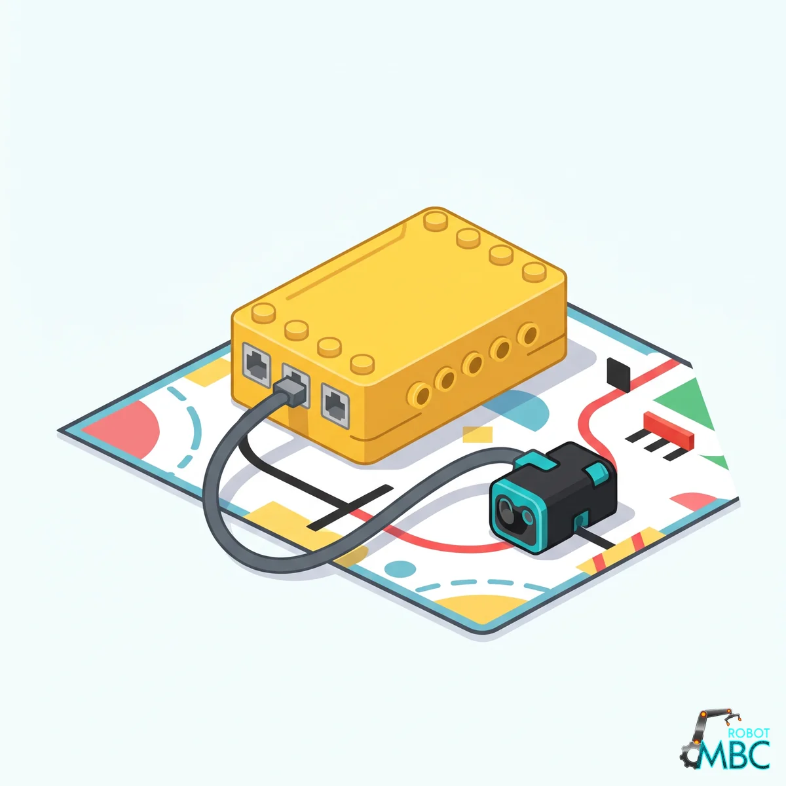SPIKESPIKE Prime (yellow hub) and Robot Inventor (teal hub)Pybricks library · Pybricks blocks · LEGO app</a>
<a class="pick-tile pg-ev3" href="/en/sensors/unicam/ev3/index.md">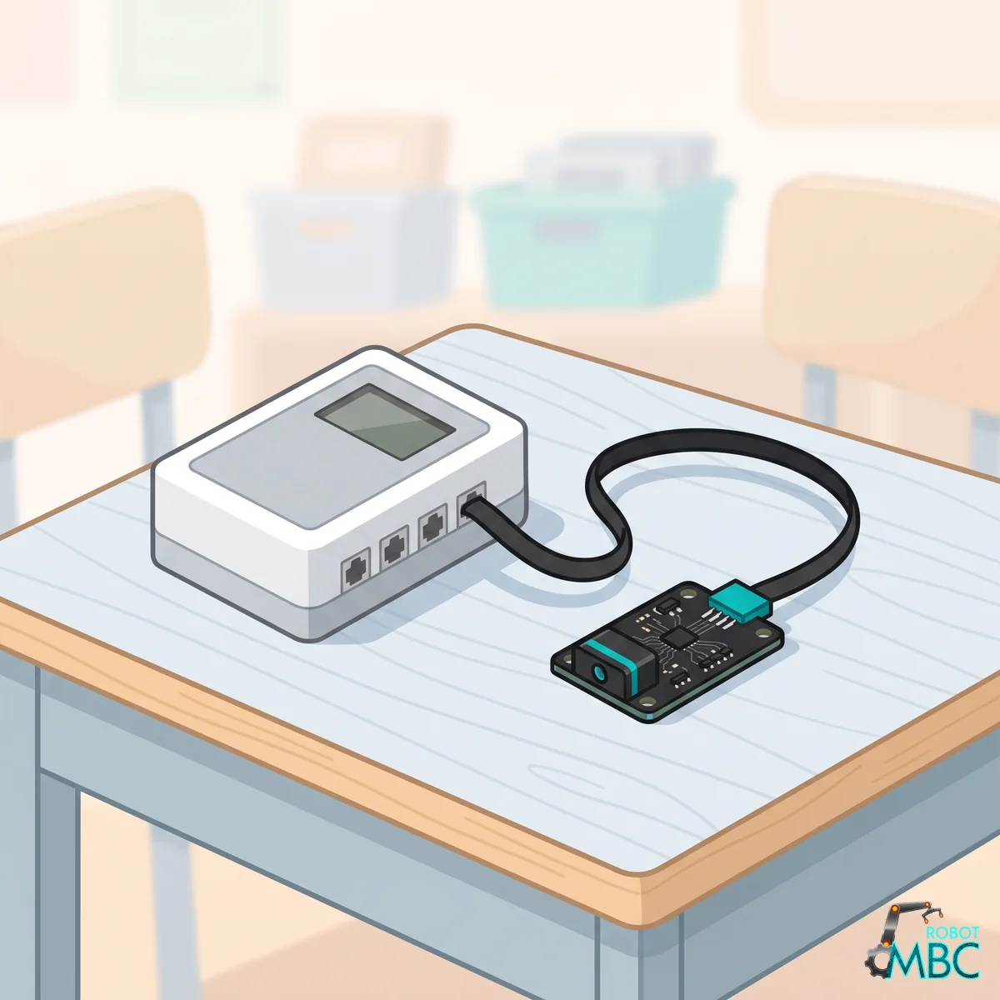EV3MINDSTORMS EV3, shows up as an Infrared SensorEV3-G · EV3 Classroom · EV3 MicroPython</a>
<a class="pick-tile pg-matrix" href="/en/sensors/unicam/matrix/mvision.md">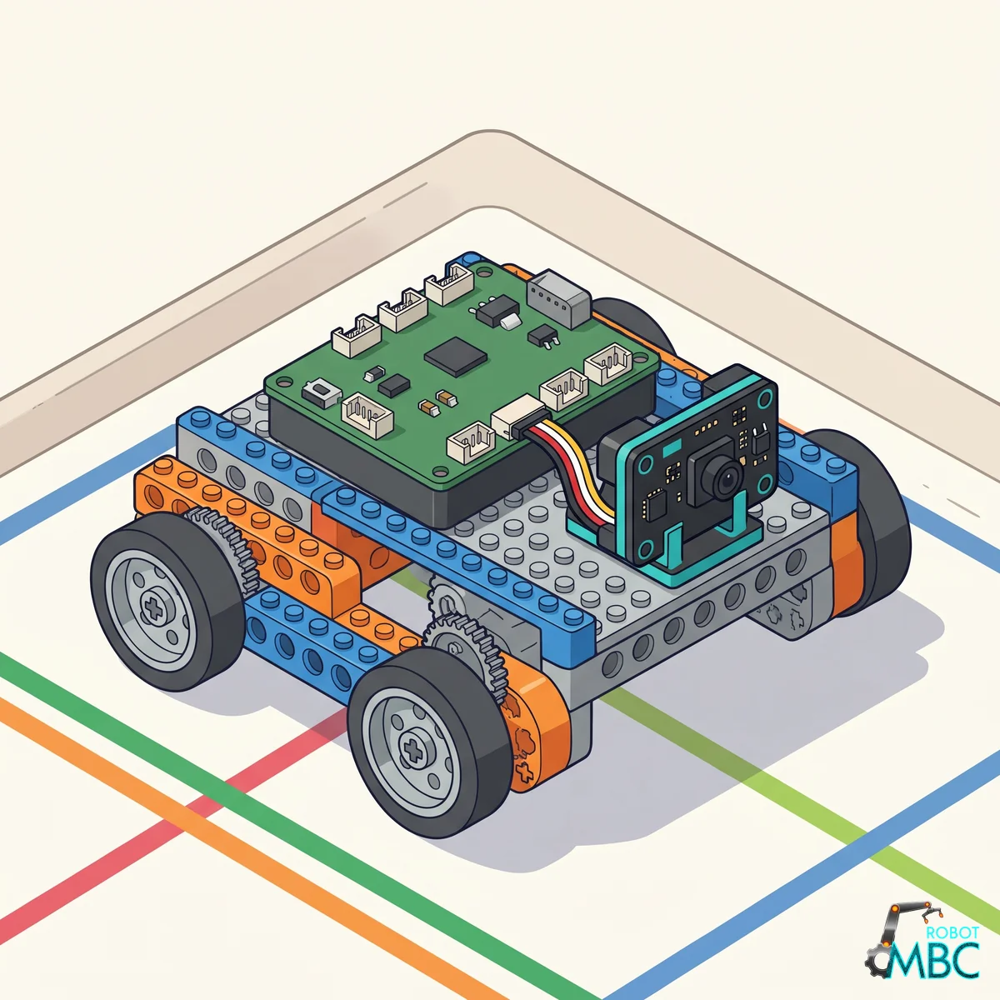MATRIXMATRIX Mini R4, mVision camera blocksmVision blocks</a>
<a class="pick-tile pg-arduino" href="/en/sensors/unicam/arduino/index.md">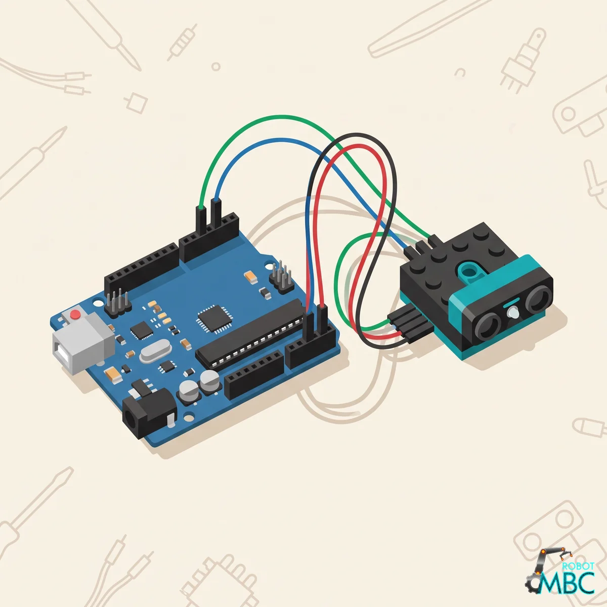ArduinoUNO, Nano, UNO R4, ESP32 over I2C (0x4C)Arduino IDE</a>
<a class="pick-tile pg-microbit" href="/en/sensors/unicam/microbit/index.md">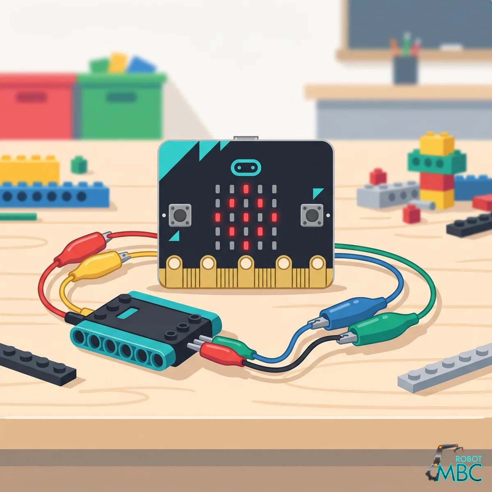micro:bitmicro:bit V1 / V2 over I2C (0x4C)MakeCode</a>
<a class="pick-tile pg-mblock" href="/en/sensors/unicam/mblock/index.md">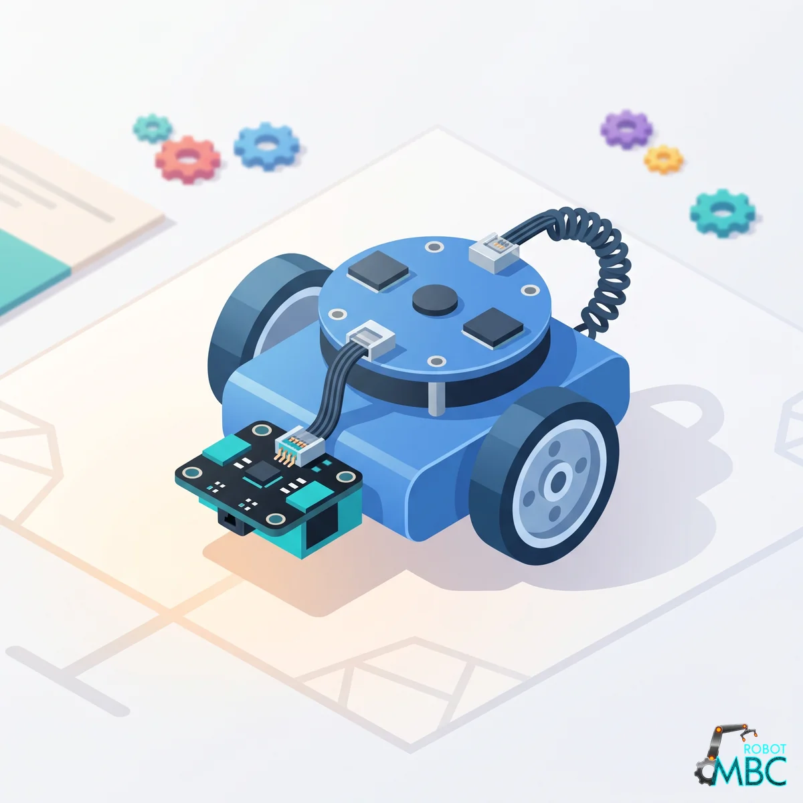mBlockmBot, Ranger, Orion, MegaPi over RJ25 serial 38400mBlock 5 (MBC Pro Sensors extension v2.2.0)</a>

<!-- /gen -->

> **One camera, five jobs: color tracking, color at points, color order, line following and object detection, switched in the camera menu. SPIKE, EV3, MATRIX, Arduino and micro:bit can all read it, and each host gets as much data as it can hold.**

## 📸 The 5 camera modes

Pick a camera mode in the camera's **MODE** menu, then a sub-option. **Sub-option = level**: the finer the level, the more values per target and the fewer targets; the table in the next section shows how many each host gets. Mode number = camera mode × 10 + sub-option (e.g. 13 = Color tracking ③ Standard; Color order = 30; Object detection = 51 / 52).

### 1 Color tracking

Teach colors on the camera first (up to 16). The camera finds the blob of each color and gives its position X, Y, plus width, height, count and area share depending on the level.

<figure class="ref-fig">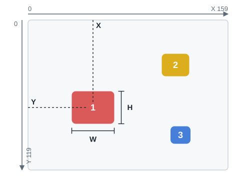</figure>

| Sub-option | What you get | Good for |
| :--- | :--- | :--- |
| ① Max colors | Position only (and count), the most colors | Many colors on the field, you only need where they are |
| ② Multi-color | Fewer colors, more precise position | Several colors with a better position |
| ③ Standard (XY + area) | Position + area (+ count) per color | The common "red, yellow, green, blue blocks" task |
| ④ Fine (XYWH) | Position, width, height, count, area | Few colors, use the size to estimate distance |

### 2 Color at points

A few fixed sample points on the frame (S1, S2 …) each give a hue; higher levels add saturation (how vivid) and value (how bright). Set the points on the camera or move them with I2C command E1. Use it for WRO tasks like "which color is in this slot".

<figure class="ref-fig">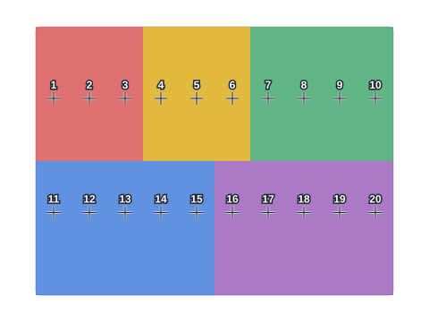</figure>

Default layout: up to 8 points in one row, more than 8 in two rows (20 points above). Each point averages the 3×3 pixels around it.

| Sub-option | Per point |
| :--- | :--- |
| ① Hue | Hue code |
| ② Hue + saturation | Hue code, saturation (tells light from dark shades) |
| ③ Hue + saturation + value | Hue code, saturation, value (H, S, V) |

### 3 Color order

Blobs in the frame are ordered **left to right** and you get the hue code of each one (the hue code of the color you taught), plus the total number of blocks. Made for WRO sequence tasks. No sub-options.

<figure class="ref-fig">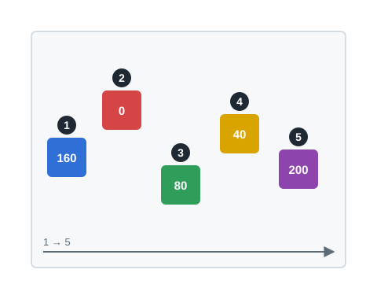</figure>

> [!TIP]
> Red has hue code **0**, the same as "nothing". Read the **total blocks** first to know how many slots are valid.

### 4 Line following

The camera looks ahead at an angle and finds the line on **three scan rows: near, middle and far**. Use the near offset for PID, the far offset and angle to see bends coming, and the junction type tells you cross, T or left / right turn. It also reports colored marker lines it crosses (JBC advanced).

<figure class="ref-fig">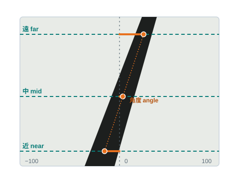</figure>

| Sub-option | Notes |
| :--- | :--- |
| ① Black line | Black line on a white floor, threshold set automatically |
| ② White line | White line on a dark floor |
| ③ Colored line | Aim at the line and press OK to pick its color (line color = target color 1) |

Line-following values: near / middle / far offset (−100~100, negative = line on the left), line angle (−90~90), near and far line width %, line-found flags (near 1 + middle 2 + far 4), junction type (0 none, 1 cross, 2 T, 3 left, 4 right, 5 dead end) and junction distance %, near line left / right edge, colored marker line number and count, side the line was last lost (0 on the line, 1 left, 2 right). All three line types use the same layout; each host gets the values it can hold.

### 5 Object detection

Color and outline together: the camera finds each blob of target colors 1~8, works out its shape and gives an **object code = color number × 10 + shape** (e.g. 13 = a triangle in color 1, 24 = a square in color 2, 0 = no object) plus its position. Up to 8 objects per frame, **largest first** (object 1 = the biggest).

<figure class="ref-fig">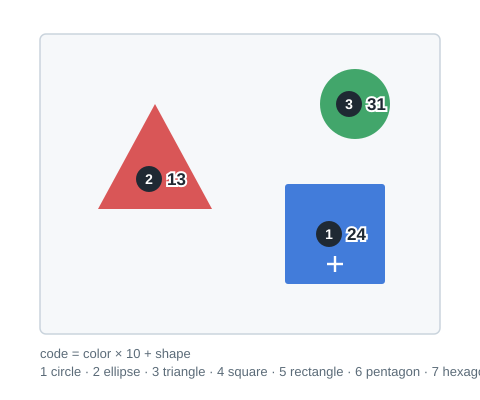</figure>

| Shape number | 0 | 1 | 2 | 3 | 4 | 5 | 6 | 7 | 8 | 9 |
| :--- | :---: | :---: | :---: | :---: | :---: | :---: | :---: | :---: | :---: | :---: |
| Shape | other / unknown | circle | ellipse | triangle | square | rectangle | pentagon | hexagon | star | trapezoid |

| Sub-option | What you get |
| :--- | :--- |
| ① Object list | Code and position of each object, plus the object count; the most objects (I2C 8, SPIKE App 7, EV3 5) |
| ② Object details | Adds width / height, area and angle (which of these fit depends on the host, see the table in the next section; I2C / mBlock get all of them plus vertices and a tracking ID); fewer objects |

- **X, Y are the centroid** (color tracking uses the bounding-box centre, so they differ); width / height = bounding box (1 more than in color tracking).
- **Angle** 0~179° (long side of the minimum bounding rectangle, 0 = pointing right, positive = turning toward the bottom of the frame); EV3 sends "(angle + 1) ÷ 2". **Vertices**: triangle 3, four-sided 4, pentagon 5, hexagon 6, star 10, circle / ellipse 0. **Tracking ID** 1~255: stays the same for the same object across frames.
- Only **target colors 1~8** count (so the code stays two digits); colors 9~16 are still tracked in color tracking, just not treated as objects.
- After teaching target 1~8 the camera asks `Target N shape`, so you can tell it which shape to look for in that color (Any = no preference); SET menu item 14 **ShapeTol 1~5** sets how loose the shape check is (default 3, larger = looser).

## 📊 Colors per host

The same sub-option carries different amounts of data on each host, and the camera **fills each host to its capacity**: you get as many colors as you taught, minus what does not fit. Click a number for its slot table.

<!-- gen:unicam-counts -->
| Camera mode · sub-option | Pybricks library | SPIKE App | Robot Inventor App | Pybricks blocks | EV3 | MATRIX | I2C |
| :--- | :---: | :---: | :---: | :---: | :---: | :---: | :---: |
| 1 Color tracking ① Max colors | [14 colors](/en/sensors/unicam/reference.md#pyb-11) | [14 colors](/en/sensors/unicam/reference.md#edu-11) | [4 colors](/en/sensors/unicam/reference.md#toy-11) | [2 colors](/en/sensors/unicam/reference.md#pyblk-11) | [12 colors](/en/sensors/unicam/reference.md#ev3-11) | [16 colors](/en/sensors/unicam/reference.md#mx-11) | [16 colors XY](/en/sensors/unicam/reference.md#i2c-11) |
| 1 Color tracking ② Multi-color | [7 colors](/en/sensors/unicam/reference.md#pyb-12) | [7 colors](/en/sensors/unicam/reference.md#edu-12) | [4 colors](/en/sensors/unicam/reference.md#toy-12) | [2 colors](/en/sensors/unicam/reference.md#pyblk-12) | [8 colors](/en/sensors/unicam/reference.md#ev3-12) | [10 colors](/en/sensors/unicam/reference.md#mx-12) | [16 colors XY + count](/en/sensors/unicam/reference.md#i2c-12) |
| 1 Color tracking ③ Standard (XY + area) | [4 colors XY + area](/en/sensors/unicam/reference.md#pyb-13) | [4 colors XY + area](/en/sensors/unicam/reference.md#edu-13) | [4 colors XY + area](/en/sensors/unicam/reference.md#toy-13) | [2 colors XY](/en/sensors/unicam/reference.md#pyblk-13) | [4 colors XY + area](/en/sensors/unicam/reference.md#ev3-13) | [5 colors XY + area](/en/sensors/unicam/reference.md#mx-13) | [16 colors XY + area + count](/en/sensors/unicam/reference.md#i2c-13) |
| 1 Color tracking ④ Fine (XYWH) | [2 colors XYWH](/en/sensors/unicam/reference.md#pyb-14) | [2 colors XYWH](/en/sensors/unicam/reference.md#edu-14) | [2 colors XYWH](/en/sensors/unicam/reference.md#toy-14) | [1 color XYWH](/en/sensors/unicam/reference.md#pyblk-14) | [2 colors XYWH](/en/sensors/unicam/reference.md#ev3-14) | [3 colors XYWH](/en/sensors/unicam/reference.md#mx-14) | [16 colors XYWH + count + area](/en/sensors/unicam/reference.md#i2c-14) |
| 2 Color at points ① Hue | [14 points hue](/en/sensors/unicam/reference.md#pyb-21) | [14 points hue](/en/sensors/unicam/reference.md#edu-21) | [4 points hue](/en/sensors/unicam/reference.md#toy-21) | [2 points hue](/en/sensors/unicam/reference.md#pyblk-21) | [12 points hue](/en/sensors/unicam/reference.md#ev3-21) | [20 points hue](/en/sensors/unicam/reference.md#mx-21) | [16 points hue](/en/sensors/unicam/reference.md#i2c-21) |
| 2 Color at points ② Hue + saturation | [7 points hue + sat](/en/sensors/unicam/reference.md#pyb-22) | [7 points hue + sat](/en/sensors/unicam/reference.md#edu-22) | [2 points hue + sat](/en/sensors/unicam/reference.md#toy-22) | [2 points hue + sat](/en/sensors/unicam/reference.md#pyblk-22) | [4 points hue + sat/value](/en/sensors/unicam/reference.md#ev3-22) | [10 points hue + sat](/en/sensors/unicam/reference.md#mx-22) | [16 points hue + sat](/en/sensors/unicam/reference.md#i2c-22) |
| 2 Color at points ③ Hue + saturation + value | [4 points hue + sat + value](/en/sensors/unicam/reference.md#pyb-23) | [4 points hue + sat + value](/en/sensors/unicam/reference.md#edu-23) | [2 points hue + sat/value](/en/sensors/unicam/reference.md#toy-23) | [1 point(s) raw hue + sat + value](/en/sensors/unicam/reference.md#pyblk-23) | [2 point(s) raw hue + sat + value](/en/sensors/unicam/reference.md#ev3-23) | [6 points hue + sat + value](/en/sensors/unicam/reference.md#mx-23) | [16 points hue + sat + value](/en/sensors/unicam/reference.md#i2c-23) |
| 3 Color order | [13 blocks hue code](/en/sensors/unicam/reference.md#pyb-30) | [13 blocks hue code](/en/sensors/unicam/reference.md#edu-30) | [3 blocks hue code](/en/sensors/unicam/reference.md#toy-30) | [2 blocks hue code](/en/sensors/unicam/reference.md#pyblk-30) | [11 blocks hue code](/en/sensors/unicam/reference.md#ev3-30) | [18 blocks hue code](/en/sensors/unicam/reference.md#mx-30) | [16 blocks hue code](/en/sensors/unicam/reference.md#i2c-30) |
| 4 Line following ①②③ black / white / colored line | [14 values](/en/sensors/unicam/reference.md#pyb-41) | [13 values](/en/sensors/unicam/reference.md#edu-41) | [5 values](/en/sensors/unicam/reference.md#toy-41) | [4 values](/en/sensors/unicam/reference.md#pyblk-41) | [12 values](/en/sensors/unicam/reference.md#ev3-41) | [14 values](/en/sensors/unicam/reference.md#mx-41) | [14 values](/en/sensors/unicam/reference.md#i2c-41) |
| 5 Object detection ① Object list | [4 objects](/en/sensors/unicam/reference.md#pyb-51) | [7 objects](/en/sensors/unicam/reference.md#edu-51) | [2 objects](/en/sensors/unicam/reference.md#toy-51) | [1 object](/en/sensors/unicam/reference.md#pyblk-51) | [5 objects](/en/sensors/unicam/reference.md#ev3-51) | [4 objects](/en/sensors/unicam/reference.md#mx-51) | [8 objects: color, shape, XY](/en/sensors/unicam/reference.md#i2c-51) |
| 5 Object detection ② Object details | [2 objects + size, area](/en/sensors/unicam/reference.md#pyb-52) | [2 objects + size, area, angle](/en/sensors/unicam/reference.md#edu-52) | [1 object + area](/en/sensors/unicam/reference.md#toy-52) | [1 object + area](/en/sensors/unicam/reference.md#pyblk-52) | [2 objects + area, angle](/en/sensors/unicam/reference.md#ev3-52) | [3 objects + size, area](/en/sensors/unicam/reference.md#mx-52) | [8 objects + size, area, angle](/en/sensors/unicam/reference.md#i2c-52) |
<!-- /gen -->

- Full slot-by-slot layout (what is in each slot, range, how to split): [Value reference](/en/sensors/unicam/reference.md).
- One firmware edition per host: **SPIKE edition** (official app and Pybricks detected automatically), **EV3 edition**, **MATRIX edition**, **Universal I2C edition** (Arduino, micro:bit), **mBlock edition** (mBot etc.).

## 🎛️ On the camera

The back of the camera has a 1.8" color screen and 4 buttons; everything is set on the camera, no computer needed.

1. **Live view**: left / right cycles target 1 … target N → **MENU**. N = the last taught color + 1 empty slot (up to 16). In camera mode 2 (color at points) it cycles sample points S1 … Sn → MENU instead (n = the last point set + 1 empty slot).
2. **OK on a target: teach a color** (AxisX → AxisY → OK to pick; hold OK for 0.8 s to finish at once; then adjust Hue / Sta / Size / Locked · MaxArea). **Side button** on a target: clear it (with its assigned shape). In object detection, teaching target 1~8 is followed by a `Target N shape` prompt.
   Camera mode 2: OK on a sample point = **set its position** (like teaching a color: AxisX → OK → AxisY → OK saves; side button = don't save); side button on a sample point = clear it. **Points that are not set are not drawn and send H S V 0 to the host** (like an untaught target); the positions are the same ones the host changes with command E1.
3. **OK on MENU**: 3×2 cards (Track = color tracking, Spot = color at points, Order = color order, Line = line following, Object = object detection, Setup = camera settings; green text + green dot = mode in use). Left / right picks a card → OK → pick a sub-option → OK. The selected sub-option expands: `max N` on the right = **how many the current host receives at once** (e.g. color tracking 1-3 shows "max 4" on the SPIKE official app, Education edition), yellow text = which values, then what it is for. On SPIKE the camera works out from the mode the hub last read whether it is the official app (Education / home edition), Pybricks blocks or the Pybricks library; before the hub has read the camera no number is shown. On SPIKE the numbers are fixed **at the moment you enter the menu**: go back to the live view, let the hub's program start reading the camera, then open the menu; while you stay in the menu they do not change. Modes with one sub-option skip that step. In menus the side button goes back one level.
4. **Setup card**: camera menu (brightness, contrast, saturation, white balance, white calibration, self-test, defaults); side button saves and returns to the cards, EXIT returns to the live view. Item 14 ShapeTol 1~5 is the shape tolerance for object detection.
5. **Screen**: top left is the host name (green = connected, red = disconnected); the top shows "Mode mode-sub-option" (e.g. Mode 1-3) and top right the target number (from 1, the same color number the host receives); the bottom bar shows, per mode: color tracking = X Y W H count of the current target, color at points = H S V of the selected point (`--` if not set), color order = number of blocks, line following = near / far offset, angle, junction type, object detection = object count + code and position of the largest. Color at points draws the crosses and numbers of the points that are set (the selected one in cyan), color order labels the blocks, line following draws the three scan rows and the line it found, object detection outlines each object with its "color shape" label (a ? when it touches the frame edge).
6. **Kept after power-off**: target colors (16), camera settings, camera mode and each mode's sub-option, sample-point positions (set on the camera or with host command E1), shape tolerance, shapes assigned to targets 1~8. The first time this generation's firmware is flashed everything resets to defaults (Color tracking ③ Standard).

**Screen mock-ups** (redrawn from the firmware, matching the real screen; the camera image is illustrative. The `max N` numbers are for the SPIKE official app, Education edition; other hosts show different numbers):

<figure><a href="/images/sensors/unicam/ui/01-boot.webp" target="_blank" rel="noopener">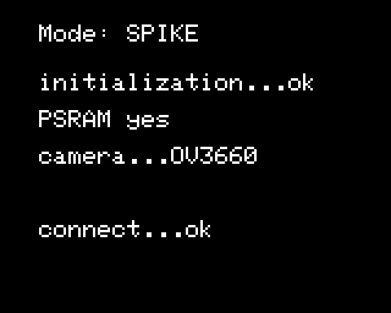</a><figcaption>Boot screen: host edition and camera model; SPIKE / EV3 editions wait for the hub before starting the camera</figcaption></figure>
<figure><a href="/images/sensors/unicam/ui/02-live-track.webp" target="_blank" rel="noopener">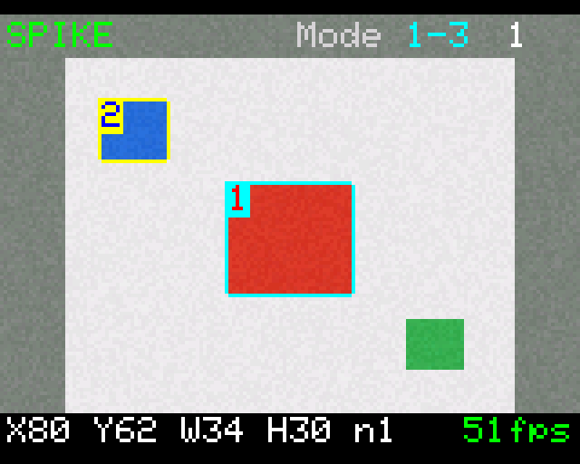</a><figcaption>Live view (mode 1 color tracking): host top left, Mode 1-3 at the top, target number top right; X Y W H count at the bottom</figcaption></figure>
<figure><a href="/images/sensors/unicam/ui/03-live-menu.webp" target="_blank" rel="noopener">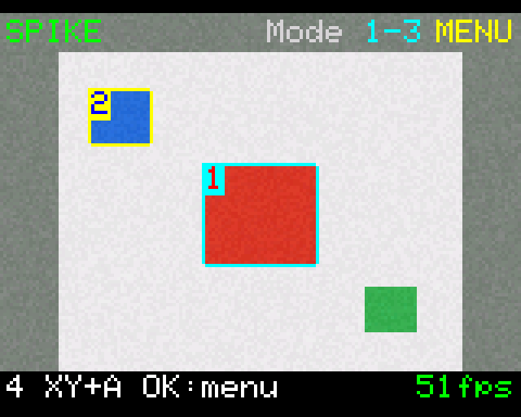</a><figcaption>Stopped on MENU: yellow MENU top right, press OK to open the menu</figcaption></figure>
<figure><a href="/images/sensors/unicam/ui/04-menu-cards.webp" target="_blank" rel="noopener">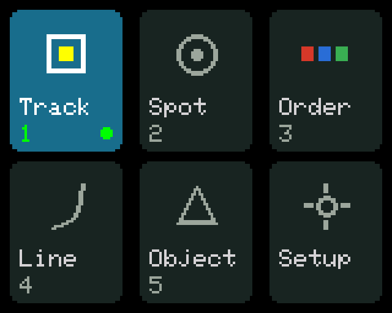</a><figcaption>MENU cards: 5 camera modes + Setup; green number and dot = mode in use</figcaption></figure>
<figure><a href="/images/sensors/unicam/ui/05-sub-track.webp" target="_blank" rel="noopener">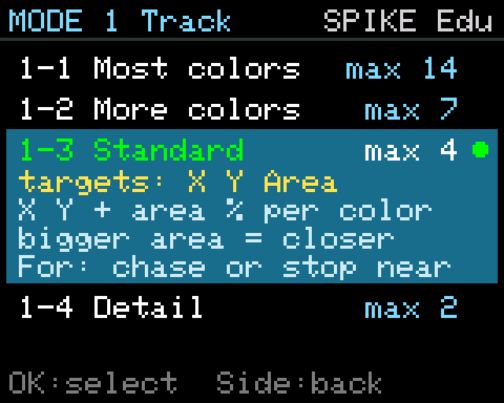</a><figcaption>Sub-modes (color tracking): max N = how many this host receives at once; yellow = which values</figcaption></figure>
<figure><a href="/images/sensors/unicam/ui/06-sub-spot.webp" target="_blank" rel="noopener">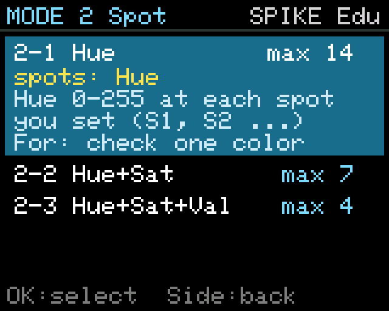</a><figcaption>Sub-modes (color at points): hue / hue + saturation / hue + saturation + value</figcaption></figure>
<figure><a href="/images/sensors/unicam/ui/07-sub-line.webp" target="_blank" rel="noopener">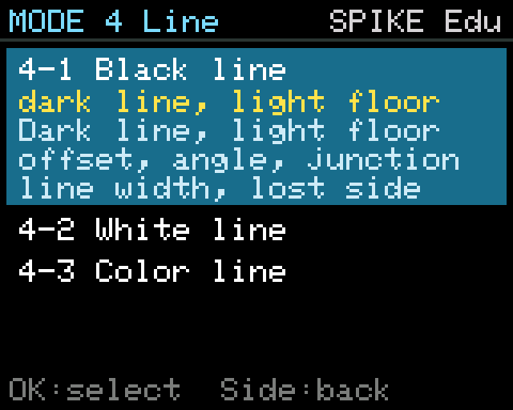</a><figcaption>Sub-modes (line following): black line, white line, color line (color line = target color 1)</figcaption></figure>
<figure><a href="/images/sensors/unicam/ui/08-sub-object.webp" target="_blank" rel="noopener">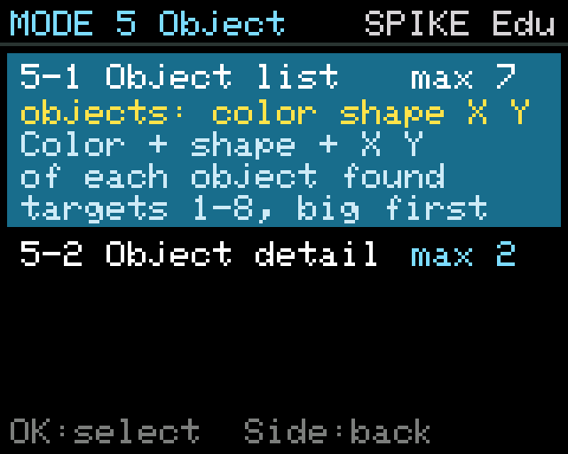</a><figcaption>Sub-modes (object detection): object list or object detail</figcaption></figure>
<figure><a href="/images/sensors/unicam/ui/09-setup.webp" target="_blank" rel="noopener">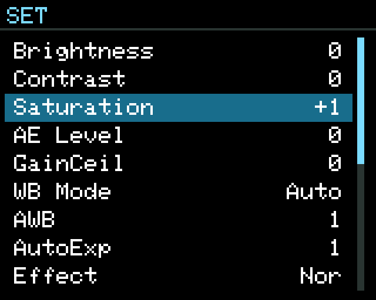</a><figcaption>Setup (camera settings): OK to adjust, side button saves and returns to the cards, EXIT back to live view</figcaption></figure>
<figure><a href="/images/sensors/unicam/ui/10-adjust.webp" target="_blank" rel="noopener">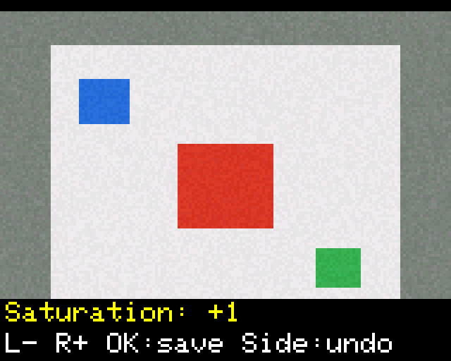</a><figcaption>Adjusting a value: applied live; left minus, right plus, OK saves, side button restores</figcaption></figure>
<figure><a href="/images/sensors/unicam/ui/11-teach-x.webp" target="_blank" rel="noopener">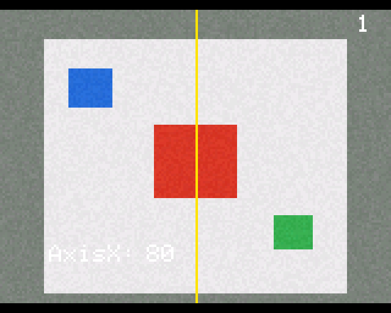</a><figcaption>Teach a color 1: the frame freezes, move the yellow line to pick X → OK</figcaption></figure>
<figure><figcaption>Teach a color 2: move the blue line to pick Y → OK to take the color</figcaption></figure>
<figure><a href="/images/sensors/unicam/ui/13-teach-shape.webp" target="_blank" rel="noopener">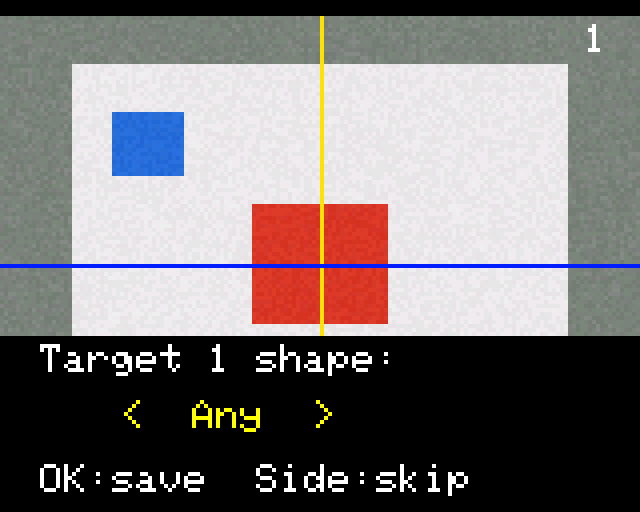</a><figcaption>Object detection: after teaching target 1~8, assign a shape (Any = none)</figcaption></figure>
<figure><a href="/images/sensors/unicam/ui/14-live-spot.webp" target="_blank" rel="noopener">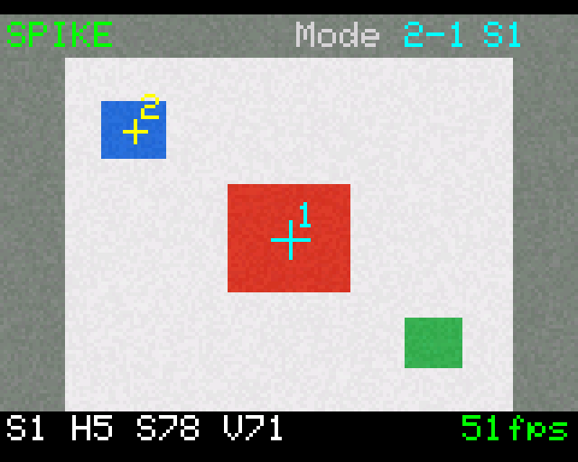</a><figcaption>Live view (mode 2 color at points): the selected point is a large cyan cross; its H S V at the bottom</figcaption></figure>
<figure><a href="/images/sensors/unicam/ui/15-spot-unset.webp" target="_blank" rel="noopener">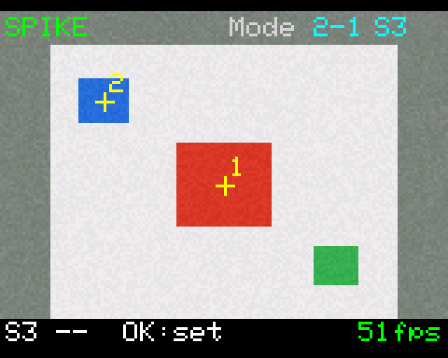</a><figcaption>Sample point not set yet: not drawn, sends 0 to the host; press OK to set it</figcaption></figure>
<figure><a href="/images/sensors/unicam/ui/16-spot-x.webp" target="_blank" rel="noopener">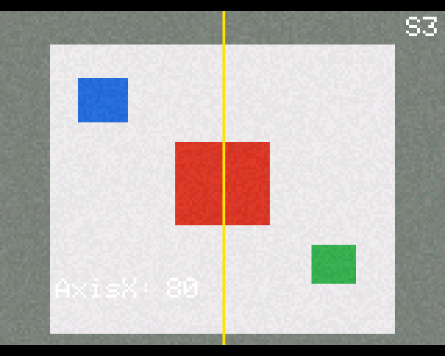</a><figcaption>Set a sample point 1: move the yellow line → OK</figcaption></figure>
<figure><a href="/images/sensors/unicam/ui/17-spot-y.webp" target="_blank" rel="noopener">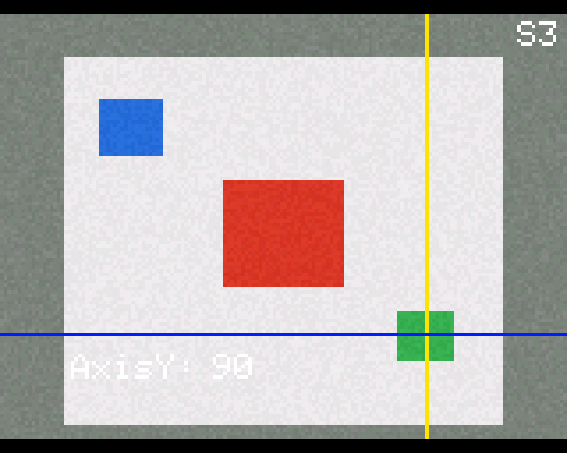</a><figcaption>Set a sample point 2: move the blue line → OK saves; side button = don't save</figcaption></figure>
<figure><a href="/images/sensors/unicam/ui/18-live-line.webp" target="_blank" rel="noopener">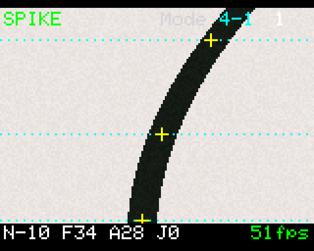</a><figcaption>Live view (mode 4 line following): three scan rows; near offset N, far F, angle A, junction J at the bottom</figcaption></figure>
<figure><a href="/images/sensors/unicam/ui/19-live-object.webp" target="_blank" rel="noopener">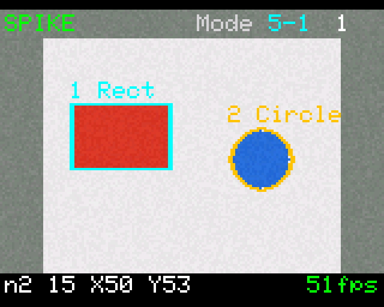</a><figcaption>Live view (mode 5 object detection): outlines + "color shape"; object count and the largest one's code and position at the bottom</figcaption></figure>

> [!NOTE]
> A SPIKE hub cannot read which mode the camera is in, so your program must match the camera setting: pass the mode number when you create the Pybricks library object (e.g. `mode=13`) and the library switches the camera to that mode; the official app cannot send commands, so pick the mode in the camera's MENU first. On EV3 read mode 0; over I2C read `0x01`, or switch from your program with command `E0`.

## 📐 Common value rules

- **Coordinates**: pixel X 0~159 (left → right), Y 0~119 (top → bottom). **0 = no target**; when there is one, X and Y are at least 1.
- **Width, height**: pixels (right − left, bottom − top).
- **Area share**: blob pixels ÷ 19200 × 100, rounded; found but under 1% sends 1.
- **Count**: number of blobs larger than the minimum area (Size).
- **Objects (camera mode 5)**: object code = color number × 10 + shape; X, Y are the centroid, width / height = bounding box + 1, angle 0~179. See "5 Object detection" above.
- **Values that can be negative** (line offsets, angle, edges): EV3, Pybricks library (signed byte) and I2C (int16) send them as they are; SPIKE App, MATRIX and Pybricks blocks send them **+100**, so subtract 100.

### Hue code 0~255

<figure class="ref-fig">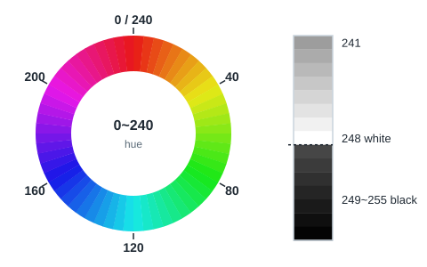</figure>

| Hue code | Color |
| :--- | :--- |
| 0~240 | Hue: red 0 (also 240), yellow 40, green 80, cyan 120, blue 160, purple 200 |
| 241~248 | White → gray (248 = white) |
| 249~255 | Black (255 = darkest) |

A pixel counts as black / white / gray when chroma (max − min) ≤ 24 or saturation ≤ 12%, and as black when its value is < 64. Saturation and value are both 0~100.

- **EV3 hue**: an EV3 slot only holds −127~100, so hue codes 0~240 are sent as "hue code × 100 ÷ 240" (rounded, so 0~100) and 241~255 as negatives −1~−15 (−(hue code − 240)). EV3 color at points ③ sends the raw hue code in two slots instead (hundreds, remainder of ÷100).

### Grids per host (all 4:3)

Hosts with little room shrink pixel coordinates into grid cells:

<figure class="ref-fig">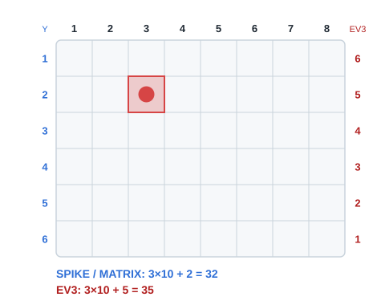</figure>

| Grid | Used by | Conversion |
| :--- | :--- | :--- |
| 16×12 | SPIKE App (Standard, Fine) | X÷10+1, Y÷10+1 |
| 16×12 cell number | Pybricks library, 14 colors (1 byte per color) | (Y÷10)×16 + X÷10 + 1, 1~192; the library splits it back into X, Y |
| 8×6 | Robot Inventor App; "X×10+Y" in the multi-color levels of EV3, SPIKE App and MATRIX | X÷20+1, Y÷20+1 |
| 40×30 | Pybricks built-in blocks | X÷4+1, Y÷4+1 |

On EV3, Y is **small at the bottom**: (119−Y)÷20+1; the SPIKE family follows Kito (small at the top). Width / height: 8×6 is W÷20+1, H÷20+1; 16×12 is W÷10+1, H÷10+1; 40×30 is W÷4, H÷4.

## 🔀 How it differs from the legacy editions (School / WRO)

Sharpshooter Vision units shipped before October 2026 (School and WRO editions) are no longer supported; their guides and examples stay online for reference in [Sharpshooter Vision legacy editions (no longer supported)](/en/sensors/esp32cam/index.md). To upgrade one to the current Sharpshooter Vision, contact the dealer you bought it from and send it back: **the firmware update is free**, and the buyer pays shipping both ways.

| | Legacy: School edition | Legacy: WRO edition (HUE12) | Current Sharpshooter Vision |
| :--- | :--- | :--- | :--- |
| Main features | Pick point + blob tracking + motion | Color code and vividness of 12 spots | Color tracking (up to 16 colors), color at points, color order, line following |
| Switch jobs on the camera | — | — | 5 camera modes + sub-options |
| Hosts | SPIKE, EV3, MATRIX, Arduino and more | SPIKE, EV3, MATRIX | SPIKE, EV3, MATRIX, Arduino, micro:bit, mBlock |
| Status | No longer supported | No longer supported | **Firmware v1: SPIKE edition verified on hardware, other hosts still to be tested** |
| Guide | [Legacy overview](/en/sensors/esp32cam/index.md) | [Legacy overview](/en/sensors/esp32cam/index.md) | This page |

- Programs written for a legacy edition do not run as-is on the current Sharpshooter Vision: the value layout is different, so rewrite them with the host guides on this page.
- To try the current Sharpshooter Vision early, [contact us](/en/contact.md).

## 🧩 Supported hosts

| Host | How it is read | Guide |
| :--- | :--- | :--- |
| SPIKE Prime / Robot Inventor | Pybricks library (modes 9 / 6), Pybricks built-in blocks (modes 5 / 7), official app Education / home edition (mode 0) | [Reading it on SPIKE](/en/sensors/unicam/spike/index.md) |
| SPIKE Essential | Not supported | — |
| EV3 | EV3-G, EV3 Classroom, EV3 MicroPython: Infrared Sensor modes 0 / 1 / 2 | [Reading it on EV3](/en/sensors/unicam/ev3/index.md) |
| MATRIX Mini R4 | MATRIXblock mVision blocks (10 slots) | [Reading it on MATRIX](/en/sensors/unicam/matrix/mvision.md) |
| Arduino / ESP32 / UNO R4 | I2C 0x4C | [Reading it on Arduino](/en/sensors/unicam/arduino/index.md) |
| micro:bit | I2C 0x4C (MakeCode) | [Reading it on micro:bit](/en/sensors/unicam/microbit/index.md) |
| mBlock (mBot, Ranger, Orion, MegaPi) | RJ25 serial 38400, MBC Pro Sensors extension v2.2.0 (in development; download the import file to try it before it is listed) | [Reading it in mBlock](/en/sensors/unicam/mblock/index.md) |

Example programs: [SPIKE](/en/sensors/unicam/spike-examples.md) · [EV3](/en/sensors/unicam/ev3-examples.md) · [Arduino](/en/sensors/unicam/arduino-examples.md) · [micro:bit](/en/sensors/unicam/microbit-examples.md) · [MATRIX](/en/sensors/unicam/matrix-examples.md) · [mBlock](/en/sensors/unicam/mblock-examples.md).

## ⚠️ Known limits, to be tested on hardware

The SPIKE edition is verified on hardware (2026-11-01, shipping firmware v1.0-261101); the firmware for the other hosts has not been run on real hardware yet, and these may change after testing:

1. **fps**: the 16-color lookup and blob labelling do more work than 4 colors; real fps still has to be measured (Kito with 4 colors runs about 50 fps).
2. **I2C pins**: SDA = IO3, SCL = IO1 is provisional; whether the ESP32 can be an I2C target on IO1 / IO3 has to be tested with an Arduino. The **mBlock edition** still has to be tried on an mBot (only the transport layer was tested on a PC).
3. **Line following**: tested on the computer with synthetic frames (straight, offset, slanted, cross / T / left / right / dead end, white line, colored line, marker lines, lost side); on a SPIKE hub the line-following examples ran on white paper with a black line (left / right correction, searching when the line is taken away, stopping at a cross / T). Other fields' lighting and shadows still need more testing.
4. **SPIKE App Python**: on the hub `device.data(port.C)` reads bytes 0~13 of mode 0 (bytes 14~15 cannot be read); the blocks only read the first 8 bytes.
5. **Sample-point positions**: set them on the camera (mode 2, OK on a sample point) or with host command E1; both change the same positions.
6. **Color order** takes up to 32 blocks (hosts actually get 2~18); the engine handles 16 colors, LEGO hosts use up to 14.
7. **Object detection** runs outline analysis on top of 16-color matching, so fps has to be measured again; when a frame cannot be finished in time the camera lowers the frame rate in mode 5 only (down to 25 fps). Shape thresholds come from the hardware-tuned object-detection edition; on the computer shapes are recognised correctly 99% of the time (area above about 310 pixels).
