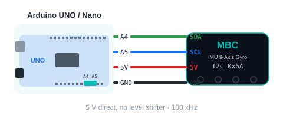

<!-- AI 注意：在此專案的 Markdown 檔案中，直接插入的 HTML 程式碼請勿使用任何縮排，否則會被 Markdown 解析器誤認為程式碼區塊（變成文本視窗）。 -->
<!-- moved: /sensors/imu/arduino/ide.md -->
<p class="moved-note">這頁內容已整合到新的說明頁：<a href="/sensors/imu/arduino/ide.md">陀螺儀 IMU 九軸 › Arduino › Arduino IDE</a></p>

# 🧪 陀螺儀 IMU × Arduino 範例

[🔙 回到陀螺儀 IMU 首頁](/sensors/imu/index.md)　｜　[📡 MBC 通用 I2C 協議 v2（進階）](/i2c-protocol.md)

這一頁有 **12 個範例**，從「確認接好了沒」一路做到「小車原地轉 90 度」「走直線」「轉到指定的方向」、校準和進階命令。每個範例都可以直接複製、上傳，程式裡每一行都有中文說明。**完全沒寫過程式也沒關係**，照順序一個一個做就好。

> [!TIP]
> 第一次用 Arduino？先看 [🔰 第一次用 Arduino：從零開始](/sensors/arduino-start.md)，15 分鐘學會安裝軟體、上傳程式、看結果。

<div style="display: flex; gap: 15px; flex-wrap: wrap; margin: 25px 0;">
<a href="/examples/imu/arduino/imu_arduino_examples.zip" target="_blank" data-ignore="true" download class="btn-download" style="flex: 1; min-width: 220px; text-align: center; background: linear-gradient(135deg, #00d2ff, #007a75); color: #fff; padding: 12px; border-radius: 8px; text-decoration: none; font-weight: bold; font-size: 1rem;">📥 下載全部範例（ZIP）</a>
</div>

---

## 🔌 接線（所有範例都一樣）

| 陀螺儀 | Arduino UNO / Nano | Arduino UNO R4 | ESP32 |
| :---: | :---: | :---: | :---: |
| VCC | 5V | 5V | 3V3 或 5V（VIN） |
| GND | GND | GND | GND |
| SDA | A4 | SDA | GPIO 21 |
| SCL | A5 | SCL | GPIO 22 |

<div style="text-align: center;">

</div>

> [!IMPORTANT]
> - 請用 **通用 I2C 版** 的陀螺儀。SPIKE 版、EV3 版的韌體不同，不能直接接 Arduino。
> - 陀螺儀**開機時要先放著不動約 0.5 秒**，它會自己記住「哪一面朝上」並把航向歸零。
> - 遠離馬達、喇叭、鐵桌：磁力計會被干擾（範例 6 可以看干擾度）。
> - 接線前先拔掉 USB 線。

---

<h2 id="cmds">📖 指令總覽（這個陀螺儀能讀到什麼）</h2>

陀螺儀就像一排有編號的「格子」，每一格放一個數字（int16）。寫 `[編號]` 再讀 2 個 byte 就拿到一個值；連續的編號可以一次讀一串（最多 16 個）。範例裡的 `mbcRead(ADDR, 編號)`、`mbcReadMany(ADDR, 起始編號, 幾個, 陣列)` 就是在做這件事。

<!-- gen:cmd-table -->
| 編號 | 名稱 | 範圍／單位 | 說明 | 出現在 |
| :---: | :--- | :--- | :--- | :--- |
| `01` | 陀螺 3D 航向 | 度 | 用三軸算的航向，開機／歸零 = 0；從上往下看**右轉（順時針）變大**，會一直累加（轉兩圈 = 720），到 ±32767 繞回 | 範例 2、3 |
| `02` | 融合航向 | 度 | 陀螺 3D 再用磁力計慢慢修正，久了不會漂 | 範例 2、3、7 |
| `03` | 陀螺 1D 航向 | 度 | 只用轉向那一軸積分 | 範例 2、3 |
| `04` | 磁力航向 | 度 | 只看磁力計（像指南針，會被鐵器干擾） | 範例 2、3 |
| `05` | 轉向軸角速度 | 0.1 度/秒 | 繞轉向軸轉多快（123 = 12.3 度/秒），正負跟航向同向 | 範例 2、4 |
| `06` | 俯仰角 | 度 | 板子繞絲印 X 軸翹起幾度，平放 = 0 | 範例 2、4 |
| `07` | 俯仰角速度 | 0.1 度/秒 | 俯仰角變化多快 | 範例 2、4 |
| `08` | 磁力信任度 | 0~255 | 融合演算法多相信磁力計，越高越好 | 範例 2、6 |
| `09` | 磁場干擾度 | 0~255 | 附近鐵器、馬達的干擾，越低越好 | 範例 2、6 |
| `0A` | 朝上的面 | 0~5 | 0 +X、1 +Y、2 +Z（平放）、3 −X、4 −Y、5 −Z | 範例 2、6 |
| `0B` | 命令狀態 | — | 最後一個命令碼 × 256 ＋ 狀態（0 完成、1 忙碌、2 失敗、3 拒絕） | 範例 11 |
| `10`~`12` | 角速度 X／Y／Z | 0.1 度/秒 | 實體軸原始值 | 範例 2、5 |
| `13`~`15` | 加速度 X／Y／Z | mg | 1000 = 1 g，平放時 Z 約 1000 | 範例 2、5 |
| `16`~`18` | 磁力 X／Y／Z | mG | 磁場強度（毫高斯） | 範例 2、5 |
| `F0` | 裝置 ID | — | 低 byte = 出廠位址 0x6A、高 byte = 1 | 範例 1 |
| `F1` | 協議版本 | 2 | 這份範例照版本 2 寫 | 範例 1 |
| `F2` | 韌體版本 | 主×100＋次 | 例如 102 = 1.2 | 範例 1 |
| `F3` | 狀態旗標 | bit | b0 就緒、b1 靜止、b2 已擷取安裝軸、b3 安裝過歪、b4 加速度計校準中、b5 磁力計校準中、b6 磁力融合已初始化、b7 磁力自動校準已收斂 | 範例 1、8 |
| `F4` | 快照序號 | — | 每 10 毫秒或收到命令後 +1 | 範例 11 |
| `F5` | 開機秒數 | 0~32767 | 數字變小 = 重開機過 | 範例 1 |
| `E0`（寫） | 航向歸零 | 無參數 | 四個航向都歸零 | 範例 3、7 |
| `E1`／`E2`（寫） | 加速度計校準開始／結束 | 無參數 | 期間 F3 b4 = 1；結束存 EEPROM 並自動歸零航向 | 範例 8 |
| `E3`／`E4`（寫） | 磁力計校準開始／結束 | 無參數 | 期間 F3 b5 = 1；結束存 EEPROM | 範例 8 |
| `E5`（寫） | 航向設成指定角度 | [角度] int16 | 四個航向都設成這個角度；只存 RAM，斷電回 0 | 範例 11 |
| `E6`（寫） | 以磁北為 0 | 無參數 | 融合航向改成目前的磁北方位 0~359；約 3 秒內完成 | 範例 11 |
| `E7`（寫） | 陀螺零點重估 | 無參數 | 放著不動約 1.5 秒，重新估計陀螺零點 | 範例 11 |
| `E8`（寫） | 重抓安裝軸 | 無參數 | 重新判定安裝方向，抓完自動歸零 | — |
| `E9`（寫） | 取消校準 | 無參數 | 取消進行中的加速度計／磁力計校準，不存檔 | — |
| `EA`（寫） | 航向修正係數 | 0、3500~3700 | 轉一圈實際讀到的度數 × 10；0 = 回到 360.0；存 EEPROM | 範例 12 |
| `EB`（寫） | 校準回出廠 | [0xA5] | 加速度計、磁力計校準與航向修正係數都回出廠值 | — |
<!-- /gen -->

> [!NOTE]
> 沒有的編號（例如 `0C`~`0F`）會讀到 `-32768`（範例裡叫 `MBC_NONE`），讀不到陀螺儀也是 `-32768`。完整規格見 [MBC 通用 I2C 協議 v2](/i2c-protocol.md)。

---

## 📋 範例總覽

| # | 範例 | 學會什麼 | 另外要準備 |
| :---: | :--- | :--- | :--- |
| 1 | [跟陀螺儀打招呼](#ex1) | 確認接線正確、讀身分證、F3 的 8 個 bit | 無 |
| 2 | [把所有的值一次印出來](#ex2) | 看懂每個編號放什麼（01~0A、10~18） | 無 |
| 3 | [我轉了幾度？](#ex3) | 四種航向、E0 歸零 | 無 |
| 4 | [轉多快？翹多高？](#ex4) | 角速度、俯仰角 | 一本書（墊高一邊） |
| 5 | [九軸原始值](#ex5) | 角速度／加速度／磁力 XYZ | 一塊磁鐵（選用） |
| 6 | [哪一面朝上？](#ex6) | 朝上的面、磁力信任度／干擾度 | 無 |
| 7 | [小車原地轉 90 度（進階）](#ex7) | 用航向控制轉彎 | 兩輪小車、L298N 馬達驅動板 |
| 8 | [校準加速度計與磁力計](#ex8) | 寫入命令 E1~E4、看 F3 | 無 |
| 9 | [小車走直線（進階）](#ex9) | 用航向修正左右輪速度 | 兩輪小車、L298N 馬達驅動板 |
| 10 | [小車轉到指定的方向（進階）](#ex10) | 轉到絕對角度（跟開機方向比） | 兩輪小車、L298N 馬達驅動板 |
| 11 | [下命令並確認做完了沒（進階）](#ex11) | 命令 E5~E7、看命令狀態 0B | 無 |
| 12 | [航向修正係數（進階）](#ex12) | 量轉一圈讀到幾度、命令 EA 存檔 | 一張有直邊的桌子（或一本書） |

> [!TIP]
> **建議順序：1 → 2 → 3 → 4 → 6 → 5 → 7 → 9 → 10 → 8 → 11 → 12。** 7、9、10 用同一台小車，要另外準備零件；8 只有航向漂得很快時才需要。11、12 是進階命令（新版韌體才有），前面都熟了再做；12 只有轉一圈讀到的不是 360 度時才需要。

---

<h2 id="ex1">1️⃣ 跟陀螺儀打招呼</h2>

**做什麼：** 確認陀螺儀接好了，印出它的「身分證」（出廠位址、協議版本、韌體版本）和狀態旗標 F3 的 8 個 bit。每次接新的陀螺儀，都先跑這一個。

**步驟：**
1. 照上面的表格接好 4 條線，USB 插上電腦。
2. 複製下面的程式，貼到 Arduino IDE，按 **→ 上傳**。
3. 打開序列埠監控窗（右上角放大鏡），速度選 **115200**。

<a href="/examples/imu/arduino/imu_01_hello/imu_01_hello.ino" download data-ignore="true">📄 下載 imu_01_hello.ino</a>

<!-- ino: examples/imu/arduino/imu_01_hello/imu_01_hello.ino -->
```cpp
/*
 * IMU 陀螺儀 × Arduino　範例 1：跟陀螺儀打招呼
 * ------------------------------------------------------------
 * 這個範例會做什麼？
 *   確認陀螺儀有沒有接好。接好了，會印出它的身分證（裝置 ID、協議版本、
 *   韌體版本）和狀態旗標 F3 的 8 個 bit（靜止中？校準中？安裝有沒有歪？）。
 *   每次接新的陀螺儀，都建議先跑這個範例。
 *
 * 你需要：IMU 陀螺儀（通用 I2C 版）、Arduino UNO／Nano／UNO R4 或 ESP32。
 *
 * 接線：
 *   陀螺儀 VCC → 5V      陀螺儀 GND → GND
 *   陀螺儀 SDA → A4      陀螺儀 SCL → A5         （UNO / Nano）
 *   UNO R4 接 SDA / SCL 腳；ESP32 接 GPIO 21 (SDA) / GPIO 22 (SCL)
 *
 * 怎麼看結果：
 *   上傳後，打開「序列埠監控窗」，速度選 115200。
 *
 * 小提醒：
 *   陀螺儀開機時要先放著不動約 0.5 秒，它會自己記住「哪一面朝上」並歸零。
 */

#include <Wire.h>                        // Arduino 內建的 I2C 通訊工具，用來跟陀螺儀講話

const uint8_t ADDR = 0x6A;               // IMU 陀螺儀的「門牌號碼」（I2C 位址）
const int16_t MBC_NONE = -32768;         // 「沒有這個值／讀不到」的代號

// 小幫手的宣告（實作在檔案最下面）；mbcWrite 的參數可以省略
bool mbcWrite(uint8_t addr, uint8_t id, const uint8_t *p = NULL, uint8_t n = 0);

void setup() {
  Serial.begin(115200);                  // 打開跟電腦講話的通道，速度 115200
  mbcBegin();                            // 準備好 I2C 通訊（小幫手在檔案最下面）
  delay(500);                            // 等陀螺儀開機 0.5 秒

  Serial.println(F("=== IMU 陀螺儀：跟陀螺儀打招呼 ==="));

  // 等陀螺儀說「我準備好了」（狀態旗標 F3 的 bit0），最多等 3 秒
  if (!mbcWaitReady(ADDR, 3000)) {
    Serial.println(F("找不到陀螺儀！請檢查："));
    Serial.println(F("  1. SDA 接 A4、SCL 接 A5（ESP32：21 / 22），有沒有接反？"));
    Serial.println(F("  2. VCC 接 5V、GND 接 GND，有沒有插緊？"));
    Serial.println(F("  3. 你的陀螺儀是「通用 I2C 版」嗎？（SPIKE 版、EV3 版不能接 Arduino）"));
    while (true) {}                      // 找不到就停在這裡
  }

  // ---- F0 裝置 ID：低 byte = 出廠位址（0x6A）、高 byte = hw[0]（IMU = 1） ----
  int16_t id = mbcRead(ADDR, 0xF0);
  Serial.print(F("找到了！出廠位址 0x"));
  Serial.print((uint8_t)(id & 0xFF), HEX);
  Serial.print(F("，款式代號 "));
  Serial.println((uint8_t)((id >> 8) & 0xFF));   // IMU = 1

  // ---- F1 協議版本（這份範例是照版本 2 寫的） ----
  Serial.print(F("協議版本："));
  Serial.println(mbcRead(ADDR, 0xF1));

  // ---- F2 韌體版本：主版×100 + 次版（例如 102 = 1.2） ----
  int16_t fw = mbcRead(ADDR, 0xF2);
  Serial.print(F("韌體版本："));
  Serial.print(fw / 100);
  Serial.print('.');
  Serial.println(fw % 100);

  // ---- F3 狀態旗標：8 個 bit，一個 bit 代表一件事 ----
  int16_t st = mbcRead(ADDR, 0xF3);
  Serial.println(F("目前狀態："));
  printFlags(st);

  // ---- F5 開機秒數 ----
  Serial.print(F("開機秒數："));
  Serial.println(mbcRead(ADDR, 0xF5));

  Serial.println(F("接線正確，可以開始玩其他範例了！"));
}

void loop() {
  // 這個範例只要在開機時檢查一次，所以 loop 裡什麼都不做
}

// 把 F3 的 8 個 bit 一行一行印出來
void printFlags(int16_t st) {
  Serial.print(F("  bit0 就緒              ")); Serial.println((st & 0x01) ? F("是") : F("否"));
  Serial.print(F("  bit1 靜止中            ")); Serial.println((st & 0x02) ? F("是") : F("否（正在動）"));
  Serial.print(F("  bit2 已擷取安裝軸      ")); Serial.println((st & 0x04) ? F("是（知道哪面朝上）") : F("否（放著不動等一下）"));
  Serial.print(F("  bit3 安裝過歪          ")); Serial.println((st & 0x08) ? F("是（請放平一點）") : F("否"));
  Serial.print(F("  bit4 加速度計校準中    ")); Serial.println((st & 0x10) ? F("是") : F("否"));
  Serial.print(F("  bit5 磁力計校準中      ")); Serial.println((st & 0x20) ? F("是") : F("否"));
  Serial.print(F("  bit6 磁力融合已初始化  ")); Serial.println((st & 0x40) ? F("是（融合航向可用）") : F("否"));
  Serial.print(F("  bit7 磁力自動校準收斂  ")); Serial.println((st & 0x80) ? F("是") : F("否"));
}

// ============================================================
// 以下是「通訊小幫手」（MBC I2C 協議 v2）：負責跟感應器講話。
// 所有 MBC 範例都一樣，不用改，也不用看懂。
//   讀法：寫 [編號] → 等 2 ms → 讀 2×k 個 byte = 從該編號起連續 k 個 int16（小端）
//   沒有這個編號（空號）時感應器回 -32768（MBC_NONE）
// ============================================================

// 開始 I2C 通訊（setup 裡呼叫一次）
// UNO/Nano：SDA=A4、SCL=A5；UNO R4：SDA/SCL 腳；ESP32：預設 GPIO21(SDA)/22(SCL)
void mbcBegin() {
  Wire.begin();
#if defined(WIRE_HAS_TIMEOUT)
  Wire.setWireTimeout(25000, true);      // 線沒接好時，不會讓 Arduino 當機卡住
#endif
}

// 從位址 addr 的感應器，由編號 id 起連續讀 k 個值（1~16）放進 out。全部讀到回傳 true
bool mbcReadMany(uint8_t addr, uint8_t id, uint8_t k, int16_t *out) {
  if (k < 1) k = 1;
  if (k > 16) k = 16;                    // 一次最多 16 個值（32 byte，Wire 緩衝區上限）
  Wire.beginTransmission(addr);
  Wire.write(id);                        // 告訴感應器：我要從第 id 號開始讀
  if (Wire.endTransmission() != 0) return false;
  delay(2);                              // 等 2 ms 再讀（ESP32 型的產品一定要等）
  uint8_t n = (uint8_t)(2 * k);
  if (Wire.requestFrom(addr, n) != n) return false;
  for (uint8_t i = 0; i < k; i++) {
    uint16_t lo = Wire.read();           // 先來的是低位元組
    uint16_t hi = Wire.read();           // 再來高位元組（小端）
    out[i] = (int16_t)(uint16_t)(lo | (hi << 8));
  }
  return true;
}

// 讀一個值。讀不到（沒接好）回傳 MBC_NONE
int16_t mbcRead(uint8_t addr, uint8_t id) {
  int16_t v;
  return mbcReadMany(addr, id, 1, &v) ? v : MBC_NONE;
}

// 送命令：寫 [id][參數…]。p 指向參數、n = 參數幾個 byte（沒參數就不填）。成功回傳 true
bool mbcWrite(uint8_t addr, uint8_t id, const uint8_t *p, uint8_t n) {
  Wire.beginTransmission(addr);
  Wire.write(id);
  for (uint8_t i = 0; i < n; i++) Wire.write(p[i]);
  return Wire.endTransmission() == 0;
}

// 等感應器準備好（狀態旗標 F3 的 bit0 = 1），最多等 ms 毫秒。準備好了回傳 true
bool mbcWaitReady(uint8_t addr, uint16_t ms) {
  unsigned long start = millis();
  while (millis() - start < ms) {
    int16_t f = mbcRead(addr, 0xF3);
    if (f != MBC_NONE && (f & 1)) return true;
    delay(50);
  }
  return false;
}
```

**你會看到：**

```text
=== IMU 陀螺儀：跟陀螺儀打招呼 ===
找到了！出廠位址 0x6A，款式代號 1
協議版本：2
韌體版本：1.2
目前狀態：
  bit0 就緒              是
  bit1 靜止中            是
  bit2 已擷取安裝軸      是（知道哪面朝上）
  bit3 安裝過歪          否
  bit4 加速度計校準中    否
  bit5 磁力計校準中      否
  bit6 磁力融合已初始化  是（融合航向可用）
  bit7 磁力自動校準收斂  否
開機秒數：2
接線正確，可以開始玩其他範例了！
```

> [!NOTE]
> **「通訊小幫手」是什麼？** 每個範例最下面都有一段一模一樣的程式，負責跟陀螺儀「講話」。你不用改它，也不用看懂。只要記得：
> - `mbcRead(ADDR, 編號)`：讀一個值（讀不到回 `-32768`）
> - `mbcReadMany(ADDR, 起始編號, 幾個, 陣列)`：從某個編號起一次讀一串（最多 16 個，同一瞬間的值）
> - `mbcWrite(ADDR, 命令)`：送命令（例如 `0xE0` 歸零）
> - `mbcWaitReady(ADDR, 毫秒)`：等陀螺儀開機好

---

<h2 id="ex2">2️⃣ 把所有的值一次印出來</h2>

**做什麼：** 每 0.5 秒把值表裡的每一個值都印出來：`01`~`0A` 一次讀 10 個、`10`~`18` 一次讀 9 個。轉一轉、翻一翻，看哪一行在變。

<a href="/examples/imu/arduino/imu_02_all_values/imu_02_all_values.ino" download data-ignore="true">📄 下載 imu_02_all_values.ino</a>

<!-- ino: examples/imu/arduino/imu_02_all_values/imu_02_all_values.ino -->
```cpp
/*
 * IMU 陀螺儀 × Arduino　範例 2：把所有的值一次印出來
 * ------------------------------------------------------------
 * 這個範例會做什麼？
 *   每 0.5 秒把陀螺儀「值表」裡的每一個值都印出來，讓你看懂每個編號放什麼：
 *     01~0A：四種航向、角速度、俯仰角、磁力信任度／干擾度、朝上的面（一次讀 10 個）
 *     10~18：角速度、加速度、磁力各 X/Y/Z（一次讀 9 個）
 *   連續的編號可以「一次讀一串」（mbcReadMany），讀到的是同一瞬間的值。
 *
 * 你需要：IMU 陀螺儀（通用 I2C 版）、Arduino UNO／Nano／UNO R4 或 ESP32。
 *
 * 接線：
 *   陀螺儀 VCC → 5V      陀螺儀 GND → GND
 *   陀螺儀 SDA → A4      陀螺儀 SCL → A5         （UNO / Nano）
 *   UNO R4 接 SDA / SCL 腳；ESP32 接 GPIO 21 (SDA) / GPIO 22 (SCL)
 *
 * 怎麼看結果：
 *   上傳後，打開「序列埠監控窗」，速度選 115200。轉一轉、翻一翻陀螺儀，看哪些數字在變。
 *
 * 小提醒：
 *   陀螺儀開機時要先放著不動約 0.5 秒，它會自己記住「哪一面朝上」並歸零。
 */

#include <Wire.h>                        // Arduino 內建的 I2C 通訊工具

const uint8_t ADDR = 0x6A;               // IMU 陀螺儀的「門牌號碼」（I2C 位址）
const int16_t MBC_NONE = -32768;         // 「沒有這個值／讀不到」的代號

// 小幫手的宣告（實作在檔案最下面）；mbcWrite 的參數可以省略
bool mbcWrite(uint8_t addr, uint8_t id, const uint8_t *p = NULL, uint8_t n = 0);

unsigned long lastPrint = 0;             // 上一次印的時間

void setup() {
  Serial.begin(115200);
  mbcBegin();
  delay(500);
  if (!mbcWaitReady(ADDR, 3000)) {
    Serial.println(F("找不到陀螺儀，請先跑範例 1 檢查接線。"));
    while (true) {}
  }
  Serial.println(F("準備好了！每 0.5 秒印一次所有的值。"));
}

void loop() {
  if (millis() - lastPrint >= 500) {     // 👉 可以改：每 0.5 秒印一次
    lastPrint = millis();

    // ---- 第一段：編號 01~0A，一次讀 10 個值 ----
    int16_t a[10];
    if (!mbcReadMany(ADDR, 0x01, 10, a)) { Serial.println(F("讀不到（第一段）")); return; }
    // ---- 第二段：編號 10~18，一次讀 9 個值 ----
    int16_t r[9];
    if (!mbcReadMany(ADDR, 0x10, 9, r)) { Serial.println(F("讀不到（第二段）")); return; }

    Serial.println(F("------------------------------"));
    Serial.print(F("01 陀螺 3D 航向（度）        ：")); Serial.println(a[0]);
    Serial.print(F("02 融合航向（度）            ：")); Serial.println(a[1]);
    Serial.print(F("03 陀螺 1D 航向（度）        ：")); Serial.println(a[2]);
    Serial.print(F("04 磁力航向（度）            ：")); Serial.println(a[3]);
    Serial.print(F("05 轉向軸角速度（0.1 度/秒） ：")); Serial.println(a[4]);
    Serial.print(F("06 俯仰角（度）              ：")); Serial.println(a[5]);
    Serial.print(F("07 俯仰角速度（0.1 度/秒）   ：")); Serial.println(a[6]);
    Serial.print(F("08 磁力信任度 0~255          ：")); Serial.println(a[7]);
    Serial.print(F("09 磁場干擾度 0~255          ：")); Serial.println(a[8]);
    Serial.print(F("0A 朝上的面 0~5              ：")); Serial.println(a[9]);
    Serial.print(F("10~12 角速度 X/Y/Z（0.1 度/秒）：")); print3(r[0], r[1], r[2]);
    Serial.print(F("13~15 加速度 X/Y/Z（mg）       ：")); print3(r[3], r[4], r[5]);
    Serial.print(F("16~18 磁力 X/Y/Z（mG）         ：")); print3(r[6], r[7], r[8]);
  }
  delay(50);
}

// 三個數字印成一行
void print3(int16_t x, int16_t y, int16_t z) {
  Serial.print(x); Serial.print(F("  ")); Serial.print(y); Serial.print(F("  ")); Serial.println(z);
}

// ============================================================
// 以下是「通訊小幫手」（MBC I2C 協議 v2）：負責跟感應器講話。
// 所有 MBC 範例都一樣，不用改，也不用看懂。
//   讀法：寫 [編號] → 等 2 ms → 讀 2×k 個 byte = 從該編號起連續 k 個 int16（小端）
//   沒有這個編號（空號）時感應器回 -32768（MBC_NONE）
// ============================================================

// 開始 I2C 通訊（setup 裡呼叫一次）
// UNO/Nano：SDA=A4、SCL=A5；UNO R4：SDA/SCL 腳；ESP32：預設 GPIO21(SDA)/22(SCL)
void mbcBegin() {
  Wire.begin();
#if defined(WIRE_HAS_TIMEOUT)
  Wire.setWireTimeout(25000, true);      // 線沒接好時，不會讓 Arduino 當機卡住
#endif
}

// 從位址 addr 的感應器，由編號 id 起連續讀 k 個值（1~16）放進 out。全部讀到回傳 true
bool mbcReadMany(uint8_t addr, uint8_t id, uint8_t k, int16_t *out) {
  if (k < 1) k = 1;
  if (k > 16) k = 16;                    // 一次最多 16 個值（32 byte，Wire 緩衝區上限）
  Wire.beginTransmission(addr);
  Wire.write(id);                        // 告訴感應器：我要從第 id 號開始讀
  if (Wire.endTransmission() != 0) return false;
  delay(2);                              // 等 2 ms 再讀（ESP32 型的產品一定要等）
  uint8_t n = (uint8_t)(2 * k);
  if (Wire.requestFrom(addr, n) != n) return false;
  for (uint8_t i = 0; i < k; i++) {
    uint16_t lo = Wire.read();           // 先來的是低位元組
    uint16_t hi = Wire.read();           // 再來高位元組（小端）
    out[i] = (int16_t)(uint16_t)(lo | (hi << 8));
  }
  return true;
}

// 讀一個值。讀不到（沒接好）回傳 MBC_NONE
int16_t mbcRead(uint8_t addr, uint8_t id) {
  int16_t v;
  return mbcReadMany(addr, id, 1, &v) ? v : MBC_NONE;
}

// 送命令：寫 [id][參數…]。p 指向參數、n = 參數幾個 byte（沒參數就不填）。成功回傳 true
bool mbcWrite(uint8_t addr, uint8_t id, const uint8_t *p, uint8_t n) {
  Wire.beginTransmission(addr);
  Wire.write(id);
  for (uint8_t i = 0; i < n; i++) Wire.write(p[i]);
  return Wire.endTransmission() == 0;
}

// 等感應器準備好（狀態旗標 F3 的 bit0 = 1），最多等 ms 毫秒。準備好了回傳 true
bool mbcWaitReady(uint8_t addr, uint16_t ms) {
  unsigned long start = millis();
  while (millis() - start < ms) {
    int16_t f = mbcRead(addr, 0xF3);
    if (f != MBC_NONE && (f & 1)) return true;
    delay(50);
  }
  return false;
}
```

**你會看到：**（平放不動）

```text
準備好了！每 0.5 秒印一次所有的值。
------------------------------
01 陀螺 3D 航向（度）        ：0
02 融合航向（度）            ：0
03 陀螺 1D 航向（度）        ：0
04 磁力航向（度）            ：1
05 轉向軸角速度（0.1 度/秒） ：0
06 俯仰角（度）              ：0
07 俯仰角速度（0.1 度/秒）   ：0
08 磁力信任度 0~255          ：230
09 磁場干擾度 0~255          ：12
0A 朝上的面 0~5              ：2
10~12 角速度 X/Y/Z（0.1 度/秒）：0  1  0
13~15 加速度 X/Y/Z（mg）       ：3  -5  1002
16~18 磁力 X/Y/Z（mG）         ：210  -95  -380
```

---

<h2 id="ex3">3️⃣ 我轉了幾度？（四種航向）</h2>

**做什麼：** 每 0.1 秒印出四種航向（`01`~`04` 一次讀 4 個）。從上往下看**右轉（順時針）數字變大**，會一直累加，可以變負數。在序列埠監控窗輸入 `z` 再按 Enter，會送命令 `E0` 把四個航向都歸零。

<a href="/examples/imu/arduino/imu_03_heading/imu_03_heading.ino" download data-ignore="true">📄 下載 imu_03_heading.ino</a>

<!-- ino: examples/imu/arduino/imu_03_heading/imu_03_heading.ino -->
```cpp
/*
 * IMU 陀螺儀 × Arduino　範例 3：我轉了幾度？（四種航向）
 * ------------------------------------------------------------
 * 這個範例會做什麼？
 *   每 0.1 秒印出四種航向（編號 01~04，一次讀 4 個）：
 *     01 陀螺 3D 航向：用全部三軸算的，最常用
 *     02 融合航向：陀螺 3D 再用磁力計慢慢修正，久了不會漂
 *     03 陀螺 1D 航向：只用轉向那一軸積分
 *     04 磁力航向：只看磁力計（像指南針，會被鐵器干擾）
 *   從上往下看「順時針」（右轉）數字變大，會一直累加（轉兩圈 = 720），可以變負數。
 *   在序列埠監控窗輸入 z 再按 Enter，會送命令 E0 把四個航向都歸零。
 *
 * 你需要：IMU 陀螺儀（通用 I2C 版）、Arduino UNO／Nano／UNO R4 或 ESP32。
 *
 * 接線：
 *   陀螺儀 VCC → 5V      陀螺儀 GND → GND
 *   陀螺儀 SDA → A4      陀螺儀 SCL → A5         （UNO / Nano）
 *   UNO R4 接 SDA / SCL 腳；ESP32 接 GPIO 21 (SDA) / GPIO 22 (SCL)
 *
 * 怎麼看結果：
 *   上傳後，打開「序列埠監控窗」，速度選 115200。把陀螺儀平放，慢慢轉一圈，看數字。
 *
 * 小提醒：
 *   陀螺儀開機時要先放著不動約 0.5 秒，它會自己記住「哪一面朝上」並歸零。
 *   要 0~359 的話自己換算：((h % 360) + 360) % 360。
 */

#include <Wire.h>                        // Arduino 內建的 I2C 通訊工具

const uint8_t ADDR = 0x6A;               // IMU 陀螺儀的「門牌號碼」（I2C 位址）
const int16_t MBC_NONE = -32768;         // 「沒有這個值／讀不到」的代號

// 小幫手的宣告（實作在檔案最下面）；mbcWrite 的參數可以省略
bool mbcWrite(uint8_t addr, uint8_t id, const uint8_t *p = NULL, uint8_t n = 0);

unsigned long lastPrint = 0;

void setup() {
  Serial.begin(115200);
  mbcBegin();
  delay(500);
  if (!mbcWaitReady(ADDR, 3000)) {
    Serial.println(F("找不到陀螺儀，請先跑範例 1 檢查接線。"));
    while (true) {}
  }
  Serial.println(F("準備好了！轉轉看陀螺儀。輸入 z + Enter 可以歸零。"));
  Serial.println(F("  陀螺3D   融合   陀螺1D   磁力"));
}

void loop() {
  // ---- 1. 電腦有送 z 過來嗎？有就送命令 E0（航向歸零，沒有參數） ----
  if (Serial.available()) {
    char ch = Serial.read();
    if (ch == 'z' || ch == 'Z') {
      mbcWrite(ADDR, 0xE0);              // 命令 E0：四個航向都歸零
      Serial.println(F(">>> 已歸零"));
    }
  }

  // ---- 2. 每 0.1 秒讀編號 01~04 四個航向 ----
  if (millis() - lastPrint >= 100) {     // 👉 可以改：每 0.1 秒印一次
    lastPrint = millis();
    int16_t h[4];
    if (!mbcReadMany(ADDR, 0x01, 4, h)) { Serial.println(F("讀不到陀螺儀")); return; }
    char line[48];
    snprintf(line, sizeof(line), "%7d %7d %7d %7d", h[0], h[1], h[2], h[3]);   // 每個數字佔 7 格，排整齊
    Serial.println(line);
  }
  delay(50);
}

// ============================================================
// 以下是「通訊小幫手」（MBC I2C 協議 v2）：負責跟感應器講話。
// 所有 MBC 範例都一樣，不用改，也不用看懂。
//   讀法：寫 [編號] → 等 2 ms → 讀 2×k 個 byte = 從該編號起連續 k 個 int16（小端）
//   沒有這個編號（空號）時感應器回 -32768（MBC_NONE）
// ============================================================

// 開始 I2C 通訊（setup 裡呼叫一次）
// UNO/Nano：SDA=A4、SCL=A5；UNO R4：SDA/SCL 腳；ESP32：預設 GPIO21(SDA)/22(SCL)
void mbcBegin() {
  Wire.begin();
#if defined(WIRE_HAS_TIMEOUT)
  Wire.setWireTimeout(25000, true);      // 線沒接好時，不會讓 Arduino 當機卡住
#endif
}

// 從位址 addr 的感應器，由編號 id 起連續讀 k 個值（1~16）放進 out。全部讀到回傳 true
bool mbcReadMany(uint8_t addr, uint8_t id, uint8_t k, int16_t *out) {
  if (k < 1) k = 1;
  if (k > 16) k = 16;                    // 一次最多 16 個值（32 byte，Wire 緩衝區上限）
  Wire.beginTransmission(addr);
  Wire.write(id);                        // 告訴感應器：我要從第 id 號開始讀
  if (Wire.endTransmission() != 0) return false;
  delay(2);                              // 等 2 ms 再讀（ESP32 型的產品一定要等）
  uint8_t n = (uint8_t)(2 * k);
  if (Wire.requestFrom(addr, n) != n) return false;
  for (uint8_t i = 0; i < k; i++) {
    uint16_t lo = Wire.read();           // 先來的是低位元組
    uint16_t hi = Wire.read();           // 再來高位元組（小端）
    out[i] = (int16_t)(uint16_t)(lo | (hi << 8));
  }
  return true;
}

// 讀一個值。讀不到（沒接好）回傳 MBC_NONE
int16_t mbcRead(uint8_t addr, uint8_t id) {
  int16_t v;
  return mbcReadMany(addr, id, 1, &v) ? v : MBC_NONE;
}

// 送命令：寫 [id][參數…]。p 指向參數、n = 參數幾個 byte（沒參數就不填）。成功回傳 true
bool mbcWrite(uint8_t addr, uint8_t id, const uint8_t *p, uint8_t n) {
  Wire.beginTransmission(addr);
  Wire.write(id);
  for (uint8_t i = 0; i < n; i++) Wire.write(p[i]);
  return Wire.endTransmission() == 0;
}

// 等感應器準備好（狀態旗標 F3 的 bit0 = 1），最多等 ms 毫秒。準備好了回傳 true
bool mbcWaitReady(uint8_t addr, uint16_t ms) {
  unsigned long start = millis();
  while (millis() - start < ms) {
    int16_t f = mbcRead(addr, 0xF3);
    if (f != MBC_NONE && (f & 1)) return true;
    delay(50);
  }
  return false;
}
```

**你會看到：**（右轉約 90 度，再輸入 z）

```text
準備好了！轉轉看陀螺儀。輸入 z + Enter 可以歸零。
  陀螺3D   融合   陀螺1D   磁力
      0       0       0       1
     45      45      44      47
     90      90      89      93
>>> 已歸零
      0       0       0       0
```

> [!TIP]
> - 平常用 `02` 融合航向就好：轉得快時跟陀螺一樣準，放久了也不會漂。
> - 要 0~359 的話自己換算：`((h % 360) + 360) % 360`。
> - 三種航向都是「相對值」（開機或歸零的方向 = 0），不是指北的羅盤角度；`04` 磁力航向也是減去零點。

---

<h2 id="ex4">4️⃣ 轉多快？翹多高？（角速度與俯仰角）</h2>

**做什麼：** 每 0.2 秒印出 `05` 轉向軸角速度、`06` 俯仰角、`07` 俯仰角速度（一次讀 3 個）。角速度單位是 0.1 度/秒，程式會印成 `12.3` 這種格式；轉超過 30 度/秒會提醒「轉太快」。

<a href="/examples/imu/arduino/imu_04_rate_tilt/imu_04_rate_tilt.ino" download data-ignore="true">📄 下載 imu_04_rate_tilt.ino</a>

<!-- ino: examples/imu/arduino/imu_04_rate_tilt/imu_04_rate_tilt.ino -->
```cpp
/*
 * IMU 陀螺儀 × Arduino　範例 4：轉多快？翹多高？（角速度與俯仰角）
 * ------------------------------------------------------------
 * 這個範例會做什麼？
 *   每 0.2 秒印出編號 05~07（一次讀 3 個）：
 *     05 轉向軸角速度：繞「轉向軸」轉多快，單位 0.1 度/秒（123 = 12.3 度/秒），正負跟航向同向
 *     06 俯仰角：板子繞絲印 X 軸翹起幾度（平放 = 0）
 *     07 俯仰角速度：俯仰角變化多快，單位 0.1 度/秒
 *   轉向軸角速度超過 30 度/秒時會提醒「轉太快」。
 *
 * 你需要：IMU 陀螺儀（通用 I2C 版）、Arduino UNO／Nano／UNO R4 或 ESP32。
 *
 * 接線：
 *   陀螺儀 VCC → 5V      陀螺儀 GND → GND
 *   陀螺儀 SDA → A4      陀螺儀 SCL → A5         （UNO / Nano）
 *   UNO R4 接 SDA / SCL 腳；ESP32 接 GPIO 21 (SDA) / GPIO 22 (SCL)
 *
 * 怎麼看結果：
 *   上傳後，打開「序列埠監控窗」，速度選 115200。原地轉陀螺儀看 05；把一邊翹起來看 06。
 *
 * 小提醒：
 *   陀螺儀開機時要先放著不動約 0.5 秒，它會自己記住「哪一面朝上」並歸零。
 */

#include <Wire.h>                        // Arduino 內建的 I2C 通訊工具

const uint8_t ADDR = 0x6A;               // IMU 陀螺儀的「門牌號碼」（I2C 位址）
const int16_t MBC_NONE = -32768;         // 「沒有這個值／讀不到」的代號

// 小幫手的宣告（實作在檔案最下面）；mbcWrite 的參數可以省略
bool mbcWrite(uint8_t addr, uint8_t id, const uint8_t *p = NULL, uint8_t n = 0);

const int FAST_DPS = 30;                 // 👉 可以改：超過幾度/秒算「轉太快」

unsigned long lastPrint = 0;

void setup() {
  Serial.begin(115200);
  mbcBegin();
  delay(500);
  if (!mbcWaitReady(ADDR, 3000)) {
    Serial.println(F("找不到陀螺儀，請先跑範例 1 檢查接線。"));
    while (true) {}
  }
  Serial.println(F("準備好了！轉轉看、翹翹看。"));
}

void loop() {
  if (millis() - lastPrint >= 200) {     // 👉 可以改：每 0.2 秒印一次
    lastPrint = millis();

    // 一次讀編號 05~07 共 3 個值：[0] 轉向軸角速度 [1] 俯仰角 [2] 俯仰角速度
    int16_t v[3];
    if (!mbcReadMany(ADDR, 0x05, 3, v)) { Serial.println(F("讀不到陀螺儀")); return; }

    Serial.print(F("轉向角速度 "));
    Serial.print(v[0] / 10); Serial.print('.'); Serial.print(abs(v[0] % 10));   // 0.1 度/秒 → 印成 12.3
    Serial.print(F(" 度/秒 | 俯仰角 "));
    Serial.print(v[1]);
    Serial.print(F(" 度 | 俯仰角速度 "));
    Serial.print(v[2] / 10); Serial.print('.'); Serial.print(abs(v[2] % 10));
    Serial.print(F(" 度/秒"));
    if (abs(v[0]) > FAST_DPS * 10) Serial.print(F("   <<< 轉太快！"));
    Serial.println();
  }
  delay(50);
}

// ============================================================
// 以下是「通訊小幫手」（MBC I2C 協議 v2）：負責跟感應器講話。
// 所有 MBC 範例都一樣，不用改，也不用看懂。
//   讀法：寫 [編號] → 等 2 ms → 讀 2×k 個 byte = 從該編號起連續 k 個 int16（小端）
//   沒有這個編號（空號）時感應器回 -32768（MBC_NONE）
// ============================================================

// 開始 I2C 通訊（setup 裡呼叫一次）
// UNO/Nano：SDA=A4、SCL=A5；UNO R4：SDA/SCL 腳；ESP32：預設 GPIO21(SDA)/22(SCL)
void mbcBegin() {
  Wire.begin();
#if defined(WIRE_HAS_TIMEOUT)
  Wire.setWireTimeout(25000, true);      // 線沒接好時，不會讓 Arduino 當機卡住
#endif
}

// 從位址 addr 的感應器，由編號 id 起連續讀 k 個值（1~16）放進 out。全部讀到回傳 true
bool mbcReadMany(uint8_t addr, uint8_t id, uint8_t k, int16_t *out) {
  if (k < 1) k = 1;
  if (k > 16) k = 16;                    // 一次最多 16 個值（32 byte，Wire 緩衝區上限）
  Wire.beginTransmission(addr);
  Wire.write(id);                        // 告訴感應器：我要從第 id 號開始讀
  if (Wire.endTransmission() != 0) return false;
  delay(2);                              // 等 2 ms 再讀（ESP32 型的產品一定要等）
  uint8_t n = (uint8_t)(2 * k);
  if (Wire.requestFrom(addr, n) != n) return false;
  for (uint8_t i = 0; i < k; i++) {
    uint16_t lo = Wire.read();           // 先來的是低位元組
    uint16_t hi = Wire.read();           // 再來高位元組（小端）
    out[i] = (int16_t)(uint16_t)(lo | (hi << 8));
  }
  return true;
}

// 讀一個值。讀不到（沒接好）回傳 MBC_NONE
int16_t mbcRead(uint8_t addr, uint8_t id) {
  int16_t v;
  return mbcReadMany(addr, id, 1, &v) ? v : MBC_NONE;
}

// 送命令：寫 [id][參數…]。p 指向參數、n = 參數幾個 byte（沒參數就不填）。成功回傳 true
bool mbcWrite(uint8_t addr, uint8_t id, const uint8_t *p, uint8_t n) {
  Wire.beginTransmission(addr);
  Wire.write(id);
  for (uint8_t i = 0; i < n; i++) Wire.write(p[i]);
  return Wire.endTransmission() == 0;
}

// 等感應器準備好（狀態旗標 F3 的 bit0 = 1），最多等 ms 毫秒。準備好了回傳 true
bool mbcWaitReady(uint8_t addr, uint16_t ms) {
  unsigned long start = millis();
  while (millis() - start < ms) {
    int16_t f = mbcRead(addr, 0xF3);
    if (f != MBC_NONE && (f & 1)) return true;
    delay(50);
  }
  return false;
}
```

**你會看到：**（平放，然後快速右轉，然後把一邊墊在書上）

```text
準備好了！轉轉看、翹翹看。
轉向角速度 0.0 度/秒 | 俯仰角 0 度 | 俯仰角速度 0.0 度/秒
轉向角速度 85.3 度/秒 | 俯仰角 0 度 | 俯仰角速度 0.2 度/秒   <<< 轉太快！
轉向角速度 0.1 度/秒 | 俯仰角 14 度 | 俯仰角速度 0.0 度/秒
```

---

<h2 id="ex5">5️⃣ 九軸原始值</h2>

**做什麼：** 每 0.2 秒印出 `10`~`18` 的九個原始值（一次讀 9 個）：角速度 XYZ（0.1 度/秒）、加速度 XYZ（mg，1000 = 1 g）、磁力 XYZ（mG）。做自己的演算法時用。

<a href="/examples/imu/arduino/imu_05_raw_9axis/imu_05_raw_9axis.ino" download data-ignore="true">📄 下載 imu_05_raw_9axis.ino</a>

<!-- ino: examples/imu/arduino/imu_05_raw_9axis/imu_05_raw_9axis.ino -->
```cpp
/*
 * IMU 陀螺儀 × Arduino　範例 5：九軸原始值
 * ------------------------------------------------------------
 * 這個範例會做什麼？
 *   每 0.2 秒印出編號 10~18 的九個原始值（一次讀 9 個）：
 *     10~12 角速度 X/Y/Z，單位 0.1 度/秒
 *     13~15 加速度 X/Y/Z，單位 mg（1000 = 1 g，平放時 Z 約 1000）
 *     16~18 磁力 X/Y/Z，單位 mG（毫高斯）
 *   這些是「實體軸」的值（板子絲印的 X、Y、Z），做自己的演算法時用。
 *
 * 你需要：IMU 陀螺儀（通用 I2C 版）、Arduino UNO／Nano／UNO R4 或 ESP32。
 *
 * 接線：
 *   陀螺儀 VCC → 5V      陀螺儀 GND → GND
 *   陀螺儀 SDA → A4      陀螺儀 SCL → A5         （UNO / Nano）
 *   UNO R4 接 SDA / SCL 腳；ESP32 接 GPIO 21 (SDA) / GPIO 22 (SCL)
 *
 * 怎麼看結果：
 *   上傳後，打開「序列埠監控窗」，速度選 115200。平放時加速度 Z 約 1000、X/Y 約 0；拿磁鐵靠近看磁力變化。
 *
 * 小提醒：
 *   陀螺儀開機時要先放著不動約 0.5 秒，它會自己記住「哪一面朝上」並歸零。
 */

#include <Wire.h>                        // Arduino 內建的 I2C 通訊工具

const uint8_t ADDR = 0x6A;               // IMU 陀螺儀的「門牌號碼」（I2C 位址）
const int16_t MBC_NONE = -32768;         // 「沒有這個值／讀不到」的代號

// 小幫手的宣告（實作在檔案最下面）；mbcWrite 的參數可以省略
bool mbcWrite(uint8_t addr, uint8_t id, const uint8_t *p = NULL, uint8_t n = 0);

unsigned long lastPrint = 0;

void setup() {
  Serial.begin(115200);
  mbcBegin();
  delay(500);
  if (!mbcWaitReady(ADDR, 3000)) {
    Serial.println(F("找不到陀螺儀，請先跑範例 1 檢查接線。"));
    while (true) {}
  }
  Serial.println(F("準備好了！"));
  Serial.println(F("角速度 X/Y/Z(0.1度/秒) | 加速度 X/Y/Z(mg) | 磁力 X/Y/Z(mG)"));
}

void loop() {
  if (millis() - lastPrint >= 200) {     // 👉 可以改：每 0.2 秒印一次
    lastPrint = millis();

    // 一次讀編號 10~18 共 9 個值：[0..2] 角速度 [3..5] 加速度 [6..8] 磁力
    int16_t r[9];
    if (!mbcReadMany(ADDR, 0x10, 9, r)) { Serial.println(F("讀不到陀螺儀")); return; }

    char line[96];
    snprintf(line, sizeof(line), "%6d %6d %6d | %6d %6d %6d | %6d %6d %6d",
             r[0], r[1], r[2], r[3], r[4], r[5], r[6], r[7], r[8]);   // 每個數字佔 6 格
    Serial.println(line);
  }
  delay(50);
}

// ============================================================
// 以下是「通訊小幫手」（MBC I2C 協議 v2）：負責跟感應器講話。
// 所有 MBC 範例都一樣，不用改，也不用看懂。
//   讀法：寫 [編號] → 等 2 ms → 讀 2×k 個 byte = 從該編號起連續 k 個 int16（小端）
//   沒有這個編號（空號）時感應器回 -32768（MBC_NONE）
// ============================================================

// 開始 I2C 通訊（setup 裡呼叫一次）
// UNO/Nano：SDA=A4、SCL=A5；UNO R4：SDA/SCL 腳；ESP32：預設 GPIO21(SDA)/22(SCL)
void mbcBegin() {
  Wire.begin();
#if defined(WIRE_HAS_TIMEOUT)
  Wire.setWireTimeout(25000, true);      // 線沒接好時，不會讓 Arduino 當機卡住
#endif
}

// 從位址 addr 的感應器，由編號 id 起連續讀 k 個值（1~16）放進 out。全部讀到回傳 true
bool mbcReadMany(uint8_t addr, uint8_t id, uint8_t k, int16_t *out) {
  if (k < 1) k = 1;
  if (k > 16) k = 16;                    // 一次最多 16 個值（32 byte，Wire 緩衝區上限）
  Wire.beginTransmission(addr);
  Wire.write(id);                        // 告訴感應器：我要從第 id 號開始讀
  if (Wire.endTransmission() != 0) return false;
  delay(2);                              // 等 2 ms 再讀（ESP32 型的產品一定要等）
  uint8_t n = (uint8_t)(2 * k);
  if (Wire.requestFrom(addr, n) != n) return false;
  for (uint8_t i = 0; i < k; i++) {
    uint16_t lo = Wire.read();           // 先來的是低位元組
    uint16_t hi = Wire.read();           // 再來高位元組（小端）
    out[i] = (int16_t)(uint16_t)(lo | (hi << 8));
  }
  return true;
}

// 讀一個值。讀不到（沒接好）回傳 MBC_NONE
int16_t mbcRead(uint8_t addr, uint8_t id) {
  int16_t v;
  return mbcReadMany(addr, id, 1, &v) ? v : MBC_NONE;
}

// 送命令：寫 [id][參數…]。p 指向參數、n = 參數幾個 byte（沒參數就不填）。成功回傳 true
bool mbcWrite(uint8_t addr, uint8_t id, const uint8_t *p, uint8_t n) {
  Wire.beginTransmission(addr);
  Wire.write(id);
  for (uint8_t i = 0; i < n; i++) Wire.write(p[i]);
  return Wire.endTransmission() == 0;
}

// 等感應器準備好（狀態旗標 F3 的 bit0 = 1），最多等 ms 毫秒。準備好了回傳 true
bool mbcWaitReady(uint8_t addr, uint16_t ms) {
  unsigned long start = millis();
  while (millis() - start < ms) {
    int16_t f = mbcRead(addr, 0xF3);
    if (f != MBC_NONE && (f & 1)) return true;
    delay(50);
  }
  return false;
}
```

**你會看到：**（平放，然後拿磁鐵靠近）

```text
準備好了！
角速度 X/Y/Z(0.1度/秒) | 加速度 X/Y/Z(mg) | 磁力 X/Y/Z(mG)
     0      1      0 |      3     -5   1002 |    210    -95   -380
     0      0      1 |      2     -4   1001 |   1850   -620   -410
```

---

<h2 id="ex6">6️⃣ 哪一面朝上？磁力可不可信？</h2>

**做什麼：** 每 0.3 秒讀 `08` 磁力信任度、`09` 磁場干擾度、`0A` 朝上的面（一次讀 3 個）。朝上的面有變化就印一行；平放（+Z 朝上）時板子內建的 LED 會亮。

<a href="/examples/imu/arduino/imu_06_level/imu_06_level.ino" download data-ignore="true">📄 下載 imu_06_level.ino</a>

<!-- ino: examples/imu/arduino/imu_06_level/imu_06_level.ino -->
```cpp
/*
 * IMU 陀螺儀 × Arduino　範例 6：哪一面朝上？磁力可不可信？
 * ------------------------------------------------------------
 * 這個範例會做什麼？
 *   每 0.3 秒讀編號 08~0A（一次讀 3 個）：
 *     0A 朝上的面：0 +X、1 +Y、2 +Z、3 −X、4 −Y、5 −Z（板子絲印的軸）
 *     08 磁力信任度 0~255：融合演算法多相信磁力計（越高越好）
 *     09 磁場干擾度 0~255：附近有沒有鐵器、馬達干擾（越低越好）
 *   朝上的面有變化就印一行；平放（+Z 朝上）時板子內建的 LED 會亮。
 *
 * 你需要：IMU 陀螺儀（通用 I2C 版）、Arduino UNO／Nano／UNO R4 或 ESP32。
 *
 * 接線：
 *   陀螺儀 VCC → 5V      陀螺儀 GND → GND
 *   陀螺儀 SDA → A4      陀螺儀 SCL → A5         （UNO / Nano）
 *   UNO R4 接 SDA / SCL 腳；ESP32 接 GPIO 21 (SDA) / GPIO 22 (SCL)
 *
 * 怎麼看結果：
 *   上傳後，打開「序列埠監控窗」，速度選 115200。把陀螺儀翻來翻去，看哪一面朝上；拿磁鐵靠近看干擾度。
 *
 * 小提醒：
 *   陀螺儀開機時要先放著不動約 0.5 秒，它會自己記住「哪一面朝上」並歸零。
 */

#include <Wire.h>                        // Arduino 內建的 I2C 通訊工具

#ifndef LED_BUILTIN
#define LED_BUILTIN 2                    // 有些 ESP32 板子沒寫內建燈在哪，就用第 2 腳
#endif

const uint8_t ADDR = 0x6A;               // IMU 陀螺儀的「門牌號碼」（I2C 位址）
const int16_t MBC_NONE = -32768;         // 「沒有這個值／讀不到」的代號

// 小幫手的宣告（實作在檔案最下面）；mbcWrite 的參數可以省略
bool mbcWrite(uint8_t addr, uint8_t id, const uint8_t *p = NULL, uint8_t n = 0);

const int LED = LED_BUILTIN;             // 板子內建的燈（UNO 是第 13 腳）

unsigned long lastPrint = 0;
int16_t lastFace = -1;                   // 上一次朝上的面（-1 = 還沒看過）

void setup() {
  Serial.begin(115200);
  pinMode(LED, OUTPUT);
  mbcBegin();
  delay(500);
  if (!mbcWaitReady(ADDR, 3000)) {
    Serial.println(F("找不到陀螺儀，請先跑範例 1 檢查接線。"));
    while (true) {}
  }
  Serial.println(F("準備好了！翻翻看陀螺儀。"));
}

void loop() {
  if (millis() - lastPrint >= 300) {     // 👉 可以改：每 0.3 秒看一次
    lastPrint = millis();

    // 一次讀編號 08~0A 共 3 個值：[0] 磁力信任度 [1] 磁場干擾度 [2] 朝上的面
    int16_t v[3];
    if (!mbcReadMany(ADDR, 0x08, 3, v)) { Serial.println(F("讀不到陀螺儀")); return; }

    digitalWrite(LED, v[2] == 2 ? HIGH : LOW);    // +Z 朝上（平放）→ 燈亮

    if (v[2] != lastFace) {              // 朝上的面有變才印
      lastFace = v[2];
      Serial.print(F("朝上的面："));
      printFace(v[2]);
      Serial.print(F(" | 磁力信任度 ")); Serial.print(v[0]);
      Serial.print(F(" | 磁場干擾度 ")); Serial.print(v[1]);
      if (v[1] > 100) Serial.print(F("（干擾大，附近有鐵器或馬達？）"));
      Serial.println();
    }
  }
  delay(50);
}

// 0A 朝上的面：0 +X、1 +Y、2 +Z、3 −X、4 −Y、5 −Z
void printFace(int16_t f) {
  switch (f) {
    case 0: Serial.print(F("+X（X 軸朝上）")); break;
    case 1: Serial.print(F("+Y（Y 軸朝上）")); break;
    case 2: Serial.print(F("+Z（平放，正面朝上）")); break;
    case 3: Serial.print(F("-X")); break;
    case 4: Serial.print(F("-Y")); break;
    case 5: Serial.print(F("-Z（翻面，背面朝上）")); break;
    default: Serial.print(F("？")); break;
  }
}

// ============================================================
// 以下是「通訊小幫手」（MBC I2C 協議 v2）：負責跟感應器講話。
// 所有 MBC 範例都一樣，不用改，也不用看懂。
//   讀法：寫 [編號] → 等 2 ms → 讀 2×k 個 byte = 從該編號起連續 k 個 int16（小端）
//   沒有這個編號（空號）時感應器回 -32768（MBC_NONE）
// ============================================================

// 開始 I2C 通訊（setup 裡呼叫一次）
// UNO/Nano：SDA=A4、SCL=A5；UNO R4：SDA/SCL 腳；ESP32：預設 GPIO21(SDA)/22(SCL)
void mbcBegin() {
  Wire.begin();
#if defined(WIRE_HAS_TIMEOUT)
  Wire.setWireTimeout(25000, true);      // 線沒接好時，不會讓 Arduino 當機卡住
#endif
}

// 從位址 addr 的感應器，由編號 id 起連續讀 k 個值（1~16）放進 out。全部讀到回傳 true
bool mbcReadMany(uint8_t addr, uint8_t id, uint8_t k, int16_t *out) {
  if (k < 1) k = 1;
  if (k > 16) k = 16;                    // 一次最多 16 個值（32 byte，Wire 緩衝區上限）
  Wire.beginTransmission(addr);
  Wire.write(id);                        // 告訴感應器：我要從第 id 號開始讀
  if (Wire.endTransmission() != 0) return false;
  delay(2);                              // 等 2 ms 再讀（ESP32 型的產品一定要等）
  uint8_t n = (uint8_t)(2 * k);
  if (Wire.requestFrom(addr, n) != n) return false;
  for (uint8_t i = 0; i < k; i++) {
    uint16_t lo = Wire.read();           // 先來的是低位元組
    uint16_t hi = Wire.read();           // 再來高位元組（小端）
    out[i] = (int16_t)(uint16_t)(lo | (hi << 8));
  }
  return true;
}

// 讀一個值。讀不到（沒接好）回傳 MBC_NONE
int16_t mbcRead(uint8_t addr, uint8_t id) {
  int16_t v;
  return mbcReadMany(addr, id, 1, &v) ? v : MBC_NONE;
}

// 送命令：寫 [id][參數…]。p 指向參數、n = 參數幾個 byte（沒參數就不填）。成功回傳 true
bool mbcWrite(uint8_t addr, uint8_t id, const uint8_t *p, uint8_t n) {
  Wire.beginTransmission(addr);
  Wire.write(id);
  for (uint8_t i = 0; i < n; i++) Wire.write(p[i]);
  return Wire.endTransmission() == 0;
}

// 等感應器準備好（狀態旗標 F3 的 bit0 = 1），最多等 ms 毫秒。準備好了回傳 true
bool mbcWaitReady(uint8_t addr, uint16_t ms) {
  unsigned long start = millis();
  while (millis() - start < ms) {
    int16_t f = mbcRead(addr, 0xF3);
    if (f != MBC_NONE && (f & 1)) return true;
    delay(50);
  }
  return false;
}
```

**你會看到：**（平放，翻面，再立起來）

```text
準備好了！翻翻看陀螺儀。
朝上的面：+Z（平放，正面朝上） | 磁力信任度 230 | 磁場干擾度 12
朝上的面：-Z（翻面，背面朝上） | 磁力信任度 228 | 磁場干擾度 15
朝上的面：+X（X 軸朝上） | 磁力信任度 225 | 磁場干擾度 18
```

---

<h2 id="ex7">7️⃣ 小車原地轉 90 度（進階）</h2>

**做什麼：** 開機先送 `E0` 歸零，然後每 3 秒原地右轉 90 度一次：用 `02` 融合航向看現在轉到幾度，差很多就轉快、快到了就轉慢，到了就停。轉 4 次回到原來的方向。

**另外要準備：** 兩輪小車、L298N 馬達驅動板（或同樣接法的 TB6612）、電池。陀螺儀平放固定在車上。

**馬達接線：**

| L298N | Arduino UNO / Nano / R4 | ESP32 |
| :---: | :---: | :---: |
| ENA、IN1、IN2（左輪） | 5、7、8 | 25、26、27 |
| ENB、IN3、IN4（右輪） | 6、9、10 | 14、32、33 |
| GND | GND | GND |

> [!WARNING]
> 第一次跑之前，把車子**架高**（輪子懸空）再上傳：右轉時左輪應該往前、右輪往後，轉反了就改 `LEFT_REVERSE`／`RIGHT_REVERSE`。開機時車子不要動（陀螺儀要先記住哪一面朝上）。

<a href="/examples/imu/arduino/imu_07_turn90_car/imu_07_turn90_car.ino" download data-ignore="true">📄 下載 imu_07_turn90_car.ino</a>

<!-- ino: examples/imu/arduino/imu_07_turn90_car/imu_07_turn90_car.ino -->
```cpp
/*
 * IMU 陀螺儀 × Arduino　範例 7：小車原地轉 90 度（進階）
 * ------------------------------------------------------------
 * 這個範例會做什麼？
 *   開機後先送命令 E0 把航向歸零，然後每 3 秒讓兩輪小車原地右轉 90 度一次：
 *   用編號 02 融合航向當「現在轉到幾度」，差距大就轉快、快到了就轉慢，
 *   到了就停。轉 4 次就回到原來的方向。
 *   從上往下看順時針（右轉）航向變大，所以右轉時目標 = 原本 + 90。
 *
 * 你需要：IMU 陀螺儀（通用 I2C 版）、Arduino UNO／Nano／UNO R4 或 ESP32。另外要：兩輪小車、L298N 馬達驅動板（或同樣接法的 TB6612）、電池。
 *
 * 接線：
 *   陀螺儀 VCC → 5V      陀螺儀 GND → GND
 *   陀螺儀 SDA → A4      陀螺儀 SCL → A5         （UNO / Nano）
 *   UNO R4 接 SDA / SCL 腳；ESP32 接 GPIO 21 (SDA) / GPIO 22 (SCL)
 *   L298N ENA → 5     IN1 → 7     IN2 → 8      （左輪）
 *   L298N ENB → 6     IN3 → 9     IN4 → 10     （右輪）
 *   L298N 的 GND 要跟 Arduino 的 GND 接在一起！
 *   （ESP32 的接腳不一樣，請看下面「馬達接腳」）
 *
 * 準備：
 *   1. 陀螺儀要平放固定在車上，開機時車子不要動（它要先記住哪一面朝上）。
 *   2. 先把車架高測試：右轉時左輪應該往前、右輪往後。轉反了就改 LEFT_REVERSE／RIGHT_REVERSE。
 *   3. 轉過頭就把 TURN_SPEED 調小、或 SLOW_ZONE 調大。
 *
 * 怎麼看結果：
 *   序列埠監控窗（115200）會印目標角度與現在的航向。
 *
 * 小提醒：
 *   想左轉：把 TURN_ANGLE 改成 -90。
 */

#include <Wire.h>

const uint8_t ADDR = 0x6A;               // IMU 陀螺儀的「門牌號碼」（I2C 位址）
const int16_t MBC_NONE = -32768;         // 「沒有這個值／讀不到」的代號

// 小幫手的宣告（實作在檔案最下面）；mbcWrite 的參數可以省略
bool mbcWrite(uint8_t addr, uint8_t id, const uint8_t *p = NULL, uint8_t n = 0);

// ---- 馬達接腳 ----
#if defined(ESP32)
// ESP32 的第 6 ~ 11 腳接著板子上的記憶體晶片，不能拿來用，所以改用這幾腳
const int ENA = 25, IN1 = 26, IN2 = 27;  // 左輪
const int ENB = 14, IN3 = 32, IN4 = 33;  // 右輪
#else
const int ENA = 5, IN1 = 7, IN2 = 8;     // 左輪
const int ENB = 6, IN3 = 9, IN4 = 10;    // 右輪
#endif

// ---- 👉 可以改的參數 ----
const int  TURN_ANGLE    = 90;           // 每次轉幾度：正數 = 右轉，負數 = 左轉
const int  TURN_SPEED    = 150;          // 轉彎速度 0~255
const int  SLOW_SPEED    = 80;           // 快到了時的慢速
const int  SLOW_ZONE     = 25;           // 剩不到幾度就改用慢速
const int  DONE_ZONE     = 2;            // 差不到幾度算到了
const unsigned long WAIT_MS = 3000;      // 每次轉完等幾毫秒
const bool LEFT_REVERSE  = false;        // 左輪轉反了改成 true
const bool RIGHT_REVERSE = false;        // 右輪轉反了改成 true

long target = 0;                         // 這一次要轉到的角度
unsigned long doneAt = 0;                // 上一次轉完的時間
bool turning = false;                    // 現在是不是正在轉

void setup() {
  Serial.begin(115200);
  pinMode(ENA, OUTPUT); pinMode(IN1, OUTPUT); pinMode(IN2, OUTPUT);
  pinMode(ENB, OUTPUT); pinMode(IN3, OUTPUT); pinMode(IN4, OUTPUT);
  drive(0, 0);                           // 先停好

  mbcBegin();
  delay(1000);                           // 多等一下，讓陀螺儀記住哪一面朝上
  if (!mbcWaitReady(ADDR, 3000)) {
    Serial.println(F("找不到陀螺儀，請先跑範例 1 檢查接線。"));
    while (true) {}
  }

  mbcWrite(ADDR, 0xE0);                  // 命令 E0：航向歸零（現在的方向 = 0 度）
  delay(100);
  Serial.println(F("已歸零。每 3 秒原地轉 90 度一次。"));
  doneAt = millis();
}

void loop() {
  int16_t heading = mbcRead(ADDR, 0x02); // 02 融合航向（度），右轉變大
  if (heading == MBC_NONE) {             // 讀不到陀螺儀 → 為了安全，停車
    drive(0, 0);
    Serial.println(F("讀不到陀螺儀 → 停車"));
    delay(50);
    return;
  }

  if (!turning) {
    // ---- 休息中：時間到了就設定下一個目標 ----
    if (millis() - doneAt >= WAIT_MS) {
      target += TURN_ANGLE;
      turning = true;
      Serial.print(F("開始轉，目標 ")); Serial.print(target); Serial.println(F(" 度"));
    }
  } else {
    // ---- 轉彎中：看還差幾度 ----
    long error = target - heading;       // 正數 = 還要往右轉，負數 = 要往左（或轉過頭了）
    if (abs(error) <= DONE_ZONE) {       // 到了
      drive(0, 0);
      turning = false;
      doneAt = millis();
      Serial.print(F("到了！現在航向 ")); Serial.println(heading);
    } else {
      int spd = (abs(error) < SLOW_ZONE) ? SLOW_SPEED : TURN_SPEED;   // 快到了就慢一點
      if (error > 0) drive(spd, -spd);   // 右轉：左輪前進、右輪後退
      else           drive(-spd, spd);   // 左轉
    }
  }
  delay(50);
}

// 控制兩個輪子：速度 -255（全速後退）~ 255（全速前進）
void drive(int left, int right) {
  if (LEFT_REVERSE)  left  = -left;
  if (RIGHT_REVERSE) right = -right;
  setMotor(ENA, IN1, IN2, left);
  setMotor(ENB, IN3, IN4, right);
}

void setMotor(int en, int inA, int inB, int speed) {
  speed = constrain(speed, -255, 255);   // 不讓速度超過範圍
  digitalWrite(inA, speed >= 0 ? HIGH : LOW);
  digitalWrite(inB, speed >= 0 ? LOW : HIGH);
  analogWrite(en, abs(speed));
}

// ============================================================
// 以下是「通訊小幫手」（MBC I2C 協議 v2）：負責跟感應器講話。
// 所有 MBC 範例都一樣，不用改，也不用看懂。
//   讀法：寫 [編號] → 等 2 ms → 讀 2×k 個 byte = 從該編號起連續 k 個 int16（小端）
//   沒有這個編號（空號）時感應器回 -32768（MBC_NONE）
// ============================================================

// 開始 I2C 通訊（setup 裡呼叫一次）
// UNO/Nano：SDA=A4、SCL=A5；UNO R4：SDA/SCL 腳；ESP32：預設 GPIO21(SDA)/22(SCL)
void mbcBegin() {
  Wire.begin();
#if defined(WIRE_HAS_TIMEOUT)
  Wire.setWireTimeout(25000, true);      // 線沒接好時，不會讓 Arduino 當機卡住
#endif
}

// 從位址 addr 的感應器，由編號 id 起連續讀 k 個值（1~16）放進 out。全部讀到回傳 true
bool mbcReadMany(uint8_t addr, uint8_t id, uint8_t k, int16_t *out) {
  if (k < 1) k = 1;
  if (k > 16) k = 16;                    // 一次最多 16 個值（32 byte，Wire 緩衝區上限）
  Wire.beginTransmission(addr);
  Wire.write(id);                        // 告訴感應器：我要從第 id 號開始讀
  if (Wire.endTransmission() != 0) return false;
  delay(2);                              // 等 2 ms 再讀（ESP32 型的產品一定要等）
  uint8_t n = (uint8_t)(2 * k);
  if (Wire.requestFrom(addr, n) != n) return false;
  for (uint8_t i = 0; i < k; i++) {
    uint16_t lo = Wire.read();           // 先來的是低位元組
    uint16_t hi = Wire.read();           // 再來高位元組（小端）
    out[i] = (int16_t)(uint16_t)(lo | (hi << 8));
  }
  return true;
}

// 讀一個值。讀不到（沒接好）回傳 MBC_NONE
int16_t mbcRead(uint8_t addr, uint8_t id) {
  int16_t v;
  return mbcReadMany(addr, id, 1, &v) ? v : MBC_NONE;
}

// 送命令：寫 [id][參數…]。p 指向參數、n = 參數幾個 byte（沒參數就不填）。成功回傳 true
bool mbcWrite(uint8_t addr, uint8_t id, const uint8_t *p, uint8_t n) {
  Wire.beginTransmission(addr);
  Wire.write(id);
  for (uint8_t i = 0; i < n; i++) Wire.write(p[i]);
  return Wire.endTransmission() == 0;
}

// 等感應器準備好（狀態旗標 F3 的 bit0 = 1），最多等 ms 毫秒。準備好了回傳 true
bool mbcWaitReady(uint8_t addr, uint16_t ms) {
  unsigned long start = millis();
  while (millis() - start < ms) {
    int16_t f = mbcRead(addr, 0xF3);
    if (f != MBC_NONE && (f & 1)) return true;
    delay(50);
  }
  return false;
}
```

**你會看到：**

```text
已歸零。每 3 秒原地轉 90 度一次。
開始轉，目標 90 度
到了！現在航向 89
開始轉，目標 180 度
到了！現在航向 180
```

> [!TIP]
> 轉過頭：把 `TURN_SPEED` 調小、`SLOW_ZONE` 調大。想左轉：`TURN_ANGLE` 改成 `-90`。

---

<h2 id="ex8">8️⃣ 校準加速度計與磁力計</h2>

**做什麼：** 在序列埠監控窗打字下命令：`1` E1 加速度計校準開始、`2` E2 結束（存檔，並自動歸零航向）、`3` E3 磁力計校準開始、`4` E4 結束（存檔）。校準中 F3 的 bit4／bit5 會是 1，程式每 0.5 秒印一次。

**怎麼校準：**
- **加速度計**：按 `1`，把陀螺儀六個面各朝上平放幾秒（正面、背面、四個側面），再按 `2`。
- **磁力計**：按 `3`，把陀螺儀朝各個方向慢慢轉（畫 8 字）約 20 秒，遠離鐵器，再按 `4`。

<a href="/examples/imu/arduino/imu_08_calibrate/imu_08_calibrate.ino" download data-ignore="true">📄 下載 imu_08_calibrate.ino</a>

<!-- ino: examples/imu/arduino/imu_08_calibrate/imu_08_calibrate.ino -->
```cpp
/*
 * IMU 陀螺儀 × Arduino　範例 8：校準加速度計與磁力計
 * ------------------------------------------------------------
 * 這個範例會做什麼？
 *   用序列埠監控窗打字下命令，幫陀螺儀做校準（結果會存進它的 EEPROM）：
 *     1 → E1 加速度計校準開始   2 → E2 加速度計校準結束（存檔，並自動歸零航向）
 *     3 → E3 磁力計校準開始     4 → E4 磁力計校準結束（存檔）
 *   校準中狀態旗標 F3 的 bit4（加速度計）或 bit5（磁力計）會是 1，程式每 0.5 秒印一次。
 *   加速度計校準：按 1 之後把陀螺儀六個面各朝上放平幾秒，再按 2。
 *   磁力計校準：按 3 之後把陀螺儀朝各個方向慢慢轉（畫 8 字）約 20 秒，再按 4。
 *
 * 你需要：IMU 陀螺儀（通用 I2C 版）、Arduino UNO／Nano／UNO R4 或 ESP32。
 *
 * 接線：
 *   陀螺儀 VCC → 5V      陀螺儀 GND → GND
 *   陀螺儀 SDA → A4      陀螺儀 SCL → A5         （UNO / Nano）
 *   UNO R4 接 SDA / SCL 腳；ESP32 接 GPIO 21 (SDA) / GPIO 22 (SCL)
 *
 * 怎麼看結果：
 *   上傳後，打開「序列埠監控窗」，速度選 115200，在上面的輸入框打 1~4 再按 Enter。
 *
 * 小提醒：
 *   不確定要不要校準？出廠已經校過；只有航向漂得很快、或朝上的面判斷錯時才需要。
 *   校準時遠離馬達、喇叭、鐵桌。
 */

#include <Wire.h>                        // Arduino 內建的 I2C 通訊工具

const uint8_t ADDR = 0x6A;               // IMU 陀螺儀的「門牌號碼」（I2C 位址）
const int16_t MBC_NONE = -32768;         // 「沒有這個值／讀不到」的代號

// 小幫手的宣告（實作在檔案最下面）；mbcWrite 的參數可以省略
bool mbcWrite(uint8_t addr, uint8_t id, const uint8_t *p = NULL, uint8_t n = 0);

unsigned long lastPrint = 0;

void setup() {
  Serial.begin(115200);
  mbcBegin();
  delay(500);
  if (!mbcWaitReady(ADDR, 3000)) {
    Serial.println(F("找不到陀螺儀，請先跑範例 1 檢查接線。"));
    while (true) {}
  }
  Serial.println(F("=== IMU 校準 ==="));
  Serial.println(F("輸入 1 = 加速度計校準開始、2 = 結束；3 = 磁力計校準開始、4 = 結束"));
}

void loop() {
  // ---- 1. 看電腦有沒有打字過來 ----
  if (Serial.available()) {
    char ch = Serial.read();
    switch (ch) {
      case '1': mbcWrite(ADDR, 0xE1); Serial.println(F(">>> E1 加速度計校準開始：六個面各朝上放平幾秒")); break;
      case '2': mbcWrite(ADDR, 0xE2); Serial.println(F(">>> E2 加速度計校準結束（存檔，航向歸零）")); break;
      case '3': mbcWrite(ADDR, 0xE3); Serial.println(F(">>> E3 磁力計校準開始：慢慢畫 8 字轉約 20 秒")); break;
      case '4': mbcWrite(ADDR, 0xE4); Serial.println(F(">>> E4 磁力計校準結束（存檔）")); break;
      default: break;                    // 其他字（例如換行）不理
    }
  }

  // ---- 2. 每 0.5 秒印一次校準狀態（F3 的 bit4、bit5）----
  if (millis() - lastPrint >= 500) {
    lastPrint = millis();
    int16_t st = mbcRead(ADDR, 0xF3);
    if (st == MBC_NONE) { Serial.println(F("讀不到陀螺儀")); return; }
    Serial.print(F("加速度計校準中 ")); Serial.print((st & 0x10) ? F("是") : F("否"));   // bit4
    Serial.print(F(" | 磁力計校準中 ")); Serial.print((st & 0x20) ? F("是") : F("否"));  // bit5
    Serial.print(F(" | 磁力融合已初始化 ")); Serial.print((st & 0x40) ? F("是") : F("否"));   // bit6
    Serial.print(F(" | 磁力自動校準收斂 ")); Serial.println((st & 0x80) ? F("是") : F("否"));  // bit7
  }
  delay(50);
}

// ============================================================
// 以下是「通訊小幫手」（MBC I2C 協議 v2）：負責跟感應器講話。
// 所有 MBC 範例都一樣，不用改，也不用看懂。
//   讀法：寫 [編號] → 等 2 ms → 讀 2×k 個 byte = 從該編號起連續 k 個 int16（小端）
//   沒有這個編號（空號）時感應器回 -32768（MBC_NONE）
// ============================================================

// 開始 I2C 通訊（setup 裡呼叫一次）
// UNO/Nano：SDA=A4、SCL=A5；UNO R4：SDA/SCL 腳；ESP32：預設 GPIO21(SDA)/22(SCL)
void mbcBegin() {
  Wire.begin();
#if defined(WIRE_HAS_TIMEOUT)
  Wire.setWireTimeout(25000, true);      // 線沒接好時，不會讓 Arduino 當機卡住
#endif
}

// 從位址 addr 的感應器，由編號 id 起連續讀 k 個值（1~16）放進 out。全部讀到回傳 true
bool mbcReadMany(uint8_t addr, uint8_t id, uint8_t k, int16_t *out) {
  if (k < 1) k = 1;
  if (k > 16) k = 16;                    // 一次最多 16 個值（32 byte，Wire 緩衝區上限）
  Wire.beginTransmission(addr);
  Wire.write(id);                        // 告訴感應器：我要從第 id 號開始讀
  if (Wire.endTransmission() != 0) return false;
  delay(2);                              // 等 2 ms 再讀（ESP32 型的產品一定要等）
  uint8_t n = (uint8_t)(2 * k);
  if (Wire.requestFrom(addr, n) != n) return false;
  for (uint8_t i = 0; i < k; i++) {
    uint16_t lo = Wire.read();           // 先來的是低位元組
    uint16_t hi = Wire.read();           // 再來高位元組（小端）
    out[i] = (int16_t)(uint16_t)(lo | (hi << 8));
  }
  return true;
}

// 讀一個值。讀不到（沒接好）回傳 MBC_NONE
int16_t mbcRead(uint8_t addr, uint8_t id) {
  int16_t v;
  return mbcReadMany(addr, id, 1, &v) ? v : MBC_NONE;
}

// 送命令：寫 [id][參數…]。p 指向參數、n = 參數幾個 byte（沒參數就不填）。成功回傳 true
bool mbcWrite(uint8_t addr, uint8_t id, const uint8_t *p, uint8_t n) {
  Wire.beginTransmission(addr);
  Wire.write(id);
  for (uint8_t i = 0; i < n; i++) Wire.write(p[i]);
  return Wire.endTransmission() == 0;
}

// 等感應器準備好（狀態旗標 F3 的 bit0 = 1），最多等 ms 毫秒。準備好了回傳 true
bool mbcWaitReady(uint8_t addr, uint16_t ms) {
  unsigned long start = millis();
  while (millis() - start < ms) {
    int16_t f = mbcRead(addr, 0xF3);
    if (f != MBC_NONE && (f & 1)) return true;
    delay(50);
  }
  return false;
}
```

**你會看到：**（輸入 3，轉一轉，再輸入 4）

```text
=== IMU 校準 ===
輸入 1 = 加速度計校準開始、2 = 結束；3 = 磁力計校準開始、4 = 結束
加速度計校準中 否 | 磁力計校準中 否 | 磁力融合已初始化 是 | 磁力自動校準收斂 否
>>> E3 磁力計校準開始：慢慢畫 8 字轉約 20 秒
加速度計校準中 否 | 磁力計校準中 是 | 磁力融合已初始化 是 | 磁力自動校準收斂 否
>>> E4 磁力計校準結束（存檔）
加速度計校準中 否 | 磁力計校準中 否 | 磁力融合已初始化 是 | 磁力自動校準收斂 是
```

> [!NOTE]
> 出廠已經校準過。只有航向漂得很快、或「朝上的面」判斷錯時才需要重做。

---

<h2 id="ex9">9️⃣ 小車走直線（進階）</h2>

> [!NOTE]
> 程式已在 Nano／UNO R4／ESP32 編譯通過，用到的讀值與命令都實測過；**小車控制還沒上車實測**，第一次跑先把車架高確認輪子方向。

**做什麼：** 開機先送 `E0` 把航向歸零，然後一直往前走。用 `02` 融合航向看有沒有走歪：修正量 `fix = KP × 航向`（最多 `MAX_FIX`），左輪 = `BASE_SPEED − fix`、右輪 = `BASE_SPEED + fix`。從上往下看順時針（往右歪）航向變大 → 左輪減速、右輪加速 → 車頭轉回左邊；往左歪則相反。讀不到陀螺儀就停車。

**另外要準備：** 兩輪小車、L298N 馬達驅動板（或同樣接法的 TB6612）、電池。陀螺儀平放固定在車上（可以直接用範例 7 的小車）。

**馬達接線：**（跟範例 7 一樣；陀螺儀照最上面的表接）

| L298N | Arduino UNO / Nano / R4 | ESP32 |
| :---: | :---: | :---: |
| ENA、IN1、IN2（左輪） | 5、7、8 | 25、26、27 |
| ENB、IN3、IN4（右輪） | 6、9、10 | 14、32、33 |
| GND | GND | GND |

> [!WARNING]
> 第一次跑之前，把車子**架高**（輪子懸空）再上傳：兩個輪子都應該往前轉，轉反了就改 `LEFT_REVERSE`／`RIGHT_REVERSE`。開機時車子不要動（陀螺儀要先記住哪一面朝上）。

<a href="/examples/imu/arduino/imu_09_drive_straight/imu_09_drive_straight.ino" download data-ignore="true">📄 下載 imu_09_drive_straight.ino</a>

<!-- ino: examples/imu/arduino/imu_09_drive_straight/imu_09_drive_straight.ino -->
```cpp
/*
 * IMU 陀螺儀 × Arduino　範例 9：小車走直線（進階）
 * ------------------------------------------------------------
 * 這個範例會做什麼？
 *   開機後先送命令 E0 把航向歸零（現在車頭的方向 = 0 度），然後一直往前走。
 *   用編號 02 融合航向看車子有沒有走歪，歪了就讓兩輪速度不一樣，把車頭拉回來：
 *     修正量 fix = KP × 航向（最多 MAX_FIX）
 *     左輪 = BASE_SPEED − fix　　右輪 = BASE_SPEED + fix
 *   從上往下看順時針（往右歪）航向變大 → fix 是正的 → 左輪減速、右輪加速 → 車頭往左轉回來。
 *   往左歪航向變小（負數）→ fix 是負的 → 左輪加速、右輪減速 → 車頭往右轉回來。
 *   讀不到陀螺儀就馬上停車。
 *
 * 你需要：IMU 陀螺儀（通用 I2C 版）、Arduino UNO／Nano／UNO R4 或 ESP32。另外要：兩輪小車、L298N 馬達驅動板（或同樣接法的 TB6612）、電池。
 *
 * 接線：
 *   陀螺儀 VCC → 5V      陀螺儀 GND → GND
 *   陀螺儀 SDA → A4      陀螺儀 SCL → A5         （UNO / Nano）
 *   UNO R4 接 SDA / SCL 腳；ESP32 接 GPIO 21 (SDA) / GPIO 22 (SCL)
 *   L298N ENA → 5     IN1 → 7     IN2 → 8      （左輪）
 *   L298N ENB → 6     IN3 → 9     IN4 → 10     （右輪）
 *   L298N 的 GND 要跟 Arduino 的 GND 接在一起！
 *   （ESP32 的接腳不一樣，請看下面「馬達接腳」）
 *
 * 準備：
 *   1. 陀螺儀要平放固定在車上，開機時車子不要動（它要先記住哪一面朝上）。
 *   2. 先把車架高測試：兩輪都應該往前轉。轉反了就改 LEFT_REVERSE／RIGHT_REVERSE。
 *   3. 車子左右扭來扭去（蛇行）→ KP 調小；歪了拉不回來 → KP 調大。
 *
 * 怎麼看結果：
 *   序列埠監控窗（115200）每 0.2 秒印一次：航向、修正量、左右輪速度。
 *   用手把車頭轉歪一點，會看到修正量變大、車子自己轉回 0 度。
 *
 * 小提醒：
 *   想改用 03 陀螺 1D 航向：把 HEADING_ID 改成 0x03（不受磁場影響，旁邊有馬達、鐵桌時比較穩）。
 *   不想一直走：把 RUN_MS 改成想走的毫秒數（例如 5000 = 走 5 秒就停）。
 */

#include <Wire.h>

const uint8_t ADDR = 0x6A;               // IMU 陀螺儀的「門牌號碼」（I2C 位址）
const int16_t MBC_NONE = -32768;         // 「沒有這個值／讀不到」的代號

// 小幫手的宣告（實作在檔案最下面）；mbcWrite 的參數可以省略
bool mbcWrite(uint8_t addr, uint8_t id, const uint8_t *p = NULL, uint8_t n = 0);

// ---- 馬達接腳 ----
#if defined(ESP32)
// ESP32 的第 6 ~ 11 腳接著板子上的記憶體晶片，不能拿來用，所以改用這幾腳
const int ENA = 25, IN1 = 26, IN2 = 27;  // 左輪
const int ENB = 14, IN3 = 32, IN4 = 33;  // 右輪
#else
const int ENA = 5, IN1 = 7, IN2 = 8;     // 左輪
const int ENB = 6, IN3 = 9, IN4 = 10;    // 右輪
#endif

// ---- 👉 可以改的參數 ----
const int   BASE_SPEED   = 150;          // 往前走的基本速度 0~255
const float KP           = 4.0;          // 歪 1 度要修正多少速度（越大修得越用力）
const int   MAX_FIX      = 80;           // 修正量最多多少（不讓一邊輪子停下來或倒轉）
const uint8_t HEADING_ID = 0x02;         // 用哪一種航向：0x02 融合航向、0x03 陀螺 1D 航向
const unsigned long RUN_MS = 0;          // 走幾毫秒就停：0 = 一直走
const bool  LEFT_REVERSE  = false;       // 左輪轉反了改成 true
const bool  RIGHT_REVERSE = false;       // 右輪轉反了改成 true

unsigned long startAt = 0;               // 開始走的時間
unsigned long lastPrint = 0;             // 上一次印出來的時間

void setup() {
  Serial.begin(115200);
  pinMode(ENA, OUTPUT); pinMode(IN1, OUTPUT); pinMode(IN2, OUTPUT);
  pinMode(ENB, OUTPUT); pinMode(IN3, OUTPUT); pinMode(IN4, OUTPUT);
  drive(0, 0);                           // 先停好

  mbcBegin();
  delay(1000);                           // 多等一下，讓陀螺儀記住哪一面朝上
  if (!mbcWaitReady(ADDR, 3000)) {
    Serial.println(F("找不到陀螺儀，請先跑範例 1 檢查接線。"));
    while (true) {}
  }

  mbcWrite(ADDR, 0xE0);                  // 命令 E0：航向歸零（現在車頭的方向 = 0 度）
  delay(100);
  Serial.println(F("已歸零。開始往前走直線。"));
  Serial.println(F("航向  修正量  左輪  右輪"));
  startAt = millis();
}

void loop() {
  // ---- 1. 走夠久了就停（RUN_MS = 0 就一直走） ----
  if (RUN_MS > 0 && millis() - startAt >= RUN_MS) {
    drive(0, 0);
    return;
  }

  // ---- 2. 讀航向：0 = 車頭正前方，往右歪變大、往左歪變小 ----
  int16_t heading = mbcRead(ADDR, HEADING_ID);
  if (heading == MBC_NONE) {             // 讀不到陀螺儀 → 為了安全，停車
    drive(0, 0);
    Serial.println(F("讀不到陀螺儀 → 停車"));
    delay(50);
    return;
  }

  // ---- 3. 算修正量：歪越多修越多，但不超過 MAX_FIX ----
  int fix = (int)(KP * heading);
  fix = constrain(fix, -MAX_FIX, MAX_FIX);
  int left  = BASE_SPEED - fix;          // 往右歪（fix 正）→ 左輪慢一點
  int right = BASE_SPEED + fix;          //                 → 右輪快一點，車頭轉回左邊
  drive(left, right);

  // ---- 4. 每 0.2 秒印一次 ----
  if (millis() - lastPrint >= 200) {
    lastPrint = millis();
    char line[40];
    snprintf(line, sizeof(line), "%4d  %6d  %4d  %4d", heading, fix, left, right);
    Serial.println(line);
  }
  delay(20);
}

// 控制兩個輪子：速度 -255（全速後退）~ 255（全速前進）
void drive(int left, int right) {
  if (LEFT_REVERSE)  left  = -left;
  if (RIGHT_REVERSE) right = -right;
  setMotor(ENA, IN1, IN2, left);
  setMotor(ENB, IN3, IN4, right);
}

void setMotor(int en, int inA, int inB, int speed) {
  speed = constrain(speed, -255, 255);   // 不讓速度超過範圍
  digitalWrite(inA, speed >= 0 ? HIGH : LOW);
  digitalWrite(inB, speed >= 0 ? LOW : HIGH);
  analogWrite(en, abs(speed));
}

// ============================================================
// 以下是「通訊小幫手」（MBC I2C 協議 v2）：負責跟感應器講話。
// 所有 MBC 範例都一樣，不用改，也不用看懂。
//   讀法：寫 [編號] → 等 2 ms → 讀 2×k 個 byte = 從該編號起連續 k 個 int16（小端）
//   沒有這個編號（空號）時感應器回 -32768（MBC_NONE）
// ============================================================

// 開始 I2C 通訊（setup 裡呼叫一次）
// UNO/Nano：SDA=A4、SCL=A5；UNO R4：SDA/SCL 腳；ESP32：預設 GPIO21(SDA)/22(SCL)
void mbcBegin() {
  Wire.begin();
#if defined(WIRE_HAS_TIMEOUT)
  Wire.setWireTimeout(25000, true);      // 線沒接好時，不會讓 Arduino 當機卡住
#endif
}

// 從位址 addr 的感應器，由編號 id 起連續讀 k 個值（1~16）放進 out。全部讀到回傳 true
bool mbcReadMany(uint8_t addr, uint8_t id, uint8_t k, int16_t *out) {
  if (k < 1) k = 1;
  if (k > 16) k = 16;                    // 一次最多 16 個值（32 byte，Wire 緩衝區上限）
  Wire.beginTransmission(addr);
  Wire.write(id);                        // 告訴感應器：我要從第 id 號開始讀
  if (Wire.endTransmission() != 0) return false;
  delay(2);                              // 等 2 ms 再讀（ESP32 型的產品一定要等）
  uint8_t n = (uint8_t)(2 * k);
  if (Wire.requestFrom(addr, n) != n) return false;
  for (uint8_t i = 0; i < k; i++) {
    uint16_t lo = Wire.read();           // 先來的是低位元組
    uint16_t hi = Wire.read();           // 再來高位元組（小端）
    out[i] = (int16_t)(uint16_t)(lo | (hi << 8));
  }
  return true;
}

// 讀一個值。讀不到（沒接好）回傳 MBC_NONE
int16_t mbcRead(uint8_t addr, uint8_t id) {
  int16_t v;
  return mbcReadMany(addr, id, 1, &v) ? v : MBC_NONE;
}

// 送命令：寫 [id][參數…]。p 指向參數、n = 參數幾個 byte（沒參數就不填）。成功回傳 true
bool mbcWrite(uint8_t addr, uint8_t id, const uint8_t *p, uint8_t n) {
  Wire.beginTransmission(addr);
  Wire.write(id);
  for (uint8_t i = 0; i < n; i++) Wire.write(p[i]);
  return Wire.endTransmission() == 0;
}

// 等感應器準備好（狀態旗標 F3 的 bit0 = 1），最多等 ms 毫秒。準備好了回傳 true
bool mbcWaitReady(uint8_t addr, uint16_t ms) {
  unsigned long start = millis();
  while (millis() - start < ms) {
    int16_t f = mbcRead(addr, 0xF3);
    if (f != MBC_NONE && (f & 1)) return true;
    delay(50);
  }
  return false;
}
```

**可以改的參數：**
- `BASE_SPEED`（150）：往前走的基本速度 0～255。
- `KP`（4.0）：歪 1 度要修正多少速度，越大修得越用力。
- `MAX_FIX`（80）：修正量最多多少。
- `HEADING_ID`（`0x02` 融合航向；`0x03` 陀螺 1D 航向）。
- `RUN_MS`（0 = 一直走）：走幾毫秒就停。
- `LEFT_REVERSE`／`RIGHT_REVERSE`：輪子轉反了改成 `true`。

**怎麼看結果：** 序列埠監控窗選 **115200**，每 0.2 秒印一行「航向 修正量 左輪 右輪」。用手把車頭轉歪一點，修正量會變大，車子自己轉回 0 度。

**常見問題：**
- **車子一開始就往一邊衝、越修越歪：** 有一個輪子轉反了。把車架高看，兩輪都要往前；改 `LEFT_REVERSE`／`RIGHT_REVERSE`。
- **蛇行（左右扭）：** `KP` 調小（例如 2.0）。
- **歪了拉不回來：** `KP` 調大，或 `MAX_FIX` 調大。
- **旁邊有馬達、鐵桌，方向慢慢偏：** `HEADING_ID` 改成 `0x03`（陀螺 1D 不看磁力計）。

---

<h2 id="ex10">🔟 小車轉到指定的方向（進階）</h2>

> [!NOTE]
> 程式已在 Nano／UNO R4／ESP32 編譯通過，用到的讀值與命令都實測過；**小車控制還沒上車實測**，第一次跑先把車架高確認輪子方向。

**做什麼：** 開機送 `E0` 歸零一次，然後依序轉到 90 → 180 → 0 → −90 → 0 度，每個停 2 秒，轉完停車。「目標 − 現在」是正數就右轉、負數就左轉；差距小於 `SLOW_ZONE` 改慢速，差 ≤ `DONE_ZONE` 就停。

**另外要準備：** 同範例 9（兩輪小車、L298N、電池，陀螺儀平放固定在車上）。

**馬達接線：**（同範例 7、9）

| L298N | Arduino UNO / Nano / R4 | ESP32 |
| :---: | :---: | :---: |
| ENA、IN1、IN2（左輪） | 5、7、8 | 25、26、27 |
| ENB、IN3、IN4（右輪） | 6、9、10 | 14、32、33 |
| GND | GND | GND |

> [!WARNING]
> 第一次跑之前，把車子**架高**（輪子懸空）再上傳：右轉時左輪應該往前、右輪往後，轉反了就改 `LEFT_REVERSE`／`RIGHT_REVERSE`。開機時車子不要動（陀螺儀要先記住哪一面朝上）。

<a href="/examples/imu/arduino/imu_10_turn_to_heading/imu_10_turn_to_heading.ino" download data-ignore="true">📄 下載 imu_10_turn_to_heading.ino</a>

<!-- ino: examples/imu/arduino/imu_10_turn_to_heading/imu_10_turn_to_heading.ino -->
```cpp
/*
 * IMU 陀螺儀 × Arduino　範例 10：小車轉到指定的方向（進階）
 * ------------------------------------------------------------
 * 這個範例會做什麼？
 *   開機時送命令 E0 把航向歸零一次（現在車頭的方向 = 0 度），之後依序轉到
 *   90 → 180 → 0 → -90 → 0 度，每轉到一個就停 2 秒，全部轉完就停車。
 *   這些是「絕對角度」：都是跟開機時的車頭方向比，中間不再歸零，所以誤差不會越轉越多。
 *   每次用「目標 − 現在」決定怎麼轉：正數 = 右轉、負數 = 左轉；
 *   差距大就轉快、快到了就轉慢，差不到 DONE_ZONE 度就停。
 *   從上往下看順時針（右轉）航向變大。
 *
 * 你需要：IMU 陀螺儀（通用 I2C 版）、Arduino UNO／Nano／UNO R4 或 ESP32。另外要：兩輪小車、L298N 馬達驅動板（或同樣接法的 TB6612）、電池。
 *
 * 接線：
 *   陀螺儀 VCC → 5V      陀螺儀 GND → GND
 *   陀螺儀 SDA → A4      陀螺儀 SCL → A5         （UNO / Nano）
 *   UNO R4 接 SDA / SCL 腳；ESP32 接 GPIO 21 (SDA) / GPIO 22 (SCL)
 *   L298N ENA → 5     IN1 → 7     IN2 → 8      （左輪）
 *   L298N ENB → 6     IN3 → 9     IN4 → 10     （右輪）
 *   L298N 的 GND 要跟 Arduino 的 GND 接在一起！
 *   （ESP32 的接腳不一樣，請看下面「馬達接腳」）
 *
 * 準備：
 *   1. 陀螺儀要平放固定在車上，開機時車子不要動（它要先記住哪一面朝上）。
 *   2. 先把車架高測試：右轉時左輪應該往前、右輪往後。轉反了就改 LEFT_REVERSE／RIGHT_REVERSE。
 *   3. 轉過頭就把 TURN_SPEED 調小、或 SLOW_ZONE 調大。
 *
 * 怎麼看結果：
 *   序列埠監控窗（115200）會印每一個目標角度、往哪邊轉、到了以後的航向。
 *   全部轉完，車頭應該對回開機時的方向。
 *
 * 小提醒：
 *   想走別的路線：改 TARGETS[] 裡的數字（可以超過 360，例如 450 = 先轉一圈再多 90）。
 *   跟範例 7 的差別：範例 7 每次「目標 += 90」（相對轉），這裡直接寫「要轉到幾度」（絕對角度）。
 */

#include <Wire.h>

const uint8_t ADDR = 0x6A;               // IMU 陀螺儀的「門牌號碼」（I2C 位址）
const int16_t MBC_NONE = -32768;         // 「沒有這個值／讀不到」的代號

// 小幫手的宣告（實作在檔案最下面）；mbcWrite 的參數可以省略
bool mbcWrite(uint8_t addr, uint8_t id, const uint8_t *p = NULL, uint8_t n = 0);

// ---- 馬達接腳 ----
#if defined(ESP32)
// ESP32 的第 6 ~ 11 腳接著板子上的記憶體晶片，不能拿來用，所以改用這幾腳
const int ENA = 25, IN1 = 26, IN2 = 27;  // 左輪
const int ENB = 14, IN3 = 32, IN4 = 33;  // 右輪
#else
const int ENA = 5, IN1 = 7, IN2 = 8;     // 左輪
const int ENB = 6, IN3 = 9, IN4 = 10;    // 右輪
#endif

// ---- 👉 可以改的參數 ----
const int  TARGETS[]     = {90, 180, 0, -90, 0};   // 依序要轉到的角度（跟開機時的車頭方向比）
const int  TURN_SPEED    = 150;          // 轉彎速度 0~255
const int  SLOW_SPEED    = 80;           // 快到了時的慢速
const int  SLOW_ZONE     = 25;           // 剩不到幾度就改用慢速
const int  DONE_ZONE     = 2;            // 差不到幾度算到了
const unsigned long WAIT_MS = 2000;      // 每次轉完等幾毫秒
const bool LEFT_REVERSE  = false;        // 左輪轉反了改成 true
const bool RIGHT_REVERSE = false;        // 右輪轉反了改成 true

const int N_TARGETS = sizeof(TARGETS) / sizeof(TARGETS[0]);   // 一共幾個目標
int step = 0;                            // 現在要轉到第幾個目標（從 0 開始數）
unsigned long doneAt = 0;                // 上一次轉完的時間
bool turning = false;                    // 現在是不是正在轉

void setup() {
  Serial.begin(115200);
  pinMode(ENA, OUTPUT); pinMode(IN1, OUTPUT); pinMode(IN2, OUTPUT);
  pinMode(ENB, OUTPUT); pinMode(IN3, OUTPUT); pinMode(IN4, OUTPUT);
  drive(0, 0);                           // 先停好

  mbcBegin();
  delay(1000);                           // 多等一下，讓陀螺儀記住哪一面朝上
  if (!mbcWaitReady(ADDR, 3000)) {
    Serial.println(F("找不到陀螺儀，請先跑範例 1 檢查接線。"));
    while (true) {}
  }

  mbcWrite(ADDR, 0xE0);                  // 命令 E0：航向歸零（只在開機做這一次）
  delay(100);
  Serial.println(F("已歸零（現在的車頭方向 = 0 度）。依序轉到 90 → 180 → 0 → -90 → 0。"));
  doneAt = millis();
}

void loop() {
  if (step >= N_TARGETS) {               // 全部轉完了：停車，什麼都不做
    drive(0, 0);
    return;
  }

  int16_t heading = mbcRead(ADDR, 0x02); // 02 融合航向（度），右轉變大
  if (heading == MBC_NONE) {             // 讀不到陀螺儀 → 為了安全，停車
    drive(0, 0);
    Serial.println(F("讀不到陀螺儀 → 停車"));
    delay(50);
    return;
  }

  int target = TARGETS[step];
  if (!turning) {
    // ---- 休息中：時間到了就開始轉下一個目標 ----
    if (millis() - doneAt >= WAIT_MS) {
      turning = true;
      Serial.print(F("目標 ")); Serial.print(target); Serial.print(F(" 度，現在 "));
      Serial.print(heading); Serial.print(F(" 度 → "));
      Serial.println(target - heading > 0 ? F("右轉") : F("左轉"));
    }
  } else {
    // ---- 轉彎中：目標 − 現在 = 還差幾度 ----
    long error = (long)target - heading; // 正數 = 還要往右轉，負數 = 要往左（或轉過頭了）
    if (abs(error) <= DONE_ZONE) {       // 到了
      drive(0, 0);
      turning = false;
      doneAt = millis();
      Serial.print(F("到了！現在航向 ")); Serial.println(heading);
      step++;                            // 換下一個目標
      if (step >= N_TARGETS) Serial.println(F("全部轉完，停車。按 Arduino 的重置鍵可以再跑一次。"));
    } else {
      int spd = (abs(error) < SLOW_ZONE) ? SLOW_SPEED : TURN_SPEED;   // 快到了就慢一點
      if (error > 0) drive(spd, -spd);   // 右轉：左輪前進、右輪後退
      else           drive(-spd, spd);   // 左轉
    }
  }
  delay(50);
}

// 控制兩個輪子：速度 -255（全速後退）~ 255（全速前進）
void drive(int left, int right) {
  if (LEFT_REVERSE)  left  = -left;
  if (RIGHT_REVERSE) right = -right;
  setMotor(ENA, IN1, IN2, left);
  setMotor(ENB, IN3, IN4, right);
}

void setMotor(int en, int inA, int inB, int speed) {
  speed = constrain(speed, -255, 255);   // 不讓速度超過範圍
  digitalWrite(inA, speed >= 0 ? HIGH : LOW);
  digitalWrite(inB, speed >= 0 ? LOW : HIGH);
  analogWrite(en, abs(speed));
}

// ============================================================
// 以下是「通訊小幫手」（MBC I2C 協議 v2）：負責跟感應器講話。
// 所有 MBC 範例都一樣，不用改，也不用看懂。
//   讀法：寫 [編號] → 等 2 ms → 讀 2×k 個 byte = 從該編號起連續 k 個 int16（小端）
//   沒有這個編號（空號）時感應器回 -32768（MBC_NONE）
// ============================================================

// 開始 I2C 通訊（setup 裡呼叫一次）
// UNO/Nano：SDA=A4、SCL=A5；UNO R4：SDA/SCL 腳；ESP32：預設 GPIO21(SDA)/22(SCL)
void mbcBegin() {
  Wire.begin();
#if defined(WIRE_HAS_TIMEOUT)
  Wire.setWireTimeout(25000, true);      // 線沒接好時，不會讓 Arduino 當機卡住
#endif
}

// 從位址 addr 的感應器，由編號 id 起連續讀 k 個值（1~16）放進 out。全部讀到回傳 true
bool mbcReadMany(uint8_t addr, uint8_t id, uint8_t k, int16_t *out) {
  if (k < 1) k = 1;
  if (k > 16) k = 16;                    // 一次最多 16 個值（32 byte，Wire 緩衝區上限）
  Wire.beginTransmission(addr);
  Wire.write(id);                        // 告訴感應器：我要從第 id 號開始讀
  if (Wire.endTransmission() != 0) return false;
  delay(2);                              // 等 2 ms 再讀（ESP32 型的產品一定要等）
  uint8_t n = (uint8_t)(2 * k);
  if (Wire.requestFrom(addr, n) != n) return false;
  for (uint8_t i = 0; i < k; i++) {
    uint16_t lo = Wire.read();           // 先來的是低位元組
    uint16_t hi = Wire.read();           // 再來高位元組（小端）
    out[i] = (int16_t)(uint16_t)(lo | (hi << 8));
  }
  return true;
}

// 讀一個值。讀不到（沒接好）回傳 MBC_NONE
int16_t mbcRead(uint8_t addr, uint8_t id) {
  int16_t v;
  return mbcReadMany(addr, id, 1, &v) ? v : MBC_NONE;
}

// 送命令：寫 [id][參數…]。p 指向參數、n = 參數幾個 byte（沒參數就不填）。成功回傳 true
bool mbcWrite(uint8_t addr, uint8_t id, const uint8_t *p, uint8_t n) {
  Wire.beginTransmission(addr);
  Wire.write(id);
  for (uint8_t i = 0; i < n; i++) Wire.write(p[i]);
  return Wire.endTransmission() == 0;
}

// 等感應器準備好（狀態旗標 F3 的 bit0 = 1），最多等 ms 毫秒。準備好了回傳 true
bool mbcWaitReady(uint8_t addr, uint16_t ms) {
  unsigned long start = millis();
  while (millis() - start < ms) {
    int16_t f = mbcRead(addr, 0xF3);
    if (f != MBC_NONE && (f & 1)) return true;
    delay(50);
  }
  return false;
}
```

**可以改的參數：**
- `TARGETS[]`（`{90, 180, 0, -90, 0}`）：依序要轉到的角度，都跟開機時的車頭方向比。
- `TURN_SPEED`（150）：轉彎速度 0～255。
- `SLOW_SPEED`（80）：快到了時的慢速。
- `SLOW_ZONE`（25）：剩不到幾度就改用慢速。
- `DONE_ZONE`（2）：差不到幾度算到了。
- `WAIT_MS`（2000）：每次轉完等幾毫秒。
- `LEFT_REVERSE`／`RIGHT_REVERSE`：輪子轉反了改成 `true`。

**怎麼看結果：** 序列埠監控窗選 **115200**，會印每個目標、往哪邊轉、到了以後的航向。最後車頭會對回開機時的方向。

**常見問題：**
- **跟範例 7 有什麼不一樣？** 範例 7 每次 `target += 90`（相對轉：從現在再轉 90 度）；範例 10 直接寫「要轉到幾度」（絕對角度，都跟開機方向比）。中間不再歸零，每次都是對「同一個 0 度」修正，所以停下來差 1～2 度也不會一次一次累加；如果每次都歸零再轉，誤差就會越積越多。
- **從 180 轉到 0，為什麼是左轉 180 度，不是右轉？** 航向是連續累加的（轉兩圈 = 720），程式照「目標 − 現在」= −180 決定左轉。想要右轉回到正前方，把目標寫成 360。
- **轉過頭、來回晃：** `TURN_SPEED` 調小，或 `SLOW_ZONE` 調大。
- **一直轉停不下來：** 輪子轉反了（右轉時左輪要往前、右輪往後），改 `LEFT_REVERSE`／`RIGHT_REVERSE`。

---

<h2 id="ex11">1️⃣1️⃣ 下命令並確認做完了沒（進階）</h2>

**做什麼：** 不用小車。一步一步示範新命令，每個命令都讀 `0B`「命令狀態」確認結果：讀目前航向 → `E5 [90]` 把航向設成 90 度（`01`／`02`／`03` 都約 90）→ `E0` 歸零 → `E7` 陀螺零點重新估計（放著不動約 1.5 秒）→ `E6` 以磁北為 0（`02` 融合航向 = 目前的磁北方位 0～359）→ 印出命令狀態碼對照表。跑完打任何一個字再按 Enter，可以再跑一次。

**另外要準備：** 無（陀螺儀照最上面的表接好就可以）。

**這個範例用到的命令與編號：**

| 編號 | 做什麼 |
| :---: | :--- |
| `E5 [角度]`（寫） | 把航向設成指定角度（例如 `E5 [90]`） |
| `E6`（寫） | 以磁北為 0：`02` 融合航向變成目前的磁北方位（0 北、90 東、180 南、270 西） |
| `E7`（寫） | 陀螺零點重新估計，要放著不動約 1.5 秒 |
| `0B`（讀） | 命令狀態 =（最後一個命令碼 × 256）＋狀態，例如 `0xE500` = E5 完成、`0xE701` = E7 忙碌中 |
| `F4`（讀） | 快照序號：每 10 毫秒或收到命令後 +1 |

> [!NOTE]
> 這些命令和 `0B`、`F4` 要 2026-11 以後的新版韌體才有（2026-11-02 Arduino Nano 實測通過）。`E5`、`E6` 只改 RAM，斷電就沒了，開機時航向一樣從 0 開始。

**命令小幫手 `mbcCmd(addr, code, p, n, timeoutMs)`：** 先記下 `F4`，送命令，然後一直讀 `F4`、`0B`，等到「`F4` 比送命令前多 2 以上、`0B` 高 byte = 這個命令碼、低 byte 不是 1 忙碌」才回傳。回傳 0 完成、1 忙碌（逾時）、2 失敗、3 拒絕、−1 讀不到。要等 `F4` 是因為同一個命令連送時，剛送完的 `0B` 可能還是上一次的結果。

<a href="/examples/imu/arduino/imu_11_commands/imu_11_commands.ino" download data-ignore="true">📄 下載 imu_11_commands.ino</a>

<!-- ino: examples/imu/arduino/imu_11_commands/imu_11_commands.ino -->
```cpp
/*
 * IMU 陀螺儀 × Arduino　範例 11：下命令並確認做完了沒（命令狀態 0B）
 * ------------------------------------------------------------
 * 這個範例會做什麼？
 *   一步一步示範陀螺儀的新命令，每送一個命令就看「命令狀態」（編號 0B）確認結果：
 *     1. 讀現在的航向
 *     2. E5 [90]：把航向設成 90 度 → 讀 01／02／03 都約 90
 *     3. E0：航向歸零 → 都約 0
 *     4. E7：陀螺零點重新估計（要放著不動約 1.5 秒）
 *     5. E6：以磁北為 0 → 02 融合航向 = 現在車頭朝向的磁北方位（0 北、90 東、180 南、270 西）
 *     6. 印出「命令狀態碼對照表」
 *   0B = (最後一個命令碼 × 256) + 狀態，例如 0xE500 = E5 完成、0xE701 = E7 忙碌中。
 *   狀態：0 完成、1 忙碌（還在做）、2 失敗、3 拒絕（現在不能做）。
 *
 * 你需要：IMU 陀螺儀（通用 I2C 版）、Arduino UNO／Nano／UNO R4 或 ESP32。不用小車。
 *
 * 接線：
 *   陀螺儀 VCC → 5V      陀螺儀 GND → GND
 *   陀螺儀 SDA → A4      陀螺儀 SCL → A5         （UNO / Nano）
 *   UNO R4 接 SDA / SCL 腳；ESP32 接 GPIO 21 (SDA) / GPIO 22 (SCL)
 *
 * 怎麼看結果：
 *   上傳後，打開「序列埠監控窗」，速度選 115200。陀螺儀平放在桌上、不要碰，看它一步一步印出來。
 *   跑完之後打任何一個字再按 Enter，可以再跑一次。
 *
 * 小提醒：
 *   E6 要磁力計正常：遠離馬達、喇叭、鐵桌；回「3 拒絕」通常是磁力融合還沒準備好，等幾秒再試，或先跑範例 8 校準磁力計。
 *   E5、E6 只改 RAM，斷電就沒了；開機時航向一樣是 0。
 */

#include <Wire.h>                        // Arduino 內建的 I2C 通訊工具

const uint8_t ADDR = 0x6A;               // IMU 陀螺儀的「門牌號碼」（I2C 位址）
const int16_t MBC_NONE = -32768;         // 「沒有這個值／讀不到」的代號

// 小幫手的宣告（實作在檔案最下面）；mbcWrite 的參數可以省略
bool mbcWrite(uint8_t addr, uint8_t id, const uint8_t *p = NULL, uint8_t n = 0);

void setup() {
  Serial.begin(115200);
  mbcBegin();
  delay(500);
  if (!mbcWaitReady(ADDR, 3000)) {
    Serial.println(F("找不到陀螺儀，請先跑範例 1 檢查接線。"));
    while (true) {}
  }
  delay(2000);                           // 開機後多等 2 秒，讓磁力融合先準備好（E6 要用）
  runDemo();
}

void loop() {
  // 打任何字 + Enter → 再跑一次
  if (Serial.available()) {
    delay(50);
    while (Serial.available()) Serial.read();   // 把這一行剩下的字（例如換行）清掉
    runDemo();
  }
}

// ---- 整個示範流程 ----
void runDemo() {
  Serial.println();
  Serial.println(F("=== IMU 陀螺儀：新命令與命令狀態 0B ==="));

  // ---- 1. 現在的航向 ----
  Serial.println(F("[1] 現在的航向"));
  printHeadings();

  // ---- 2. E5 [90]：航向設成 90 度（參數 int16 小端：先送低 byte 再送高 byte） ----
  Serial.println(F("[2] 送 E5 [90]：把航向設成 90 度"));
  int16_t angle = 90;
  uint8_t p[2] = {(uint8_t)(angle & 0xFF), (uint8_t)((angle >> 8) & 0xFF)};
  int st = mbcCmd(ADDR, 0xE5, p, 2, 1000);
  printStatus(st);
  if (st == 0) {
    waitFused(90);                       // 02 融合航向要等融合重新初始化（最多約 3 秒）
    printHeadings();
  }

  // ---- 3. E0：航向歸零 ----
  Serial.println(F("[3] 送 E0：航向歸零"));
  st = mbcCmd(ADDR, 0xE0, NULL, 0, 1000);
  printStatus(st);
  if (st == 0) {
    waitFused(0);
    printHeadings();
  }

  // ---- 4. E7：陀螺零點重新估計（要靜止約 1.5 秒，4 秒內湊不到就失敗） ----
  Serial.println(F("[4] 送 E7：陀螺零點重新估計。請不要動陀螺儀！"));
  for (int i = 3; i >= 1; i--) {         // 倒數 3 秒，讓手離開
    Serial.print(F("    ")); Serial.print(i); Serial.println(F("…"));
    delay(1000);
  }
  unsigned long t0 = millis();
  st = mbcCmd(ADDR, 0xE7, NULL, 0, 5000);
  printStatus(st);
  Serial.print(F("    花了 ")); Serial.print(millis() - t0); Serial.println(F(" ms"));
  if (st == 2) Serial.println(F("    失敗 = 這段時間被移動了，放平不要碰再跑一次。"));

  // ---- 5. E6：以磁北為 0（完成後 02 融合航向 = 目前的磁北方位 0~359） ----
  Serial.println(F("[5] 送 E6：以磁北為 0"));
  st = mbcCmd(ADDR, 0xE6, NULL, 0, 4000);
  printStatus(st);
  if (st == 0) {
    delay(50);
    int16_t fused = mbcRead(ADDR, 0x02);
    int16_t mag = mbcRead(ADDR, 0x04);
    Serial.print(F("    02 融合航向 = ")); Serial.print(fused);
    Serial.print(F(" 度（= 現在朝向的磁北方位：0 北、90 東、180 南、270 西）  04 磁力航向 = "));
    Serial.println(mag);
  } else if (st == 3) {
    int16_t f3 = mbcRead(ADDR, 0xF3);
    Serial.print(F("    拒絕：磁力計還沒就緒。F3 bit6 磁力融合已初始化 = "));
    Serial.println((f3 != MBC_NONE && (f3 & 0x40)) ? F("是") : F("否"));
    Serial.println(F("    （或正在校準）。遠離鐵器、放著等幾秒再試；一直不行就跑範例 8 校準磁力計。"));
  } else if (st == 2) {
    Serial.println(F("    失敗：融合 3 秒內沒準備好（磁場干擾太大？），換個地方再試。"));
  }

  // ---- 6. 對照表 ----
  printStatusTable();
  Serial.println(F("跑完了。打任何一個字再按 Enter，可以再跑一次。"));
}

// 一次讀 01~03 三個航向印出來
void printHeadings() {
  int16_t h[3];
  if (!mbcReadMany(ADDR, 0x01, 3, h)) { Serial.println(F("    讀不到陀螺儀")); return; }
  Serial.print(F("    01 陀螺3D = ")); Serial.print(h[0]);
  Serial.print(F("   02 融合 = "));    Serial.print(h[1]);
  Serial.print(F("   03 陀螺1D = "));  Serial.println(h[2]);
}

// 等 02 融合航向跟上目標（差 10 度以內），最多 4 秒
void waitFused(int target) {
  unsigned long start = millis();
  while (millis() - start < 4000) {
    int16_t f = mbcRead(ADDR, 0x02);
    if (f != MBC_NONE && abs(f - target) <= 10) return;
    delay(100);
  }
}

// 印出狀態碼的意思，還有 0B 原始值
void printStatus(int st) {
  Serial.print(F("    → 狀態 ")); Serial.print(st); Serial.print(' ');
  switch (st) {
    case 0:  Serial.print(F("完成")); break;
    case 1:  Serial.print(F("忙碌（等到逾時還沒做完）")); break;
    case 2:  Serial.print(F("失敗")); break;
    case 3:  Serial.print(F("拒絕（現在不能做）")); break;
    default: Serial.print(F("讀不到陀螺儀")); break;
  }
  int16_t b = mbcRead(ADDR, 0x0B);
  if (b != MBC_NONE) {
    Serial.print(F("   0B = 0x")); Serial.print((uint16_t)b, HEX);
  }
  Serial.println();
}

void printStatusTable() {
  Serial.println(F("=== 命令狀態碼對照表（0B 的低 byte；高 byte = 命令碼）==="));
  Serial.println(F("  0  完成：命令做完了"));
  Serial.println(F("  1  忙碌：還在做（E6 等磁力融合、E7 等靜止、E8 等擷取安裝軸）"));
  Serial.println(F("  2  失敗：參數錯（少參數、超出範圍、確認碼不對），或做到一半沒成功（例如 E7 被移動）"));
  Serial.println(F("  3  拒絕：現在不能做（校準中不能下 E5~E8、EB；沒在校準卻下 E2／E4／E9；E6 磁力計沒就緒）"));
  Serial.println(F(" -1  讀不到：I2C 沒回應，檢查接線（這是範例自己定的，不是陀螺儀回的）"));
}

// ============================================================
// 以下是「通訊小幫手」（MBC I2C 協議 v2）：負責跟感應器講話。
// 所有 MBC 範例都一樣，不用改，也不用看懂。
//   讀法：寫 [編號] → 等 2 ms → 讀 2×k 個 byte = 從該編號起連續 k 個 int16（小端）
//   沒有這個編號（空號）時感應器回 -32768（MBC_NONE）
// ============================================================

// 開始 I2C 通訊（setup 裡呼叫一次）
// UNO/Nano：SDA=A4、SCL=A5；UNO R4：SDA/SCL 腳；ESP32：預設 GPIO21(SDA)/22(SCL)
void mbcBegin() {
  Wire.begin();
#if defined(WIRE_HAS_TIMEOUT)
  Wire.setWireTimeout(25000, true);      // 線沒接好時，不會讓 Arduino 當機卡住
#endif
}

// 從位址 addr 的感應器，由編號 id 起連續讀 k 個值（1~16）放進 out。全部讀到回傳 true
bool mbcReadMany(uint8_t addr, uint8_t id, uint8_t k, int16_t *out) {
  if (k < 1) k = 1;
  if (k > 16) k = 16;                    // 一次最多 16 個值（32 byte，Wire 緩衝區上限）
  Wire.beginTransmission(addr);
  Wire.write(id);                        // 告訴感應器：我要從第 id 號開始讀
  if (Wire.endTransmission() != 0) return false;
  delay(2);                              // 等 2 ms 再讀（ESP32 型的產品一定要等）
  uint8_t n = (uint8_t)(2 * k);
  if (Wire.requestFrom(addr, n) != n) return false;
  for (uint8_t i = 0; i < k; i++) {
    uint16_t lo = Wire.read();           // 先來的是低位元組
    uint16_t hi = Wire.read();           // 再來高位元組（小端）
    out[i] = (int16_t)(uint16_t)(lo | (hi << 8));
  }
  return true;
}

// 讀一個值。讀不到（沒接好）回傳 MBC_NONE
int16_t mbcRead(uint8_t addr, uint8_t id) {
  int16_t v;
  return mbcReadMany(addr, id, 1, &v) ? v : MBC_NONE;
}

// 送命令：寫 [id][參數…]。p 指向參數、n = 參數幾個 byte（沒參數就不填）。成功回傳 true
bool mbcWrite(uint8_t addr, uint8_t id, const uint8_t *p, uint8_t n) {
  Wire.beginTransmission(addr);
  Wire.write(id);
  for (uint8_t i = 0; i < n; i++) Wire.write(p[i]);
  return Wire.endTransmission() == 0;
}

// 等感應器準備好（狀態旗標 F3 的 bit0 = 1），最多等 ms 毫秒。準備好了回傳 true
bool mbcWaitReady(uint8_t addr, uint16_t ms) {
  unsigned long start = millis();
  while (millis() - start < ms) {
    int16_t f = mbcRead(addr, 0xF3);
    if (f != MBC_NONE && (f & 1)) return true;
    delay(50);
  }
  return false;
}

// ============================================================
// 命令小幫手（範例 11、12 才有）：送命令，等「命令狀態」0B 回報結果。
//   0B = (命令碼 << 8) | 狀態；狀態 0 完成、1 忙碌、2 失敗、3 拒絕。
//   注意：同一個命令連送兩次時，剛送完那一下 0B 可能還是「上一次」的結果。
//   所以先記下 F4（快照序號，每 10 ms 或收到命令後 +1，0~255 繞回），
//   等 F4 比送命令前多 2 以上，那時讀到的 0B 一定是這次命令之後的。
// 回傳：0 完成、1 忙碌（等到 timeoutMs 還沒好）、2 失敗、3 拒絕、-1 讀不到／寫不進去
// ============================================================
int mbcCmd(uint8_t addr, uint8_t code, const uint8_t *p, uint8_t n, uint16_t timeoutMs) {
  int16_t s0 = mbcRead(addr, 0xF4);      // 送命令前的快照序號
  if (s0 == MBC_NONE) return -1;
  if (!mbcWrite(addr, code, p, n)) return -1;
  bool fresh = false;                    // F4 已經多 2 了嗎？（多了以後的 0B 才採信）
  bool gotAny = false;                   // 有沒有讀到過任何東西
  unsigned long start = millis();
  while (true) {
    int16_t s = mbcRead(addr, 0xF4);     // 先讀 F4、再讀 0B（0B 一定不會比 F4 舊）
    int16_t b = mbcRead(addr, 0x0B);
    if (s != MBC_NONE && b != MBC_NONE) {
      gotAny = true;
      if ((uint8_t)((uint8_t)s - (uint8_t)s0) >= 2) fresh = true;
      uint8_t who = (uint16_t)b >> 8;    // 高 byte：最後一個命令碼
      uint8_t state = b & 0xFF;          // 低 byte：狀態
      if (fresh && who == code && state != 1) return state;
    }
    if (millis() - start >= timeoutMs) return gotAny ? 1 : -1;
    delay(10);
  }
}
```

**怎麼看結果：** 序列埠監控窗選 **115200**，陀螺儀平放、不要碰。正常會看到每一步都有「→ 狀態 0 完成　0B = 0xE500」這樣的一行。

**命令狀態碼（`0B` 低 byte）：**

| 碼 | 意思 | 例子 |
| :---: | :--- | :--- |
| 0 | 完成 | E0、E5 馬上完成；E7 靜止約 1.5 秒後完成 |
| 1 | 忙碌 | E6 等磁力融合、E7 等靜止、E8 等擷取安裝軸 |
| 2 | 失敗 | 少參數、EA 超出 3500～3700、EB 確認碼不對；E7 4 秒內被移動；E6 3 秒內融合沒好 |
| 3 | 拒絕 | 校準中下 E5～E8、EB；沒在校準卻下 E2／E4／E9；E6 磁力計沒就緒 |
| −1 | 讀不到 | 範例自己定的：I2C 沒回應 |

**常見問題：**
- **E6 回 3 拒絕：** 磁力融合還沒初始化（`F3` bit6 = 0）或正在校準。遠離馬達、鐵桌，放著等幾秒再跑；一直不行就用範例 8 校準磁力計。
- **E7 回 2 失敗：** 這段時間被碰到了。放平、手離開再跑。
- **E5 之後 `02` 融合航向慢一點才到 90：** 融合要重新初始化（最多約 3 秒），程式會等它。
- **E5、E6 斷電就沒了嗎？** 對，只改 RAM，開機航向一樣從 0 開始。

---

<h2 id="ex12">1️⃣2️⃣ 航向修正係數（進階）</h2>

**做什麼：** 有些陀螺儀轉一圈讀到的不是剛好 360 度。這個範例量出「實際轉一圈讀到幾度」，算出 EA = 每圈度數 × 10，用命令 `EA` 存進陀螺儀。

**另外要準備：** 一張有直邊的桌子（或一本書）當對齊線。

**步驟：**
1. 陀螺儀平放，前端對齊桌邊。
2. 按 Enter（程式先送 `EA 0` 回到每圈 360.0 並歸零）。
3. 從上往下看**順時針**轉整整 5 圈，對齊回原位。
4. 再按 Enter：程式讀 `03` 陀螺 1D 航向、算出 EA，在 3500～3700 之間才寫入。
5. 隨時輸入 `r` 再按 Enter，可以把 EA 寫回 0。

**換算方向：** 轉 5 圈讀到 1750 度 → 每圈 350.0 → EA = 3500。寫入後陀螺儀把讀值乘 360 ÷ 350.0，轉一圈就讀到 360。

> [!NOTE]
> 命令 `EA` 要 2026-11 以後的新版韌體才有（2026-11-02 Arduino Nano 實測通過）。

<a href="/examples/imu/arduino/imu_12_heading_correction/imu_12_heading_correction.ino" download data-ignore="true">📄 下載 imu_12_heading_correction.ino</a>

<!-- ino: examples/imu/arduino/imu_12_heading_correction/imu_12_heading_correction.ino -->
```cpp
/*
 * IMU 陀螺儀 × Arduino　範例 12：航向修正係數（轉一圈不是剛好 360 度時）
 * ------------------------------------------------------------
 * 這個範例會做什麼？
 *   有些陀螺儀轉整整一圈，讀到的不是剛好 360 度（例如 357 或 363）。
 *   這個範例帶你量出「每轉一圈實際讀到幾度」，算出修正係數，用命令 EA 存進陀螺儀：
 *     1. 陀螺儀平放、前端對齊桌邊 → 按 Enter
 *        （程式先送 EA 0 回到「每圈 360.0」，再量，量到的才是沒修正過的原始角度）
 *     2. 從上往下看「順時針」轉整整 TURNS 圈（預設 5 圈），前端對齊回同一個桌邊 → 按 Enter
 *     3. 讀 03 陀螺 1D 航向累積的角度，算出 EA = 每圈讀到的度數 × 10
 *        例：轉 5 圈讀到 1785 度 → 每圈 357.0 度 → EA = 3570
 *     4. EA 在 3500～3700 才寫進去（超出就請你重做）
 *   寫進去以後，陀螺儀會把讀值放大或縮小成每圈 360 度（讀值 × 360 ÷ 357.0）。
 *   隨時輸入 r 再按 Enter：把 EA 寫回 0（回到每圈 360.0，不修正）。
 *
 * 你需要：IMU 陀螺儀（通用 I2C 版）、Arduino UNO／Nano／UNO R4 或 ESP32。不用小車。
 *         一張有直邊的桌子（或一本書）當「對齊線」。
 *
 * 接線：
 *   陀螺儀 VCC → 5V      陀螺儀 GND → GND
 *   陀螺儀 SDA → A4      陀螺儀 SCL → A5         （UNO / Nano）
 *   UNO R4 接 SDA / SCL 腳；ESP32 接 GPIO 21 (SDA) / GPIO 22 (SCL)
 *
 * 怎麼看結果：
 *   上傳後，打開「序列埠監控窗」，速度選 115200，照著畫面的提示做。
 *   監控窗右下角選「換行」（或「NL 和 CR 都要」），直接按 Enter 就可以；
 *   選「沒有行結尾」的話，請打任何一個字（例如 g）再按 Enter。
 *
 * 小提醒：
 *   寫入後陀螺儀要「停 3 秒」才存進 EEPROM，請等 3 秒以上再拔電；存好以後斷電也記得。
 *   改了係數，航向會自動歸零一次。
 *   每次量都會先把舊係數清成 0；量完沒寫入（超出範圍、重做）的話，係數就是 360.0。
 *   轉的時候慢慢轉、線先繞好（或把 Arduino 一起轉），圈數一定要數對。
 */

#include <Wire.h>                        // Arduino 內建的 I2C 通訊工具

const uint8_t ADDR = 0x6A;               // IMU 陀螺儀的「門牌號碼」（I2C 位址）
const int16_t MBC_NONE = -32768;         // 「沒有這個值／讀不到」的代號

// 小幫手的宣告（實作在檔案最下面）；mbcWrite 的參數可以省略
bool mbcWrite(uint8_t addr, uint8_t id, const uint8_t *p = NULL, uint8_t n = 0);

// ---- 👉 可以改的參數 ----
const int TURNS = 5;                     // 要轉幾圈（越多圈越準，最多 80 圈）
const uint16_t EA_MIN = 3500;            // 陀螺儀接受的範圍：每圈 350.0 ~ 370.0 度
const uint16_t EA_MAX = 3700;

void setup() {
  Serial.begin(115200);
  mbcBegin();
  delay(500);
  if (!mbcWaitReady(ADDR, 3000)) {
    Serial.println(F("找不到陀螺儀，請先跑範例 1 檢查接線。"));
    while (true) {}
  }
  Serial.println(F("=== IMU 陀螺儀：航向修正係數 EA ==="));
  printMenu();
}

void loop() {
  char ch = waitKey(false);              // 等使用者按 Enter（或打字）
  if (ch == 'r' || ch == 'R') resetCorrection();
  else measure();
  printMenu();
}

void printMenu() {
  Serial.println();
  Serial.println(F("按 Enter 開始量；輸入 r 再按 Enter = 把 EA 寫回 0（每圈 360.0）"));
}

// ---- 量一次、算 EA、寫進去 ----
void measure() {
  // 步驟 1：對齊
  Serial.println(F("步驟 1：陀螺儀平放在桌上，前端（絲印 X 箭頭那端）對齊桌邊，放好不要動，然後按 Enter"));
  char ch = waitKey(false);
  if (ch == 'r' || ch == 'R') { resetCorrection(); return; }

  // 先回到每圈 360.0（不修正），量到的才是原始角度；EA 會順便把航向歸零
  int st = sendEA(0);
  if (st != 0) { Serial.print(F("EA 0 沒成功，狀態 ")); Serial.println(st); return; }
  delay(300);
  Serial.print(F("已歸零，03 陀螺 1D 航向 = ")); Serial.println(mbcRead(ADDR, 0x03));

  // 步驟 2：轉 TURNS 圈
  Serial.print(F("步驟 2：從上往下看「順時針」慢慢轉整整 "));
  Serial.print(TURNS);
  Serial.println(F(" 圈，前端對齊回同一個桌邊，放好不要動，然後按 Enter"));
  waitKey(true);                         // 等的時候每秒印一次目前角度
  delay(300);
  int16_t d = mbcRead(ADDR, 0x03);       // 03 陀螺 1D 航向：一直累積，轉 5 圈約 1800
  if (d == MBC_NONE) { Serial.println(F("讀不到陀螺儀")); return; }

  if (d < 0) {
    Serial.print(F("讀到 ")); Serial.print(d);
    Serial.println(F(" 度（負數）：好像轉成「逆時針」了。請從上往下看順時針轉，重做一次。"));
    return;
  }

  // 步驟 3：算 EA = 每圈讀到的度數 × 10（四捨五入）
  long ea = ((long)d * 10 + TURNS / 2) / TURNS;
  Serial.print(F("轉 ")); Serial.print(TURNS); Serial.print(F(" 圈讀到 ")); Serial.print(d);
  Serial.print(F(" 度 → 每圈 ")); Serial.print(ea / 10); Serial.print('.'); Serial.print(ea % 10);
  Serial.print(F(" 度 → EA = ")); Serial.println(ea);

  if (ea < EA_MIN || ea > EA_MAX) {
    Serial.println(F("超出 3500～3700（每圈 350～370 度）：可能圈數數錯、沒對齊、或轉太快。不寫入，請重做一次。"));
    return;
  }

  // 步驟 4：寫進陀螺儀
  st = sendEA((uint16_t)ea);
  if (st == 0) {
    Serial.print(F("已寫入 EA = ")); Serial.print(ea);
    Serial.println(F("。陀螺儀停 3 秒才存進 EEPROM，請等一下再拔電；航向已歸零。"));
    delay(3500);
    Serial.print(F("存好了。想檢查的話，開範例 3、輸入 z 歸零，再順時針轉 "));
    Serial.print(TURNS); Serial.print(F(" 圈，03 應該讀到約 ")); Serial.println(TURNS * 360L);
  } else {
    Serial.print(F("寫入失敗，狀態 ")); Serial.println(st);
  }
}

// ---- EA 寫回 0 ----
void resetCorrection() {
  int st = sendEA(0);
  if (st == 0) Serial.println(F("已把 EA 寫回 0（每圈 360.0，不修正），航向已歸零。3 秒後存進 EEPROM。"));
  else { Serial.print(F("EA 0 沒成功，狀態 ")); Serial.println(st); }
}

// 送 EA [係數 uint16 小端]：先送低 byte 再送高 byte。回傳 mbcCmd 的狀態
int sendEA(uint16_t v) {
  uint8_t p[2] = {(uint8_t)(v & 0xFF), (uint8_t)(v >> 8)};
  return mbcCmd(ADDR, 0xEA, p, 2, 1500);
}

// 等使用者按 Enter（或打一個字再按 Enter）。回傳打的第一個字（只按 Enter = '\n'）
// showAngle = true 時，等的時候每秒印一次 03 陀螺 1D 航向
char waitKey(bool showAngle) {
  while (Serial.available()) Serial.read();      // 先把之前剩下的字清掉
  unsigned long last = millis();
  while (!Serial.available()) {
    if (showAngle && millis() - last >= 1000) {
      last = millis();
      Serial.print(F("  現在 03 = ")); Serial.println(mbcRead(ADDR, 0x03));
    }
    delay(10);
  }
  char ch = Serial.read();
  delay(50);
  while (Serial.available()) Serial.read();      // 這一行剩下的字（例如換行）不要
  return ch;
}

// ============================================================
// 以下是「通訊小幫手」（MBC I2C 協議 v2）：負責跟感應器講話。
// 所有 MBC 範例都一樣，不用改，也不用看懂。
//   讀法：寫 [編號] → 等 2 ms → 讀 2×k 個 byte = 從該編號起連續 k 個 int16（小端）
//   沒有這個編號（空號）時感應器回 -32768（MBC_NONE）
// ============================================================

// 開始 I2C 通訊（setup 裡呼叫一次）
// UNO/Nano：SDA=A4、SCL=A5；UNO R4：SDA/SCL 腳；ESP32：預設 GPIO21(SDA)/22(SCL)
void mbcBegin() {
  Wire.begin();
#if defined(WIRE_HAS_TIMEOUT)
  Wire.setWireTimeout(25000, true);      // 線沒接好時，不會讓 Arduino 當機卡住
#endif
}

// 從位址 addr 的感應器，由編號 id 起連續讀 k 個值（1~16）放進 out。全部讀到回傳 true
bool mbcReadMany(uint8_t addr, uint8_t id, uint8_t k, int16_t *out) {
  if (k < 1) k = 1;
  if (k > 16) k = 16;                    // 一次最多 16 個值（32 byte，Wire 緩衝區上限）
  Wire.beginTransmission(addr);
  Wire.write(id);                        // 告訴感應器：我要從第 id 號開始讀
  if (Wire.endTransmission() != 0) return false;
  delay(2);                              // 等 2 ms 再讀（ESP32 型的產品一定要等）
  uint8_t n = (uint8_t)(2 * k);
  if (Wire.requestFrom(addr, n) != n) return false;
  for (uint8_t i = 0; i < k; i++) {
    uint16_t lo = Wire.read();           // 先來的是低位元組
    uint16_t hi = Wire.read();           // 再來高位元組（小端）
    out[i] = (int16_t)(uint16_t)(lo | (hi << 8));
  }
  return true;
}

// 讀一個值。讀不到（沒接好）回傳 MBC_NONE
int16_t mbcRead(uint8_t addr, uint8_t id) {
  int16_t v;
  return mbcReadMany(addr, id, 1, &v) ? v : MBC_NONE;
}

// 送命令：寫 [id][參數…]。p 指向參數、n = 參數幾個 byte（沒參數就不填）。成功回傳 true
bool mbcWrite(uint8_t addr, uint8_t id, const uint8_t *p, uint8_t n) {
  Wire.beginTransmission(addr);
  Wire.write(id);
  for (uint8_t i = 0; i < n; i++) Wire.write(p[i]);
  return Wire.endTransmission() == 0;
}

// 等感應器準備好（狀態旗標 F3 的 bit0 = 1），最多等 ms 毫秒。準備好了回傳 true
bool mbcWaitReady(uint8_t addr, uint16_t ms) {
  unsigned long start = millis();
  while (millis() - start < ms) {
    int16_t f = mbcRead(addr, 0xF3);
    if (f != MBC_NONE && (f & 1)) return true;
    delay(50);
  }
  return false;
}

// ============================================================
// 命令小幫手（範例 11、12 才有）：送命令，等「命令狀態」0B 回報結果。
//   0B = (命令碼 << 8) | 狀態；狀態 0 完成、1 忙碌、2 失敗、3 拒絕。
//   注意：同一個命令連送兩次時，剛送完那一下 0B 可能還是「上一次」的結果。
//   所以先記下 F4（快照序號，每 10 ms 或收到命令後 +1，0~255 繞回），
//   等 F4 比送命令前多 2 以上，那時讀到的 0B 一定是這次命令之後的。
// 回傳：0 完成、1 忙碌（等到 timeoutMs 還沒好）、2 失敗、3 拒絕、-1 讀不到／寫不進去
// ============================================================
int mbcCmd(uint8_t addr, uint8_t code, const uint8_t *p, uint8_t n, uint16_t timeoutMs) {
  int16_t s0 = mbcRead(addr, 0xF4);      // 送命令前的快照序號
  if (s0 == MBC_NONE) return -1;
  if (!mbcWrite(addr, code, p, n)) return -1;
  bool fresh = false;                    // F4 已經多 2 了嗎？（多了以後的 0B 才採信）
  bool gotAny = false;                   // 有沒有讀到過任何東西
  unsigned long start = millis();
  while (true) {
    int16_t s = mbcRead(addr, 0xF4);     // 先讀 F4、再讀 0B（0B 一定不會比 F4 舊）
    int16_t b = mbcRead(addr, 0x0B);
    if (s != MBC_NONE && b != MBC_NONE) {
      gotAny = true;
      if ((uint8_t)((uint8_t)s - (uint8_t)s0) >= 2) fresh = true;
      uint8_t who = (uint16_t)b >> 8;    // 高 byte：最後一個命令碼
      uint8_t state = b & 0xFF;          // 低 byte：狀態
      if (fresh && who == code && state != 1) return state;
    }
    if (millis() - start >= timeoutMs) return gotAny ? 1 : -1;
    delay(10);
  }
}
```

**可以改的參數：**
- `TURNS`（5，最多 80）：要轉幾圈，越多圈越準。

**怎麼看結果：** 序列埠監控窗選 **115200**。右下角選「換行」就能直接按 Enter；選「沒有行結尾」要先打一個字（例如 `g`）再按 Enter。轉的時候每秒印一次目前的 `03`。

**常見問題：**
- **寫完多久可以拔電？** 陀螺儀停 3 秒才存進 EEPROM（值沒變就不寫），等 3 秒以上再拔；存好以後斷電也記得。
- **寫完航向跳回 0？** 改係數一定會自動歸零一次，正常。
- **「超出 3500～3700」：** 圈數數錯（少轉或多轉一圈會差 70 度以上）、沒對齊，或轉太快。慢慢轉、數清楚再做一次。
- **讀到負數：** 轉成逆時針了，要從上往下看順時針轉。
- **量一半不做了，係數變成什麼？** 每次量都會先送 `EA 0`，所以沒寫入就是 360.0（不修正）。
- **想回出廠：** 輸入 `r`（只清航向修正係數）；要連加速度計、磁力計校準一起回出廠是 `EB [A5]`（這個範例不做）。
- **線會纏住：** 線先反方向繞好，或把 Arduino 一起轉。

---

## ❓ 常見問題

**Q：一直出現「找不到陀螺儀」？**
1. 檢查 SDA、SCL 有沒有接反（UNO：SDA → A4、SCL → A5；R4：SDA／SCL；ESP32：21／22）。
2. 檢查 VCC、GND 有沒有插緊。
3. 確認是 **通用 I2C 版**：SPIKE 版、EV3 版的韌體不同，不能直接接 Arduino。

**Q：序列埠監控窗一堆亂碼？**
速度沒選 **115200**，在監控窗右下角改好就正常了。

**Q：航向放著不動也一直慢慢變？**
1. 開機時有沒有先放著不動 0.5 秒？沒有就按 Arduino 的 RESET 鍵重來。
2. 用 `02` 融合航向（有磁力計修正），不要用 `01`／`03`。
3. 遠離馬達、喇叭、鐵桌；用範例 6 看磁場干擾度。
4. 還是漂：跑範例 8 重新校準。

**Q：讀到 `-32768` 是什麼意思？**
這是「沒有這個值」的代號（範例裡叫 `MBC_NONE`）：編號是空號（例如 `0C`~`0F`），或是讀不到陀螺儀（線鬆了）。寫程式時先檢查 `v != MBC_NONE` 再用。

**Q：小幫手裡的 `delay(2)` 可以拿掉嗎？**
陀螺儀本身不需要，但 PS4/PS5 接收器和神攝手（ESP32 做的）一定要，所以 MBC 所有範例一律等 2 毫秒。建議留著。

**Q：ESP32 當主機時要注意什麼？**
接線用 GPIO 21（SDA）／22（SCL）。小車範例的馬達腳位 ESP32 跟 UNO 不同，程式裡已用 `#if defined(ESP32)` 分開；ESP32 沒有 `LED_BUILTIN` 的板子，範例 6 用第 2 腳。

**Q：想知道每一個格子放什麼資料？**
請看上面的 [指令總覽](#cmds) 和 [MBC 通用 I2C 協議 v2](/i2c-protocol.md)（給會寫程式的人看的進階資料）。
