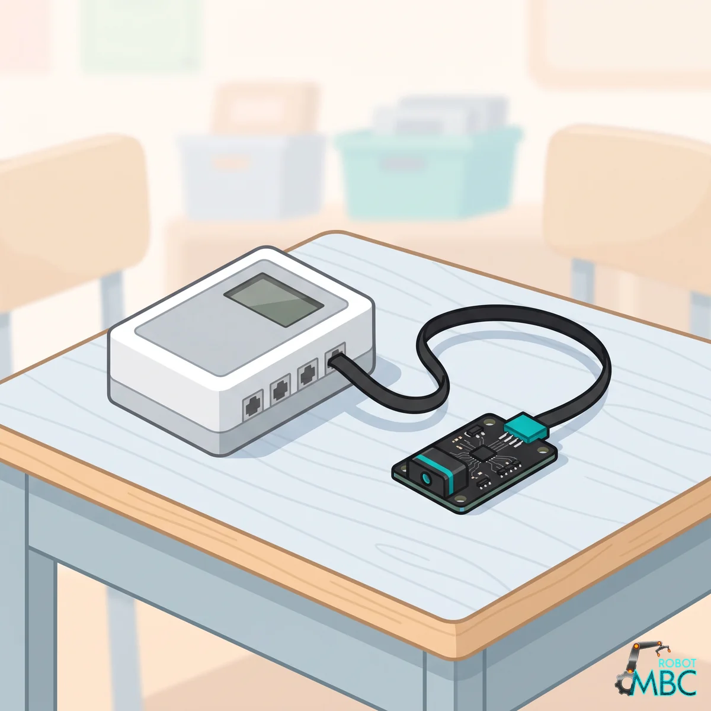
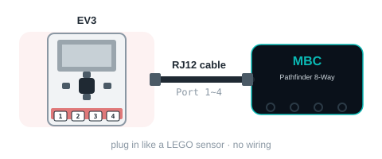

<!-- AI 注意：在此專案的 Markdown 檔案中，直接插入的 HTML 程式碼請勿使用任何縮排，否則會被 Markdown 解析器誤認為程式碼區塊（變成文本視窗）。 -->
<!-- 本頁由 _build/gen-guides.mjs 產生（line8 × ev3），請勿手改；改內容請改 _build/guides.json、_build/guides/**、_build/protocol/*.json 後重跑 node _build/gen-guides.mjs -->
<!-- guide: line8/ev3 -->
# 循行者 8 路 (Line8) × MINDSTORMS EV3

循行者 8 路 (Line8)用在 MINDSTORMS EV3：先確認要買哪個版本、怎麼接，再選你用的軟體，之後整頁都只講那個軟體。

<figure class="guide-hero"></figure>

## 要買哪個版本

買 **EV3 版**（RJ12 接頭），插 EV3 的 1~4 號感應器孔。**EV3 先開機再插感應器**，**插頭一次插到底**；數字不動或 EV3 認錯時，拔掉重插一次。

> [!TIP]
> **EV3 實測通過（2026-11-03）**：原廠 EV3 韌體（EV3-G／EV3 Classroom／clev3r）、Pybricks v4 實測通過；ev3dev／EV3 MicroPython v2 支援（模式表跟原廠紅外線感應器相同）。EV3 把它認成**紅外線感應器**（type 33）。

- **EV3 切換感應器模式約要 1.1 秒**（原廠紅外線感應器也一樣）：程式固定讀一個模式，不要在迴圈裡輪流切。
- **沒有線時，模式 0 停在最後看到線的那一側**（±8），不是 0。
- **EV3 版不支援主機下命令**（原廠韌體、Pybricks、ev3dev 都不能下 E0～E9；格式跟原廠紅外線感應器完全相同）。替代做法：**插上電時按住板子按鍵＝白線模式**（沒按＝黑線）；運作中按校準按鈕＝5 秒動態校準。左右反向、門檻 EV3 版沒有，要用請改 SPIKE 版或 I2C 版。

## 怎麼接

<figure class="ref-fig"></figure>

## ② 選你用的軟體

<!-- sw-grid -->

## 其他資料

- [循行者 8 路 (Line8)產品介紹、規格與校準](/sensors/line8/index.md)
- [下載中心](/downloads.md)
